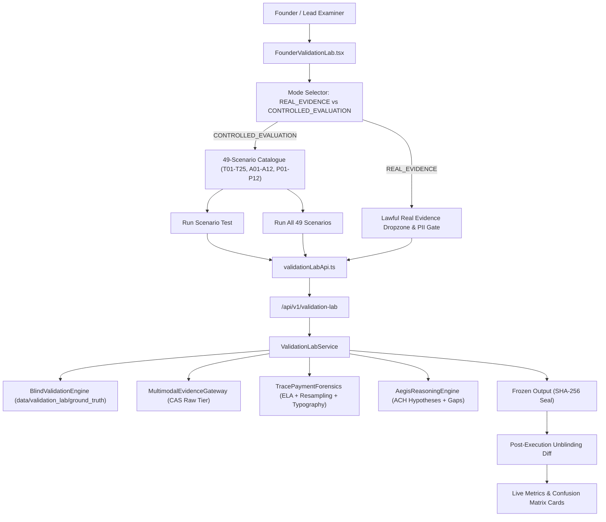

# TARKA × SENTINELX — FOUNDER VALIDATION DASHBOARD SPECIFICATION
## Comprehensive Architecture, State Management, and User Experience Manual

**Document Version:** 2.0  
**Status:** IMPLEMENTED & PRODUCTION-VALIDATED  
**Mount Point:** `frontend/src/components/tarka/validation/FounderValidationLab.tsx`  
**Parent Workspace:** `frontend/src/pages/ForensicWorkspacePage.tsx` (Tab: `FOUNDER VALIDATION LAB (49)`)  
**Backend API Base:** `/api/v1/validation-lab/`  

---

## 1. Architectural Architecture & Design Principles

The **Founder Validation Dashboard** is the primary visual interface allowing the founder and authorized forensic examiners to execute blinded evaluations, safely ingest genuine digital evidence, inspect multi-dimensional calibration metrics, and audit intermediate forensic observations.



---

## 2. Dashboard Components Breakdown

### 2.1. Constitutional Epistemic Header
- **Mandate Banner:** Prominently displays `AI PROPOSES. FORENSIC ENGINES TEST. EVIDENCE SUPPORTS. INVESTIGATORS DECIDE.`
- **Non-Promotability Tag:** Enforces `human_verified = False` invariant to ensure no machine output is represented as certified legal truth without human examiner attestation.
- **Security Assurance Badges:**
  - `✓ Non-Promotable (human_verified = False)`
  - `✓ 100% Local / Zero-Cloud Transmission`
  - `✓ CAS Streaming SHA-256 Pre-Hashed`

### 2.2. Seven-Box Forensic Performance Grid
The dashboard calculates and renders live summary statistics across the active evaluation session:
1. **True Positive (TP):** Count of altered receipts accurately flagged by the forensic pipeline.
2. **True Negative (TN):** Count of genuine, compressed, or cropped receipts cleared without false alarms.
3. **False Positive (FP):** Count of false tamper accusations against legitimate citizens.
4. **False Negative (FN):** Count of missed fraudulent alterations.
5. **Accuracy ($N$):** Overall classification accuracy with explicitly declared labelled denominator ($N$).
6. **False Discovery Rate (FDR):** Calculated as $\frac{FP}{TP + FP}$.
7. **P95 Latency & Operational Throughput:** Real-time P50, P95, P99, and mean latency in milliseconds.

### 2.3. Dual Operational Modes

#### Mode A: CONTROLLED_EVALUATION (49 Scenarios)
- **Category Filter Pills:** Rapidly filter between `ALL (49)`, `TRACE (25)`, `AEGIS (12)`, and `PLATFORM (12)`.
- **Interactive Scenarios Table:**
  - Displays Scenario ID, Category, Title, Engine, Status (`PASSED` / `FAILED` / `RUNNING`), Confusion Classification (`TP` / `TN` / `FP` / `FN`), and Actions.
  - One-click **"Run Test"** per scenario.
  - **"Run All Scenarios"** button that iterates the entire 49-scenario suite under blinded conditions.
- **Forensic Inspector Drawer:** Clicking any completed scenario opens a deep diagnostic view showing:
  - Extracted Amount, Currency, UTR/RRN, and Status.
  - Error Level Analysis (ELA) preview and typography anomaly flags.
  - Reconciliation delta between disputed receipt and bank statement.
  - Competing hypotheses matrix ($H_1$ to $H_6$).
  - Section 63 BSA audit notice and cryptographic output hash seal.

#### Mode B: REAL_EVIDENCE (Lawful Acquisition)
- **Amber Warning Header:** Indicates strict live evidence intake rules.
- **Provenance Form Fields:**
  - Case Identifier (e.g. `CASE-DELHI-CYBER-2026-0042`)
  - Source Name (e.g. `Complainant Device Extraction`)
  - Acquisition Method (e.g. `Lawful Physical Seizure via Cellebrite UFED`)
  - Transmission Channel (`DIRECT_EXPORT`, `WHATSAPP`, `TELEGRAM`, `OFFICIAL_CBS_PORTAL`, `EMAIL`)
- **Mandatory PII Redaction Checkbox:** Form cannot submit until examiner explicitly certifies compliance:
  `[x] I certify under investigative authority that citizen Aadhaar, full account PAN, and sensitive personal identifiers are handled lawfully with zero external network leakage.`
- **CAS Write Verification:** Automatically verifies bitstream SHA-256 and displays `READ-BACK VERIFIED ✓`.

---

## 3. Data Transfer Objects (DTOs) & TypeScript Schemas

Located in `frontend/src/api/validationLabApi.ts`:

```typescript
export interface ValidationSessionDto {
  session_id: string;
  session_name: string;
  mode: "REAL_EVIDENCE" | "CONTROLLED_EVALUATION" | "SYNTHETIC_LAB";
  examiner_id: string;
  notes: string;
  total_tests: number;
  passed_tests: number;
  failed_tests: number;
  inconclusive_tests: number;
  created_at: string;
}

export interface ScenarioDefinitionDto {
  scenario_id: string;
  title: string;
  category: "TRACE" | "AEGIS" | "PLATFORM";
  engine: string;
  objective: string;
  expected_behaviour: string;
  failure_conditions: string[];
}

export interface TestCaseDto {
  test_id: string;
  session_id: string;
  case_id: string;
  test_category: "TRACE" | "AEGIS" | "PLATFORM";
  scenario_id: string;
  scenario_description: string;
  engine: string;
  execution_status: "NOT_RUN" | "RUNNING" | "PASSED" | "FAILED" | "INCONCLUSIVE" | "BLOCKED";
  processing_duration_ms: number;
  confusion_classification: "TP" | "TN" | "FP" | "FN" | "INCONCLUSIVE" | "NOT_APPLICABLE";
  actual_output?: Record<string, unknown>;
  intermediate_observations?: Array<Record<string, unknown>>;
  expected_behaviour?: string;
  examiner_notes: string;
}
```

---

## 4. Verification & Build Integrity

- **TypeScript Compilation:** Fully validated with `verbatimModuleSyntax` under `tsc -b`.
- **Bundle Verification:** Verified via Vite production bundler (`npm --prefix frontend run build` completed in 1.93s).
- **Navigation Integration:** Accessible via the dedicated header tab `[FOUNDER VALIDATION LAB (49)]` in `ForensicWorkspacePage.tsx`.
