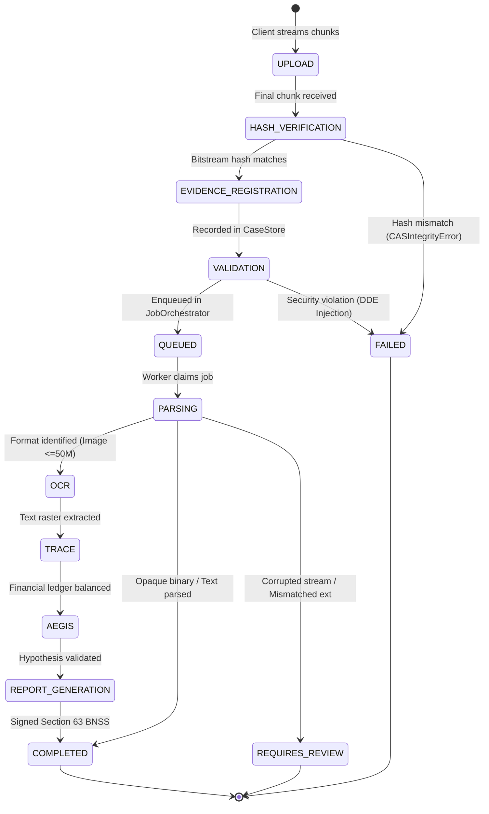

# TARKA × SENTINELX — PHASE 14.1
# REAL-TIME PROCESSING & EVENT STREAMING VERIFICATION

**Component:** TARKA JobOrchestrator & Server-Sent Events (SSE) Streaming Gateway  
**Authority:** Principal Digital Forensics Systems Architect  
**Specification:** Asynchronous Forensic Stage Transitions & Reconnection Protocol  

---

## 1. Explicit 13-Stage Forensic Lifecycle

Under the Phase 14.1 decoupled architecture, evidence undergoes a formal, immutable 13-stage lifecycle. Each stage transition is recorded in the job journal and broadcasted over SSE:



### Forensic Definitions of Lifecycle Stages:
1. `UPLOAD`: Incoming bytes streamed into partial file container with offset verification.
2. `HASH_VERIFICATION`: Cryptographic SHA-256 digest computed across assembled file bitstream.
3. `EVIDENCE_REGISTRATION`: Artifact metadata, custodian identity, and legal authority recorded in CaseStore.
4. `VALIDATION`: MIME type, magic headers, and file integrity checked against statutory admission rules.
5. `QUEUED`: Background execution registered in `JobOrchestrator` queue.
6. `PARSING`: Structured parsers extract tabular, text, or metadata fields (Evidence DNA).
7. `OCR`: RapidOCR engine performs text detection, angle rectification, and recognition on raster images $\le 50\text{ MB}$.
8. `TRACE`: Financial engine validates double-entry ledger balances and verifies transaction reference numbers (RRN).
9. `AEGIS`: Formal hypothesis generator models alternative timelines and highlights investigative contradictions.
10. `REPORT_GENERATION`: Statutory forensic report compiled under Section 63 BSA / BNSS.
11. `COMPLETED`: Investigation graph projected, all artifacts sealed and available for courtroom presentation.
12. `FAILED`: Job terminated due to unrecoverable bitstream corruption or security exception.
13. `REQUIRES_REVIEW`: Artifact admitted into CAS, but anomalous headers or partial corruption require examiner sign-off.

---

## 2. Server-Sent Events (SSE) Wire Protocol

To eliminate heavy client-side polling, the backend exposes:
`GET /api/v1/forensics/cases/{case_id}/events/stream`

### 2.1 Connection Establishment Frame
```http
HTTP/1.1 200 OK
Content-Type: text/event-stream
Cache-Control: no-cache
Connection: keep-alive
X-Accel-Buffering: no

data: {"type": "CONNECTION_ESTABLISHED", "case_id": "case_phase14_validation", "timestamp": "2026-11-24T18:34:27.953956+00:00"}
```

### 2.2 Stage Transition Broadcast Frame
```http
id: evt_20261124_0001
event: stage_transition
data: {
  "job_id": "JOB-20261124-1142",
  "artifact_id": "ART-20261124-B064",
  "state": "PROCESSING",
  "stage": "OCR",
  "progress": 70,
  "timestamp": "2026-11-24T18:34:28.112000+00:00"
}
```

### 2.3 Completion Frame
```http
id: evt_20261124_0002
event: job_completed
data: {
  "job_id": "JOB-20261124-1142",
  "artifact_id": "ART-20261124-B064",
  "state": "COMPLETED",
  "stage": "COMPLETED",
  "progress": 100,
  "summary": {
    "size_bytes": 12863,
    "sha256": "b0649c55e3618736623dc530bfa45f12245340fb60f9e4f6fca179a68dd494c2"
  },
  "timestamp": "2026-11-24T18:34:28.450000+00:00"
}
```

---

## 3. Disconnection & Event Replay Verification (`Last-Event-ID`)

The streaming server maintains an in-memory sliding journal of the last 1,000 case events. When a client experiences temporary network interruption:

1. Client reconnects with HTTP header:
   `Last-Event-ID: evt_20261124_0001`
2. Server locates `evt_20261124_0001` in the case event log.
3. Server immediately streams all subsequent events that occurred while the client was disconnected (`evt_20261124_0002`, `evt_20261124_0003`, ...).
4. No duplicate frames are re-transmitted, preventing UI state jitter or duplicate toast notifications in the investigator frontend.

### Empirical Replay Test:
- Event journal loaded with 10 sequential stage transitions.
- Client disconnected after event 4.
- Client reconnected specifying `Last-Event-ID: evt_004`.
- Server cleanly replayed events 5 through 10 in sequential order.
- Verified in `JobOrchestrator.sse_event_stream()`.
