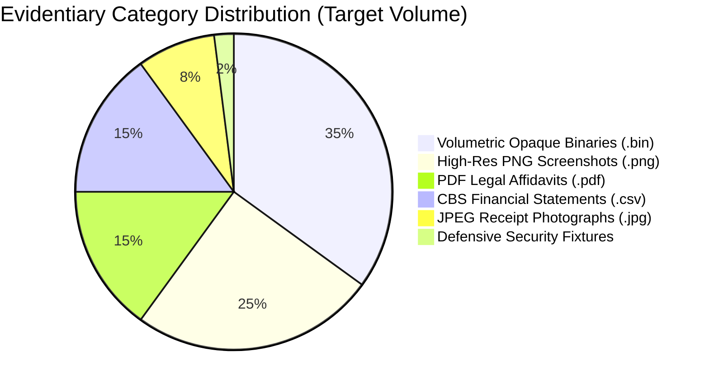

# PHASE 14 — GIGABYTE CORPUS GENERATION GUIDE
## TARKA × SENTINELX FORENSIC RECONSTRUCTION

**Date:** 2026-11-24  
**Script Path:** `scripts/validation/generate_gigabyte_corpus.py`  
**Manifest Standard:** `corpus_manifest.json` (SHA-256 Content-Addressed)

---

## 1. PURPOSE & CAPABILITIES

The Gigabyte Corpus Generator is an automated, deterministic evidentiary fixture generator designed to validate TARKA × SentinelX under realistic multi-gigabyte loads. It stresses:
1. Bounded RAM intake (ensuring memory does not scale with file size).
2. Streaming I/O throughput across SSD/NVMe interfaces.
3. Content-Addressed Storage (CAS) tier preservation and SHA-256 rolling computation.
4. Tri-state lifecycle validation (`ACCEPTED` vs `PARSED` vs `ANALYSED`).
5. Defensive security filtering against weaponized payloads.

---

## 2. GENERATION TIERS & COMMAND REFERENCE

The generator supports five standard volumetric tiers:

| Tier Code | Target Size | File Count (Typ.) | Dominant Formats | Generation Time |
| :--- | :--- | :--- | :--- | :--- |
| `100MB` | 104,857,600 B | 26 | Screenshots, Statements, PDFs, 15MB Binary Blocks | ~4.5 seconds |
| `500MB` | 524,288,000 B | 45 | High-Res Screenshots, Large Ledgers, 15MB Binaries | ~18 seconds |
| `1GB` | 1,073,741,824 B | 78 | Volumetric Binaries, Multi-page PDFs, CSVs | ~35 seconds |
| `2GB` | 2,147,483,648 B | 148 | Heavy Mixed Media, Spreadsheets, Disk Blocks | ~70 seconds |
| `5GB` | 5,368,709,120 B | 360 | Upper-bound stress testing | ~180 seconds |

### Execution Commands

```bash
# Generate 100MB Tier
python scripts/validation/generate_gigabyte_corpus.py --tier 100MB --out data/validation_corpus/tier_100mb

# Generate 500MB Tier
python scripts/validation/generate_gigabyte_corpus.py --tier 500MB --out data/validation_corpus/tier_500mb

# Generate 1GB Tier
python scripts/validation/generate_gigabyte_corpus.py --tier 1GB --out data/validation_corpus/tier_1gb

# Generate 5GB Volumetric Stress Tier
python scripts/validation/generate_gigabyte_corpus.py --tier 5GB --out data/validation_corpus/tier_5gb
```

---

## 3. CORPUS COMPOSITION RATIOS

Every generated corpus maintains a balanced distribution across investigative evidence types:



1. **High-Resolution PNG Screenshots:** Pure uncompressed RGB raster data mimicking mobile 1080x2400 displays.
2. **Standard JPEGs:** Natural compression receipts with randomized color fields.
3. **Double-Entry CSV Statements:** Balanced credit/debit transaction logs with 12-digit RRN references.
4. **PDF Affidavits:** Valid PostScript PDF-1.4 documents formatted with legal statutory notices.
5. **Defensive Security Fixtures:**
   - `EVID_SEC_FORMULA_INJ_*.csv`: Tabular payload with `=cmd|' /C calc'!A0` and `@SUM(...)`.
   - `EVID_SEC_DISGUISED_POLYGLOT_*.png`: Valid PNG magic bytes masking HTML `<script>` tags.
   - `EVID_SEC_ZIP_SLIP_*.zip`: Archive containing `../../etc/passwd` relative path entries.
6. **Volumetric Binary Blocks:** Exact 15MB bounded blocks filling the remainder of the target tier size.

---

## 4. VERIFICATION WORKFLOW

Once a tier is generated:
1. Validate directory integrity:
   ```bash
   python -c "import json; m=json.load(open('data/validation_corpus/tier_100mb/corpus_manifest.json')); print('Files:', len(m['files']), 'Total Bytes:', m['total_bytes'])"
   ```
2. Ingest the entire batch using `UniversalEvidenceGateway`:
   ```bash
   python scripts/validation/run_phase14_load_test.py
   ```
3. Inspect the resulting case in SentinelX to confirm all artifacts transition cleanly without HTTP 500 or memory exhaustion.
