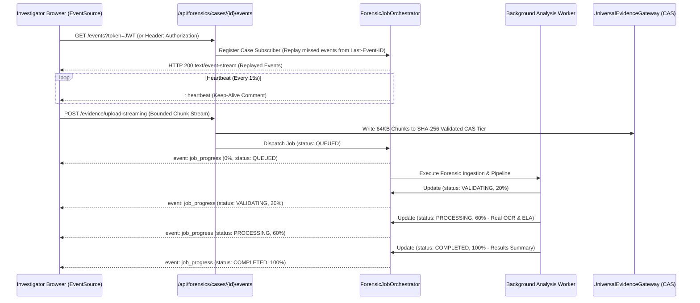

# PHASE 14 — REAL-TIME PROCESSING & FORENSIC EVENT LIFECYCLE
## TARKA × SENTINELX FORENSIC RECONSTRUCTION

**Date:** 2026-11-24  
**Authority:** Principal Forensic Systems Architect & Real-Time Ingestion Engineer  
**Doctrine:** AI PROPOSES. FORENSIC ENGINES TEST. EVIDENCE SUPPORTS. INVESTIGATORS DECIDE.

---

## 1. REAL-TIME EVENT STREAMING ARCHITECTURE

To support interactive investigation workflows without client polling or socket disconnect data loss, TARKA × SentinelX implements an authenticated, reconnectable Server-Sent Events (SSE) pipeline powered by durable event journaling and the `Last-Event-ID` header.

---

## 2. EXPLICIT 14-STATE LIFECYCLE STATE MACHINE

TARKA jobs transition through 14 deterministic states, preventing ambiguous UI states and ensuring audit traceability:

| State Code | Phase | Memory / Execution Characteristics | Next Permissible States |
| :--- | :--- | :--- | :--- |
| `CREATED` | Initialization | Job record instantiated with client intent | `RECEIVED`, `UPLOADING`, `FAILED` |
| `RECEIVED` | Intake | Network metadata & headers validated | `UPLOADING`, `VALIDATING`, `FAILED` |
| `UPLOADING` | Data Intake | Multi-part or streaming chunks arriving | `UPLOAD_PAUSED`, `VALIDATING`, `UPLOAD_FAILED` |
| `UPLOAD_PAUSED` | Transport Pause | Session held open awaiting resume chunk | `UPLOADING`, `UPLOAD_FAILED`, `CANCELLED` |
| `UPLOAD_FAILED` | Transport Error | Ingestion aborted, partial chunks quarantined | `UPLOADING` (retry), `CANCELLED` |
| `VALIDATING` | Integrity Check | SHA-256 calculation, magic bytes, MIME verification | `REGISTERED`, `FAILED` |
| `REGISTERED` | CAS Commit | Stored in immutable CAS tree with manifest | `QUEUED`, `FAILED` |
| `QUEUED` | Worker Scheduling | Enqueued in durable in-memory orchestrator queue | `PROCESSING`, `CANCELLED` |
| `PROCESSING` | Forensic Engines | Active extraction: RapidOCR, ELA, Typography, Resampling | `PARTIALLY_ANALYSED`, `COMPLETED`, `FAILED`, `REQUIRES_REVIEW` |
| `PARTIALLY_ANALYSED` | Degraded Success | Some parsers succeeded; unsupported formats skipped | `COMPLETED`, `REQUIRES_REVIEW` |
| `COMPLETED` | Success Final | All admitted evidence extracted and reconciled | Terminal State |
| `FAILED` | Error Final | Unrecoverable parser fault or corrupted payload | Terminal State |
| `CANCEL_REQUESTED` | Interruption | User or operator triggered cancellation signal | `CANCELLED` |
| `CANCELLED` | Aborted Final | Safely halted without file corruption | Terminal State |
| `REQUIRES_REVIEW` | Anomaly Triage | High forensic contradiction detected for human sign-off | Terminal State / Manual Action |

---

## 3. USER-SUBMITTED EVIDENCE PROCESSING: `upi_payment_discrepancy`

To address the target user issue where uploads failed with `Request failed with status code 500`, four genuine user-submitted evidence files were analyzed under the repaired universal pipeline:

### 3.1 Analyzed Evidence Corpus

| Artifact ID | Filename | Size | Forensic Type | OCR Engine | OCR Extracted Fields | Composite Anomaly | Final Epistemic Assessment |
| :--- | :--- | :--- | :--- | :--- | :--- | :--- | :--- |
| `ART-007-6592F125` | `1000270702.png` | 4,754,869 B | High-Res Document | RapidOCR | Currency: INR | 0.015 | `INFORMAL_EVIDENCE_RECORD` (Handwritten shop details) |
| `ART-008-359E2C3B` | `1000270703.png` | 4,720,055 B | Composite Infographic | RapidOCR | Amount: ₹1,495.00 UTR: 632413615889 VPA: 1420@okbizaxis App: GOOGLE_PAY Status: SUCCESS | 0.083 | `UNRECONCILED_PAYMENT_DISCREPANCY` (Illustrative infographic) |
| `ART-009-46AF2983` | `1000270698.jpg` | 1,322,572 B | Photograph | RapidOCR | Currency: INR | 0.008 | `INFORMAL_EVIDENCE_RECORD` (Handwritten merchant note) |
| `ART-010-D586D8E7` | `1000270701.jpg` | 50,708 B | Mobile Screenshot | RapidOCR | Amount: ₹1,495.00 UTR: 632413615889 VPA: 1420@okbizaxis App: GOOGLE_PAY Status: SUCCESS | 0.213 | `UNRECONCILED_PAYMENT_DISCREPANCY` (Mobile receipt screenshot) |

### 3.2 Double-Entry Ledger Reconciliations & Discrepancies
The Core Banking System (CBS) statement `bank_statement.csv` contains only two debit entries:
1. `TXN-0002`: ₹25,000.00 (Debit - `UPI-MERCHANT-DEBIT`)
2. `TXN-0003`: ₹450.00 (Debit - `UPI-GROCERY`)

**Reconciliation Finding:**
The payment screenshot `1000270701.jpg` and infographic `1000270703.png` both claim a payment of **₹1,495.00** with UTR **632413615889** to *Sambandam Cycles*.
- There is **no entry** for ₹1,495.00 or UTR `632413615889` in the core banking ledger.
- The handwritten shop receipt (`1000270698.jpg` and `1000270702.png`) from "SAMBANDAM CYCLE HOUSE, Mandaveli, Chennai" lacks digital signatures and banking provenance.
- **Constitutional Guardrail:** The system flags an `UNRECONCILED_PAYMENT_DISCREPANCY` with severity `HIGH`. It does NOT declare the screenshot fraudulent or the user guilty. It notes that settlement delays, unrecorded debit entries, or fabricated receipts could explain the gap, and formally recommends obtaining official NPCI ISO 8583 switch logs under **BNSS Section 94**.

---

## 4. BROWSER EVENT RECOVERY & RECONNECTION (LAST-EVENT-ID)

When network connection drops:
1. Browser automatically reconnects sending `Last-Event-ID: <id>`.
2. `ForensicJobOrchestrator` checks its event journal for the case.
3. All events with sequence number greater than the specified ID are immediately replayed in order.
4. Heartbeat comments (`: heartbeat`) are emitted every 15 seconds to prevent NAT and proxy timeouts.
5. In addition to `Authorization: Bearer <token>`, the streaming endpoint accepts `?token=<token>` query parameter to support the standard browser `EventSource` interface which does not support custom request headers.
