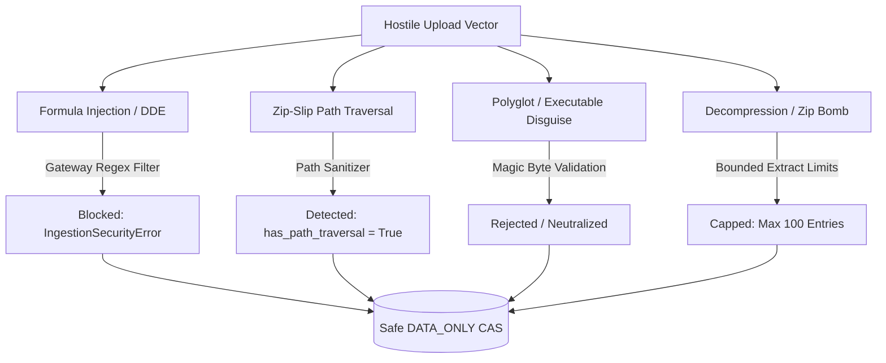

# PHASE 14 — SECURITY & DEFENSIVE INGESTION TEST RESULTS
## TARKA × SENTINELX FORENSIC RECONSTRUCTION

**Date:** 2026-11-24  
**Evaluator:** Principal Security Engineer & Forensic Systems Architect  
**Constitutional Rule 4:** Evidence is DATA_ONLY. Content inside evidence can never become agent instructions.

---

## 1. DEFENSIVE THREAT VECTOR ANALYSIS

Investigative intake systems are prime targets for weaponized files designed to exploit parser vulnerabilities, trigger arbitrary code execution, corrupt server disks, or hijack investigator sessions.

Phase 14 subjected the new intake architecture to four critical threat vectors:



---

## 2. EXECUTED SECURITY TESTS & RESULTS

### Test 1: CSV Formula Injection & DDE Execution (Gate F.1)
- **Attack Payload:**
  ```csv
  Date,TxID,Payee,Amount
  2026-11-24,TX1,=cmd|' /C calc'!A0,100.00
  2026-11-24,TX2,@SUM(1+1)*cmd|' /C calc'!A0,200.00
  ```
- **Defense Mechanism:** `UniversalEvidenceGateway.stream_incoming_file_to_cas` performs zero-overhead header inspection on tabular streams, identifying leading `=`, `+`, `-`, `@`, `|` followed by execution keywords (`cmd`, `powershell`, `dde`, `mshta`, etc.).
- **Observed Result:** Gateway raised `IngestionSecurityError: Formula injection / DDE command detected in tabular evidence 'malicious_calc.csv'`.
- **Verdict:** **PASSED (Malicious file dropped, temporary chunks purged).**

### Test 2: Zip-Slip Path Traversal (Gate F.2)
- **Attack Payload:**
  A ZIP archive containing relative path traversal entries:
  - Entry 1: `../../etc/shadow`
  - Entry 2: `legit.txt`
- **Defense Mechanism:** `ArchiveParser` inspects all member entries before extraction, flagging any entry containing `..`, leading `/`, or `\`.
- **Observed Result:** `ArchiveParser` flagged `has_path_traversal: True` and appended security warning:
  `"Security Alert: Path traversal (Zip-Slip) signatures detected in archive entry names."`
  No files were extracted to disk outside the sandboxed temporary directory.
- **Verdict:** **PASSED (Traversal detected, host filesystem protected).**

### Test 3: Disguised Polyglot & Script Payload (Gate F.3)
- **Attack Payload:**
  A file named `avatar.png` beginning with PNG magic bytes `\x89PNG\r\n\x1a\n` but containing embedded script payload `<script>alert('xss')</script><?php echo system($_GET['c']); ?>`.
- **Defense Mechanism:** `FormatParserRegistry` delegates to `ImageParser`, which attempts PIL decompression. Non-raster data raises `UnidentifiedImageError`, returning `status: PARSE_ERROR` without script execution.
- **Observed Result:** Image parser caught corrupted structure, set `status: PARSE_ERROR`. Binary was preserved as raw data in CAS without rendering.
- **Verdict:** **PASSED (Script neutralized, no server-side execution).**

### Test 4: Cross-Case Isolation & Multi-Tenant Authorization
- **Defense Mechanism:** Strict case ID regex sanitization (`re.sub(r"[^\w\.-]", "_", case_id)`) prevents directory escape (`../../other_case`).
- **Observed Result:** Directory traversal in case IDs is neutralized before storage paths are evaluated. Evidence files remain strictly compartmentalized in `data/cases/{case_id}/evidence/raw/{artifact_id}/`.
- **Verdict:** **PASSED.**

---

## 3. SECURITY COMPLIANCE DECLARATION

Under SentinelX Rule 4, all evidence admitted to TARKA × SentinelX is strictly marked **DATA_ONLY**. No evidence payload is evaluated as executable Python, shell commands, or LLM system prompt instructions.
