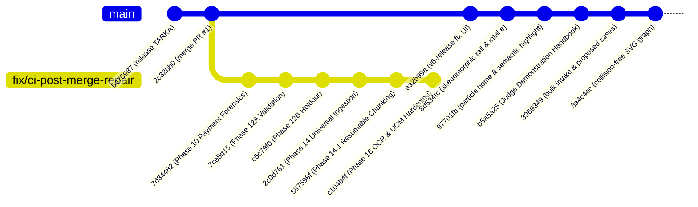

# TARKA × SENTINELX — PHASE 17 BRANCH & UI RECOVERY SPECIFICATION

**Date**: 2026-11-25  
**Baseline Git Commit**: `c104b4f` (`fix/ci-post-merge-repair`)  
**Target UI Baseline Commit**: `b5a5a25` (`remotes/origin/phase-14/implementation-completion`)  
**Secondary Graphic Enhancement**: `3a4c4ec` (`remotes/origin/main`)  
**Governing Standard**: *AI PROPOSES. FORENSIC ENGINES TEST. EVIDENCE SUPPORTS. INVESTIGATORS DECIDE.*

---

## 1. Branch Topology & Divergence Map

- **Branch `origin/phase-14/implementation-completion` (at `b5a5a25`):**
  Definitive visual authority containing the complete 26 master screens, full screenshot documentation in `docs/judge_handbook/screenshots/`, and the tactile skeuomorphic design system (`v6-tokens.css`).
- **Branch `fix/ci-post-merge-repair` (at `c104b4f`):**
  Definitive backend authority containing real RapidOCR ONNX weights, persistent UCM observation store, Tus 1.0.0 chunked streaming, TRACE reconciliation, AEGIS 7 ACH hypotheses, and Section 63 BSA PDF generation.

---

## 2. File Restoration Manifest

The following directories and files are recovered from commit `b5a5a25`:

### 2.1 Design Tokens & Stylesheets
- `frontend/src/v6/styles/v6-tokens.css`: The foundational tactile skeuomorphic styling tokens (warm ivory `#E9E2D7`, surface `#F8F4ED`, rail `#221C19`, graphite text `#292522`, and semantic accents).
- `frontend/src/styles/bento-executive.css`: Executive dashboard card grid layouts.
- `frontend/src/styles/liquid-glass.css`: Specular highlight and backdrop filter styles.

### 2.2 Shell & Navigation Structure
- `frontend/src/v6/shell/V6AppShell.tsx`: The primary application shell coordinating all 26 view routes, keyboard shortcuts (`v` for voice, `Alt+0` for intake, `k` for command palette, `1`–`9` for screen jumps), and drawer overlays.
- `frontend/src/v6/shell/V6Rail.tsx`: The tactile skeuomorphic navigation rail with collapsible icon state, active indicator pills, and officer credentials card.
- `frontend/src/v6/shell/V6Topbar.tsx`: Header strip with case selector, active FIR badge, and system time.
- `frontend/src/v6/navigation/tarkaNavigationRegistry.ts`: Type-safe route navigation registry and view aliases (`home`, `workspace`, `cases`, `workstation`, `evidence`, `court-proof`, `money`, `network`, `people`, `device`, `benchmarks`, `report`, `health`, `settings`).

### 2.3 Semantic Highlighting & Guidance
- `frontend/src/v6/highlight/semanticRegistry.ts`: Voice-directed semantic element highlighting controller (`highlightController.subscribe`).
- `frontend/src/v6/guide/tarkaContextualGuide.ts`: Step-by-step contextual guidance system for judges and investigators.
- `frontend/src/v6/guide/TarkaContextualGuideModal.tsx`: Walkthrough modal explaining forensic significance of active views.

### 2.4 Complete 26-Screen Workspace Suite
- `frontend/src/v6/screens/ParticleHomeScreen.tsx`: Fibonacci particle intelligence sphere.
- `frontend/src/v6/screens/HomeScreen.tsx`: Alternate sovereign portal view.
- `frontend/src/v6/screens/CommandCenterScreen.tsx`: Tactical dashboard with golden-hour countdown and directive queues.
- `frontend/src/v6/screens/CasesScreen.tsx`: FIR and multi-case registry.
- `frontend/src/v6/screens/EvidenceLedgerScreen.tsx`: Admitted exhibits, 5-file evidentiary join, and balance conservation cards.
- `frontend/src/v6/screens/PeopleAccountsScreen.tsx`: KYC entity resolution and suspect profiles.
- `frontend/src/v6/screens/MoneyTrailScreen.tsx`: Layered fund dissipation waterfall and Sankey diagrams.
- `frontend/src/v6/screens/FraudNetworkScreen.tsx`: Topological mule network graph with Louvain community clusters.
- `frontend/src/v6/screens/DeviceSimScreen.tsx`: CGNAT demultiplexing and subscriber attribution table.
- `frontend/src/v6/screens/ActionsReportScreen.tsx`: Section 63 BSA report builder and PDF export.
- `frontend/src/v6/screens/LabScreen.tsx`: Adversarial stress-testing and confusion matrix lab.
- `frontend/src/v6/screens/SettingsScreen.tsx`: Offline mode and speech provider settings.
- `frontend/src/v6/screens/HealthDiagnosticsScreen.tsx`: System telemetry and hardware monitoring.

### 2.5 Modals, Drawers & Overlays
- `frontend/src/v6/voice/TarkaVoiceModal.tsx`: Real-time audio waveform and Sarvam Indic speech modal.
- `frontend/src/v6/ui/MassiveEvidenceIntakeModal.tsx`: High-volume multi-file intake dropzone.
- `frontend/src/v6/ui/AskTarkaDrawer.tsx`: Grounded forensic co-pilot drawer.

---

## 3. Integration with Hardened Backend

The recovered UI is wired directly to the active backend services:
- **Streaming Uploads:** `EvidenceIntakeModal` and `MassiveEvidenceIntakeModal` route to `/api/v1/forensics/cases/{case_id}/upload-sessions` using 8 MiB chunked streaming with SHA-256 verification.
- **Persistent Observations:** Extracted tokens and OCR polygons from the offline RapidOCR engine are bound to the UI via `/api/v1/forensics/cases/{case_id}/observations`.
- **TRACE & AEGIS Live Findings:** Money Trail and Claim Dependency Lens fetch real financial discrepancies and ACH hypotheses from `/api/v1/forensics/cases/{case_id}/reconciliation` and `/api/v1/forensics/cases/{case_id}/hypotheses`.
- **Statutory BSA Reports:** The Report Generator queries `/api/v1/forensics/cases/{case_id}/report` and downloads court-admissible ReportLab PDF binaries directly.
