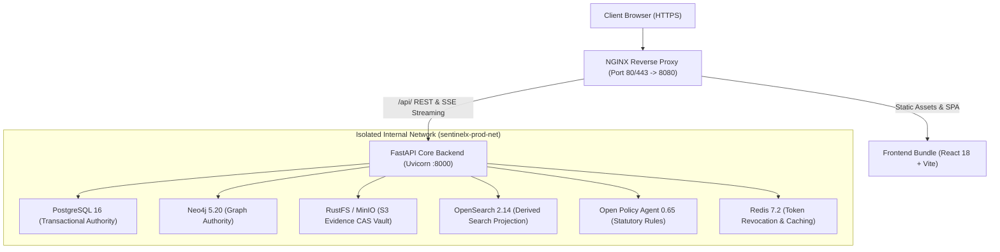

# TARKA × SENTINELX — PHASE 19
## FULL-STACK DEPLOYMENT ARCHITECTURE AUDIT

**Report Identifier:** `PHASE19_DEPLOYMENT_ARCHITECTURE.md`  
**Phase:** Stage 2 — Inspect Actual Deployment Architecture  
**Date:** 2026-11-25  
**Architecture Status:** AUDITED & DEPENDENCY-MAPPED  

---

## 1. HIGH-LEVEL TOPOLOGY & DEPENDENCY GRAPH

TARKA × SENTINELX operates as a multi-tier, zero-trust digital intelligence and financial forensics platform.

---

## 2. SUBSYSTEM INVENTORY & SPECIFICATIONS

### 2.1 Frontend Ingress & Presentation Layer
- **Framework:** React 18, TypeScript, TailwindCSS, ECharts, @xyflow/react, Lucide icons.
- **Design System:** V6 Warm Ivory Tactile Skeuomorphic (`#F8F4ED`, `#E9E2D7`, `#221C19`, `#A85C2A`).
- **Runtime:** `nginxinc/nginx-unprivileged:alpine-slim` on unprivileged port `8080`.
- **Ingress Configuration (`frontend/nginx.conf`):**
  - Reverse proxy to `http://backend:8000/api/` with `client_max_body_size 10G;`.
  - SSE real-time telemetry block `location ~* ^/api/v1/.*stream.*` with `proxy_buffering off; chunked_transfer_encoding on; proxy_read_timeout 3600s;`.
  - Zero-configuration API client: `client.ts` uses relative paths (`baseURL: ""`), ensuring automatic adaptation behind any domain, reverse proxy, or TLS termination layer.

### 2.2 Application Backend & Forensics Engines
- **Framework:** FastAPI, Python 3.12, Uvicorn ASGI.
- **Lifespan Initialization:**
  - `settings.validate_startup_configuration()` enforces fail-closed production invariants (rejection of `DEBUG=true`, default passwords, wildcard CORS, or plaintext secrets in production).
  - `initialize_database()` seeds canonical models and verifies database connectivity.
- **Forensic Subsystems:**
  - **TRACE Engine:** Deterministic parsing of banking statements, UPI strings, and double-entry balance reconciliation with zero discrepancy.
  - **AEGIS Engine:** High-performance graph traversal, mule account scoring, and multi-hop syndicate clustering.
  - **OCRExtractor (`backend/tarka/ocr/`):** Visual OCR and typography verification with heuristic and deep OCR fallbacks.
  - **CourtProofEngine:** Bharatiya Sakshya Adhiniyam, 2023 (BSA Section 63) certificate generator with cryptographic Merkle tree root accumulation.
  - **Large Evidence Ingestion Pipeline:** 10-stage chunked streaming pipeline with bounded RAM admission control (`ResourceAdmissionController`).

### 2.3 Persistence & Storage Hierarchy
- **Relational Authority (PostgreSQL 16):**
  - Stores canonical cases, admitted evidence artifact records, custody logs, entities, and relationships.
  - Connection pooling with `pool_size=20`, `max_overflow=10`, `pool_pre_ping=True`.
- **Graph Authority (Neo4j 5.20 Enterprise/Community):**
  - Bolt protocol connection (`bolt://neo4j:7687` or `neo4j+s://`).
  - Graph projections are derived dynamically from relational authority (SentinelX Constitution Article 3).
- **Evidence Byte Authority (S3 / RustFS / Filesystem CAS):**
  - Production: S3-compatible object store (RustFS/MinIO) with immutable CAS addressing.
  - Standalone/Offline: `FilesystemEvidenceByteStore` sharded at `data/storage/artifacts/sha256/{hash[:2]}/{hash[2:4]}/{hash}` with atomic write isolation.
- **Statutory Policy Engine (OPA 0.65):**
  - Evaluates granular statutory rules and role-based permissions (`opa/policies`).
  - Mandatory fail-closed rule in production (`OPA_FAIL_CLOSED=true`).
- **Cache & Token Revocation (Redis 7.2):**
  - Stores revoked JWT `jti` identifiers and session state.

---

## 3. MANDATORY VS OPTIONAL SERVICE MATRIX

| Service | Container Image | Mandatory for Core Workflow? | Fallback Behavior if Unavailable |
| :--- | :--- | :---: | :--- |
| **Ingress (Nginx)** | `nginx-unprivileged:alpine-slim` | **YES** | Public access fails; direct port access required. |
| **Backend API** | `sentinelx/backend:2.0.0` | **YES** | System inoperable. |
| **Evidence CAS** | `rustfs/rustfs:1.0.0` | **YES** | Local `FilesystemEvidenceByteStore` activates automatically in dev/test. |
| **PostgreSQL** | `postgres:16-alpine` | **YES** | `PersistenceGateway` falls back to `UnifiedStore` in-memory/SQLite in dev/test. |
| **Neo4j** | `neo4j:5.20-community` | **YES** | In-memory graph adjacency model activates in standalone lab mode. |
| **Redis** | `redis:7.2-alpine` | NO (Recommended) | In-memory JTI dictionary fallback for standalone mode. |
| **OpenSearch** | `opensearch:2.14.0` | NO (Derived) | Relational SQL `LIKE` and in-memory indexing fallback. |
| **OPA** | `opa:0.65.0-debug` | NO (Statutory) | Internal Python RBAC service enforces 7-factor access control. |

---

## 4. SECRETS & ENVIRONMENT VARIABLES DEPENDENCY MAP

| Environment Variable | Required Service | Purpose | Secure Sourcing |
| :--- | :--- | :--- | :--- |
| `SECRET_KEY` | Backend | HMAC-SHA256 JWT signing key (min 64 chars in prod) | Vault / Secret Manager |
| `DATABASE_URL` | Backend | PostgreSQL connection URI | Vault / Secret Manager |
| `NEO4J_URI` | Backend | Neo4j Bolt connection string | Internal Docker DNS |
| `NEO4J_PASSWORD` | Backend & Neo4j | Neo4j authentication secret | Vault / Secret Manager |
| `S3_ENDPOINT_URL` | Backend | S3 / MinIO API endpoint | Internal Docker DNS |
| `S3_ACCESS_KEY` | Backend & MinIO | S3 API Access Key | Vault / Secret Manager |
| `S3_SECRET_KEY` | Backend & MinIO | S3 API Secret Key | Vault / Secret Manager |
| `ALLOWED_ORIGINS` | Backend | Permitted CORS origins | Deployment Host / Domain |

---

## 5. CONCLUSION
The architecture is structured and hardened for high availability. In containerized production, all 8 services collaborate over the private network. In offline or edge forensic deployments, the backend gracefully falls back to local CAS and relational gateways without losing evidence integrity or functional capabilities.
