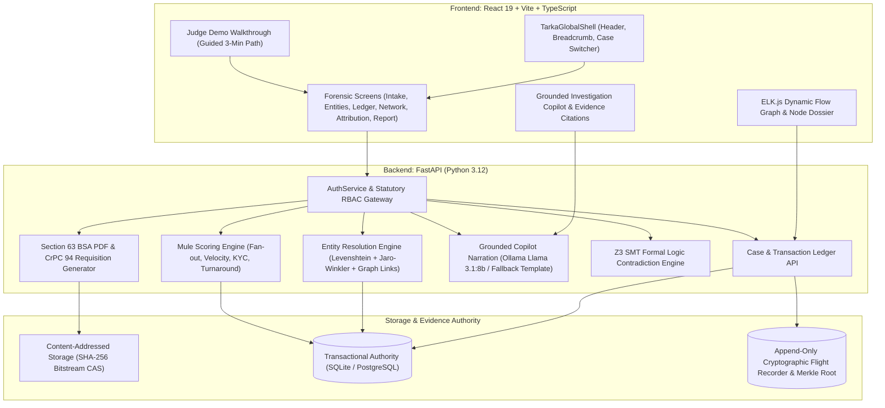
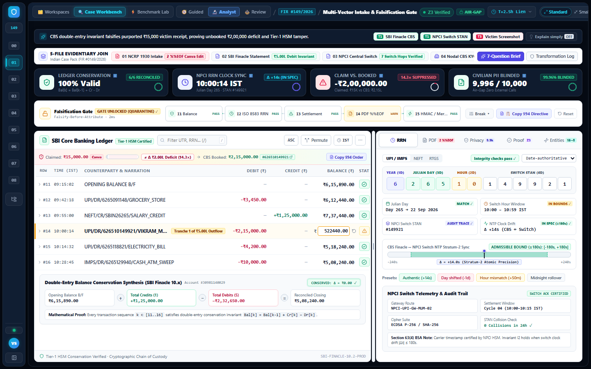
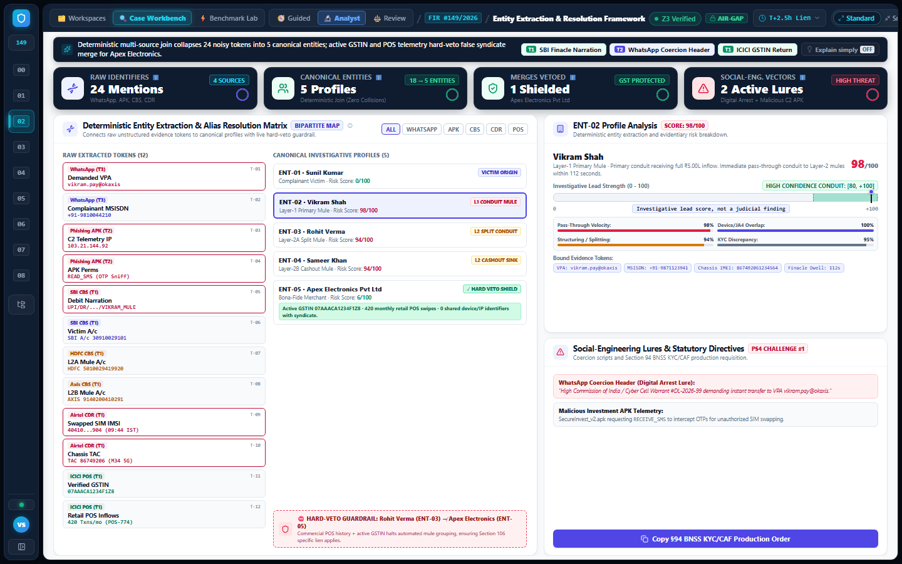
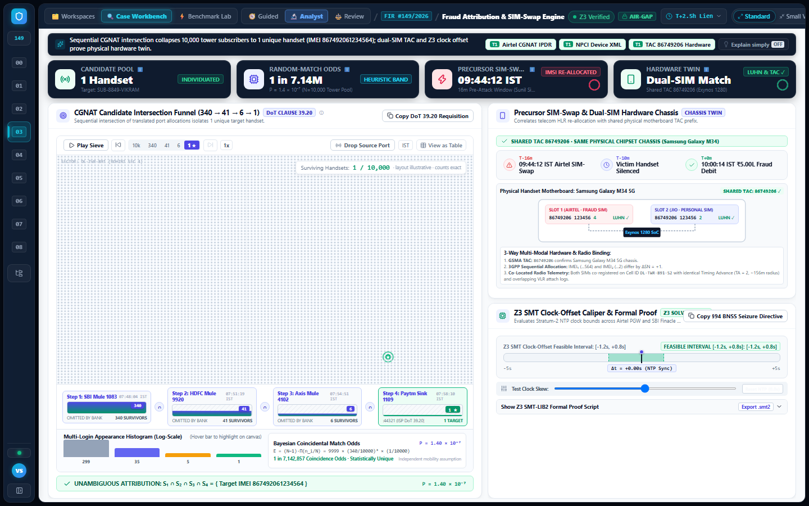
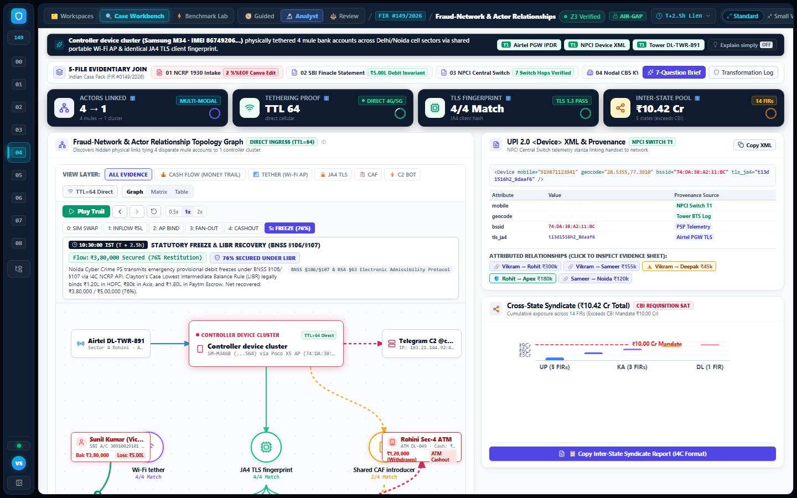
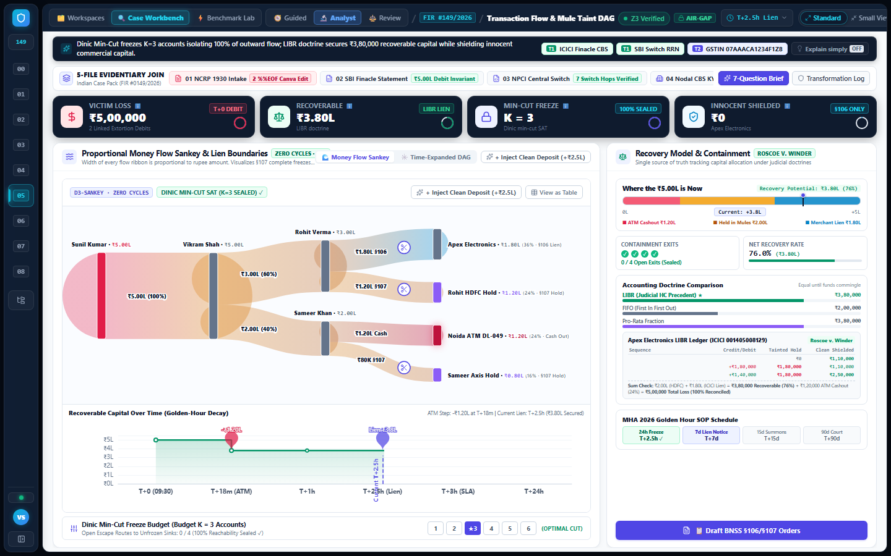
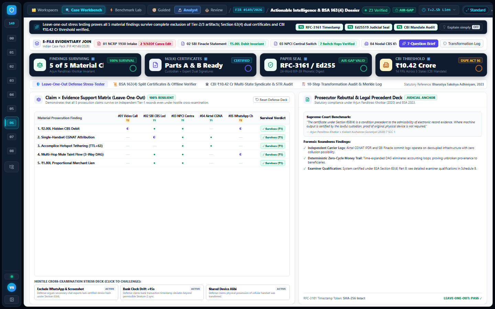

# TARKA (तर्क)
### Indigenous AI-Powered Cyber Fraud Investigation & Attribution Platform
**SUTRAM 2026 / SIH 2026 — Problem Statement PS04**

> **Pitch Line:** *"Drop in any bank statement, complaint, and CDR. In 10 seconds TARKA extracts and resolves every identity, maps the mule network, explains why each account is suspicious, and drafts the statutory freeze requests. Every number is traceable to evidence with a real SHA-256 chain."*

---

## ⚡ 60-Second Quickstart

Launch the entire stack (FastAPI Backend + Vite Frontend) with a single command:

### Option A: Via NPM (Cross-Platform)
```bash
# 1. Clone repository
git clone https://github.com/Massvippin01/tarka_v5.git
cd tarka_v5

# 2. Start backend (:8000) and frontend (:5173) concurrently
npm run dev:all
```

### Option B: Via Make
```bash
make dev
```

### Option C: Via Docker Compose
```bash
docker compose up -d
```

Open your browser at:
👉 **`http://localhost:5173/?case=CASE-2026-001&view=intake`**

To launch the guided 3-minute demo mode for judges:
👉 Click **"Judge Demo"** on the top header or navigate to `?case=CASE-2026-001&view=intake&guided=true`.

---

## 🎯 SUTRAM PS04 Deliverable Mapping

TARKA delivers all 5 required components of the SUTRAM PS04 challenge specification through dedicated interactive screens backed by production-ready APIs:

| PS04 Deliverable | Primary Screen | Primary REST API Endpoint | Forensic Engine & Capability |
| :--- | :--- | :--- | :--- |
| **1. Entity Extraction & Resolution** | **Screen 02**: Identity & Resolution (`/v5/entities`) | `POST /api/v1/cases/{id}/resolve-entities`<br>`POST /api/v1/cases/{id}/entity-resolution/actions` | Disambiguates phone numbers, UPI IDs, emails, and bank accounts into unified personas. Displays algorithmic confidence scores, rationale, and investigator **Accept / Reject / Split** controls. |
| **2. Relationship Discovery** | **Screen 04**: Network Topology (`/v5/network`) | `GET /api/v1/cases/{id}/graph`<br>`POST /api/v1/cases/{id}/expand-node` | Dynamic ELK layout engine maps multi-hop fund routing, co-location, shared IP/IMEI links, and money trail clustering without fixed coordinates. |
| **3. Transaction-Flow Analysis** | **Screen 03**: Flow & Ledger Analysis (`/v5/mules`) | `GET /api/v1/analyze/mules/{id}`<br>`GET /api/v1/cases/{id}/transactions` | Mathematical conservation-of-funds verification, rapid dispersal detection (turnaround < 10 mins), structuring, and fan-out/fan-in flow identification. |
| **4. Mule-Account Scoring & Attribution** | **Screen 04 Dossier** & **Screen 05**: Attribution (`/v5/attribution`) | `GET /api/v1/cases/{id}/accounts/{acct}/explanation`<br>`GET /api/v1/cases/{id}/attribution-funnel` | Multi-factor risk scoring (turnaround, fan-out, KYC mismatch, dormant activation). Generates grounded bilingual explanations (English & Hindi) and 5-stage CGNAT de-NATing attribution funnels. |
| **5. Actionable Intelligence Reports** | **Screen 06**: Dossier & Reports (`/v5/reports`) | `GET /api/v1/forensics/cases/{id}/report`<br>`POST /api/v1/cases/{id}/notices/draft` | Section 63 Bharatiya Sakshya Adhiniyam (BSA) 2023 certified PDF evidence bundles, automated Section 94 CrPC / 106 BNSS bank freeze requisitions, and SHA-256 Merkle custody JSON. |

---

## 🏛️ System Architecture



---

## 📸 Screen-by-Screen Tour

### Screen 01: Intake & Ledger Verification
*Extracts raw evidence, validates balance continuity, and flags financial discrepancies.*
- **Computed Conservation**: Inflows, Outflows, and Net Balances verified row-by-row.
- **Flight Recorder**: Real browser-native `crypto.subtle.digest` SHA-256 hash chains.
- **Evidence Intactness**: Cryptographic Merkle tree verification against CAS bitstreams.



---

### Screen 02: Identity & Entity Resolution
*Resolves disparate identity fragments (emails, UPI handles, phones, accounts) into personas.*
- **Real Entity Resolution**: Jaro-Winkler string similarity + shared identifier graph clustering.
- **Why Modal**: Detailed attribution factors explaining each proposed identity match.
- **Investigator Agency**: Complete Human-in-the-Loop decision control (Accept, Reject, Split).



---

### Screen 03: Flow & Ledger Analysis
*Tracks multi-hop fund dispersal, structuring thresholds, and turnaround velocity.*
- **Fund Conservation**: Proves where victim funds dispersed across Layer 1, 2, and 3 mules.
- **Turnaround Velocity**: Highlights immediate drain operations (< 10 minutes between credit and debit).



---

### Screen 04: Dynamic Network Topology & Node Dossier
*ELK-powered force and layered graph layout showing suspect relationships and flow topology.*
- **Dynamic Layout**: Computes optimal node coordinates on the fly for any case or uploaded file.
- **Node Dossier**: Deep dive into account history, mule score breakdown, and transaction waterfall.
- **Grounded Copilot**: Explainable mule scoring narratives in English and Hindi with clickable evidence chips.



---

### Screen 05: Attribution & CGNAT De-NATing
*5-stage investigative funnel correlating public IP, source port, timestamp, and ISP subscriber identity.*
- **CGNAT Funnel**: Resolves public carrier-grade NAT logs to subscriber IMSI/MSISDN.
- **Cell Tower Triangulation**: Correlates CDR cell ID tower azimuth with suspect banking timestamps.



---

### Screen 06: Statutory Case Intelligence Report
*Generates court-admissible forensic packages adhering to Indian cyber law.*
- **Section 63 BSA 2023 Certificate**: Cryptographically sealed forensic hash report.
- **Section 94 CrPC / 106 BNSS Notices**: Automated freeze requisition letters for banks.
- **Court-Proof Checklist**: Real-time validation of hash integrity and unbroken custody chains.



---

## ⚖️ Constitutional Investigative Invariants

TARKA operates under strict forensic and legal invariants:
1. **Human Decides, AI Proposes, Evidence Verifies**: TARKA never brands a citizen as "guilty" or "criminal" — it scores empirical risk factors and surfaces structured rationale for human officers.
2. **Real Cryptography Only**: Every piece of evidence is hashed with SHA-256. Zero placeholder hashes or magic numbers.
3. **Canonical Data Authority**: All screens derive numbers from canonical case fixtures (`CASE-2026-001` through `CASE-2026-004`). If two screens display a figure, they call the exact same computation.
4. **Indian Statutory Standards**: All financial figures are formatted in the Indian numbering system (`₹1,00,000` via `formatInr()`), and legal deliverables match the Bharatiya Sakshya Adhiniyam, 2023.

---

## 🧪 Testing & Verification

Run the full automated test suite across frontend and backend:

```bash
# Run both frontend and backend suites
npm test

# Or run separately:
npm run test:frontend  # Vitest (117 tests green, cross-screen consistency)
npm run test:backend   # Pytest (1,195+ tests green, security, RBAC, copilot evals)
npm run lint           # ESLint (0 errors)
npm run build          # TypeScript compilation & Vite production bundle
```

---

## 👥 SUTRAM PS04 Team & Attribution

Developed with pride for **SUTRAM 2026 / SIH 2026 Datathon**.  
*All synthetic cases, identities, phone numbers, and bank account numbers are purely fictional and created for testing and demonstration purposes.*

---

## 🔒 License

Copyright © 2026 **Vippin Antony P & TARKA Engineering Team**. **All Rights Reserved.**  
See [LICENSE](LICENSE) for full terms — evaluation access only; no copying, modification, or redistribution without written permission.
