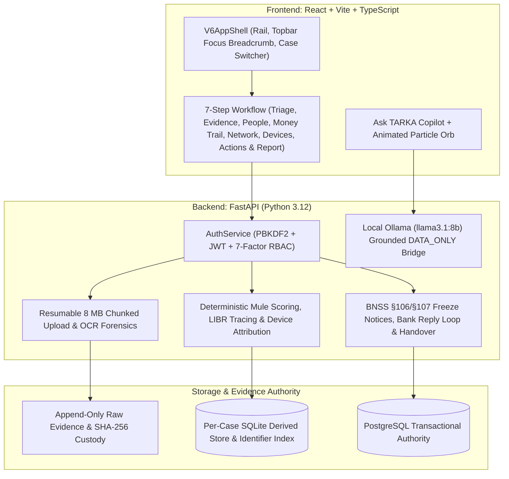
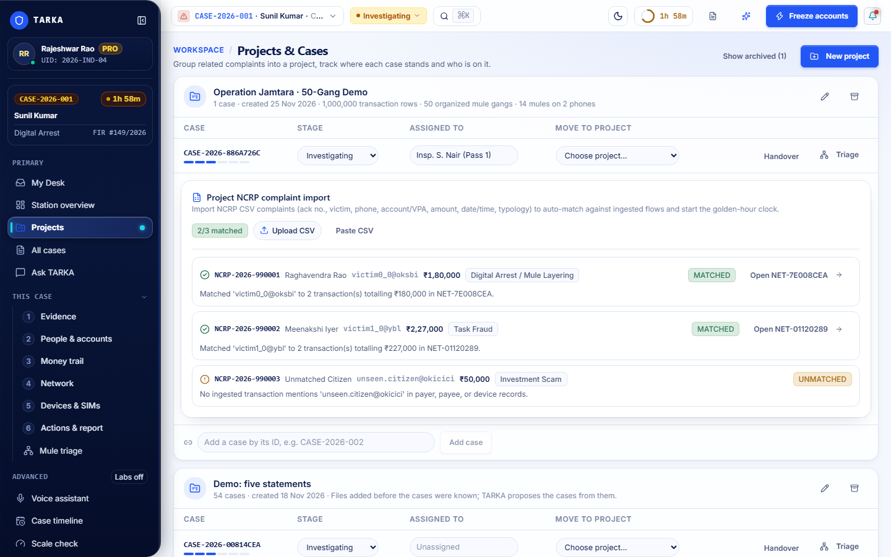
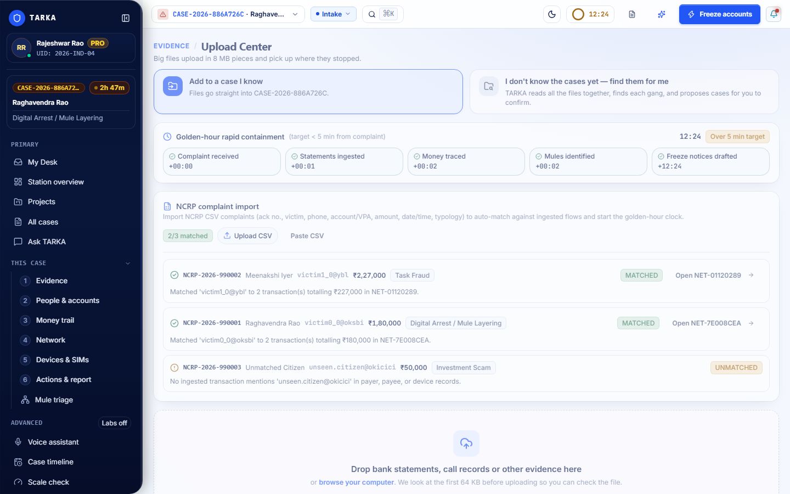
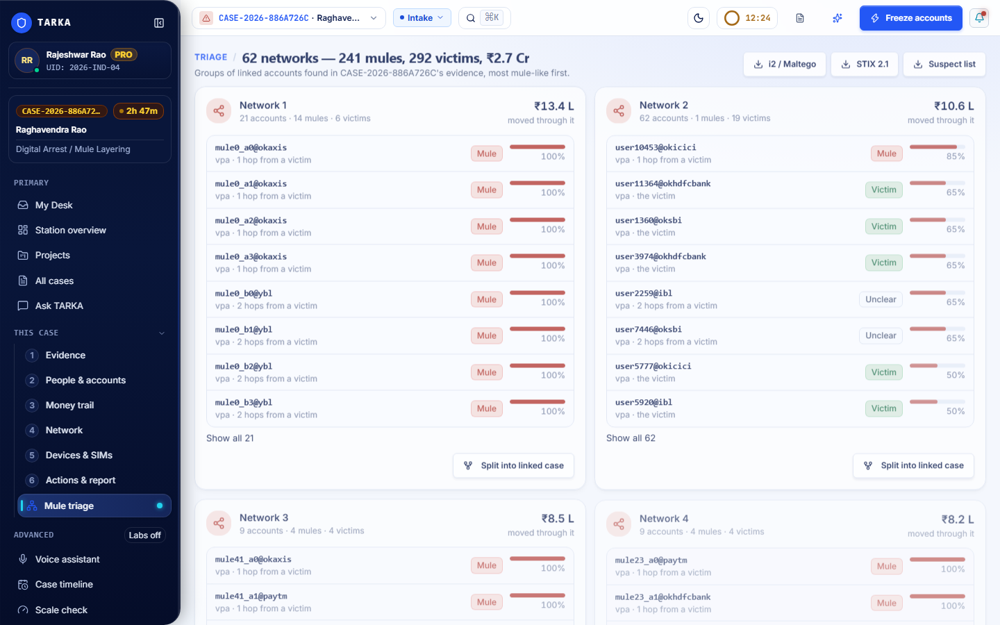
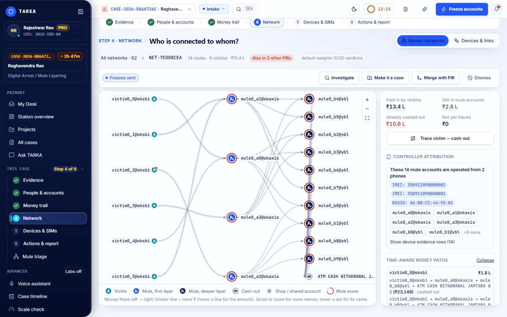
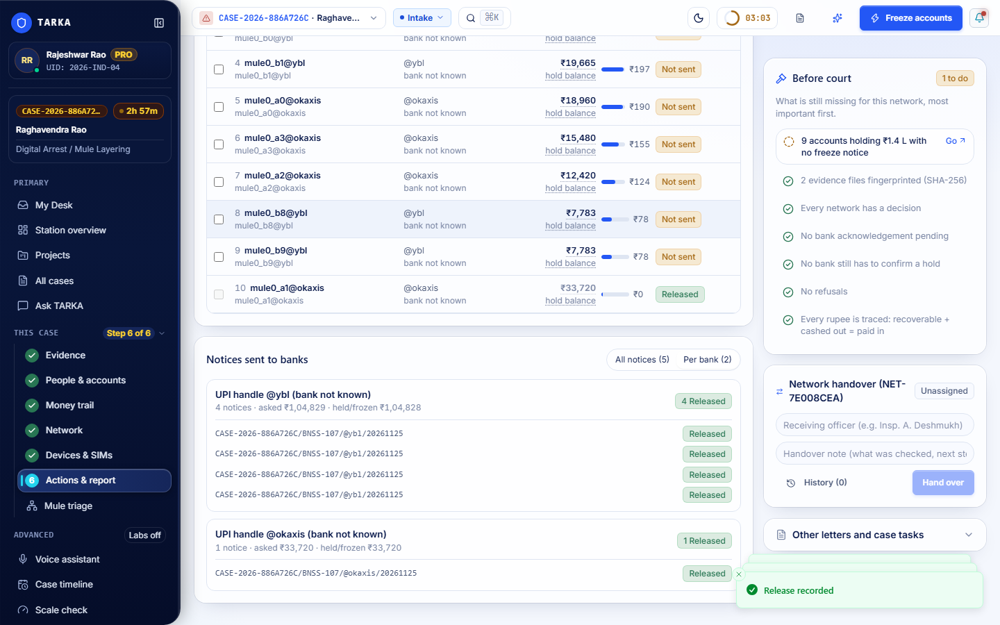
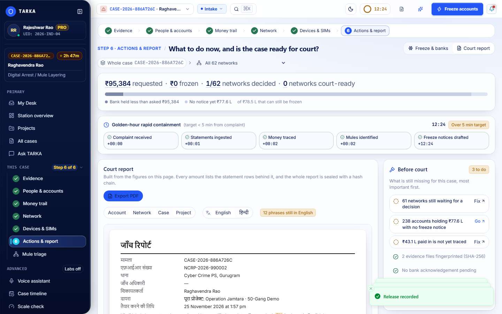

# TARKA (तर्क)
### Deterministic Cyber-Fraud Tracing & Golden-Hour Recovery Platform

> *"Drop in raw bank statements, telecom device logs, NCRP complaints, and UPI screenshots. TARKA isolates every mule network, links accounts to shared controller phones, traces recoverable balances forward in time, and drafts BNSS §106/§107 freeze notices and bilingual court reports — with every number backed by a SHA-256 chain of custody."*

---

## ⚡ Quickstart

### Option A: Local Dev (Backend + Frontend)
```bash
# 1. Clone repository
git clone https://github.com/Massvippin01/tarka_v5.git
cd tarka_v5

# 2. Build a clean demo database (optional, 1M-row / 50-gang dataset)
PYTHONPATH=backend venv/Scripts/python backend/tools/build_demo_db.py

# 3. Start backend (:8000) and frontend (:5173)
python -m uvicorn app.main:app --app-dir backend --port 8000
cd frontend && npm run dev
```

### Option B: Docker Compose (Lean Production Stack)
```bash
docker compose -f docker-compose.lean.yml up --build -d
```

---

## 🎯 Core Capabilities

| Capability | Engine & Implementation | Screen |
| :--- | :--- | :--- |
| **NCRP 1930 Complaint Matching** | Auto-matches victim CSV complaints against ingested transactions by account/VPA/phone, amount, and time window without inventing missing fields. | **Projects & Cases** |
| **Golden-Hour Rapid Containment** | Tracks elapsed seconds from complaint intake through statement ingestion, LIBR tracing, mule discovery, and bank freeze drafting. | **Upload Center** & **Triage** |
| **Scale Triage & Mule Scoring** | Deterministic two-pass SQL/graph scoring (`99.3%` precision at 1M rows), 72 h dormant-burst detection, and adaptive ranking by freezable ₹. | **① Triage** & **③ People & accounts** |
| **OCR & Receipt Tamper Forensics** | PaddleOCR / RapidOCR fallback with Indian-lakh parsing, EXIF/ELA/layout checks, and receipt-vs-bank-ledger reconciliation. | **② Evidence** |
| **Time-Aware LIBR Money Trail** | Strictly forward-in-time tracing using Lowest Intermediate Balance Rule (LIBR) to separate cashed-out funds from recoverable balances. | **④ Money trail** |
| **Controller Phone Attribution** | Clusters mule accounts sharing IMEI, IMSI, Wi-Fi BSSID, or IP while filtering carrier NAT (`> 25` accounts) and flagging SIM swaps. | **⑤ Network** & **⑥ Devices & SIMs** |
| **Bank Reply Loop & Bilingual Court Report** | Drafts per-bank **BNSS §106/§107** freeze notices (`Sent → Acknowledged → Frozen`), logs officer handover, and exports EN/HI SHA-256 PDFs. | **⑦ Actions & report** |
| **Grounded Local Copilot** | On-premise **Ollama (`llama3.1:8b`)** assistant with animated particle orb and strict `DATA_ONLY` prompt-injection defense. | **Ask TARKA** |

---

## 🏛️ System Architecture



---

## 📸 Live UI Tour

### 1. Projects & NCRP 1930 Complaint Matching
*Groups related FIRs into one operation, auto-matches NCRP complaints to bank rows, and logs hash-chained officer handovers.*



---

### 2. Chunked Upload Center & Golden-Hour Clock
*Fingerprints every uploaded file with SHA-256 on arrival and tracks the live golden-hour containment clock.*



---

### 3. Adaptive Mule Triage (1M Rows / 50 Gangs)
*Isolates organized mule networks and ranks them by still-recoverable ₹ in a compact sortable table.*



---

### 4. Fraud Network & Controller Phone Attribution
*Maps victim-to-mule money flows alongside shared handset IMEIs ("14 mule accounts operated from 2 phones") and time-aware LIBR paths.*



---

### 5. BNSS §106/§107 Freeze Notices & Bank Reply Loop
*Ranks accounts by freeze value, groups notices per bank, and tracks live bank responses (`Sent → Acknowledged → Frozen`).*



---

### 6. Bilingual Court Report (English + हिन्दी)
*Exports SHA-256-sealed court annexures across Account, Network, Case, or Project scopes in English and Hindi.*



---

## ⚖️ Investigative & Forensic Principles

1. **AI Proposes, Evidence Verifies, Human Decides**: TARKA never declares a person guilty or innocent — every flag carries a plain-English rationale and requires human confirmation.
2. **Immutable Evidence Integrity**: Raw evidence is append-only and SHA-256 hashed; content inside evidence is strictly `DATA_ONLY` and never treated as instructions.
3. **Deterministic Math, Zero Guessing**: Scoring, LIBR fund tracing, and device clustering are 100% deterministic and reproducible; missing data produces no signal rather than a guess.
4. **Indian Statutory Alignment**: Indian rupee formatting (`₹1,00,000`), **BNSS §§106–107** freeze/attachment workflows, and **BSA §63** electronic record certification.

---

## 🔒 License

Copyright © 2026 **Vippin Antony P & TARKA Engineering Team**. **All Rights Reserved.**  
See [LICENSE](LICENSE) for full terms — evaluation access only; no copying, modification, or redistribution without written permission.
