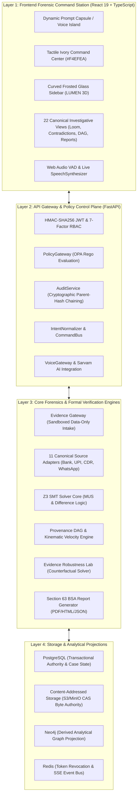

# TARKA — SYSTEM ARCHITECTURE SPECIFICATION
## Multi-Tier Digital Forensics & Formal Investigative Verification Platform

**Document Version:** 1.0.0-PROD  
**Authority:** Principal Software Architect  
**Related Documents:** [TARKA_MASTER_PLAN.md](file:///C:/PROJECTS/SentinelX/TARKA_MASTER_PLAN.md) | [TARKA_SECURITY_MODEL.md](file:///C:/PROJECTS/SentinelX/TARKA_SECURITY_MODEL.md)

---

## 1. HIGH-LEVEL ARCHITECTURAL TOPOLOGY

TARKA is engineered as a clean 4-tier decoupled architecture enforcing strict boundaries between presentation, policy evaluation, formal verification, and canonical storage authorities.

---

## 2. COMPONENT DECOMPOSITION & RESPONSIBILITIES

### 2.1 Layer 1: Forensic Command Station (Frontend)
- **Technology Stack:** Vite 8.0, React 19, TypeScript 5.8, Framer Motion, Lucide-React.
- **Visual Aesthetic:** Tactile Skeuomorphic Command Center based on verified reference designs:
  - **Surface Canvas:** Warm forensic ivory/clay (`#F4EFEA`, `#FAF8F3`) with soft recessed wells and inner shadow bevels (`box-shadow: inset 1px 1px 3px rgba(0,0,0,0.06)`).
  - **Dynamic Prompt Capsule:** Floating pill header hosting examiner avatar, status pill, and direct conversational/voice prompt input.
  - **Curved Translucent Sidebar:** Frosted glass sidebar panel (`backdrop-filter: blur(16px)`, specular edge highlight, translucent pill active states) inspired by the `LUMEN` 3D glassmorphic reference.
  - **Floating Dock Navigation:** Floating pill navigation dock at bottom viewport controlling high-level workspace modes (`Overview`, `Activity`, `Intake`, `Contradictions`, `Timeline`, `Graph`, `Reports`).
- **Interaction Modules:**
  - `TarkaForensicWorkstation.tsx`: Primary workstation router.
  - `DemoDirectorModal.tsx` & `DemoArrowOverlay.tsx`: Autonomous guided demo orchestration engine.
  - `SarvamVoiceModal.tsx`: Multilingual ambient voice modal with local Web Audio VAD.
  - `ContradictionPanel.tsx`: Interactive Z3 conflict explorer with counterfactual toggle.
  - `ProvenanceDAGView.tsx`: Bidirectional byte-to-conclusion lineage graph.

### 2.2 Layer 2: API Gateway & Policy Control Plane (Backend)
- **Framework:** FastAPI 0.137 mounted on Python 3.12 with asynchronous endpoints.
- **Gateways & Middleware:**
  - `PolicyGateway`: Evaluates 7 orthogonal authorization factors: `(Role, Clearance, Case Scope, Jurisdiction, Purpose, Tool, Action Risk Class)`. Rejects out-of-scope requests with HTTP 403.
  - `AuthService`: Generates and verifies HMAC-SHA256 signed JWT tokens with JTI tracking and Redis revocation checks.
  - `AuditService`: Maintains an immutable, tamper-evident audit ledger using SHA-256 parent-hash chaining:
    $$\text{Hash}_n = \text{SHA-256}(\text{Hash}_{n-1} \parallel \text{EventBytes}_n)$$
  - `CommandBus`: Single typed dispatcher for all investigator actions regardless of modality (Voice, UI click, Keyboard, or Multi-Agent task).

### 2.3 Layer 3: Core Forensics & Reasoning Engines
- **Evidence Gateway (`app/services/evidence_gateway.py`):**
  - Manages acquisition, streaming SHA-256 hashing in 64KB bounded chunks, UUIDv7 identity assignment, and CAS storage.
  - Enforces the `DATA_ONLY` sandbox boundary to isolate prompt injection inside forensic artifacts.
- **Formal Verification Core (`backend/tarka/solver/`):**
  - **Z3 SMT Solver v5.1.0:** Translates extracted facts into propositional and difference logic formulas.
  - **Minimal Unsatisfiable Subsets (MUS):** Computes exact, irreducible contradictory subsets (e.g., proving that a ₹25,000 debit in core banking records cannot co-exist with a ₹15,000 disputed transaction receipt under identical UPI RRN).
  - **Counterfactual Lab:** Interactively excludes disputed artifacts and re-solves constraints in real time.
- **Statutory Admissibility (`backend/tarka/core/forensic_report.py`):**
  - Compiles legal certificates compliant with Section 63 of Bharatiya Sakshya Adhiniyam, 2023.
  - Produces deterministic composite SHA-256 fingerprints over substantive findings.

### 2.4 Layer 4: Storage & Analytical Projections
- **PostgreSQL 16:** Authoritative relational repository for cases, entities, facts, relationships, examiner decisions, and audit events.
- **Content-Addressed Storage (CAS):** Byte authority storing raw, immutable forensic files indexed strictly by SHA-256 digest. Dual-mode support: S3/MinIO in production; deterministic filesystem CAS in air-gapped deployments.
- **Neo4j 5.x:** Derived graph projection. Rebuildable from PostgreSQL state via incremental deltas. Never acts as a standalone source of truth.

---

## 3. UNBROKEN EVIDENCE LINEAGE FLOW

Every investigative finding emitted by TARKA follows an unbroken cryptographic chain of custody:

$$\begin{aligned}
\text{Raw File Bytes} &\longrightarrow \text{SHA-256 Digest} \longrightarrow \text{CAS Storage Address} \\
&\longrightarrow \text{UUIDv7 Artifact ID} \longrightarrow \text{Canonical Extraction Fact} \\
&\longrightarrow \text{Z3 SMT Logical Constraint} \longrightarrow \text{Minimal Unsatisfiable Subset} \\
&\longrightarrow \text{Statutory Finding} \longrightarrow \text{Section 63 BSA Certificate}
\end{aligned}$$
