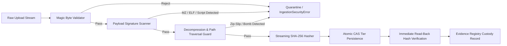

# TARKA EVIDENCE INGESTION SPECIFICATION
## Hardened Multimodal Evidence Gateway, CAS Storage & Bitstream Custody

**Standard Reference:** TARKA-INGEST-GW-v1.0  
**Authority:** SentinelX Engineering Constitution & Section 63 BSA / CrPC § 91  

---

## 1. Gateway Principles
The Multimodal Evidence Gateway (`MultimodalEvidenceGateway`) is the exclusive ingress boundary for all physical and digital evidence submitted to TARKA. No file may enter the investigation graph or analytical modules without passing through this gateway.

### Invariants:
1. **Append-Only Evidence:** Evidence bytes are immutable. Modifying or overwriting stored evidence is architecturally impossible.
2. **Bitstream CAS Storage:** Storage is keyed strictly by Content-Addressable Storage (CAS) SHA-256 bitstream hash.
3. **Data-Only Execution Barrier:** Evidence is DATA ONLY. Content inside evidence can never be parsed as code, executed as scripts, or interpreted as LLM agent instructions.

---

## 2. Ingestion Defense Pipeline



---

## 3. Detailed Defense Mechanisms

### 3.1 Strict Magic Byte Verification
MIME types declared in HTTP headers are untrusted user input. The Gateway validates the initial byte sequence against immutable file signatures:

| Format | Magic Bytes / Header Signature | Max Admitted Size |
| :--- | :--- | :--- |
| **PNG** | `\x89PNG\r\n\x1a\n` | 50 MB |
| **JPEG** | `\xff\xd8\xff` | 50 MB |
| **WebP** | `RIFF....WEBP` | 50 MB |
| **PDF** | `%PDF-` | 100 MB |
| **CSV** | Printable ASCII/UTF-8 with delimited rows | 25 MB |
| **XLSX** | `PK\x03\x04` with valid XML sheet structure | 50 MB |
| **ZIP** | `PK\x03\x04` (subject to Zip-Slip & bomb validation) | 100 MB |

### 3.2 Executable Payload & Script Detection
The gateway scans file bytes for dangerous executable signatures and embedded active script tags:
- **Windows Executables:** `\x4d\x5a` (`MZ` DOS/PE header)
- **Linux Executables:** `\x7f\x45\x4c\x46` (`ELF` header)
- **macOS Binaries:** `\xca\xfe\xba\xbe`, `\xfe\xed\xfa\xce`, `\xcf\xfa\xed\xfe` (Mach-O)
- **Active Web Payloads:** `<script`, `javascript:`, `vbscript:`, `onload=`, `eval(`
If any signature is detected, ingestion aborts immediately with `IngestionSecurityError: Malicious or executable payload rejected`.

### 3.3 Archive Security (Zip-Slip & Decompression Bomb Protection)
When ingesting ZIP archives:
1. **Zip-Slip Traversal Prevention:** Every entry's normalized path is checked against the target extraction root:
   ```python
   target_path = (extract_dir / member.filename).resolve()
   if not str(target_path).startswith(str(extract_dir.resolve())):
       raise IngestionSecurityError("Path traversal attack detected")
   ```
2. **Decompression Bomb Defense:**
   - Maximum uncompressed size limit: $500\text{ MB}$.
   - Maximum expansion ratio limit: $100:1$.
   - Cumulative uncompressed bytes tracked dynamically during decompression.

### 3.4 CAS Storage Tier Isolation
All files are organized into isolated directory tiers under `storage_root / {case_id} / evidence /`:
- `raw/`: Immutable raw evidence bitstream (named by SHA-256 hash).
- `derived/`: Normalized RGB working copies, web previews (`.webp`).
- `ocr/`: OCR extraction JSON results, token arrays, polygon data.
- `normalized/`: Clean tabular CSV/JSON representations of statements.
- `analysis/`: Analytical results, ELA heatmap previews, anomaly scores.
- `reports/`: Digitally signed Section 63 BSA statutory certificates.

### 3.5 Streaming Bitstream Verification
Evidence is streamed into storage in $64\text{ KB}$ bounded chunks while computing the SHA-256 digest on the fly. Immediately following the write, the file is re-read from disk and re-hashed to verify disk integrity before the custody record is committed to PostgreSQL.
