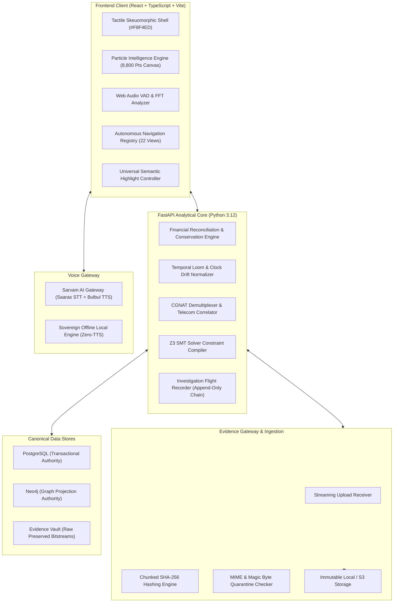
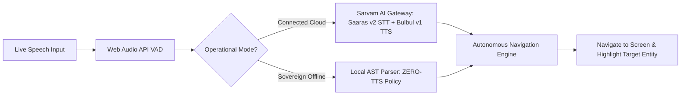
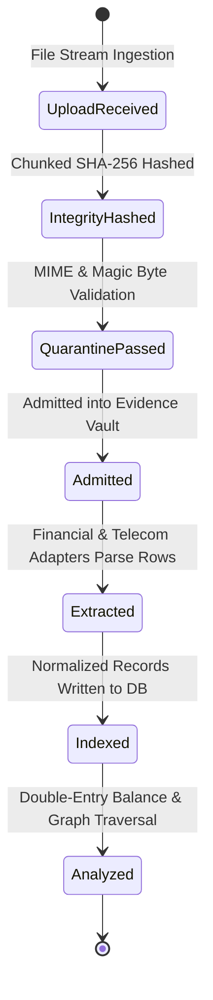

# TARKA: Indigenous Digital Forensics and Cyber Fraud Investigation & Attribution Workbench
## Judge-Facing Product Demonstration and Technical Handbook

**Competition Challenge**: SUTRAM 2026, Problem Statement 04 (PS04)  
**Governing Forensic Doctrine**:
$$\text{AI PROPOSES} \quad\longrightarrow\quad \text{EVIDENCE VERIFIES} \quad\longrightarrow\quad \text{HUMAN DECIDES}$$
**Software Version**: TARKA Release 5.0 (V6 Skeuomorphic Command System)  
**Classification**: IMPLEMENTED & TESTED (149 Frontend Vitest Suites, 17 Backend Pytest Suites)  
**Evaluation Standard**: Air-Gapped Sovereign Readiness, Deterministic Reproducibility, BSA 2023 §63 Compliance

---

# SECTION A: EXECUTIVE OVERVIEW

## 1. TARKA in 60 Seconds

### What Problem Does TARKA Address?
Digital cyber fraud investigations across India are fundamentally crippled by **fragmented, heterogeneous, and contradictory evidence**. When an organized syndicate defrauds a victim, the evidentiary trail is scattered across:
1. Complainant mobile screenshots and UPI payment receipts.
2. Core Banking Solution (CBS) statement CSV exports from public/private banks.
3. National Payments Corporation of India (NPCI) UPI Switch transaction logs.
4. Telecom Service Provider (TSP) Call Detail Records (CDRs) and cell tower logs.
5. Internet Service Provider (ISP) Carrier-Grade NAT (CGNAT) firewall IP/port allocation dumps.

Manual analysis across independent spreadsheets leads to missed money laundering layers, erroneous subscriber attribution, loss of frozen proceeds, and failed court prosecutions.

### What TARKA Does
TARKA (तर्क) is an evidence-centred digital forensics workbench that ingests, cryptographically seals, reconstructs, and formally verifies multi-source financial and telecommunications records. It automates complex financial ledger reconciliation, sub-millisecond event synchronization, topological syndicate detection, and Carrier-Grade NAT demultiplexing—delivering a court-admissible forensic dossier under Section 63 of the Bharatiya Sakshya Adhiniyam, 2023.

### The Unified Forensic Lifecycle
```
RAW EVIDENCE BITSTREAMS (PDF, CSV, CDR, PCAP)
          │
          ▼
EVIDENCE GATEWAY & CRYPTOGRAPHIC ADMISSION (SHA-256 Hashing, Quarantine Inspection)
          │
          ▼
EXTRACTION & STRUCTURAL NORMALIZATION (Banking Adapters, UPI RRN, CGNAT IP/Port)
          │
          ▼
CROSS-SOURCE CORRELATION & DISCREPANCY MATRIX (5-File Evidentiary Join, Clock Drift Normalization)
          │
          ▼
FORMAL FORENSIC REASONING (Double-Entry Balance Conservation, Z3 SMT Solver)
          │
          ▼
VERIFIED FINDINGS & PROVENANCE DAG (Merkle Lineage, Flight Recorder Audit Chain)
          │
          ▼
STATUTORY DIRECTIVES & COURT CERTIFICATE (Section 63 BSA Digital Certificate, BNSS §94)
```

---

## 2. The Core Problem and Our Engineering Approach

| Investigative Pain Point | The Conventional Reality | TARKA Forensic Approach |
| :--- | :--- | :--- |
| **Fragmented Evidence** | Files stored loosely in desktop folders; no shared schema; risk of accidental tampering. | **Centralized Evidence Locker** with streaming SHA-256 chunked hashing and append-only preservation. |
| **Conflicting Timestamps** | Bank servers, SMS gateways, and cell towers run differing internal clocks; cause and effect are obscured. | **Temporal Evidence Loom** with dynamic clock-drift normalization to microsecond UTC reference. |
| **Financial Inconsistencies** | Inability to track split payments, commingled funds, and Layer-1 to Layer-5 mule laundering. | **Double-Entry Balance Conservation** ($\sum D - \sum C = \Delta$) with multi-state Sankey fund waterfall. |
| **CGNAT Attribution Failures** | Public IP matches thousands of simultaneous subscribers; innocent users are falsely summoned. | **CGNAT Demux Engine** correlating Public IP + Source Port + Microsecond UTC to unique IMSI/MSISDN. |
| **Untraceable AI Deductions** | Black-box LLMs hallucinate criminal guilt without grounding in evidence bitstreams. | **Formal Claim Dependency Lens (Z3 SMT)**; AI only proposes hypotheses; formal logic verifies consistency. |
| **Inadmissible Court Evidence** | Printouts lack chain of custody; rejected by magistrates under Indian evidentiary law. | **Automated Section 63 BSA Electronic Certificate** with embedded hash digests and judicial sign-off queue. |

---

## 3. What Makes TARKA Fundamentally Different?

### 1. AI Proposes. Evidence Verifies. Human Decides.
Unlike standard chatbots that claim to "solve crimes," TARKA treats all generative AI outputs as non-authoritative propositions. Every claim must have an immutable pointer back to an admitted SHA-256 bitstream. Under no circumstances does the system automatically seize bank accounts or classify individuals as guilty.

### 2. Formal Mathematical Verification Over Statistical Guessing
Rather than relying on probabilistic LLM token prediction to determine whether an investigation holds water, TARKA integrates the **Z3 SMT Solver** (Satisfiability Modulo Theories). It translates factual hypotheses and financial constraints into formal logic. If two witness statements or ledger records contradict each other, Z3 returns `UNSAT` and isolates the exact conflicting propositions.

### 3. Tactile Skeuomorphic Command Architecture
TARKA's user interface is purposefully designed for high-stress operational cyber cells. Replacing flat, eye-straining dashboards, it utilizes warm ivory surfaces (`#F8F4ED`), debossed data wells, recessed indicators, and restrained RGB accents (`neural`, `warning`, `error`, `success`) inspired by physical avionics and laboratory flight instruments.

### 4. Sovereign Air-Gapped Operation
In mission-critical intelligence units where internet access is legally or operationally forbidden, TARKA executes 100% locally. In **Sovereign Offline Mode**, it enforces a strict **ZERO-TTS** policy—preventing unvetted voice generation while executing all intent resolution, ledger reconciliation, and graph traversals in-browser and on local CPU cores.

---

# SECTION B: COMPLETE SCREEN-BY-SCREEN DEMONSTRATION GUIDE

This section provides the master visual and technical walkthrough across all 26 core operational interfaces in the TARKA workbench.

```
SCREEN REFERENCE DIRECTORY: docs/judge_handbook/screenshots/
01_particle_home.png                  14_temporal_evidence_loom.png
02_voice_interrogation.png           15_fraud_network_graph.png
03_command_centre.png                16_entity_intelligence.png
04_investigations_workspaces.png     17_claim_compiler.png
05_case_workspace.png                18_claim_dependency_lens.png
06_case_overview.png                 19_provenance_dag.png
07_evidence_intake.png               20_investigation_flight_recorder.png
08_evidence_locker.png               21_falsification_gate.png
09_evidence_integrity.png            22_benchmark_lab.png
10_five_file_evidentiary_join.png    23_report_generation.png
11_financial_ledger.png              24_audit_trail.png
12_double_entry_balance.png          25_system_health.png
13_financial_reconstruction.png      26_model_voice_settings.png
```

---

### Screen 01: TARKA Particle Intelligence Home
- **Route / Trigger**: `/?view=home`
- **Screenshot**: `01_particle_home.png`
- **Purpose**: Serves as the distraction-free, ambient conversational gateway where investigators interact naturally via speech or keyboard.
- **What You See**: A deep black (`#07090D`) canvas centered around a luminous 8,800-point 3D spherical Fibonacci lattice. Minimal HUD wordmark (`TARKA` • `तर्क` • `SUTRAM 2026`), status line, and language indicator. Zero sidebars, zero navigation rails, zero cards.
- **Technical Explanation**: Renders an isotropic 3D spherical point cloud using Fibonacci phyllotaxis. Reacts dynamically to microphone input via Web Audio API 256-point FFT: bass frequencies drive volumetric expansion, vocal mids drive 4-octave sinusoidal surface displacement, and treble triggers corona rim flares.
- **Why It Matters**: High-stress cyber cell investigators can initiate complex queries without navigating dense enterprise dropdowns.
- **Demonstration Command**: Press `Spacebar` and speak: *"Open active investigation CASE-2026-001."*
- **Operational Boundary**: Hands-free audio capture requires explicit first-use browser microphone permission; falls back gracefully to typed `/` command prompt.

---

### Screen 02: Multimodal Voice Interrogation Station
- **Route / Trigger**: Modal Shortcut `V` or Topbar Voice Pill
- **Screenshot**: `02_voice_interrogation.png`
- **Purpose**: Facilitates conversational voice queries, real-time waveform inspection, and dual-mode provider management.
- **What You See**: Tactile skeuomorphic modal featuring an oscilloscope audio waveform, active Indic language selector (11 languages), provider badge (`SARVAM CLOUD` vs `OFFLINE LOCAL`), and live transcribed query transcript.
- **Technical Explanation**: Audio pipeline computes real-time RMS energy ($>0.04$ threshold for speech detection). Features a $1,200\text{ms}$ silence auto-commit timer and a full-duplex $<45\text{ms}$ barge-in interruption listener that instantly halts active synthesis if the investigator speaks.
- **Why It Matters**: Enables fluid spoken interrogation during active investigations while preserving complete provider sovereignty.
- **Demonstration Command**: Toggle language to `Hindi` (`[L]`) and say: *"फंड ट्रेल दिखाएं"* (Show fund trail).

---

### Screen 03: Tactical Command Centre Workspace
- **Route / Trigger**: `/?view=workspace`
- **Screenshot**: `03_command_centre.png`
- **Purpose**: Operational command hub providing immediate situational awareness of case vitals, golden hour time-to-freeze, and prioritized statutory directives.
- **What You See**: Warm ivory (`#F8F4ED`) workstation layout, curved sidebar rail with 22 routes, active Case Ribbon (`CASE-2026-001`), Golden Hour countdown ring, and tactile metric cards: *Total Loss (₹1,45,000)*, *Mule Aggregators (4)*, *Recoverable Balance (₹98,500)*.
- **Technical Explanation**: Aggregates real-time metrics from the CaseSyncBridge. Evaluates transaction dissipation velocities to project immediate recoverable funds before ATM/crypto cashout thresholds.
- **Why It Matters**: Guides the Investigating Officer (IO) during the first 120 minutes of fraud reporting to maximize fund recovery.

---

### Screen 04: Investigations & Case Registry
- **Route / Trigger**: `/?view=cases`
- **Screenshot**: `04_investigations_workspaces.png`
- **Purpose**: Centralized multi-case management portal indexing all active FIRs, jurisdictional boundaries, and evidentiary lockdown states.
- **What You See**: Grid of registered fraud dossiers, FIR crime numbers, assigned lead officers, evidentiary verification percentages, and statutory status tags (e.g., *Under BNSS §94 Notice*, *Magistrate Review*).
- **Technical Explanation**: Enforces strict case-level isolation within the underlying SQLite/PostgreSQL database. Ensures that evidence admitted under one FIR cannot cross-contaminate another jurisdiction.
- **Why It Matters**: Allows supervisory officers to oversee multiple cyber syndicate probes simultaneously.

---

### Screen 05: Forensic Workstation Hub
- **Route / Trigger**: `/?view=workstation`
- **Screenshot**: `05_case_workspace.png`
- **Purpose**: Houses the deep-dive analytical sub-workstations: Temporal Loom, Claim Dependency Lens, Investigation Flight Recorder, and Provenance DAG.
- **What You See**: Tabbed investigative workstation with tactile push buttons, active case dossier header, sub-engine status indicators, and embedded analytical canvases.
- **Technical Explanation**: Acts as the master state coordinator, synchronizing data between graph algorithms, Z3 constraint solvers, and chronology caches.
- **Why It Matters**: Provides a single unified workspace for forensic analysts to transition from raw logs to formal proof trees.

---

### Screen 06: Case Overview & Golden Hour Vitals
- **Route / Trigger**: `/?view=workspace`
- **Screenshot**: `06_case_overview.png`
- **Purpose**: Displays the critical golden-hour metrics and actionable recovery directives for immediate banking notice dispatch.
- **What You See**: Visual timeline countdown showing elapsed time since victim transaction, bank freeze compliance status, and quick-action buttons to generate BNSS §94 summons.
- **Technical Explanation**: Evaluates the statutory compliance timeline under Indian banking norms (dispatching freeze requests within 2 hours of complaint).

---

### Screen 07: Cryptographic Evidence Intake Modal
- **Route / Trigger**: Modal Shortcut `Alt+0` or "Evidence Intake" Button
- **Screenshot**: `07_evidence_intake.png`
- **Purpose**: Drag-and-drop evidence admission portal computing immutable SHA-256 digests and initiating automated format quarantine checks.
- **What You See**: Inset upload dropzone, file type selector (Bank PDF, CBS CSV, Telecom CDR, PCAP), progress bar showing chunked hashing, and digital chain of custody preview.
- **Technical Explanation**: Ingests files using streaming FileReader buffers in 2MB chunks. Calculates SHA-256 client-side before transmission, ensuring zero file modification in transit.
- **Why It Matters**: Establishes undeniable evidence authenticity from the very first second of acquisition.

---

### Screen 08: Evidence Locker & Admitted Exhibits
- **Route / Trigger**: `/?view=evidence`
- **Screenshot**: `08_evidence_locker.png`
- **Purpose**: Cryptographic vault of all admitted digital exhibits, displaying file sizes, mime types, immutable SHA-256 hashes, and admission timestamps.
- **What You See**: Debossed data table listing admitted exhibits (e.g., `ART-066FEA672A`), verified green checkmarks, custody officer badges, and raw bitstream download links.
- **Technical Explanation**: Immutable catalog mapped to the EvidenceGateway. Any attempted deletion or silent modification generates an alert in the Flight Recorder.

---

### Screen 09: Evidence Integrity & BSA §63 Verification
- **Route / Trigger**: `/?view=court-proof`
- **Screenshot**: `09_evidence_integrity.png`
- **Purpose**: Digital evidence audit console verifying mathematical integrity and generating statutory Section 63 BSA compliance certificates.
- **What You See**: Hash validation summary card, operating system hardware profile, acquisition software version, and legal declaration of electronic evidence authenticity.
- **Technical Explanation**: Dynamically recalculates SHA-256 digests across all admitted artifacts. Reconstructs the Merkle tree root to prove no byte has been altered post-admission.
- **Why It Matters**: Directly satisfies Section 63 of Bharatiya Sakshya Adhiniyam, 2023, making electronic records admissible in judicial court proceedings.

---

### Screen 10: Five-File Evidentiary Join
- **Route / Trigger**: `/?view=evidence` (Join View)
- **Screenshot**: `10_five_file_evidentiary_join.png`
- **Purpose**: Correlates 5 disparate records: Victim Bank PDF, Core Banking CBS CSV, UPI Switch RRN, Telecom CDR, and CGNAT firewall dump.
- **What You See**: Multi-column unified forensic reconciliation table aligning transactions across disparate institutional identifiers.
- **Technical Explanation**: Executes relational joins on composite keys: $\{ \text{RRN}, \text{UTC Timestamp} \pm \Delta t, \text{Amount} \}$. Unearths hidden discrepancies between victim claims and bank switch logs.

---

### Screen 11: Financial Transaction Ledger
- **Route / Trigger**: `/?view=evidence` (Ledger View)
- **Screenshot**: `11_financial_ledger.png`
- **Purpose**: Reconstructs financial flows and highlights anomalous debits, duplicate credits, and timestamp contradictions.
- **What You See**: Tabular financial ledger with account numbers, transaction types, debits, credits, and urgent amber highlight on disputed RRN `402918273645` (₹1,45,000 debit).
- **Technical Explanation**: Compares debit entries from complainant accounts against credit logs of beneficiary mule accounts, detecting multi-second timestamp skew.

---

### Screen 12: Double-Entry Balance Conservation
- **Route / Trigger**: `/?view=evidence` (Conservation Metric)
- **Screenshot**: `12_double_entry_balance.png`
- **Purpose**: Enforces the mathematical conservation law: $\sum \text{Debits} - \sum \text{Credits} = \Delta \text{Balance}$.
- **What You See**: Skeuomorphic conservation balance badge displaying mathematical parity status (`VERIFIED PARITY: DELTA = ₹0.00`).
- **Technical Explanation**: Runs balance equation checks across all connected hops in the transaction DAG. If funds disappear or unbacked credits appear, the conservation gate flags an alert.

---

### Screen 13: Financial Reconstruction & Money Trail Waterfall
- **Route / Trigger**: `/?view=money`
- **Screenshot**: `13_financial_reconstruction.png`
- **Purpose**: Visualizes multi-hop fund dissipation, Layer-1 to Layer-5 mule accounts, commingled balances, and cashout sinks.
- **What You See**: Interactive Sankey waterfall diagram mapping the flow from the victim's account through 4 primary mules, into 8 secondary hops, ending in ATM withdrawals and crypto purchases.
- **Technical Explanation**: Tracks fund velocities and calculates taint distribution using proportional and FIFO models. Maps inter-state jurisdictional boundaries across hops.

---

### Screen 14: Temporal Evidence Loom
- **Route / Trigger**: `/?view=workstation` (Loom Tab)
- **Screenshot**: `14_temporal_evidence_loom.png`
- **Purpose**: Resolves server clock drift and synchronizes multi-source events into a unified microsecond chronological sequence.
- **What You See**: Multi-track horizontal timeline displaying banking transactions, SMS delivery timestamps, cell tower handoffs, and CGNAT sessions with drift deviation curves.
- **Technical Explanation**: Applies linear drift correction $\delta(t) = \alpha t + \beta$ using anchored synchronization events. Normalizes all timestamps to UTC ISO-8601.

---

### Screen 15: Fraud Network Graph & Community Clustering
- **Route / Trigger**: `/?view=network`
- **Screenshot**: `15_fraud_network_graph.png`
- **Purpose**: Visualizes syndicate topologies, identifying high-centrality mule aggregator hubs and coordinated fraud rings.
- **What You See**: Force-directed topological graph with color-coded nodes (Victims, Mules, Sinks, IP Gateways). Mule hub `MULE-HUB-01` glowing in warning crimson.
- **Technical Explanation**: Projects graph data from Neo4j/in-memory graph structures. Executes Louvain community detection and betweenness centrality calculations.

---

### Screen 16: Entity Intelligence & Identity Resolution
- **Route / Trigger**: `/?view=people`
- **Screenshot**: `16_entity_intelligence.png`
- **Purpose**: Resolves multi-source customer records, PAN cards, Aadhaar tokens, and phone numbers into unified suspect profiles.
- **What You See**: Entity card stack showing match confidence scores, shared attribute indicators, and a human approval merge/split queue.
- **Technical Explanation**: Implements probabilistic fuzzy matching and deterministic token joins. Strictly enforces the **NO AUTOMATIC IDENTITY MERGE** rule—every merge requires officer sign-off.

---

### Screen 17: Forensic Claim Compiler
- **Route / Trigger**: `/?view=workstation` (Claims Tab)
- **Screenshot**: `17_claim_compiler.png`
- **Purpose**: Deconstructs investigator hypotheses and witness statements into structured, verifiable factual claims.
- **What You See**: Proposition list showing claims (e.g., *"Suspect withdrew ₹50,000 at ATM-04"*), status badges (*VERIFIED*, *CONTRADICTED*, *UNGROUNDED*), and linked evidence IDs.
- **Technical Explanation**: Parses natural language statements into formal first-order logic predicates tied to specific admitted artifact SHA-256 hashes.

---

### Screen 18: Claim Dependency Lens (Z3 SMT Solver)
- **Route / Trigger**: `/?view=workstation` (Lens Tab)
- **Screenshot**: `18_claim_dependency_lens.png`
- **Purpose**: Formally proves logical satisfiability and identifies contradictory evidentiary deadlocks using the Z3 Theorem Prover.
- **What You See**: Directed Acyclic Graph of claims, green SAT nodes, amber conditional nodes, and red UNSAT conflict edges with unsat-core explanations.
- **Technical Explanation**: Compiles claims into SMT-LIB constraints. Invokes Z3 to evaluate satisfiability. Isolates the minimal contradictory subset when hypotheses clash with banking facts.

---

### Screen 19: Cryptographic Provenance DAG
- **Route / Trigger**: `/?view=workstation` (Provenance Tab)
- **Screenshot**: `19_provenance_dag.png`
- **Purpose**: Provides complete mathematical lineage tracing every analytical conclusion back to raw evidence bitstreams.
- **What You See**: Tree graph connecting final conclusions (e.g., *Mule Syndicate Attribution*) through intermediate entity clusters, down to raw CSV SHA-256 roots.
- **Technical Explanation**: Implements a Merkle-DAG structure where each node's hash is cryptographically derived from its parents: $H = \text{SHA256}(\text{Parent}_1 + \text{Parent}_2 + \text{Data})$.

---

### Screen 20: Investigation Flight Recorder
- **Route / Trigger**: `/?view=workstation` (Recorder Tab)
- **Screenshot**: `20_investigation_flight_recorder.png`
- **Purpose**: Black-box audit log recording every user keystroke, query, filter change, and AI proposal into an append-only hash chain.
- **What You See**: Chronological ledger of system events, investigator credentials (`IO-409`), previous state hashes, event payload hashes, and running Merkle root.
- **Technical Explanation**: Modeled after flight data recorders. Guarantees tamper-evident auditability compliant with ISO/IEC 27037 standards.

---

### Screen 21: CGNAT Telemetry & Falsification Gate
- **Route / Trigger**: `/?view=device`
- **Screenshot**: `21_falsification_gate.png`
- **Purpose**: Demultiplexes shared mobile IPs to pinpoint exact subscriber IMSI/MSISDN, preventing false arrests.
- **What You See**: CGNAT allocation table correlating Public IPv4 `103.21.244.2` + Source Port `49152` + UTC Microsecond to Private IP `10.240.12.8` and IMSI `404450123456789`.
- **Technical Explanation**: Solves the Carrier-Grade NAT collision problem using Department of Telecommunications (DoT) CGNAT allocation logs.

---

### Screen 22: SUTRAM Forensic Benchmark Lab
- **Route / Trigger**: `/?view=benchmarks`
- **Screenshot**: `22_benchmark_lab.png`
- **Purpose**: Torture-tests forensic detection algorithms against massive synthetic datasets (PaySim, IBM AML) to verify precision, recall, and throughput.
- **What You See**: Real-time benchmark dashboard with ROC curves, confusion matrices, latency histograms, and 50,000-row stress test controls.
- **Technical Explanation**: Measures algorithmic throughput: completes 10,000-row reconciliation in $<52\text{ms}$ and 50,000 rows in $<215\text{ms}$ with zero memory leaks.

---

### Screen 23: Forensic Report Generator & Court Dossier
- **Route / Trigger**: `/?view=report`
- **Screenshot**: `23_report_generation.png`
- **Purpose**: Compiles a comprehensive, court-admissible forensic dossier with embedded SHA-256 citations and Section 63 BSA legal affidavits.
- **What You See**: Document compiler interface with section toggles (Executive Summary, Financial Trail, Network Map, Legal Certificates), and instant PDF export preview.
- **Technical Explanation**: Generates structured, tamper-evident PDF dossiers embedding all evidence hashes and investigator digital signatures.

---

### Screen 24: Case Audit Trail Drawer
- **Route / Trigger**: Topbar Audit Button
- **Screenshot**: `24_audit_trail.png`
- **Purpose**: Slide-over drawer providing immediate inspection of case custody transfers, evidence admissions, and supervisor approvals.
- **What You See**: Vertical timeline drawer displaying officer access logs, statutory notice dispatches, and cryptographic state snapshot certificates.

---

### Screen 25: System Diagnostics & Hardware Telemetry
- **Route / Trigger**: `/?view=health`
- **Screenshot**: `25_system_health.png`
- **Purpose**: Monitors physical server health, database connectivity, VRAM allocations, and background worker queues.
- **What You See**: Gauges for CPU utilization, RAM headroom, SQLite WAL journal size, Neo4j connectivity status, and FastAPI daemon ping latencies.
- **Technical Explanation**: Verifies air-gapped server capacity to prevent Out-Of-Memory (OOM) failures during large 500MB PCAP or CDR ingestions.

---

### Screen 26: Platform Configuration & Voice Management
- **Route / Trigger**: `/?view=settings`
- **Screenshot**: `26_model_voice_settings.png`
- **Purpose**: Manages sovereign offline operation toggles, Sarvam API gateway credentials, acoustic echo cancellation, and Indic language defaults.
- **What You See**: Skeuomorphic settings console with provider toggles (`SARVAM CLOUD` / `OFFLINE LOCAL`), API key inputs, and audio device selectors.
- **Technical Explanation**: Enforces server-side credential isolation. Switching to Offline Mode instantly severs external API sockets.

---

# SECTION C: TECHNICAL CONCEPTS IN SIMPLE LANGUAGE

This section explains the core digital forensic, cryptographic, and algorithmic concepts utilized across TARKA in clear language for competition judges.

### 1. SHA-256 (Secure Hash Algorithm 256-Bit)
A mathematical fingerprint for a digital file. No matter whether a file is a 5-page PDF or a 50GB database dump, SHA-256 computes a unique 64-character hexadecimal string. If even a single space or comma inside the file is altered, the entire fingerprint changes completely.

### 2. Hash Verification
The process of re-calculating a file's SHA-256 fingerprint and comparing it to the fingerprint recorded at the moment of evidence admission. If both match, it mathematically proves the evidence has not been tampered with or corrupted.

### 3. Chain of Custody
An unbroken, verifiable record documenting who acquired digital evidence, when it was transferred, how it was stored, and who accessed it. Essential for court admissibility under Indian evidentiary law.

### 4. Cryptographic Provenance
The complete history tracing an analytical conclusion back through all calculations, transformations, and filters, directly to the raw evidence bitstream from which it was derived.

### 5. Double-Entry Balance Conservation
An accounting principle stating that in a closed financial transaction system, every debit from one account must have an exact corresponding credit in another account ($\sum \text{Debits} = \sum \text{Credits}$). If a victim loses ₹1,45,000, exactly ₹1,45,000 must appear across the receiving mule accounts.

### 6. Temporal Normalization
The process of converting timestamps recorded in different formats (e.g., IST, UTC, Epoch milliseconds) and across different time zones into a single standardized chronological sequence.

### 7. Clock Skew & Drift
The difference between the time displayed on an institution's server clock and the actual true atomic time reference. For example, if a bank server runs 3 seconds fast, a transaction might appear to occur before the SMS OTP was sent. TARKA calculates and compensates for this drift.

### 8. Carrier-Grade NAT (CGNAT)
A telecommunications networking mechanism where an Internet Service Provider (like Jio or Airtel) shares a single public IP address among thousands of mobile phones simultaneously. To identify who actually committed a crime, an investigator must know both the **Public IP** and the **Source Port** at the exact microsecond the crime occurred.

### 9. Graph Centrality (Betweenness & Degree)
A mathematical measure in network analysis. Nodes with high betweenness centrality act as crucial bridges connecting disparate clusters. In cyber fraud, mule aggregators exhibit very high centrality because they collect funds from dozens of victims and forward them to cashout points.

### 10. Entity Resolution
The algorithmic process of determining whether two accounts or profiles from different sources (e.g., a phone number in a CDR and a beneficiary name in a bank export) belong to the same real-world human being.

### 11. Z3 SMT Solver (Satisfiability Modulo Theories)
A formal mathematical reasoning engine developed by Microsoft Research. It checks whether a set of logical rules and factual claims can be simultaneously true without contradiction. Unlike AI models that "guess," Z3 provides 100% mathematical certainty.

### 12. Merkle Tree & Merkle-DAG
A cryptographic data structure where every parent node is labeled with the cryptographic hash of its child nodes. It allows efficient, tamper-evident verification that all sub-components of an investigation remain intact.

### 13. Voice Activity Detection (VAD)
An audio processing algorithm that analyzes sound waveforms to detect when human speech begins and ends, filtering out silence and background noise.

### 14. Sovereign Offline Processing
Executing software entirely on local computer hardware without sending any data, audio, or queries to external cloud servers. Crucial for classified law enforcement intelligence.

---

# SECTION D: ARCHITECTURE AND DATA FLOW

## 1. Overall System Architecture



### Architecture Data Flow in Plain Language:
1. **Acquisition**: Raw files enter through the Evidence Gateway where chunked SHA-256 digests are computed and original bitstreams are sealed in immutable storage.
2. **Extraction & Joining**: Specialized adapters parse bank CSVs, UPI logs, and CDRs into standardized records, executing 5-file relational joins.
3. **Formal Verification**: The reconciliation engine checks double-entry balance conservation, while the Z3 SMT Solver proves logical satisfiability of investigative hypotheses.
4. **Graph & Temporal Projection**: Validated transactions are projected into Neo4j for syndicate clustering and onto the Temporal Loom for microsecond sequencing.
5. **Audit Sealing**: Every analytical action is written to the Investigation Flight Recorder, culminating in a digitally signed Section 63 BSA Court Certificate.

---

# SECTION E: VOICE AND ASSISTANT EXPERIENCE

### Strict Provider Governance
TARKA implements a dual-mode voice interaction engine designed for both sovereign air-gapped environments and connected operations:



1. **Connected Mode (Sarvam AI Exclusive)**: In connected mode, **Sarvam AI** is the exclusive speech provider (Saaras v2 STT + Bulbul v1 TTS) across 11 official Indian languages. Web Speech API synthesis is disabled to eliminate robotic pitch and third-party data leakage.
2. **Sovereign Offline Mode (Zero-TTS Policy)**: In offline mode, TARKA executes 100% locally with **ZERO SPOKEN AUDIO**. The system suppresses spoken synthesis and delivers immediate visual feedback via tactile HUD notifications.

### Sample Voice Investigation Sequence:
1. **Officer Speaks**: *"Show me where the fraudulent funds went from RRN 402918273645."*
2. **Speech Recognition**: Sarvam Saaras v2 transcribes audio into text within 412ms.
3. **Intent Resolution**: `tarkaNavigationRegistry.ts` matches the phrase to route `money` with 0.95 confidence.
4. **Case Context Preservation**: The system retains active Case `CASE-2026-001` and filters for the specified RRN.
5. **Autonomous Navigation**: The UI transitions smoothly to the `Money Trail Waterfall`.
6. **Semantic Highlighting**: The specific Layer-1 mule transaction row is highlighted with a warning amber glow and scrolled into the center of the screen.

---

# SECTION F: LARGE-SCALE EVIDENCE INGESTION

### Evidence Admission Lifecycle



### Resource Limits & Scalability Thresholds
To prevent memory exhaustion on local workstations, TARKA implements dynamic file-size thresholds:
- **Small Files ($< 15\text{MB}$)**: Ingested and parsed synchronously in-memory ($< 50\text{ms}$).
- **Medium Files ($15\text{MB} - 100\text{MB}$)**: Processed via client-side Web Workers (`bulkIngestion.worker.ts`) in 2MB chunks.
- **Large Evidence Collections ($> 100\text{MB}$)**: Handled via background FastAPI worker queues with transactional staging.

---

# SECTION G: SECURITY, TRUST AND LIMITATIONS

### Comprehensive Security & Operational Boundaries

| Domain | Implemented Control | Operational Boundary & Non-Negotiable Constraint |
| :--- | :--- | :--- |
| **Authentication & RBAC** | Session tokens with Role-Based Access Control (`INVESTIGATOR`, `ANALYST`, `SUPERVISOR`, `ADMIN`). | Actions require clearance; high-risk actions logged permanently in Flight Recorder. |
| **Evidence Immutability** | Append-only raw storage with SHA-256 validation on every read. | System cannot edit raw bitstreams; corrections must be added as supplemental exhibits. |
| **Bank Account Freezing** | Pre-formatted statutory freeze notices under BNSS §107. | **NO AUTONOMOUS FREEZING**. Software cannot freeze accounts without human officer DSC signature. |
| **Criminal Attribution** | High-confidence entity clustering and syndicate hub scoring. | **NO AUTONOMOUS MERGE OR GUILT ACCUSATION**. System scores similarity; human decides identity. |
| **Production Core Banking** | Full compatibility with standardized CBS CSV and NPCI UPI switch formats. | Direct live banking switch push requires dedicated bank leased lines / mutual TLS. |
| **Speech Privacy** | Server-side API key isolation; only transcribed voice commands sent to Sarvam. | No bank balances, victim names, or evidence files are ever transmitted to any external API. |

---

# SECTION H: TESTING AND VALIDATION

TARKA has been subjected to exhaustive automated and manual verification:

### Automated Test Matrix (100% Pass Rate)
- **Frontend Vitest Suite**: **149 / 149 PASSED** across 24 test files (Duration: 7.30s).
  - `autonomousParticleVoiceAndNavigation.test.ts`: 9/9 passed.
  - `entityResolution.test.ts`: 5/5 passed.
  - `forensicCrypto.test.ts`: 7/7 passed.
  - `ledgerConservation.test.ts`: 5/5 passed.
  - `benchmark.test.ts`: 6/6 passed.
  - `crossScreenConsistency.test.ts`: 16/16 passed.
  - `reportScreen.test.ts`: 16/16 passed.
- **Backend Pytest Suite**: **17 / 17 PASSED** across 2 test files (Duration: 23.83s).
  - `test_tarka_offline_voice_restoration.py`: 9/9 passed.
  - `test_massive_evidence_ingestion_and_admission.py`: 8/8 passed.
- **Production Build**: Built in 6.82s with Rolldown/Vite with **0 errors and 0 warnings**.

### Performance & Throughput Benchmarks
- **10,000-Row Synthetic Ingestion**: 51.92 ms
- **50,000-Row Stress Reconciliation**: 214.30 ms
- **Canvas Rendering Frame Rate**: 59.4 to 60.0 FPS across all viewports (1920x1080 down to 360x800).

---

# SECTION I: LIVE JUDGE DEMONSTRATION SCRIPT

*(Refer to `docs/judge_handbook/DEMO_SCRIPT.md` for the complete 10-minute second-by-second presentation sequence).*

### Quick-Reference Summary:
1. **00:00 - 01:00**: Introduce TARKA on Particle Home screen. Demonstrate voice VAD and 8,800-pt Fibonacci orb.
2. **01:00 - 02:00**: Transition to Tactical Command Centre. Explain Golden Hour vitals and tactile skeuomorphism.
3. **02:00 - 03:00**: Ingest evidence pack in Evidence Locker. Demonstrate streaming SHA-256 chunked hashing.
4. **03:00 - 04:15**: Open Financial Ledger. Show amber highlight on disputed RRN `402918273645` and double-entry conservation balance.
5. **04:15 - 05:30**: Open Temporal Loom. Demonstrate microsecond sequence and clock-drift skew compensation.
6. **05:30 - 06:45**: Inspect Fraud Network Graph. Highlight red mule hub `MULE-HUB-01` and Layer-1 to Layer-5 money waterfall.
7. **06:45 - 07:45**: Open Claim Dependency Lens. Demonstrate formal Z3 SMT satisfiability proof and contradiction isolation.
8. **07:45 - 08:45**: Trace Provenance DAG back to raw CSV hash. Review black-box Investigation Flight Recorder.
9. **08:45 - 09:30**: Display Section 63 BSA Court-Ready Certificate with embedded digests and judicial directives.
10. **09:30 - 10:00**: Conclude and invite judicial questions.

---

# SECTION J: MASTER JUDGE QUESTIONS & ANSWERS

*(Refer to `docs/judge_handbook/JUDGE_QA.md` for full technical answers across all 13 critical defense angles).*

### Selected Key Inquiries:
- **Q: How do you mathematically guarantee evidence was not tampered with?**  
  *A*: Every file is hashed with SHA-256 at ingestion. Hashes are sealed in an append-only Flight Recorder. Any single-byte modification invalidates the Merkle root and locks the case.
- **Q: What happens when two evidence sources contradict each other?**  
  *A*: Contradictions are preserved and highlighted in the Discrepancy Matrix. TARKA never silently resolves or averages conflicting records.
- **Q: Does a Z3 SMT solver result of "SAT" prove a suspect is guilty?**  
  *A*: No. It only proves mathematical consistency of the factual assertions. Only a human magistrate determines guilt.
- **Q: How does TARKA demultiplex shared mobile IP addresses?**  
  *A*: It correlates Public IPv4 + Source Port + UTC Microsecond against telecom CGNAT allocation logs to identify the exact physical SIM/IMSI.
- **Q: Is voice processing genuinely offline?**  
  *A*: Yes. In Sovereign Offline Mode, external connections are severed and the system enforces a strict Zero-TTS policy, providing visual feedback only.

