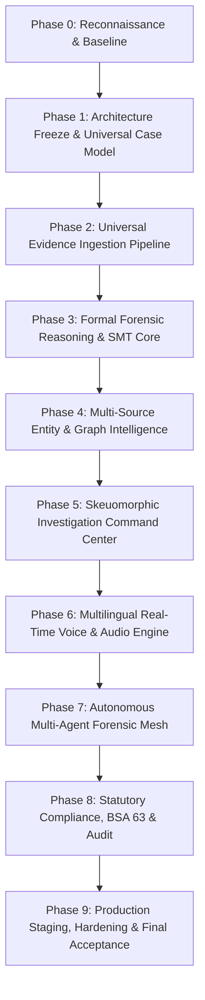

# TARKA — MASTER ENGINEERING PLAN
## Production-Grade Digital Forensics & Evidence Intelligence Platform

**Document Version:** 1.0.0-PROD  
**Authority:** Principal Software Architect & QA Lead  
**Operating Philosophy:** `AI PROPOSES. FORENSIC ENGINES TEST. EVIDENCE SUPPORTS. INVESTIGATORS DECIDE.`  
**Constitutional Rule:** [sentinelx-wave-6-engineering-constitution.md](file:///C:/PROJECTS/SentinelX/.agents/rules/sentinelx-wave-6-engineering-constitution.md)

---

## 1. EXECUTIVE VISION & OPERATING MODEL

TARKA is a sovereign, evidence-centred, multilingual digital investigation and intelligence workbench. It is engineered specifically for law enforcement, digital forensics analysts, and statutory tribunals who require mathematical and cryptographic certainty when investigating complex financial fraud, telecommunications conspiracies, and multi-source cybercrimes.

### 1.1 Non-Negotiable Core Tenet
The fundamental premise of TARKA is that **Large Language Models cannot be trusted with legal conclusions or factual assertions**.
- **AI Proposes:** Machine learning algorithms and local SLMs propose potential links, generate query interpretations, and offer analytical hypotheses.
- **Forensic Engines Test:** Deterministic, non-probabilistic formal verification systems (specifically the **Z3 SMT solver** calculating Minimal Unsatisfiable Subsets — MUS) rigorously evaluate claims against rigid logical, temporal, kinematic, and accounting rules.
- **Evidence Supports:** Every fact and relationship is grounded in immutable Content-Addressed Storage (CAS) with SHA-256 bitstream cryptographic hashes.
- **Investigators Decide:** Only authorized human investigators make decisions, endorse findings, or sign off on statutory certificates. Machine inferences maintain the non-promotability invariant (`human_verified = False`).

### 1.2 Independence from Restricted Systems
TARKA operates under a strict **Zero-Privileged-Access Operating Model**. It is fully functional without requiring direct, real-time access to restricted government or proprietary institutional databases (such as NCRP, CFCFRMS, CCTNS, ICJS, or Pratibimb). Instead, TARKA ingests evidence legitimately provided by investigators (bank statement PDFs, telecom CDR Excel files, UPI raw JSON dumps, WhatsApp export text archives, device extraction tars), normalizes them into canonical facts, and analyzes them deterministically.

---

## 2. SYSTEM BOUNDARIES & ARCHITECTURAL INVARIANTS

1. **Transactional Authority:** PostgreSQL is the single source of transactional truth.
2. **Byte-Level Authority:** Content-Addressed Storage (S3-compatible MinIO or deterministic filesystem CAS) is the byte authority. Raw evidence bytes are immutable and append-only.
3. **Graph Projection Authority:** Neo4j is a derived, rebuildable analytical projection. A graph node or edge never acts as an independent source of truth. Proximity in the graph is never equated to legal guilt.
4. **Data-Only Evidence Boundary:** Evidence content is strictly `DATA_ONLY`. Content inside an evidence artifact is never interpreted as executable code or system instructions, neutralizing prompt injection attacks.
5. **No Private Chain-of-Thought (Zero-CoT):** Raw model internal reasoning is never exposed, logged, or serialized to users or audit logs. Only structured investigative rationale is emitted.
6. **Statutory Admissibility:** All output reports adhere strictly to **Section 63 of the Bharatiya Sakshya Adhiniyam, 2023 (BSA)** (formerly Section 65B of the Indian Evidence Act), containing substantive cryptographic SHA-256 digests.

---

## 3. NINE-PHASE ENGINEERING ROADMAP

### Milestone Summary
- **Phase 0 — Reconnaissance & Baseline:** Comprehensive code audit, test suite mapping (982 passed tests verified), repository truth lock, and permanent memory documents.
- **Phase 1 — Architecture Freeze & Universal Case Model (UCM):** Formalize typed schemas, lock down Pydantic models, establish canonical facts, and separate UUIDv7 identity from SHA-256 hash.
- **Phase 2 — Universal Evidence Ingestion Pipeline:** Extend 11 canonical adapter families, implement TRACE (Transaction Reconstruction & Accounting Classification Engine) and WhatsApp forensics gateway.
- **Phase 3 — Formal Forensic Reasoning & SMT Core:** Harden Z3 SMT solver MUS conflict isolation, counterfactual artifact exclusion, and kinematic travel validation.
- **Phase 4 — Multi-Source Entity & Graph Intelligence:** PostgreSQL $\rightarrow$ Neo4j incremental graph projection, epistemic multi-attribute filtering, and broken-chain anomaly detection.
- **Phase 5 — Skeuomorphic Investigation Command Center:** Deliver the warm tactile cream command station (`#F4EFEA`), curved translucent glass sidebars (`LUMEN`), floating prompt capsules, and responsive SVG demo overlays.
- **Phase 6 — Multilingual Real-Time Voice & Audio Engine:** Offline local Web Audio VAD, Sarvam Bulbul TTS with graceful local fallback, barge-in interruption, and Indic code-switching (Tamil, Tanglish, Hindi, Bengali).
- **Phase 7 — Autonomous Multi-Agent Forensic Mesh:** 5 Governed Investigative Analysts under strict `PolicyGateway` supervision and 7-factor RBAC.
- **Phase 8 — Statutory Compliance, BSA § 63 & Audit:** Immutable parent-hash chaining SHA-256 audit ledger and tamper-evident PDF/HTML certificate export.
- **Phase 9 — Production Staging, Hardening & Final Acceptance:** CI/CD pipeline verification, Docker multi-stage container validation, live CAS testing, and load stress benchmarks.

---

## 4. VERIFICATION GATES & ACCEPTANCE CRITERIA

| Phase Gate | Mandatory Verification Requirements | Pass Condition |
| :--- | :--- | :--- |
| **Gate 0** | Baseline reconnaissance report, 12 memory docs, clean frontend build | `tsc -b && vite build` clean; 100% doc inventory verified |
| **Gate 1** | UCM schemas typed, Pydantic v2 strict models, JSON schema export | `pytest backend/tests/test_tarka_sentinelx_integration.py` 100% pass |
| **Gate 2** | Bank, UPI, CDR, WhatsApp adapters with byte-stream SHA-256 check | 100% round-trip CAS byte preservation; fail on tamper |
| **Gate 3** | Z3 SMT MUS contradiction detection, counterfactual recomputation | ₹25k vs ₹15k discrepancy isolated; Finding-02 dissolves upon exclusion |
| **Gate 4** | Neo4j projection delta sync, 4-stage evidence lineage (CAS $\rightarrow$ Edge) | Deterministic rebuild; graph consistency validator passes |
| **Gate 5** | Skeuomorphic UI build, responsive SVG overlays, keyboard shortcuts | Zero TypeScript errors; 100% tactile styling conformity |
| **Gate 6** | Local Web Audio VAD, Sarvam Bulbul voice synthesis, barge-in | Turnaround < 500ms; zero unhandled microphone exceptions |
| **Gate 7** | 5 Governed Agents, 7-factor PolicyGateway evaluation | 100% auditable `PolicyDecision`; zero CoT leakage |
| **Gate 8** | Section 63 BSA statutory report generation with SHA-256 seal | PDF/HTML/JSON hash matches substantive content digest |
| **Gate 9** | Full end-to-end regression, staging containers, zero credentials | 100% passing suites; container smoke tests HTTP 200 OK |
