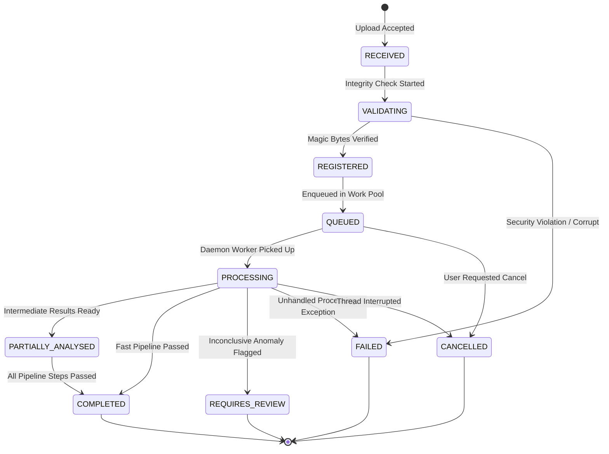

# TARKA REAL-TIME PROCESSING & ORCHESTRATION ARCHITECTURE
## 10-State Deterministic FSM, Durable Task Persistence & Server-Sent Events

**Standard Reference:** TARKA-ORCH-v1.0  
**Authority:** SentinelX Engineering Constitution & Wave 6 Reliability Guidelines  

---

## 1. System Objective
Forensic evidence processing involves computationally heavy tasks (Error Level Analysis, high-resolution edge convolutions, OCR field understanding, graph projections, and multi-hypothesis reasoning). The `ForensicJobOrchestrator` provides deterministic, asynchronous job scheduling with real-time UI feedback, durable crash recovery, and thread cancellation.

---

## 2. 10-State Deterministic FSM



### State Semantics:
1. `RECEIVED`: File bitstream received at API endpoint; assigned UUID job ID.
2. `VALIDATING`: Pre-admit security validation running (magic bytes, AV signatures, archive traversal).
3. `REGISTERED`: Admitted into CAS storage; SHA-256 custody record generated.
4. `QUEUED`: Placed in the processing queue awaiting available thread worker.
5. `PROCESSING`: Forensic worker thread active (running TRACE and AEGIS engines).
6. `PARTIALLY_ANALYSED`: Intermediate findings available (e.g. OCR finished while ELA continues).
7. `COMPLETED`: All analytical pipelines finished; findings stored in case record.
8. `REQUIRES_REVIEW`: Elevated anomaly detected requiring human examiner confirmation.
9. `CANCELLED`: Aborted by authorized investigator; resources reclaimed.
10. `FAILED`: Pipeline halted due to unexpected error or data corruption.

---

## 3. Durable Disk Persistence
To survive server crashes or restarts, all job states are saved to durable disk storage:
- **Location:** `data/jobs/{case_id}/{job_id}.json`
- **Atomic Writes:** State is written to a temporary file (`.tmp`) and atomically renamed to prevent partial writes.
- **Payload Schema:**
  ```json
  {
    "job_id": "job-f8a19b2c",
    "case_id": "case-phase10-001",
    "state": "COMPLETED",
    "progress_percent": 100,
    "current_stage": "ANALYSIS_COMPLETE",
    "created_at_iso": "2026-11-23T05:40:00Z",
    "updated_at_iso": "2026-11-23T05:40:02Z",
    "artifact_ids": ["ART-001", "ART-002"],
    "cancel_requested": false,
    "error_message": null,
    "metadata": { "findings_summary": "Processed 2 artifacts" }
  }
  ```

---

## 4. Real-Time Streaming (Server-Sent Events)
Instead of inefficient client polling loops, the frontend connects to a real-time event stream:
- **Endpoint:** `GET /api/v1/forensics/cases/{case_id}/events/stream`
- **Protocol:** Server-Sent Events (`text/event-stream`)
- **Event Types:**
  - `job_progress`: Progress updates (`progress_percent`, `current_stage`).
  - `job_completed`: Pipeline completion notification with final results.
  - `job_failed`: Failure notification with sanitized error messages.
  - `keep_alive`: Periodic ping to maintain HTTP connection across proxies.
