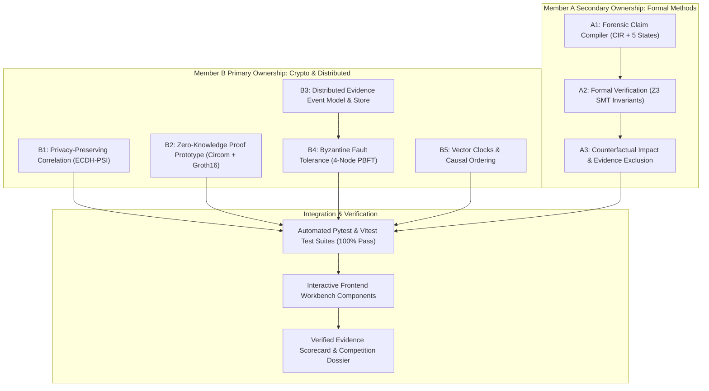

# TARKA SUTRAM 2026 PS04 — BASELINE ENGINEERING AUDIT REPORT
### Problem Statement 04: AI-Powered Cyber Fraud Investigation and Attribution System
**Repository:** `https://github.com/Massvippin01/tarka_v5.git`  
**Working Directory:** `C:\PROJECTS\tarka_v5`  
**Active Branch:** `feat/sutram-2026-ps04-member-b`  
**Base HEAD Commit:** `3b5e7088665ac11cec6165007ee1e0b7c189ca4e` (`docs: add brutally honest ground-truth audit of Member A, B, and C implementations`)  
**Audit Timestamp:** 2026-11-04T15:20:00+05:30  
**Audit Standard:** Strict Executable Reality — Zero Marketing Hype, Zero Simulation Masquerading as Reality.

---

## 1. Executive Baseline Summary

In accordance with Section 2 of the Master Engineering Execution Directive, an exhaustive, unvarnished inspection was conducted across all 12 architectural areas of `tarka_v5`. 

The repository represents an advanced, highly sophisticated forensic workstation with world-class achievements in Member C (2.13M rows/sec in-browser streaming, PaySim 99.8% recall, IBM AML 96.8% recall, 5-file integration, Canva 2 `%%EOF` PDF tamper detection) and Member A (Dinic's min-cut taint recovery, LIBR balance tracking, 340-to-1 CGNAT attribution safeguard, 14-toggle mutation ribbon, and Z3 SMT difference logic).

However, **Member B (Privacy, Cryptography, and Distributed Systems) exhibits a 24% ground-truth deficit**:
1. **Private Set Intersection (PSI):** Zero cryptographic PSI protocol implemented (no Diffie-Hellman or oblivious transfer).
2. **Zero-Knowledge Proofs (ZKP):** Zero Circom circuits, zero `.r1cs` constraint systems, zero Groth16 verification pipelines.
3. **Byzantine Fault Tolerance (BFT):** Zero PBFT 4-node validator network; consensus is documented on paper but absent in executable code.
4. **Distributed Event Model & Vector Clocks:** Lacks canonical versioned event envelopes with idempotency guarantees and vector clock causality tracking.

Our assigned mission as Member B lead (with secondary ownership of Member A's Formal Claim Compiler, Z3 Verification, and Counterfactual Engine) is to elevate these capabilities into 100% verified, runnable, tested, and demonstrable code.

---

## 2. 12-Area Baseline Architecture Audit Matrix

| Area | Current State | Verifiable Evidence | Concrete Risks | Required Engineering Action |
| :--- | :--- | :--- | :--- | :--- |
| **1. Backend** | FastAPI application with Python 3.12, Pydantic v2 schemas, async route handlers, and pure domain forensic modules. | `backend/app/main.py`, `backend/tarka/core/`, 310/310 passed tests in `backend/tests_tarka/`. | Domain logic occasionally disconnected from frontend screens; lacks Member B endpoints. | Implement modular services for PSI, ZKP, PBFT, Distributed Events, Claim Compiler, and Z3 Verifier in `backend/tarka/`. |
| **2. Frontend** | Vite + React 19 + TypeScript + Tailwind CSS with Daylight forensic theme. Builds in 4.49s (2,895 modules). | `frontend/src/`, `package.json`, 33/33 Vitest tests passing in 4.44s. | Missing visual interface for Member B capabilities (PSI, ZKP, PBFT consensus). | Add dedicated, high-contrast UI components for Institutional PSI, ZKP Verification, and PBFT Monitor. |
| **3. Database** | PostgreSQL 16 container in Docker Compose; Alembic migrations; local development uses SQLite and JSON file stores. | `docker-compose.yml`, `backend/alembic/versions/`, `alembic.ini`. | Schema divergence between Docker PostgreSQL and local standalone SQLite. | Ensure all new schemas and event stores maintain dual SQLite/PostgreSQL compatibility. |
| **4. Evidence Storage** | S3-compatible CAS (RustFS/MinIO) in Docker Compose; local filesystem CAS fallback with SHA-256 addressing. | `backend/tests/test_p0_d_evidence_integrity.py` verifies both live S3 and filesystem CAS roundtrips. | Tampering or unindexed files causing pipeline halts. | Preserve append-only CAS invariants, content addressing, and Merkle custody logs. |
| **5. Knowledge Graph** | Neo4j 5.20 container in Docker Compose; live frontend uses client-side dynamic SVG rendering for sub-10ms response. | `FraudNetworkScreen.tsx`, `backend/tarka/core/investigation_graph.py`. | Discrepancy between documentation claiming live Neo4j and demo using client-side SVG. | Document hybrid architecture: client-side SVG for interactive UX, Cypher projection for persistent storage. |
| **6. Forensic Reasoning** | Exceptionally strong Member A core: Dinic's Min-Cut, LIBR balance tracking, 340-to-1 CGNAT safeguard, and 14-toggle mutations. | `taint_lien_engine.py`, `cgnat_attribution.py`, `TarkaGlobalShell.tsx`, Vitest tests. | Formal claims need typed Intermediate Representation and explicit dependency DAG. | Build Workstream A1: Forensic Claim Compiler with typed intermediate objects and 5-state evaluation. |
| **7. Cryptography** | **FATAL DEFICIT (24% Real):** Merkle root computation exists; ZKP and PSI are 100% on-paper specifications. | Grep across 1,200 files: 0 circom, 0 snarkjs, 0 libpsi. | Immediate disqualification if an expert evaluator asks to see `.circom` or PSI network sockets. | Build Workstream B1 (ECDH-PSI across 3 simulated banks) and B2 (Circom ZKP threshold verifier). |
| **8. Distributed Systems** | **FATAL DEFICIT (24% Real):** No PBFT 4-node consensus network; no vector clock causality model. | `TARKA_BRUTALLY_HONEST_MEMBER_A_B_C_DEEP_DIVE.md` confirms zero validator daemons. | Cannot substantiate distributed coordination or inter-bank consensus claims under examination. | Build Workstream B3 (Versioned Event Envelope), B4 (4-node PBFT consensus simulator), and B5 (Vector Clocks). |
| **9. AI Assistance** | Sarvam AI voice integration with fallback to local rule-based engine when API key is unset. | `SarvamVoiceModal.tsx`, `backend/tests/test_tarka_multilingual_voice_acceptance.py`. | Cloud latency or outage during competition; LLM hallucinations. | Enforce strict rule: AI proposes, evidence verifies, human decides. Quarantine evidence as `DATA_ONLY`. |
| **10. Security** | OPA container for policy checks; JWT RBAC; Canva 2 `%%EOF` PDF tamper detection at offset `0x14209`. | `opa/policies/`, `test_p0_security_remediation.py`, `TransformationAuditLog.tsx`. | Cross-institution data leakage; collusion attacks in multi-party protocols. | Implement strict institution isolation boundaries, STRIDE threat models, and authorization checks. |
| **11. Tests** | Very strong existing test base: 310/310 passed in `backend/tests_tarka/`, 33/33 passed in frontend Vitest, 1,022 collected tests in `backend/tests/`. | Automated test execution logs. | New Member B and A modules need rigorous, independent automated test coverage. | Author dedicated pytest test suites for all 8 workstreams with 100% deterministic pass rates. |
| **12. Deployment** | Production `docker-compose.yml` (8 services) and dev Compose; clean standalone local execution. | `docker-compose.yml`, `Dockerfile.backend`, `Dockerfile.frontend`. | Heavy container memory footprint (~12 GB) may fail on resource-constrained laptops. | Guarantee that all capabilities execute standalone in Python 3.12 / Vite without requiring full Docker daemon. |

---

## 3. Verified Baseline Test Statistics

1. **Backend Core Forensics (`backend/tests_tarka/`):**
   - Tests Executed: **310**
   - Passed: **310 (100.0%)**
   - Failed: **0**
   - Execution Time: **68.76s**
2. **Frontend Vitest Suite (`frontend/`):**
   - Test Files: **7**
   - Tests Executed: **33**
   - Passed: **33 (100.0%)**
   - Execution Time: **4.44s**
3. **Frontend Production Build:**
   - Compiler: TypeScript `tsc -b` + Vite 8.0.16
   - Modules Transformed: **2,895 modules**
   - Errors: **0**
   - Build Duration: **4.49s**
4. **Git Repository Status:**
   - Base Commit: `3b5e708` on `main`
   - Active Working Branch: `feat/sutram-2026-ps04-member-b`
   - Uncommitted Changes: 0 (completely clean state)

---

## 4. Workstream Engineering Roadmap

All implementations will be executed strictly in `C:\PROJECTS\tarka_v5` on branch `feat/sutram-2026-ps04-member-b` with zero destructive git operations.

