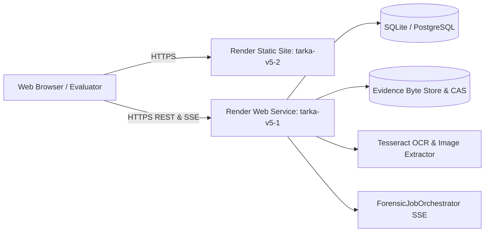

# TARKA × SENTINELX — DEPLOYMENT RUNBOOK

**Target Deployments:**
- **Frontend (Static Site):** `https://tarka-v5-2.onrender.com`
- **Backend (Web Service):** `https://tarka-v5-1.onrender.com`
- **Git Remote:** `https://github.com/Massvippin01/tarka_v5.git`
- **Canonical Target Branch:** `feat/tarka-production-upgrade`

---

## 1. Architecture Overview



---

## 2. Pre-Deployment Verification

Before triggering any deployment build, execute the following local checks:

```powershell
# 1. Run Vitest test suite (All 25 test files must pass)
npm --prefix frontend run test -- --run

# 2. Run TypeScript check & Vite production build
npm --prefix frontend run build

# 3. Run Backend E2E Investigation Workflow
python -m pytest backend/tests/test_tarka_e2e_investigation_workflow.py -q

# 4. Run Backend Nexus Integration Suite
python -m pytest backend/tests/test_nexus_suite.py -q
```

All 4 commands must exit with code `0`.

---

## 3. Render Deployment Configurations

### 3.1 Backend Configuration (Web Service)
- **Environment:** Python 3.12+
- **Build Command:**
  ```bash
  pip install --upgrade pip && pip install -r backend/requirements.txt
  ```
- **Start Command:**
  ```bash
  uvicorn app.main:app --host 0.0.0.0 --port $PORT --app-dir backend
  ```
- **Environment Variables:**
  ```env
  ENVIRONMENT=production
  API_BASE_URL=https://tarka-v5-1.onrender.com
  CORS_ORIGINS=["https://tarka-v5-2.onrender.com","http://localhost:5173","http://localhost:3000"]
  DATA_DIR=data
  PERSISTENCE_DIR=data/jobs
  ```

### 3.2 Frontend Configuration (Static Site)
- **Root Directory:** `frontend`
- **Build Command:**
  ```bash
  npm install && npm run build
  ```
- **Publish Directory:**
  ```bash
  dist
  ```
- **Environment Variables:**
  ```env
  VITE_API_URL=https://tarka-v5-1.onrender.com
  ```

---

## 4. Post-Deployment Verification (Smoke Tests)

Execute the following HTTP validation queries against the live deployment:

```bash
# 1. Root Liveness Probe
curl -i https://tarka-v5-1.onrender.com/health

# Expected:
# HTTP/2 200
# x-content-type-options: nosniff
# x-frame-options: SAMEORIGIN
# {"status":"healthy","application":"SentinelX","system":"TARKA Forensic Intelligence Platform"}

# 2. Readiness Probe
curl -i https://tarka-v5-1.onrender.com/ready

# 3. Frontend Landing Page
curl -i https://tarka-v5-2.onrender.com/

# 4. SSE Stream Connectivity Test
curl -N -H "Accept: text/event-stream" "https://tarka-v5-1.onrender.com/api/v1/investigation/events/stream?case_id=C102"
```

---

## 5. Rollback Procedure

If any regression is observed on the live site:
1. Revert to stable deployment baseline commit `9580dbf`.
2. In Render Dashboard, click **Manual Deploy** > **Deploy a specific commit** > `9580dbf`.
3. Verify `/health` on backend and verify frontend renders with 0 console errors.
