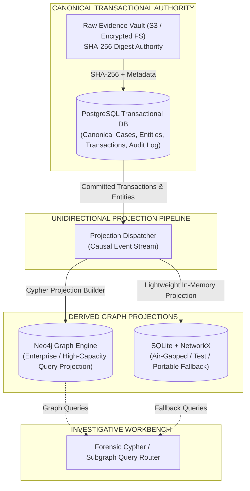

# ARCHITECTURAL DECISION RECORD: ADR-002
## Graph Persistence, Projection, and Offline Storage Architecture

**Status:** APPROVED & RATIFIED  
**Date:** November 5, 2026  
**Deciders:** Principal Architect, Distributed Systems Lead (Member B), Forensic Intelligence Lead (Member A), Platform Lead (Member C)  
**Governing Doctrine:** SentinelX Wave 6 Engineering Constitution & SUTRAM 2026 PS04 Master Directive  

---

# 1. CONTEXT & PROBLEM STATEMENT

TARKA requires high-performance multi-hop graph traversal to detect circular fund dissipation, mule syndicates, and layered cyber-fraud rings across thousands of banking transactions and telecom interactions. At the same time, criminal prosecution under Bharatiya Sakshya Adhiniyam, 2023 (BSA §63) demands strictly immutable transactional authority, point-in-time chain of custody, and auditable evidence provenance.

Furthermore, field deployment requirements span two radically different runtime environments:
1. **Centralized Production / High-Performance Cluster:** Running with distributed databases, enterprise security, and dedicated graph engines.
2. **Field / Air-Gapped / Evaluation Environment:** Running in isolated courtrooms, rural cyber-crime police stations, or competition demonstration laptops without requiring multi-gigabyte background server clusters.

We must define the system of record, the role of graph projection engines, offline fallback guarantees, and the synchronization model without violating canonical data authority.

---

# 2. CORE ARCHITECTURAL INVARIANTS

Under Section 3 (*Canonical Data Authority*) and Section 4 (*Evidence Integrity*) of the Engineering Constitution:
1. **PostgreSQL is the Transactional Authority:** All cases, evidence metadata, canonical transactions, entity registries, investigator review decisions, and audit ledgers must reside in PostgreSQL.
2. **Projections are Strictly Derived and Rebuildable:** Neo4j is a query projection, NOT the system of record. Every node, edge, and property in Neo4j must be 100% rebuildable from canonical PostgreSQL events.
3. **Ban Bidirectional Synchronization:** Mutations NEVER originate in the graph projection. Writes flow exclusively:  
   `Investigative Action / Ingestion → PostgreSQL (Write Ahead Log / Transaction) → Projection Pipeline → Neo4j / In-Memory Graph`.
4. **Offline and Air-Gapped Portability:** The system must provide a seamless SQLite and in-memory NetworkX/Rust fallback projection so that all forensic evaluations and demonstrations can execute deterministically without external daemon dependencies.
5. **No Independent Truth:** No graph metric (betweenness centrality, PageRank, community cluster) can ever supersede or contradict primary evidence exhibits.

---

# 3. CONSIDERED ALTERNATIVES

### Alternative 1: Pure Neo4j as Primary Database
- **Concept:** Store cases, raw evidence records, transactions, and audit trails directly as Neo4j nodes and relationships.
- **Evaluation:** *REJECTED.*
  - Lacks standardized relational financial ledger guarantees (ACID constraints across multi-table audits).
  - Forensic point-in-time state recovery and cryptographic hash chains are difficult to guarantee under native graph storage.
  - Massive operational overhead for standalone field laptops and automated CI/CD test runners.

### Alternative 2: Pure PostgreSQL Relational Storage (with Recursive CTEs)
- **Concept:** Store everything in standard SQL tables and query graph relationships using SQL:1999 recursive Common Table Expressions or graph extensions (e.g. Apache AGE).
- **Evaluation:** *REJECTED.*
  - Multi-hop path tracing ($>5$ hops) across cycles (mule loops) produces exponential query planning complexity and performance degradation.
  - Lacks native Cypher query compatibility required for visual investigative workbenches and standard intelligence graph tooling.

### Alternative 3: Polyglot Persistence with Unidirectional Event-Driven Graph Projection (Chosen)
- **Concept:** PostgreSQL as transactional authority + Neo4j as derived Cypher graph projection + SQLite / NetworkX embedded fallback for air-gapped and CI test execution.
- **Evaluation:** *ACCEPTED.*
  - Perfect separation of concerns: relational transactional safety for legal evidence custody; dedicated graph indices for topological pattern matching.
  - Zero loss of data if Neo4j is wiped or corrupted: graph state can be fully replayed from canonical events.

---

# 4. DECISION OUTCOME & SPECIFICATION

**We adopt Alternative 3: Polyglot Persistence with Unidirectional Event-Driven Graph Projection.**

### 1. Data Ownership Boundaries:
- `cases`, `evidence_register`, `canonical_transactions`, `canonical_entities`, `claims`, `audit_ledger`: **PostgreSQL**.
- `EntityNode`, `TransactionEdge`, `DeviceLinkEdge`, `MuleLoop`: **Neo4j** (rebuilt on demand).
- `offline_case_store.db`: **SQLite** (contains exact SQLite schema mirrors of canonical models for zero-dependency execution).

### 2. Projection Consistency Model:
- Writes to PostgreSQL commit synchronously with an incrementing `sequence_number` and Lamport timestamp.
- The projection worker consumes committed events and applies Cypher `MERGE` mutations idempotently.
- If Neo4j falls behind or disconnects, the projection worker records a lag metric; once reconnected, it replays from `last_projected_sequence_number`.
- A CLI management tool `python -m tarka.cli.rebuild_projections --case-id <ID>` truncates graph projections and rebuilds them completely from PostgreSQL records.

### 3. Offline Mode Auto-Detection:
- When `NEO4J_URI` is unset, unreachable, or in test environments (`TARKA_OFFLINE_MODE=1`), the graph router automatically routes traversal queries through the embedded in-memory topological engine (`InMemoryGraphService`), ensuring 100% of forensic graph algorithms (mule chain detection, cut vertex analysis, temporal tracing) function flawlessly without external services.

---

# 5. CONSEQUENCES & TRADE-OFFS

- **Positive:**
  - **Forensic Defensibility:** Primary evidence and audit logs are isolated from graph query caching and indexing.
  - **Disaster Recovery:** Complete loss of Neo4j volume causes zero permanent data loss.
  - **Testability:** All 400+ unit and integration tests run self-contained in seconds without requiring Dockerized Neo4j containers.
  - **Speed:** Cypher index tuning can be optimized purely for query throughput without worrying about relational write locks.
- **Negative:**
  - Eventual consistency delay (typically $<50\text{ ms}$) between transaction insertion and graph edge availability.
  - Requires maintaining projection mapping logic between relational schemas and Cypher graph models.

---

# 6. VERIFICATION REQUIREMENTS

1. Projection rebuild test: Ingest canonical transactions, wipe graph projection, execute rebuild, assert graph node/edge count equals canonical transaction/entity count.
2. Invariant verification: Verify that no mutation API endpoint writes directly to Neo4j without first acquiring a PostgreSQL transactional commit.
3. Offline fallback test: Disable Neo4j connection, execute mule chain detection, verify algorithm returns identical results using the embedded graph service.

