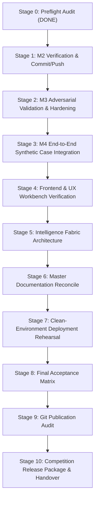

# SUTRAM 2026 PS04: FINAL EXECUTION PREFLIGHT AUDIT
## Repository State, Working-Tree Discovery, Environment Baseline, and Master Execution Order

**Repository:** `C:\PROJECTS\tarka_v5`  
**Track:** SUTRAM 2026 — Problem Statement PS04 (*AI-Powered Cyber Fraud Investigation and Attribution System*)  
**Active Branch:** `feat/sutram-2026-ps04-member-b`  
**Reported Baseline HEAD:** `976a6e4571daefbe2acd7bf76c68cba5b01ab470`  
**Date of Audit:** November 5, 2026  
**Governing Doctrine:** AI Proposes. Evidence Verifies. Human Decides.  
**Execution Authority:** Master Completion Directive (Authorized to execute M2 closeout, M3 adversarial validation, M4 end-to-end integration, and publication)

---

# 1. REPOSITORY AND ENVIRONMENT DISCOVERY

### 1.1 Git Repository Verification
- **Filesystem Root:** `C:/PROJECTS/tarka_v5`
- **Active Git Branch:** `feat/sutram-2026-ps04-member-b`
- **Current HEAD Commit:** `976a6e4571daefbe2acd7bf76c68cba5b01ab470` (`feat(ps04-member-b): complete implementation and verification of B1-B5 and A1-A3 workstreams`)
- **Remote URL:** `https://github.com/Massvippin01/tarka_v5.git` (fetch and push)
- **Tracking Ref:** Configured to push to `origin/feat/sutram-2026-ps04-member-b`.

### 1.2 Working-Tree Inventory
The working tree contains carefully segregated changes:
1. **Phase 3 UI Improvements:**
   - Design System kit in `frontend/src/components/tarka/kit/` (`ContradictionIndicator.tsx`, `EvidenceProvenancePill.tsx`, `FinancialAmountDisplay.tsx`, `ForensicStateNotice.tsx`, `TimestampDisplay.tsx`)
   - Bento executive styles and tokens (`frontend/src/styles/bento-executive.css`, `tokens.css`)
   - Remediated `/api` proxy routing in `frontend/vite.config.ts` and 17 component files
2. **Milestone M0 (Canonical Contracts):**
   - Backend contracts in `backend/tarka/contracts/`
   - Frontend TypeScript mirrors in `frontend/src/types/contracts/`
   - Example payload vault in `contracts/canonical_v1/examples/`
   - Test suite: `backend/tests/test_canonical_contracts_v1.py` (15/15 passed)
3. **Milestone M1 (TAIE Integration Foundation):**
   - Modular adapter framework in `backend/tarka/taie/`
   - 3 high-fidelity mock banking adapters (HDFC, ICICI, SBI)
   - Test suite: `backend/tests/test_taie_integration_foundation.py` (12/12 passed)
4. **Milestone M2 (Distributed Event Fabric & PBFT):**
   - Core distributed engine in `backend/tarka/distributed/` (`event_envelope.py`, `vector_clock.py`, `event_store.py`, `pbft_consensus.py`, `claim_bridge.py`)
   - Test suite: `backend/tests/test_m2_distributed_event_fabric.py` (18/18 passed)
   - 11 architectural specifications in `docs/SUTRAM_PS04_DOCUMENTATION/09_DISTRIBUTED_EVENT_FABRIC/`

### 1.3 Infrastructure and Process Status
- **Docker Engine:** Docker daemon is not active on this host; native runtime is utilized (Python 3.12.1 + Node.js 22.12.0 / Vite 8.0.16).
- **Active Daemons:**
  - Backend FastAPI server active on `http://127.0.0.1:8080` (Task 2826)
  - Frontend Vite dev server active on `http://127.0.0.1:5173` (Task 2800)
- **Environment Files:** Only `.env.example`, `.env.development.example`, `.env.staging.example`, and `.env.production.example` are present. No production secrets or personal credentials exist in the working directory.

---

# 2. CONSTITUTIONAL INVARIANTS & GIT SAFETY RULES

In accordance with Section 13 and Section 15 of the SentinelX Engineering Constitution:
1. **Zero Destructive Git Commands:** No `git reset --hard`, `git clean -fd`, `git checkout -- .`, or `git stash` operations.
2. **Preserve User Modifications:** All existing Phase 3, M0, M1, and M2 work is strictly preserved.
3. **Milestone-Specific Publication:** Commits will be segregated cleanly by milestone.
4. **No Force-Pushes:** Only clean fast-forward push operations to `feat/sutram-2026-ps04-member-b`.

---

# 3. MASTER EXECUTION PLAN

