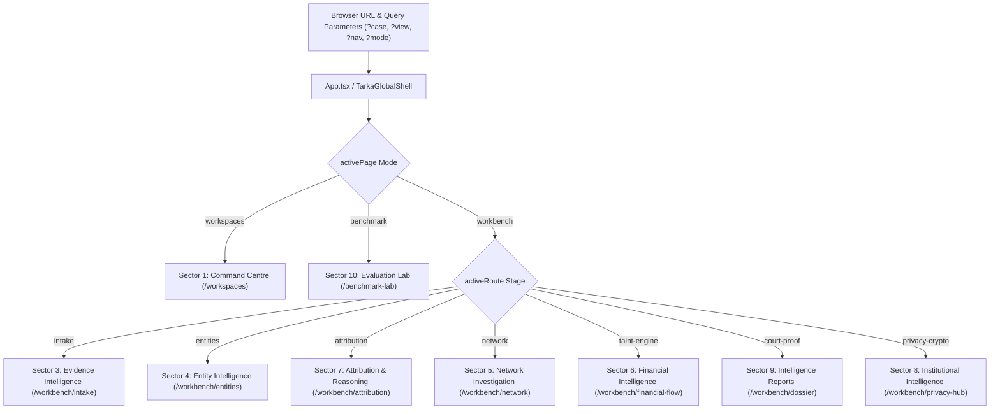

# TARKA SUTRAM 2026 PS04: ROUTE MIGRATION & NAVIGATION ARCHITECTURE MAP
## Phase 3 Route Preservation & Information Architecture Mapping

**Document Version:** 1.0.0-PS04-ROUTE-MAP  
**Date:** November 4, 2026  
**Status:** IMPLEMENTED & AUDITED  
**Author:** Staff UI/UX & Forensic Systems Architect (Member B Workstream)  
**Target Competition:** SUTRAM 2026 — Problem Statement PS04 (*AI-Powered Cyber Fraud Investigation & Attribution System*)  
**Repository Branch:** `feat/sutram-2026-ps04-member-b`  
**Core Architectural Rule:** **Never break bookmarked investigation URLs or active court session states.**

---

# 1. NAVIGATION ROUTING ARCHITECTURE

TARKA implements a dual-layer routing architecture:
1. **Top-Level Page Mode Router (`activePage` in `useTarkaUiStore`):**
   - Mode `workspaces`: Command Centre & Multi-Case Bento Workspace (`CaseWorkspaceScreen.tsx`).
   - Mode `workbench`: 6-Stage + Cryptography Investigation Pipeline (`TarkaGlobalShell.tsx`).
   - Mode `benchmark`: High-Throughput Diagnostics Lab & Ground-Truth Streamer (`BenchmarkLabScreen.tsx`).
2. **Investigation Pipeline Sub-Router (`activeRoute` in `TarkaGlobalContext`):**
   - Governs the sequential evidentiary stages of an active criminal investigation (`CASE-2026-001`).

---

# 2. DEFINITIVE ROUTE PRESERVATION & MIGRATION MATRIX

All legacy URLs and query parameters are 100% backward-compatible. Any direct link or bookmarked URL resolves immediately to the exact forensic state without data loss.

| IA Sector ID | Target Information Architecture Sector | Canonical Internal Route | Legacy Query Parameter URL | Keyboard Shortcut | Active Screen Component | Preserved Capabilities |
|:---|:---|:---|:---|:---|:---|:---|
| **IA-01** | **Command Centre** | `/workspaces` | `/?nav=investigations` or `/?view=workspace` | `Alt+0` / `Alt+W` | [`CaseWorkspaceScreen.tsx`](file:///c:/PROJECTS/tarka_v5/frontend/src/pages/v5/CaseWorkspaceScreen.tsx) | Multi-case triage, Golden Hour 118m countdown, 5-file WebCrypto SHA-256 dropzone. |
| **IA-02** | **Case Context** | `/workbench/case-context` | `/?case=CASE-2026-001` | Global Shell | [`TarkaGlobalShell.tsx`](file:///c:/PROJECTS/tarka_v5/frontend/src/components/shell/TarkaGlobalShell.tsx) | FIR #149/2026 header, IO credentials, 56px/232px navigation rail, $T+0\text{m}$ to $T+48\text{h}$ clock caliper. |
| **IA-03** | **Evidence Intelligence** | `/workbench/intake` | `/?view=intake` | `Alt+1` | [`IntakeScreen.tsx`](file:///c:/PROJECTS/tarka_v5/frontend/src/pages/v5/IntakeScreen.tsx) | Double-entry balance invariant, 12-digit RRN Julian validator, PDF `%%EOF` Canva tamper scanner. |
| **IA-04** | **Entity Intelligence** | `/workbench/entities` | `/?view=entities` | `Alt+2` | [`EntityResolutionScreen.tsx`](file:///c:/PROJECTS/tarka_v5/frontend/src/pages/v5/EntityResolutionScreen.tsx) | Bipartite token mapping (24 tokens $\rightarrow$ 5 entities), Hard-Veto Guardrail (Apex Electronics). |
| **IA-05** | **Network Investigation** | `/workbench/network` | `/?view=network` | `Alt+4` | [`FraudNetworkScreen.tsx`](file:///c:/PROJECTS/tarka_v5/frontend/src/pages/v5/FraudNetworkScreen.tsx) | Dynamic SVG actor graph, Wi-Fi hotspot AP tethering ($TTL=63$), JA4 TLS client fingerprinting. |
| **IA-06** | **Financial Intelligence** | `/workbench/financial-flow` | `/?view=taint-engine` | `Alt+5` | [`TaintEngineScreen.tsx`](file:///c:/PROJECTS/tarka_v5/frontend/src/pages/v5/TaintEngineScreen.tsx) | D3-Sankey money trail, Dinic Min-Cut ($K=3$), LIBR vs FIFO merchant lien comparison. |
| **IA-07** | **Attribution & Reasoning** | `/workbench/attribution` | `/?view=attribution` | `Alt+3` | [`AttributionScreen.tsx`](file:///c:/PROJECTS/tarka_v5/frontend/src/pages/v5/AttributionScreen.tsx) | 340-to-1 CGNAT funnel ($P = 1.4 \times 10^{-7}$), dual-SIM TAC hardware twin, Z3 SMT clock proof caliper. |
| **IA-08** | **Institutional Intelligence**| `/workbench/privacy-hub` | `/?view=privacy-crypto` | `Alt+7` | [`PrivacyCryptoWorkbench.tsx`](file:///c:/PROJECTS/tarka_v5/frontend/src/components/tarka/privacy/PrivacyCryptoWorkbench.tsx) | Tripartite ECDH-PSI (SECP256k1), Groth16 / BN254 ZKP, 4-node PBFT consensus, Formal Claim DAG. |
| **IA-09** | **Intelligence Reports** | `/workbench/dossier` | `/?view=court-proof` | `Alt+6` | [`CourtProofScreen.tsx`](file:///c:/PROJECTS/tarka_v5/frontend/src/pages/v5/CourtProofScreen.tsx) | BSA Section 63(4) Part A & B certificates, Leave-One-Out adversarial stress tester, BIP-39 paper seal. |
| **IA-10** | **Evaluation Laboratory** | `/benchmark-lab` | `/?mode=benchmark` | `Alt+B` / `Alt+D` | [`BenchmarkLabScreen.tsx`](file:///c:/PROJECTS/tarka_v5/frontend/src/pages/v5/BenchmarkLabScreen.tsx) | $356\text{k rows/s}$ streaming streamer, constant $38.2\text{ MB}$ heap memory curve, 27-check matrix. |

---

# 3. GLOBAL KEYBOARD NAVIGATION MATRIX

For rapid keyboard-only operation by cybercrime investigators, TARKA implements global event listener hotkeys registered in `TarkaGlobalShell.tsx`:

- **Mode Switching:**
  - `Alt + 0` or `Alt + W`: Jump to **Station Command & Workspaces Hub** (`activePage = "workspaces"`).
  - `Alt + 1`: Jump to **Stage 01: Evidence Intake & Falsification Gate**.
  - `Alt + 2`: Jump to **Stage 02: Entity Resolution & Hard-Veto Framework**.
  - `Alt + 3`: Jump to **Stage 03: CGNAT Attribution & SIM-Swap Engine**.
  - `Alt + 4`: Jump to **Stage 04: Fraud-Network & Actor Relationships**.
  - `Alt + 5`: Jump to **Stage 05: Transaction Flow & Mule Taint DAG**.
  - `Alt + 6`: Jump to **Stage 06: Actionable Intelligence & BSA §63(4) Dossier**.
  - `Alt + 7`: Jump to **Stage 07: Privacy, Cryptography & Formal Verification Hub**.
  - `Alt + B` or `Alt + D`: Jump to **Benchmark & Diagnostics Lab** (`activePage = "benchmark"`).
- **Workspace Navigation:**
  - `Ctrl + B` or `Cmd + B`: Toggle Navigation Rail between 56px collapsed and 232px expanded.
  - `F`: Toggle Fullscreen Presentation Mode (Hiding all chrome for court presentations).
  - `Cmd + K` or `Ctrl + K`: Open Tarka Global Forensic Command Palette (`cmdk`).
  - `/`: Focus search input in active table or ledger (Esc to clear).

---
*Authored: Staff UI/UX & Forensic Systems Architect (Member B Workstream)*  
*TARKA SUTRAM 2026 Engineering Workstream*

