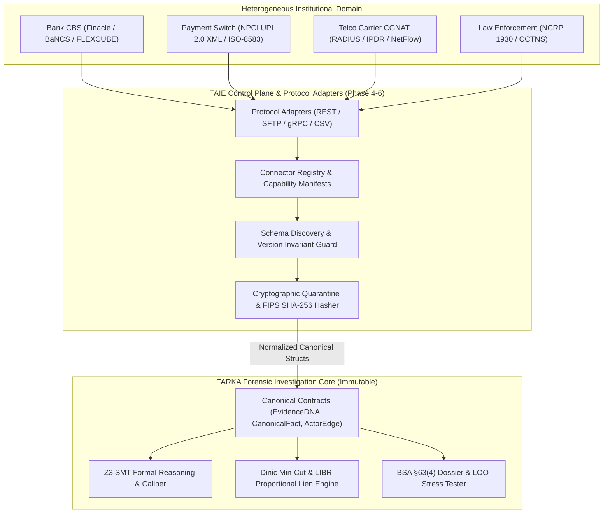

# TARKA SUTRAM 2026 PS04: TAIE ARCHITECTURAL DIRECTION
## Future-Proofing for the TARKA Adaptive Interoperability Engine (TAIE)

**Document Version:** 1.0.0-PS04-TAIE  
**Date:** November 4, 2026  
**Status:** ARCHITECTURAL SPECIFICATION & FORWARD ROADMAP (Phase 4–8 Planning Authority)  
**Author:** Staff Distributed Systems & Forensic Systems Architect (Member B Workstream)  
**Target Competition:** SUTRAM 2026 — Problem Statement PS04 (*AI-Powered Cyber Fraud Investigation & Attribution System*)  
**Repository Branch:** `feat/sutram-2026-ps04-member-b`  
**Working Directory:** `C:\PROJECTS\tarka_v5`  
**Core Architectural Rule:** **Keep integration health strictly distinct from evidence integrity.**

---

# 1. EXECUTIVE SUMMARY & SUBSYSTEM PURPOSE

Digital forensic investigations and cyber fraud attribution in India operate within an extraordinarily fragmented technological environment. A single cyber extortion case (such as a CBI / TRAI "Digital Arrest" scheme) requires synthesis across radically disparate technological stacks:
1. **Commercial Banking Core Systems:** Oracle FLEXCUBE, Infosys Finacle 10.x/11.x, and TCS BaNCS running proprietary double-entry SQL schemas with asynchronous batch commit logs.
2. **National Payment Switches:** NPCI Unified Payments Interface (UPI 2.0 / 3.0) XML gateway payloads, IMPS ISO-8583 message packets, and NACH clearing streams.
3. **Telecom Service Providers (TSPs):** Bharti Airtel, Reliance Jio, and Vodafone Idea Carrier-Grade NAT (CGNAT) RADIUS translation dumps, eNodeB / gNodeB cell sector CDRs, and IPDR logs.
4. **Law Enforcement Systems:** NCRP 1930 incident intake portals, State Police CCTNS Crime and Criminal Tracking Network & Systems, and judicial ICJS integration endpoints.
5. **Emerging Decentralized Layers:** Inter-bank Private Set Intersection (ECDH-PSI) protocols, Groth16 / Circom Zero-Knowledge proof verifiers, and Byzantine Fault Tolerant (PBFT) audit ledgers.

Historically, investigative systems either rely on brittle point-to-point scripts or force institutions into rigid, centralized database migrations that violate data sovereignty and DPDPA 2023 purpose limitations.

**TAIE (TARKA Adaptive Interoperability Engine)** is designed as an extensible, protocol-agnostic, and governed integration layer. Its mission is to enable TARKA to ingest, normalize, and cryptographically attest records from heterogeneous institutional infrastructure without altering TARKA's core forensic reasoning Caliper.

---

# 2. CORE ARCHITECTURAL BOUNDARIES & INVARIANTS



### The Seven TAIE Invariants

1. **Evidence Integrity vs. Integration Health Separation:** A network timeout, connector restart, or dropped TCP socket is an *Integration Health Event*. It must never invalidate or mutate an *Evidence Hash* or an existing *Chain-of-Custody Record*.
2. **Raw Bitstream Preservation:** Adapters parse, normalize, and extract structured fields, but the original source byte stream must be preserved bit-for-bit in immutable storage with an immediate client-side FIPS 180-4 SHA-256 cryptographic digest.
3. **Source Metadata vs. Canonical Record Distinction:** An extracted transaction amount or timestamp belongs to the `CanonicalFact` domain. The underlying parser name, version, schema hash, and ingestion protocol belong to the `EvidenceDNA` and `ConnectorManifest` provenance domains.
4. **No Autonomous Identity Merges:** TAIE may discover that two records share identical phone numbers or VPAs, but it may only propose candidate edges. The decision to merge personas remains an exclusive human investigator prerogative.
5. **Statutory Fail-Closed Behavior:** If a connector cannot establish cryptographic provenance, lawful acquisition authority under Section 94 BNSS, or RFC-3161 timestamp synchronization, the record is placed in **Cryptographic Quarantine** and excluded from automatic graph projections.
6. **Air-Gap Operational Mode:** TAIE must operate fully without outbound internet connectivity. Local file-based adapters, physical USB evidence dropzones, and air-gapped forensic images must share identical parsing pipelines as live streaming connectors.
7. **DPDPA Purpose Limitation & Privacy-Preserving Federation:** Inter-bank queries across institutional boundaries must default to Private Set Intersection (ECDH-PSI) or Zero-Knowledge Proofs (Groth16), preventing civilian financial records from being pooled into central databases.

---

# 3. TAIE SUBSYSTEM CAPABILITIES & COMPONENT TAXONOMY

### 3.1 Connector Registry & Capability Manifests
Every institutional adapter declares a formal JSON-LD capability manifest specifying:
- **Connector Identity:** Unique UUID, vendor namespace, semantic version, and release hash.
- **Protocol Bindings:** SFTP, REST/HTTPS, Apache Kafka, gRPC, or Static Forensic File.
- **Statutory Authority:** Supported Indian statutory warrants (e.g., Section 94 BNSS, DoT Clause 39.20, RBI Master Direction).
- **Supported Schemas:** Declared input MIME types, parsing schemas, and normalized canonical target mappings.
- **Verification Level:** Certified Air-Gap Valid, Simulated Demo, or Production Integration.

### 3.2 Protocol & Schema Adapters
- **Finacle / BaNCS Ledger Adapter:** Parses double-entry core banking transaction commit streams; validates balancing invariants ($Bal_k = Bal_{k-1} + Cr - Dr$); audits Julian date day counts in transaction reference numbers.
- **NPCI UPI 2.0 / 3.0 XML Adapter:** Extracts and validates XML stanzas containing `<Device>` mobile fingerprints, JA4 TLS hashes, PSP routing handles, and 12-digit RRN structures.
- **DoT Carrier CGNAT Adapter:** Parses large-scale RADIUS translation logs; normalizes ephemeral port ranges, public NAT IPv4 addresses, and cell tower sector IDs.
- **Forensic Binary / PDF Exhibit Adapter:** Inspects PDF incremental update trailers (`%%EOF`); detects Canva, Adobe Acrobat, and Ghostscript post-issuance doctoring.

### 3.3 Semantic Mapping & Transformation Engine
- Converts heterogeneous source fields into typed canonical forensic models:
  - `SourceRawText` $\rightarrow$ `NormalizedValue` (Separating verbatim source bits from parsed representations).
  - Explicit error handling for character encodings (ASCII, UTF-8, Latin-1, Windows-1252) preventing encoding injection.
  - Multi-timezone normalization: Records native source timezone, conversion rationale, and UTC epoch timestamps.

### 3.4 Cryptographic Quarantine & Ingestion Gate
- All incoming records pass through a pre-ingestion validation sieve.
- Records failing structural validation, exhibiting checksum corruption, or lacking verified acquisition warrants are routed to a persistent Quarantine Store.
- Quarantined records can be inspected in the UI without risking contagion into active prosecution dossiers.

---

# 4. CANONICAL CONTRACT SPECIFICATIONS (PREVIEW)

Below are the canonical TypeScript contracts that decouple the frontend workbench from underlying external data sources:

```typescript
/**
 * TAIE Canonical Evidence Exhibit Contract
 */
export interface CanonicalEvidenceExhibit {
  artifact_id: string;                      // Stable internal UUID (e.g. ART-001)
  original_filename: string;                // Verbatim source filename
  sha256_digest: string;                    // FIPS 180-4 64-char lowercase hex
  file_size_bytes: number;                  // Exact byte length
  mime_type: string;                        // Verified MIME type
  source_tier: "T1" | "T2" | "T3";          // Evidentiary hierarchy tier
  custody_chain_seq: number;                // Monotonic chain-of-custody sequence
  intake_timestamp_utc: string;             // ISO-8601 acquisition timestamp
  intake_officer_id: string;                // Identifier of seizing officer
  statutory_warrant_ref?: string;           // Section 94 BNSS / Section 106 warrant
  quarantine_status: "CLEAN" | "QUARANTINED" | "REJECTED";
  quarantine_reason?: string;
  source_connector_id: string;              // TAIE Connector UUID
  source_connector_version: string;         // Semantic version of parsing adapter
}

/**
 * TAIE Canonical Transaction Fact Contract
 */
export interface CanonicalTransactionFact {
  fact_id: string;                          // Global fact UUID
  source_artifact_id: string;               // Link to parent exhibit
  record_index: number;                     // 0-based row/packet index in source
  rrn: string;                              // 12-digit UPI / CBS reference
  remitter_account: string;                 // Source account / VPA
  beneficiary_account: string;              // Destination account / VPA
  amount_inr: number;                       // Authoritative transaction value
  transaction_timestamp_utc: string;        // UTC normalized timestamp
  transaction_timestamp_ist: string;        // IST local timestamp (UTC+05:30)
  clock_domain: string;                     // NTP clock domain (e.g., clk_sbi_finacle)
  clock_drift_seconds: number;              // Quantified drift relative to Stratum-1
  source_provenance_ref: string;            // Exact line, offset, or XML stanza xpath
  review_status: "UNREVIEWED" | "VERIFIED" | "DISPUTED";
  reviewed_by?: string;
}
```

---

# 5. PHASE 3 IMPLEMENTATION GUARDRAILS

To prevent architectural debt during the current Phase 3 UI engineering sprint, all frontend code must adhere to the following constraints:
1. **No Fictitious External Integrations:** The UI must never display simulated partner connections (e.g., "Connected to Live HDFC Core Banking API") as live production services. Synthetic demonstration data must be prominently tagged.
2. **Typed Service Layer Boundaries:** UI components must consume data exclusively through typed store and context interfaces (`TarkaGlobalContext`, `useTarkaUiStore`, `forensicsApi.ts`), never through direct ad-hoc network fetches.
3. **Extensible Institution Context:** The global shell and navigation headers must model institutional identity (`agency`, `police_station`, `bank_node`) as extensible state variables.
4. **Deferred Component Scope:** A dedicated "Institutional Integration Management" configuration screen is formally deferred to **Phase 5 (TAIE Core & Initial Connectors)**. Phase 3 focuses strictly on the 8 prioritized investigative screens.

---

# 6. FORWARD IMPLEMENTATION PHASING (PHASES 4–8)

| Phase Identifier | Target Subsystem | Core Technical Objectives |
|:---|:---|:---|
| **Phase 4** | Integration Contracts & TAIE Spec | Canonical contract schemas, threat models, connector SDK interface, transformation provenance format. |
| **Phase 5** | TAIE Core & Initial Adapters | Ingestion engine runtime, REST and file adapters, Finacle/BaNCS CSV parser, Quarantine ledger. |
| **Phase 6** | Advanced Institutional Adaptability | SOAP/SFTP adapters, streaming IPDR netflow ingestion, offline synchronization, schema drift impact caliper. |
| **Phase 7** | Privacy-Preserving Federation | Multi-Party ECDH-PSI, Groth16 ZKP regulatory verifier, 4-node PBFT inter-bank replication, formal SMT claim compiler. |
| **Phase 8** | Production Hardening & Deployment | MeghRaj / NIC cloud deployment profiles, State Data Centre runbooks, zero-trust air-gap containers, CFSL acceptance testing. |

---
*Authored: Staff Distributed Systems & Forensic Systems Architect (Member B Workstream)*  
*TARKA SUTRAM 2026 Engineering Workstream*

