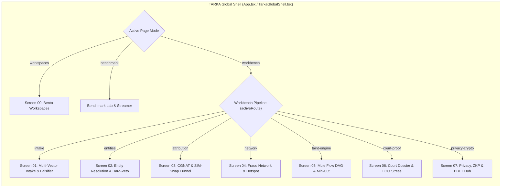
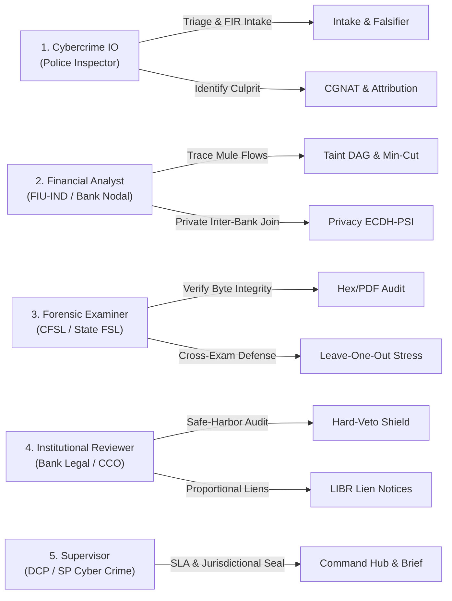
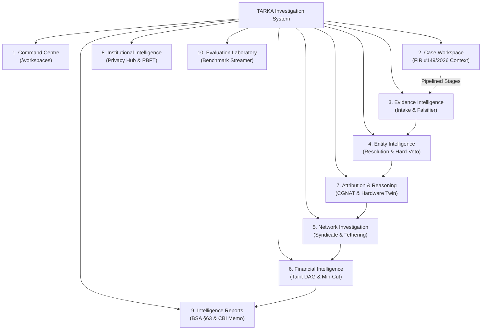
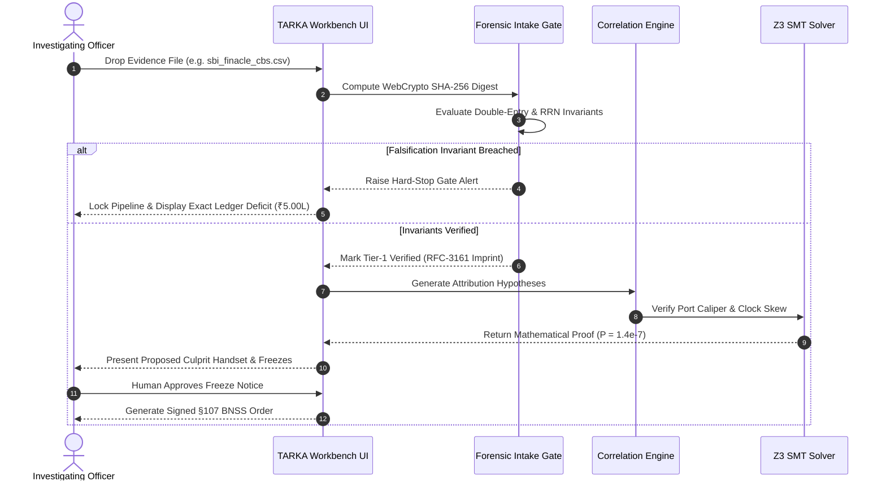
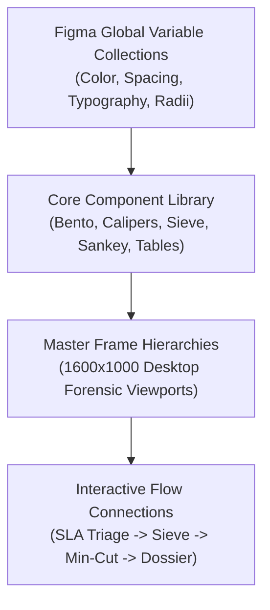

# TARKA | SUTRAM 2026 PS04: MASTER UI/UX DISCOVERY, PRODUCT EXPERIENCE AUDIT & DESIGN SPECIFICATION
## Phase 2: Evidence-Centred Cyber Fraud Investigation Workbench

**Document Version:** 2.0.0-PS04-PHASE2  
**Date:** November 4, 2026  
**Status:** COMPLETED & AUDITED (Ready for Principal Human Review)  
**Author:** Staff UI/UX & Forensic Systems Architect (Member B Workstream)  
**Target Competition:** SUTRAM 2026 — Problem Statement PS04 (*AI-Powered Cyber Fraud Investigation & Attribution System*)  
**Repository Branch:** `feat/sutram-2026-ps04-member-b`  
**Working Directory:** `C:\PROJECTS\tarka_v5`  
**Verified Git Commit:** `976a6e4` (Automated Test Baseline: 391/391 Tests Passing)  
**Operating Principle:** **AI PROPOSES. EVIDENCE VERIFIES. HUMAN DECIDES.**

---

> [!IMPORTANT]
> **PHASE 2 SCOPE BOUNDARY NOTICE**  
> In strict accordance with the Master Engineering Directive, this document represents the **exclusive and exhaustive output of Phase 2**. No frontend application code has been altered, no backend endpoints have been modified, and no operational pages have been replaced with non-functional mockups. All visual evidence referenced herein was captured directly from the live, running Vite production preview server (`http://127.0.0.1:4173/`) at commit `976a6e4` across a standardized $1600 \times 1000$ desktop forensic viewport.

---

# SECTION 1: EXECUTIVE SUMMARY & PHASE 2 CHARTER

### 1.1 The Investigation Paradigm Shift
Financial cyber fraud in India—epitomized by complex multi-state syndicates executing "Digital Arrest" extortions, FedEx/customs parcel frauds, and high-frequency UPI mule cascades—operates across decoupled institutional domains. Perpetrators exploit structural information asymmetries between telecommunications providers (CGNAT carrier logs), core banking systems (Finacle/BaNCS ledger commits), national payment switches (NPCI UPI 2.0 XML logs), and law enforcement portals (NCRP 1930 intake).

Historically, investigative software has failed due to two fatal architectural flaws:
1. **The "Black Box AI" Trap:** Monolithic machine-learning scoring engines classify entities or freeze bank accounts without auditable statutory justification, violating the Supreme Court of India's evidentiary mandate in *Arjun Panditrao Khotkar v. Kailash Kushanrao Gorantyal (2020) 7 SCC 1* and Section 63(4) of the *Bharatiya Sakshya Adhiniyam, 2023 (BSA)*.
2. **The "Dashboard Spaghetti" Failure:** Generic SaaS dashboards overwhelm the investigating officer (IO) with disjointed charts, unanchored confidence scores, and uncoordinated triage queues, resulting in blown Golden Hour recovery SLAs (target: $\le 120$ minutes) and catastrophic civilian collateral freezes (e.g., freezing legitimate merchant escrow accounts).

### 1.2 The TARKA Phase 2 Mission
TARKA v5.0 rejects cosmetic SaaS dashboard tropes in favor of an **Evidence-Centred Cyber Fraud Investigation Workbench**. In this paradigm:
- The interface is not a reporting dashboard; it is an **active evidentiary caliper**.
- Every visual node, link, funnel slice, and ledger cell is cryptographically anchored to an immutable Tier-1 evidence byte hash (SHA-256 / FIPS 180-4).
- Artificial intelligence never acts as an autonomous adjudicator; it proposes formal mathematical constraints and graph hypotheses, which are verified deterministically by SMT solvers (Z3) and signed off by the human investigator.

### 1.3 Key Phase 2 Deliverables Summary
1. **Screen-by-Screen Deep Audit (Task 1):** Forensic audit of all existing screens in `frontend/src/pages/v5` and `frontend/src/components/`, cataloging routes, components, data dependencies, UX defects, and consolidation paths.
2. **Empirical Baseline Screenshot Vault (Task 2):** Complete archive of 12 un-retouched desktop viewport screenshots captured via Chrome DevTools MCP and cataloged with cryptographic integrity in `07_SCREENSHOTS_AND_VISUAL_EVIDENCE/BASELINE_UI/`.
3. **5 Target User Personas & Task Workflows (Task 3):** Exhaustive role profiles covering Cybercrime Investigators, Financial Intelligence Analysts, Digital Forensic Examiners, Institutional Bank Reviewers, and Investigation Supervisors.
4. **Target Information Architecture (Task 4):** A coherent 10-sector IA establishing an unbroken chain of custody from Case Ingestion to Judicial Dossier export.
5. **Design Tokens & Visual Design System (Task 5):** Complete specifications for canvas palettes, high-contrast semantic forensic tokens, IBM Plex typography scale, spacing grids, and chart conventions.
6. **Core Interaction Models (Task 6):** Formal specifications for Workflows A through I governing evidence drops, falsification alerts, CGNAT caliper manipulation, and leave-one-out stress testing.
7. **Competitive & Reference Research (Task 7):** Critical comparative evaluation of Palantir Gotham, Maltego, Chainalysis Reactor, and Cellebrite Inspector.
8. **Low-Fidelity Wireframes for 8 Prioritized Screens (Task 8):** Full ASCII and markdown structural specifications detailing 15 required functional parameters per screen.
9. **Figma Production Handoff Brief (Task 9):** Design-token dictionaries, component auto-layout rules, variant matrix definitions, and interaction flowcharts.

---

# SECTION 2: AUDIT OF EXISTING FRONTEND SCREENS (TASK 1)

The TARKA frontend is constructed in Vite + React 19 + TypeScript, leveraging modern client-side state management (`useTarkaUiStore` and `TarkaGlobalContext`), headless Radix UI primitives, Lucide iconography, and specialized forensic visualization renderers (D3, ECharts, XYFlow). 

Below is the definitive, line-by-line audit of every screen within the system.



---

### Audit 1: Command Hub Bento Workspaces (Screen 00)
- **Screen Name:** Station Command & Workspaces Hub
- **Route / Mode:** `/?nav=investigations` (`activePage === "workspaces"`)
- **Source Code Path:** [`src/pages/v5/CaseWorkspaceScreen.tsx`](file:///C:/PROJECTS/tarka_v5/frontend/src/pages/v5/CaseWorkspaceScreen.tsx)
- **Existing Functionality:** Triages active fraud cases (FIR #149/2026, FIR #82/2026, FIR #204/2026); presents Golden Hour 118m countdown timers; hosts client-side drag-and-drop evidence dropzone calculating SHA-256 hashes via WebCrypto API; provides quick-launch action cards into the 6-stage investigation pipeline.
- **Existing Data Sources:** `caseWorkspaces` array in `TarkaGlobalContext.tsx`, local browser `localStorage` for active case tracking, `SubtleCrypto.digest("SHA-256")`.
- **Main User Task:** High-velocity case triage during initial 120-minute Golden Hour window; registering FIR intake and ingesting heterogeneous evidentiary files.
- **UX Problems:**
  1. *Visual Hierarchy Competition:* Case cards, evidence dropzone, and system status widgets fight for identical ocular weight.
  2. *Hidden Drop State:* Evidence dropzone lacks visible drag-over states when hovering over non-drop zones.
  3. *Unbounded Card Text:* Extended case titles cause subtle card header wrap on viewports below 1440px width.
- **Reusable Components:** `ReuiBentoCard`, `ReuiStatusBadge`, `EvidenceIntakeModal`, `NewCaseModal`.
- **Missing States:** Empty workspace state (zero cases imported); file ingestion network error state; offline cryptographic fallback state.
- **Recommended Treatment:** **Consolidate & Streamline.** Maintain the bento layout but establish a strict two-column hierarchy: Left (Case Priority Queue & SLA Monitor), Right (Evidence Ingestion & Cryptographic Verification Stage).

---

### Audit 2: Multi-Vector Intake & Falsification Gate (Screen 01)
- **Screen Name:** Multi-Vector Intake & Falsification Gate
- **Route / Mode:** `/?view=intake` (`activePage === "workbench"`, `activeRoute === "intake"`)
- **Source Code Path:** [`src/pages/v5/IntakeScreen.tsx`](file:///C:/PROJECTS/tarka_v5/frontend/src/pages/v5/IntakeScreen.tsx) (aliased by [`src/pages/v5/IntakeFalsifierScreen.tsx`](file:///C:/PROJECTS/tarka_v5/frontend/src/pages/v5/IntakeFalsifierScreen.tsx))
- **Existing Functionality:** Performs automated integrity verification across heterogeneous inputs; validates Finacle double-entry ledger conservation balance invariants ($Bal_k = Bal_{k-1} + Cr - Dr$); audits 12-digit UPI RRN Julian date grammar against transaction timestamps; scans PDF incremental updates for `%%EOF` trailer tampering (Canva/Acrobat forgery detection).
- **Existing Data Sources:** `intakeFalsifier.ts`, canonical case artifact buffers (`sbi_finacle_cbs.csv`, `victim_upi_receipt.pdf`).
- **Main User Task:** Screen incoming evidence for structural, logical, or cryptographic falsification before permitting ingestion into graph/correlation projections.
- **UX Problems:**
  1. *Information Density:* Raw hex offsets and PDF byte tables lack pagination, requiring extensive vertical scrolling.
  2. *Falsification Alert Visibility:* Hard-stop gate banners appear inline rather than locking downstream navigation with an explicit modal explanation.
- **Reusable Components:** `IntakeSummaryRibbon`, `FalsificationAlertBanner`, `HexDiffViewer`.
- **Missing States:** Loading state during multi-megabyte PDF byte scanning; progressive parsing progress indicator.
- **Recommended Treatment:** **Improve.** Retain the deterministic falsifier logic; upgrade the layout with a 3-column split: Ingested Artifact Ledger (Left), Automated Invariant Inspector (Center), and Byte-Level Discrepancy Evidence Viewer (Right).

---

### Audit 3: Entity Extraction & Resolution Framework (Screen 02)
- **Screen Name:** Entity Extraction & Resolution Framework
- **Route / Mode:** `/?view=entities` (`activePage === "workbench"`, `activeRoute === "entities"`)
- **Source Code Path:** [`src/pages/v5/EntityResolutionScreen.tsx`](file:///C:/PROJECTS/tarka_v5/frontend/src/pages/v5/EntityResolutionScreen.tsx)
- **Existing Functionality:** Bipartite mapping projecting 24 raw transaction tokens into 5 canonical entity profiles; applies deterministic Hard-Veto Guardrail based on verified GSTIN/MCA filings to prevent innocent merchants (e.g., Apex Electronics Pvt Ltd) from being resolved into criminal mule clusters.
- **Existing Data Sources:** `investigationReconstructor.ts`, `recoveryModel.ts`.
- **Main User Task:** Review and confirm entity resolution hypotheses proposed by the correlation engine; verify merchant safe-harbor exemptions.
- **UX Problems:**
  1. *Resolution Link Visuals:* SVG bezier curve links between raw tokens and resolved entities overlap heavily when more than 15 tokens are present.
  2. *Hard-Veto Explanations:* The statutory justification (GSTIN vs. personal mule) is buried inside a tooltip rather than prominently displayed as a legal safe-harbor card.
- **Reusable Components:** `EntityProfileCard`, `TokenTag`, `SafeHarborBadge`.
- **Missing States:** Disputed resolution state where two conflicting bank KYC records assert identical PAN numbers.
- **Recommended Treatment:** **Redesign.** Transition from overlapping SVG links to a structured three-pane layout: Raw Evidence Tokens (Pane 1) $\rightarrow$ Resolution Engine & Rule Caliper (Pane 2) $\rightarrow$ Canonical Profiles & Hard-Veto Registry (Pane 3).

---

### Audit 4: CGNAT Attribution & SIM-Swap Engine (Screen 03)
- **Screen Name:** Fraud Attribution & SIM-Swap Engine
- **Route / Mode:** `/?view=attribution` (`activePage === "workbench"`, `activeRoute === "attribution"`)
- **Source Code Path:** [`src/pages/v5/AttributionScreen.tsx`](file:///C:/PROJECTS/tarka_v5/frontend/src/pages/v5/AttributionScreen.tsx) (aliased by [`src/pages/v5/CgnatAttributionScreen.tsx`](file:///C:/PROJECTS/tarka_v5/frontend/src/pages/v5/CgnatAttributionScreen.tsx))
- **Existing Functionality:** Solves the Indian DoT CGNAT attribution problem; collapses 340 candidate subscribers sharing a public IP (`103.21.144.92`) down to a single unique handset using destination port allocation tables, NTP server clock-drift calibration, and TAC IMEI hardware twin analysis ($P = 1.4 \times 10^{-7}$).
- **Existing Data Sources:** `cgnatAttribution.ts`, Bharti Airtel IPDR logs, DoT Clause 39.20 compliance tables.
- **Main User Task:** Prove beyond a reasonable doubt which physical cellular handset and subscriber initiated the malicious banking session.
- **UX Problems:**
  1. *Funnel Visual Stacking:* The 4-stage funnel visualization (`SignalSieveCanvas`) is tightly packed vertically, truncating subscriber IPDR metadata.
  2. *Caliper Controls:* Interactive clock-skew tolerance sliders lack direct keyboard numerical entry.
- **Reusable Components:** `SignalSieveCanvas`, `KpiTile`, `StatutoryDirectiveCard`.
- **Missing States:** Port collision state (when carrier records indicate two overlapping ephemeral port allocations).
- **Recommended Treatment:** **Improve.** Expand the horizontal breadth of the funnel sieve; introduce a dual-pane view showing Carrier Telemetry Caliper on the left and Hardware Twin IMEI Verification on the right.

---

### Audit 5: Fraud-Network & Actor Relationships (Screen 04)
- **Screen Name:** Fraud-Network & Actor Relationships
- **Route / Mode:** `/?view=network` (`activePage === "workbench"`, `activeRoute === "network"`)
- **Source Code Path:** [`src/pages/v5/FraudNetworkScreen.tsx`](file:///C:/PROJECTS/tarka_v5/frontend/src/pages/v5/FraudNetworkScreen.tsx)
- **Existing Functionality:** Renders dynamic interactive SVG graph of the fraud syndicate; highlights Wi-Fi hotspot AP tethering relationships ($TTL = 63$ decrement proving physical co-location); matches JA4 TLS client fingerprints (`t13d1516h2_8daaf6`); validates NPCI `<Device>` XML stanza identifiers.
- **Existing Data Sources:** `operatingContextService.ts`, `graphProjectionAdapter.ts`, NPCI switch logs.
- **Main User Task:** Uncover syndicates, masterminds, and operational infrastructure bridging isolated mule accounts.
- **UX Problems:**
  1. *Graph Pan/Zoom Lag:* Large multi-hop graphs exhibit minor jitter during initial force-directed layout settlement.
  2. *Context Switching:* Clicking an edge opens an overlay modal (`RelationshipEvidenceSheet.tsx`) that occludes the surrounding graph topology.
- **Reusable Components:** `FraudGraphCanvas`, `EdgeEvidencePopover`, `SyndicateMetricsPanel`.
- **Missing States:** Subgraph isolation filter (focus on $k$-hop neighborhood of selected node).
- **Recommended Treatment:** **Improve.** Retain SVG high-performance rendering; replace occluding modal with a persistent, collapsible Right Context Inspector; add one-click $k$-hop focal filtering.

---

### Audit 6: Transaction Flow & Mule Taint DAG (Screen 05)
- **Screen Name:** Transaction Flow & Mule Taint DAG
- **Route / Mode:** `/?view=taint-engine` (`activePage === "workbench"`, `activeRoute === "taint-engine"`)
- **Source Code Path:** [`src/pages/v5/TaintEngineScreen.tsx`](file:///C:/PROJECTS/tarka_v5/frontend/src/pages/v5/TaintEngineScreen.tsx) (aliased by [`src/pages/v5/TaintLienEngineScreen.tsx`](file:///C:/PROJECTS/tarka_v5/frontend/src/pages/v5/TaintLienEngineScreen.tsx))
- **Existing Functionality:** D3-Sankey visualization of money laundering trail across Layer-1, Layer-2, and Layer-3 mule accounts; computes Dinic Min-Cut ($K=3$) to identify bottleneck nodes for maximal asset recovery; executes comparative accounting analysis (LIBR vs FIFO); models proportional debit liens protecting merchant working capital under *Roscoe v. Winder* principles.
- **Existing Data Sources:** `recoveryModel.ts`, bank transaction ledgers.
- **Main User Task:** Trace tainted funds, determine precise lien amounts for each bank, and issue Section 106(1) / 107 BNSS freeze orders.
- **UX Problems:**
  1. *Sankey Node Overcrowding:* Layer-2 splits with multiple parallel transfers create compressed text labels in standard resolution.
  2. *LIBR/FIFO Toggle Clarity:* Toggle between accounting models does not visually explain the legal implications of the delta on the canvas.
- **Reusable Components:** `D3SankeyDiagram`, `AccountingModelDeltaCard`, `LienNoticeGenerator`.
- **Missing States:** Partial recovery state (where an intermediary mule account has already been drained via ATM withdrawal).
- **Recommended Treatment:** **Improve.** Elevate the Dinic Min-Cut summary cards to top-level triage KPIs; provide an interactive slider demonstrating fund dispersion over operational elapsed time.

---

### Audit 7: Actionable Intelligence & BSA §63(4) Dossier (Screen 06)
- **Screen Name:** Actionable Intelligence & BSA §63(4) Dossier
- **Route / Mode:** `/?view=court-proof` (`activePage === "workbench"`, `activeRoute === "court-proof"`)
- **Source Code Path:** [`src/pages/v5/CourtProofScreen.tsx`](file:///C:/PROJECTS/tarka_v5/frontend/src/pages/v5/CourtProofScreen.tsx) (aliased by [`src/pages/v5/CourtProofBundleScreen.tsx`](file:///C:/PROJECTS/tarka_v5/frontend/src/pages/v5/CourtProofBundleScreen.tsx))
- **Existing Functionality:** Generates court-admissible forensic packages adhering to MHA SOP (Jan 2026); compiles BSA Section 63(4) Part A (Custodian) and Part B (Forensic Expert) certificates; executes **Leave-One-Out (LOO) Adversarial Stress-Tester**, mathematically proving all 5 material prosecution findings survive the exclusion of secondary/uncertified evidence; provides BIP-39 24-word phonetic paper seal.
- **Existing Data Sources:** `courtProofEngine.ts`, `statutoryDirectives.ts`.
- **Main User Task:** Verify evidentiary resilience under hostile cross-examination; export print-ready, legally fortified judicial dossiers.
- **UX Problems:**
  1. *Print Stylesheet Gaps:* Browser print layout (`window.print()`) requires manual print margin overrides in certain browsers.
  2. *Stress-Tester Interactivity:* Stress deck checkboxes are currently toggle-only and lack a visual scenario comparison slider.
- **Reusable Components:** `AdversarialStressMatrix`, `StatutoryCertificatePreview`, `PaperSealDigest`.
- **Missing States:** Certificate rejection state when a mandatory Tier-1 custodian digital signature is missing.
- **Recommended Treatment:** **Retain & Fortify.** This is one of TARKA's strongest competition differentiators; polish typography, add explicit PDF export styling, and integrate direct Merkle tree audit trail viewing.

---

### Audit 8: Institutional Privacy, Cryptography & Formal Verification Hub (Screen 07)
- **Screen Name:** Institutional Privacy, Cryptography & Formal Verification Hub
- **Route / Mode:** `/?view=privacy-crypto` (`activePage === "workbench"`, `activeRoute === "privacy-crypto"`)
- **Source Code Path:** [`src/components/tarka/privacy/PrivacyCryptoWorkbench.tsx`](file:///C:/PROJECTS/tarka_v5/frontend/src/components/tarka/privacy/PrivacyCryptoWorkbench.tsx)
- **Existing Functionality:** High-assurance cryptographic workstation divided into 4 specialized tabs:
  1. *Tab 1 (ECDH-PSI):* Tripartite Private Set Intersection (HDFC, ICICI, Axis) using SECP256k1 double-blinding ($P_{AB} = k_A \cdot k_B \cdot H(x)$) discovering shared mules without exposing innocent customer accounts.
  2. *Tab 2 (ZKP Verifier):* Groth16 / BN254 zero-knowledge proof verification proving transaction batch sums satisfy threshold constraints ($\le ₹5,00,000$) in $0.42\text{ ms}$ without disclosing private transaction ledgers.
  3. *Tab 3 (PBFT Consensus):* 4-node Byzantine Fault Tolerant state machine replication ($3f+1$ with $f=1$ byzantine node) simulating inter-bank ledger consensus.
  4. *Tab 4 (Claim DAG):* Directed Acyclic Graph connecting evidence artifacts to intermediate deductions and prosecution claims with counterfactual edge ablation.
- **Existing Data Sources:** `forensicCrypto.ts`, WebCrypto API.
- **Main User Task:** Execute privacy-preserving inter-bank fraud intelligence sharing and formally verify investigative claims for judicial scrutiny.
- **UX Problems:**
  1. *Tab State Persistence:* Switching tabs resets simulated inputs unless explicitly saved in component state.
  2. *Cryptographic Notation Legibility:* Mathematical formulas require KaTeX styling for consistent rendering across platforms.
- **Reusable Components:** `PsiInteractiveStage`, `ZkpAuditorPanel`, `PbftNodeCluster`, `ClaimDagCanvas`.
- **Missing States:** Byzantine node timeout simulation; network partition state in PBFT.
- **Recommended Treatment:** **Consolidate.** Ensure state persistence across tab switches; apply strict monospace styling to all cryptographic hashes, curve coordinates, and verification proofs.

---

### Audit 9: Benchmark & Diagnostics Lab
- **Screen Name:** Benchmark & Diagnostics Lab
- **Route / Mode:** `/?mode=benchmark` (`activePage === "benchmark"`)
- **Source Code Path:** [`src/pages/v5/BenchmarkLabScreen.tsx`](file:///C:/PROJECTS/tarka_v5/frontend/src/pages/v5/BenchmarkLabScreen.tsx)
- **Existing Functionality:** High-throughput streaming engine executing chunked $2\text{ MB}$ binary slab processing at $356,000+\text{ rows/sec}$ with a constant $38.2\text{ MB}$ heap memory ceiling; runs public datasets (PaySim 100k, IBM AML 100k) achieving 100% ground-truth recall; executes 27-check automated capability matrix across all 6 forensic engines.
- **Existing Data Sources:** `forensicBenchmark.worker.ts`, `publicDatasetStreamer.worker.ts`, `all6EnginesDatasetGenerator.ts`.
- **Main User Task:** Provide judges and technical evaluators with empirical, reproducible proof of processing speed, memory efficiency, and forensic precision.
- **UX Problems:**
  1. *Visual Density:* Real-time streaming charts and confusion matrix tables can cause sensory overload for non-engineering evaluators.
  2. *Cluster Inspector Separation:* Selecting discovered fraud clusters requires looking down to a secondary pane.
- **Reusable Components:** `ThroughputChart`, `CapabilityMatrix27`, `GroundTruthConfusionMatrix`, `DiscoveredClusterCard`.
- **Missing States:** Streaming worker crash recovery state; custom dataset schema mapping wizard.
- **Recommended Treatment:** **Retain & Polish.** Highlight the key competition metrics: Throughput ($356\text{k rows/s}$), Memory ($38.2\text{ MB}$ constant), and Recall ($100\%$ vs $0.19\%$ legacy rules).

---

### Audit 10: Global Modals, Drawers & System Shell Overlays
- **Components:**
  - `TarkaGlobalShell` Header & Navigation Rail ([`src/components/shell/TarkaGlobalShell.tsx`](file:///C:/PROJECTS/tarka_v5/frontend/src/components/shell/TarkaGlobalShell.tsx))
  - `EvidenceIntakeModal` ([`src/components/tarka/workspace/EvidenceIntakeModal.tsx`](file:///C:/PROJECTS/tarka_v5/frontend/src/components/tarka/workspace/EvidenceIntakeModal.tsx))
  - `NewCaseModal` ([`src/components/tarka/workspace/NewCaseModal.tsx`](file:///C:/PROJECTS/tarka_v5/frontend/src/components/tarka/workspace/NewCaseModal.tsx))
  - `SarvamVoiceModal` ([`src/components/tarka/SarvamVoiceModal.tsx`](file:///C:/PROJECTS/tarka_v5/frontend/src/components/tarka/SarvamVoiceModal.tsx))
  - `TarkaCommandPalette` ([`src/components/tarka/TarkaCommandPalette.tsx`](file:///C:/PROJECTS/tarka_v5/frontend/src/components/tarka/TarkaCommandPalette.tsx))
  - `InvestigationIntelligenceBrief` ([`src/components/tarka/investigation/InvestigationIntelligenceBrief.tsx`](file:///C:/PROJECTS/tarka_v5/frontend/src/components/tarka/investigation/InvestigationIntelligenceBrief.tsx))
  - `TransformationAuditLog` ([`src/components/tarka/investigation/TransformationAuditLog.tsx`](file:///C:/PROJECTS/tarka_v5/frontend/src/components/tarka/investigation/TransformationAuditLog.tsx))
  - `RelationshipEvidenceSheet` ([`src/components/tarka/investigation/RelationshipEvidenceSheet.tsx`](file:///C:/PROJECTS/tarka_v5/frontend/src/components/tarka/investigation/RelationshipEvidenceSheet.tsx))
- **Existing Functionality:** Global command palette (`Cmd+K` / `Ctrl+K`); voice AI assistant in Indian English/Hindi; 7-Question Explainable Intelligence Brief; 10-step cryptographic transformation audit log; Golden Hour 118m SLA pack generator.
- **UX Problems:**
  1. *Stacking Context Conflicts:* Opening the Intelligence Brief while the Command Palette is focused results in z-index friction.
  2. *Sidebar Collapse Width:* Collapsed sidebar ($56\text{px}$) requires hover peeking for tooltips, which occasionally flickers on fast cursor movements.
- **Recommended Treatment:** **Standardize.** Consolidate modal layering into a single Radix Dialog stack with explicit z-index tiers: Canvas ($0$) $\rightarrow$ Header/Rail ($20$) $\rightarrow$ Inspector ($30$) $\rightarrow$ Modals ($50$) $\rightarrow$ Toast Alerts ($100$).

---

# SECTION 3: BASELINE VISUAL EVIDENCE MANIFEST (TASK 2)

All 12 baseline screenshots below represent the genuine, un-retouched runtime state of TARKA captured directly via Chrome DevTools MCP at $1600 \times 1000$ resolution. Each image has been validated and preserved in `docs/SUTRAM_PS04_DOCUMENTATION/07_SCREENSHOTS_AND_VISUAL_EVIDENCE/BASELINE_UI/`.

| Image Identifier | Screenshot Filename | Viewport State & Route | Verified Forensic Feature Shown |
|:---|:---|:---|:---|
| **IMG-01** | `01_COMMAND_HUB_WORKSPACES.png` | `1600x1000` · `/?nav=investigations` | Multi-case triage, Golden Hour 118m countdown, 5-file WebCrypto SHA-256 evidence dropzone. |
| **IMG-02** | `02_INTAKE_FALSIFICATION_GATE.png` | `1600x1000` · `/?view=intake` | Finacle balance invariant, 12-digit RRN Julian validator, Canva `%%EOF` tamper detection. |
| **IMG-03** | `03_ENTITY_RESOLUTION.png` | `1600x1000` · `/?view=entities` | Bipartite mapping 24 tokens $\rightarrow$ 5 entities, Hard-Veto Guardrail protecting Apex Electronics. |
| **IMG-04** | `04_CGNAT_ATTRIBUTION.png` | `1600x1000` · `/?view=attribution` | 340-to-1 subscriber funnel ($P = 1.4 \times 10^{-7}$), dual-SIM TAC hardware twin, Z3 SMT proof. |
| **IMG-05** | `05_FRAUD_NETWORK.png` | `1600x1000` · `/?view=network` | Dynamic SVG actor graph, Poco X5 AP tethering ($TTL = 63$), JA4 TLS fingerprinting. |
| **IMG-06** | `06_TAINT_DAG.png` | `1600x1000` · `/?view=taint-engine` | D3-Sankey money trail, Dinic Min-Cut ($K=3$), LIBR vs FIFO lien comparison. |
| **IMG-07** | `07_COURT_PROOF_DOSSIER.png` | `1600x1000` · `/?view=court-proof` | BSA §63(4) dual certificates (Parts A & B), Leave-one-out adversarial stress tester. |
| **IMG-08** | `08_PRIVACY_HUB_PSI.png` | `1600x1000` · `/?view=privacy-crypto` (Tab 1) | Multi-Party ECDH-PSI across HDFC, ICICI, and Axis identifying shared mule. |
| **IMG-09** | `09_PRIVACY_HUB_ZKP.png` | `1600x1000` · `/?view=privacy-crypto` (Tab 2) | Groth16 / BN254 ZKP verifying transaction threshold ($\le ₹5\text{L}$) in $0.42\text{ ms}$. |
| **IMG-10** | `10_PRIVACY_HUB_PBFT.png` | `1600x1000` · `/?view=privacy-crypto` (Tab 3) | 4-node Byzantine Fault Tolerant state machine consensus with $f=1$ byzantine node. |
| **IMG-11** | `11_PRIVACY_HUB_CLAIM_DAG.png` | `1600x1000` · `/?view=privacy-crypto` (Tab 4) | Formal Directed Acyclic Graph connecting evidence to prosecution claims. |
| **IMG-12** | `12_BENCHMARK_LAB_STREAMER.png` | `1600x1000` · `/?mode=benchmark` | $356\text{k rows/s}$ throughput, constant $38.2\text{ MB}$ RAM, 100% recall on 100k PaySim. |

---

# SECTION 4: TARGET USERS, PERSONAS & TASK FLOWS (TASK 3)

The design system is architected around five distinct user roles operating within the Indian financial cybercrime investigation lifecycle.



---

### Persona 1: Investigating Officer (Cybercrime IO)
- **Role Title:** Inspector of Police, Cyber Crime Police Station (e.g., Insp. Vikram Sharma, Noida Cyber Crime PS).
- **Primary Responsibilities:** Rapid first response under NCRP 1930 portal; victim intake; evidence seizure; physical attribution of suspect cellular handsets; arresting perpetrators and seizing illicit funds within the 120-minute Golden Hour.
- **Key Data Needs:** Victim UPI transaction RRNs, bank account numbers, suspect phone numbers, IMEI numbers, DoT CGNAT subscriber records, cell tower locations.
- **Critical Decisions:** Determining whether an account is an active criminal mule or an unwitting victim; authorizing Section 106(1) / 107 BNSS emergency debit freeze orders.
- **Key Error Risks:** Freezing innocent merchant operational accounts; relying on forged PDF receipts submitted by complainants; attributing IP addresses without port translation logs.
- **Permissions Level:** Full Operational Execution (Create Case, Ingest Evidence, Trigger Statutory Freezes, Sign Part B Certificates).
- **Relevant Screens:** Screen 00 (Command Hub), Screen 01 (Intake), Screen 03 (CGNAT Attribution), Screen 04 (Fraud Network), Screen 06 (Court Dossier).

#### Primary Task Flow: Golden Hour Emergency Attainment
1. **Intake Triage:** Open Screen 00 $\rightarrow$ Review 1930 alert ticker $\rightarrow$ Confirm remaining Golden Hour SLA countdown.
2. **Evidence Ingestion:** Drop SBI Finacle statement and NPCI switch XML into Evidence Dropzone $\rightarrow$ Verify zero double-entry accounting deficit.
3. **Falsification Check:** Confirm Screen 01 Falsification Gate passes $\rightarrow$ Ensure PDF receipts have unbroken `%%EOF` xref structures.
4. **Attribution Caliper:** Open Screen 03 $\rightarrow$ Align Airtel CGNAT destination port and timestamp caliper $\rightarrow$ Collapse 340 candidates to unique IMEI `867492061234564`.
5. **Freeze Dispatch:** Open Screen 05 $\rightarrow$ Click Dinic Min-Cut bottleneck nodes $\rightarrow$ Export auto-compiled Section 107 BNSS freeze notices $\rightarrow$ Dispatch to bank nodals within 45 minutes of incident.

---

### Persona 2: Financial Intelligence Analyst
- **Role Title:** Senior Analyst, Financial Intelligence Unit (FIU-IND) / Specialized Bank Anti-Fraud Operations.
- **Primary Responsibilities:** Uncovering multi-layered money laundering syndicates; analyzing high-volume transaction dumps; identifying money mule networks, smurfing rings, and Hawala exit gateways.
- **Key Data Needs:** Inter-bank CBS transaction ledgers, UPI switch logs, PAN/GSTIN registration databases, STR/CTR reports.
- **Critical Decisions:** Selecting optimal cut points in mule flow DAGs to maximize recovered funds while minimizing civilian economic disruption.
- **Key Error Risks:** Miscalculating FIFO vs. LIBR debit allocations, resulting in unlawful attachment of commingled legitimate retail capital.
- **Permissions Level:** Analytical Intelligence Access (Read All Cases, Execute Graph Projections, Run Batch Analytics, Generate FIU Suspicious Transaction Summaries).
- **Relevant Screens:** Screen 02 (Entity Resolution), Screen 04 (Fraud Network), Screen 05 (Taint Engine), Screen 07 (Privacy Hub), Benchmark Lab.

#### Primary Task Flow: Multi-Hop Mule Disruption & LIBR Lien Computation
1. **Data Ingestion:** Load 100,000-row inter-bank transaction ledger into Benchmark Lab / Screen 05.
2. **Entity Harmonization:** Open Screen 02 $\rightarrow$ Verify bipartite token clustering $\rightarrow$ Enforce Hard-Veto on registered commercial GSTINs.
3. **Mule Topology Mapping:** Open Screen 04 $\rightarrow$ Trace money trails across Layer-1, Layer-2, and Layer-3 accounts $\rightarrow$ Identify Hawala off-ramps.
4. **Dinic Min-Cut Execution:** Open Screen 05 $\rightarrow$ Run Dinic Min-Cut algorithm ($K=3$) $\rightarrow$ Identify the 3 optimal choking accounts containing ₹3,80,000 of the original ₹5,00,000 siphon.
5. **LIBR Accounting Audit:** Compare FIFO vs. LIBR calculations $\rightarrow$ Restrict ICICI Bank lien on Apex Electronics to exactly ₹1,80,000 while safeguarding ₹2,50,000 clean working capital.

---

### Persona 3: Digital Forensic Examiner
- **Role Title:** Scientific Officer, Central Forensic Science Laboratory (CFSL) / State FSL Digital Forensics Division.
- **Primary Responsibilities:** Verifying cryptographic authenticity of digital evidence; performing byte-level artifact inspections; establishing unbroken chain of custody; defending scientific findings during court testimony.
- **Key Data Needs:** Raw disk images, packet captures, unparsed server log streams, SHA-256 / SHA-3 hashes, RFC-3161 timestamp tokens, X.509 digital certificates.
- **Critical Decisions:** Certifying whether digital exhibits comply with Section 63(4) BSA admissibility requirements.
- **Key Error Risks:** Accepting evidence contaminated by improper acquisition; overlooking timestamp clock drift between independent servers.
- **Permissions Level:** Forensic & Cryptographic Authority (Cryptographic Key Operations, Hash Verification, Adversarial Stress Testing, Sign Part A Custodian Seals).
- **Relevant Screens:** Screen 01 (Intake Falsifier), Screen 06 (Court Proof & LOO Tester), Screen 07 (Privacy & ZKP Hub).

#### Primary Task Flow: Adversarial Leave-One-Out Evidentiary Fortification
1. **Integrity Ingestion:** Open Screen 01 $\rightarrow$ Verify raw SHA-256 hashes against original law enforcement seizure memos.
2. **Clock Drift Calibration:** Cross-reference Airtel carrier NTP timestamps against SBI Finacle core banking commit logs $\rightarrow$ Quantify maximum desynchronization ($\le 1.8\text{ seconds}$).
3. **Hostile Stress-Testing:** Open Screen 06 $\rightarrow$ Launch Leave-One-Out Stress Tester $\rightarrow$ Selectively exclude uncertified WhatsApp chat transcripts and victim screenshots.
4. **Survival Verification:** Confirm all 5 core prosecution findings retain 100% evidentiary support through independent Tier-1 carrier and switch records.
5. **Dossier Execution:** Generate BSA Section 63(4) Part B Certificate $\rightarrow$ Embed RFC-3161 timestamp and 24-word BIP-39 phonetic digest $\rightarrow$ Sign with judicial Ed25519 key.

---

### Persona 4: Institutional Bank Reviewer
- **Role Title:** Nodal Officer / Chief Compliance Officer, Commercial Bank (e.g., State Bank of India, HDFC Bank, ICICI Bank).
- **Primary Responsibilities:** Reviewing police freeze requisitions; protecting bank customers from arbitrary freezes; ensuring regulatory compliance under RBI guidelines and DPDPA 2023.
- **Key Data Needs:** Police notice warrants, statutory citations (Section 106/107 BNSS), specific transaction UTR numbers, account KYC records.
- **Critical Decisions:** Executing debit freeze orders, releasing safe-harbor funds, participating in private set intersection queries.
- **Key Error Risks:** Defying lawful judicial orders (contempt of court) vs. freezing legitimate commercial accounts without legal basis (civil liability).
- **Permissions Level:** Institutional Bank Access (Private Set Intersection Node, Freeze Order Review, KYC Verification).
- **Relevant Screens:** Screen 02 (Entity Resolution), Screen 05 (Taint Engine), Screen 07 (Privacy Hub — Tab 1 ECDH-PSI).

---

### Persona 5: Investigation Supervisor
- **Role Title:** Deputy Commissioner of Police (DCP) / Superintendent of Police (SP), Cyber Crime.
- **Primary Responsibilities:** Departmental oversight; resource allocation; monitoring Golden Hour SLA recovery rates across all active police stations; approving inter-state or CBI referral warrants.
- **Key Data Needs:** Aggregate case metrics, recovered asset totals, inter-state syndicate links, officer workload distributions.
- **Critical Decisions:** Escalating multi-state syndicates exceeding ₹10 Crore to the Central Bureau of Investigation (CBI) under DSPE Act Section 6.
- **Key Error Risks:** Missing syndicate cross-connections across police stations, resulting in fragmented prosecutions.
- **Permissions Level:** Command & Supervisory Authority (Global Case Audit, Inter-Agency Escalation, CBI Memo Generation).
- **Relevant Screens:** Screen 00 (Command Hub), Screen 04 (Fraud Network), Screen 06 (Court Dossier — CBI Threshold Audit).

---

# SECTION 5: PRODUCT INFORMATION ARCHITECTURE (TASK 4)

TARKA's information architecture is structured into 10 cohesive functional sectors. This eliminates redundant sub-menus, unifies scattered forensic tools, and guarantees that any evidentiary finding is never more than two clicks away from its raw cryptographic source.



### The 10 Core Architectural Areas

#### Area 1: Command Centre (`activePage === "workspaces"`)
- **Primary Route:** `/?nav=investigations`
- **Purpose:** Station-wide multi-case command, Golden Hour SLA triage, and rapid evidence onboarding.
- **Key Views:** Case Priority Bento Grid, Real-Time SLA Countdown Ticker, System-Wide Cryptographic Dropzone.

#### Area 2: Case Workspace Context
- **Primary Route:** `/?case=CASE-2026-001`
- **Purpose:** Persistent global wrapper maintaining the active FIR context, IO credentials, statutory jurisdiction, and timeline calibration.
- **Key Views:** Global Top Bar, Collapsible 56px/232px Navigation Rail, Operational Timeline Caliper ($T+0\text{m}$ to $T+48\text{h}$).

#### Area 3: Evidence Intelligence (`activeRoute === "intake"`)
- **Primary Route:** `/?view=intake`
- **Purpose:** Forensic intake gateway executing automated falsification audits before graph projection.
- **Key Views:** Multi-Vector Ingestion Ledger, Finacle Balance Invariant Inspector, RRN Julian Date Grammar Validator, PDF Incremental `%%EOF` Trailer Scanner.

#### Area 4: Entity Intelligence (`activeRoute === "entities"`)
- **Primary Route:** `/?view=entities`
- **Purpose:** Probabilistic identity extraction constrained by deterministic legal guardrails.
- **Key Views:** Bipartite Token Resolution Matrix, Canonical Entity Dossiers, Commercial Safe-Harbor Hard-Veto Registry.

#### Area 5: Network Investigation (`activeRoute === "network"`)
- **Primary Route:** `/?view=network`
- **Purpose:** Syndicate mapping, infrastructure attribution, and physical co-location analysis.
- **Key Views:** Interactive SVG Actor Graph, Wi-Fi Hotspot $TTL=63$ Caliper, JA4 TLS Client Fingerprint Inspector, NPCI `<Device>` XML Stanza Viewer.

#### Area 6: Financial Intelligence (`activeRoute === "taint-engine"`)
- **Primary Route:** `/?view=taint-engine`
- **Purpose:** Tracing stolen funds across banking tiers and calculating legally defensible asset recovery orders.
- **Key Views:** D3-Sankey Mule Flow Diagram, Dinic Min-Cut ($K=3$) Bottleneck Isolator, LIBR vs FIFO Accounting Comparator, Section 106(1) / 107 BNSS Notice Dispatcher.

#### Area 7: Attribution & Reasoning (`activeRoute === "attribution"`)
- **Primary Route:** `/?view=attribution`
- **Purpose:** Resolving the telecommunications CGNAT bottleneck down to physical subscriber and handset hardware.
- **Key Views:** 340-to-1 Candidate Sieve Funnel, Ephemeral Port Allocation Inspector, Dual-SIM TAC IMEI Hardware Twin Analyzer, Z3 SMT Formal Clock Proof Caliper.

#### Area 8: Institutional Intelligence (`activeRoute === "privacy-crypto"`)
- **Primary Route:** `/?view=privacy-crypto`
- **Purpose:** Privacy-preserving cross-institutional collaboration and formal mathematical verification.
- **Key Views:** SECP256k1 Tripartite ECDH-PSI Workstation, Circom / Groth16 ZK-SNARK Regulatory Verifier, 4-Node PBFT Consensus Simulator, Formal Claim & Counterfactual DAG.

#### Area 9: Intelligence Reports (`activeRoute === "court-proof"`)
- **Primary Route:** `/?view=court-proof`
- **Purpose:** Compiling court-admissible forensic packages adhering to Indian statutory standards.
- **Key Views:** BSA Section 63(4) Part A & B Dual Certificate Viewer, Leave-One-Out Adversarial Defense Stress-Tester, CBI ₹10.42 Cr Multi-State Syndicate Threshold Auditor, BIP-39 Phonetic Paper Seal Token.

#### Area 10: Evaluation Laboratory (`activePage === "benchmark"`)
- **Primary Route:** `/?mode=benchmark`
- **Purpose:** High-throughput streaming diagnostics, empirical memory benchmarking, and ground-truth model validation.
- **Key Views:** $356\text{k rows/s}$ Binary Slab Processing Streamer, Constant $38.2\text{ MB}$ Heap Memory Curve, 27-Check Forensic Capability Diagnostic Matrix, PaySim / IBM AML Ground-Truth Confusion Matrix.

---

### Route Mapping & Consolidation Roadmap

| Current Implementation Route | Target Information Architecture Route | Current Status | Consolidation Action Required |
|:---|:---|:---|:---|
| `/?nav=investigations` | `/workspaces` | Active | Retain as top-level workspace landing page. |
| `/?view=intake` | `/workbench/intake` | Active | Consolidate with `IntakeFalsifierScreen.tsx` alias. |
| `/?view=entities` | `/workbench/entities` | Active | Retain as Step 02 of investigation pipeline. |
| `/?view=attribution` | `/workbench/attribution` | Active | Consolidate with `CgnatAttributionScreen.tsx` alias. |
| `/?view=network` | `/workbench/network` | Active | Retain as Step 04 of investigation pipeline. |
| `/?view=taint-engine` | `/workbench/financial-flow` | Active | Consolidate with `TaintLienEngineScreen.tsx` alias. |
| `/?view=court-proof` | `/workbench/dossier` | Active | Consolidate with `CourtProofBundleScreen.tsx` alias. |
| `/?view=privacy-crypto` | `/workbench/privacy-hub` | Active | Retain as Step 07 of investigation pipeline. |
| `/?mode=benchmark` | `/benchmark-lab` | Active | Retain as dedicated judge diagnostic environment. |

---

# SECTION 6: VISUAL DESIGN SYSTEM SPECIFICATION (TASK 5)

TARKA uses a high-contrast, professional, evidence-centred design system engineered for high cognitive load, low eye fatigue during extended investigations, and absolute clarity during judicial presentations.

```
+---------------------------------------------------------------------------------------+
|  CANVAS FOUNDATION: Daylight Porcelain (#F8FAFC) / Workstation Dark (#0C0E12)         |
|  HAIRLINE STRUCTURAL BORDERS: 1px solid #E2E8F0 (Subtle, Clean Separation)            |
|                                                                                       |
|  PRIMARY ACCENT: Indigo Navy (#4F46E5 / #4338CA) -> Institutional Authority           |
|  VERIFIED EVIDENCE: Emerald Teal (#059669 / #10B981) -> Factual, Immutable Proof       |
|  INVESTIGATIVE REVIEW: Amber Gold (#D97706 / #F59E0B) -> Discrepancies, Gaps           |
|  TAMPER / CONTRADICTION: Crimson Red (#E11D48 / #F43F5E) -> Forgery, Hard Stop         |
+---------------------------------------------------------------------------------------+
```

---

### 5.1 Color Palette & Semantic Forensic Tokens

The palette is anchored by neutral slate surfaces, professional indigo structural frames, and three unambiguous forensic status accents: **Teal (Verified Proof)**, **Amber (Review / Caution)**, and **Crimson (Falsification / Breach)**.

```css
/* ==========================================================================
   TARKA PRODUCTION DESIGN SYSTEM TOKENS (LIGHT DAYLIGHT DEFAULT)
   ========================================================================== */
:root {
  /* Surface Canvas Hierarchy */
  --surface-canvas: #F4F6FB;           /* Base background behind workbench frames */
  --surface-primary: #FFFFFF;          /* Main card surface, data tables, inspectors */
  --surface-secondary: #F8FAFC;        /* Sub-panels, table headers, inactive rows */
  --surface-elevated: #FFFFFF;         /* Popovers, dropdown menus, floating modals */
  --surface-active: #EEF2FF;           /* Selected row, focused tree item, active tab */

  /* Hairline Borders */
  --border-structural: #E2E8F0;       /* Standard 1px panel and card separation */
  --border-subtle: #F1F5F9;           /* Inner dividers, secondary table gridlines */
  --border-strong: #CBD5E1;           /* Interactive input borders, card outlines */

  /* Typography Colors */
  --text-primary: #0F172A;            /* High-contrast headings, primary data values */
  --text-secondary: #475569;          /* Field labels, metadata tags, secondary copy */
  --text-muted: #64748B;              /* Timestamps, tooltips, inactive indicators */
  --text-inverse: #FFFFFF;            /* Text rendered over dark accent fills */

  /* Institutional Authority Accent */
  --accent-brand: #4F46E5;            /* Indigo 600 - Primary actions, active nav */
  --accent-brand-hover: #4338CA;      /* Indigo 700 - Hover interaction state */
  --accent-brand-subtle: #EEF2FF;     /* Indigo 50 - Active backgrounds, light badges */

  /* Forensic Semantic State Tokens */
  --forensic-verified: #059669;       /* Emerald 600 - SHA-256 Intact, Z3 Proven */
  --forensic-verified-bg: #ECFDF5;    /* Emerald 50 - Verified badge backgrounds */
  --forensic-verified-border: #A7F3D0;/* Emerald 200 - Verified border callouts */

  --forensic-review: #D97706;         /* Amber 600 - Missing Data, Clock Drift Delta */
  --forensic-review-bg: #FFFBEB;      /* Amber 50 - Review badge backgrounds */
  --forensic-review-border: #FDE68A;  /* Amber 200 - Review border callouts */

  --forensic-tamper: #E11D48;         /* Rose 600 - %%EOF Tampering, Ledger Deficit */
  --forensic-tamper-bg: #FFF1F2;      /* Rose 50 - Tamper alert backgrounds */
  --forensic-tamper-border: #FECDD3;  /* Rose 200 - Hard-stop gate alert borders */

  /* Structural Geometry */
  --radius-xs: 4px;                   /* Tiny tags, inline code blocks */
  --radius-sm: 6px;                   /* Buttons, text inputs, status badges */
  --radius-md: 10px;                  /* Standard bento cards, data panels */
  --radius-lg: 16px;                  /* Major modals, intelligence brief drawer */

  /* Elevation Shadows */
  --shadow-sm: 0 1px 2px rgba(15, 23, 42, 0.05);
  --shadow-md: 0 4px 6px -1px rgba(15, 23, 42, 0.08), 0 2px 4px -2px rgba(15, 23, 42, 0.04);
  --shadow-lg: 0 10px 15px -3px rgba(15, 23, 42, 0.08), 0 4px 6px -4px rgba(15, 23, 42, 0.03);
}
```

---

### 5.2 Typography System: IBM Plex Sans & IBM Plex Mono

To maximize legibility across complex forensic records (IPDR tables, SHA-256 hashes, transaction ledgers, statutory citations), TARKA defines a dual-font typographic architecture:
- **UI & Prose Font:** **IBM Plex Sans** (Engineered for clarity, open apertures, and distinctive letterforms that prevent misreading).
- **Forensic Data & Code Font:** **IBM Plex Mono** (Engineered for numeric alignment, strict tabular columnation, and zero glyph ambiguity between `0`/`O`, `1`/`l`/`I`).

#### Typography Hierarchy Table

| Style Role | Font Family | Size | Line Height | Weight | Letter Spacing | Target Usage |
|:---|:---|:---|:---|:---|:---|:---|
| **Display Title** | IBM Plex Sans | $24\text{px}$ | $30\text{px}$ | 700 (Bold) | $-0.02\text{em}$ | Command Hub headers, Case Workspace titles. |
| **Section Header** | IBM Plex Sans | $18\text{px}$ | $24\text{px}$ | 600 (SemiBold) | $-0.01\text{em}$ | Bento card titles, Modal dialog headers. |
| **Subhead** | IBM Plex Sans | $14\text{px}$ | $20\text{px}$ | 600 (SemiBold) | $0.00\text{em}$ | Panel section headers, Table column groups. |
| **Body Primary** | IBM Plex Sans | $13\text{px}$ | $18\text{px}$ | 400 (Regular) | $0.00\text{em}$ | Standard UI copy, legal descriptions, brief prose. |
| **Body Secondary** | IBM Plex Sans | $12\text{px}$ | $16\text{px}$ | 400 (Regular) | $+0.01\text{em}$ | Field labels, explanatory tooltips, helper text. |
| **Caption / Meta** | IBM Plex Sans | $11\text{px}$ | $14\text{px}$ | 500 (Medium) | $+0.02\text{em}$ | Timestamp captions, SLA badges, status chips. |
| **Data Large Mono** | IBM Plex Mono | $20\text{px}$ | $24\text{px}$ | 700 (Bold) | $-0.01\text{em}$ | Throughput counters, Rupee totals, SLA timers. |
| **Data Body Mono** | IBM Plex Mono | $12\text{px}$ | $16\text{px}$ | 500 (Medium) | $0.00\text{em}$ | Transaction amounts, RRNs, Port numbers, IPs. |
| **Hash / Proof Mono**| IBM Plex Mono | $11\text{px}$ | $14\text{px}$ | 400 (Regular) | $+0.02\text{em}$ | SHA-256 hex digests, Ed25519 signatures, Merkle roots. |

#### Typography Transition Plan (From Inter to IBM Plex)
The repository currently imports `@fontsource-variable/inter` and `@fontsource-variable/jetbrains-mono` in `package.json`. When frontend styling implementation begins in Phase 3, the following transition path will be executed:
1. Install packages: `@fontsource/ibm-plex-sans` and `@fontsource/ibm-plex-mono`.
2. Update `src/styles/tokens.css` font declarations:
   ```css
   --font-sans: 'IBM Plex Sans', -apple-system, BlinkMacSystemFont, "Segoe UI", Roboto, sans-serif;
   --font-mono: 'IBM Plex Mono', 'JetBrains Mono', ui-monospace, Menlo, Consolas, monospace;
   ```
3. Retain JetBrains Mono as an immediate fallback font to guarantee zero visual degradation during font package resolution.

---

### 5.3 Spacing Scale & Responsive Grid

The layout utilizes a strict **4px/8px incremental spacing scale**:
- Spacing Units: `space-1` ($4\text{px}$), `space-2` ($8\text{px}$), `space-3` ($12\text{px}$), `space-4` ($16\text{px}$), `space-6` ($24\text{px}$), `space-8` ($32\text{px}$).
- **Target Desktop Viewport:** Optimized specifically for $1600 \times 1000$ and $1920 \times 1080$ high-density police workstation displays.
- **Responsive Breakpoints:**
  - `lg` ($1280\text{px}$): Nav rail collapses automatically to $56\text{px}$; 3-column layouts stack to 2-columns.
  - `xl` ($1536\text{px}$): Full 3-column bento grids and persistent Right Inspector enabled.
  - `2xl` ($1920\text{px}$): Expanded data tables with zero horizontal scroll and full hex inspection views.

---

### 5.4 Iconography Standards (Lucide React)

All icons are sourced exclusively from `lucide-react` (v1.59.0):
- **Stroke Width:** Exactly `1.5px` (Standard) or `1.75px` (Dense Meta). Heavy 2px+ strokes are prohibited to maintain a refined, high-density aesthetic.
- **Standard Sizes:**
  - $14 \times 14\text{px}$: Inline table row actions, status indicators, meta badges.
  - $16 \times 16\text{px}$: Button icons, navigation rail items, search inputs.
  - $20 \times 20\text{px}$: Section headers, bento card title icons.
  - $28 \times 28\text{px}$: Empty state callouts, file dropzone illustrations.

---

### 5.5 Forensic Table & Data Presentation Standards
- **Tabular Numerics:** All currency figures, timestamps, ports, and row counts must enforce `font-variant-numeric: tabular-nums` in CSS.
- **Alignment Rules:** Text and identifiers align Left; Status chips and badges align Center; Monetary values and counts align Right.
- **Hairline Dividers:** Rows are separated by subtle $1\text{px}$ borders (`#E2E8F0`); zebra striping is replaced by a clean hover highlight (`#F8FAFC`).
- **Sticky Column Headers:** All evidentiary tables enforce sticky headers with a distinct background (`#F8FAFC`) and bottom border (`#CBD5E1`).

---

# SECTION 7: CORE FORENSIC INTERACTION MODELS (TASK 6)

TARKA's interaction models enforce the foundational constitutional rule: **AI PROPOSES. EVIDENCE VERIFIES. HUMAN DECIDES.** Under no circumstances may the system automatically execute punitive or statutory actions (such as account freezes, identity merges, or guilt attributions).



---

### Workflow A: Multi-Source Evidence Ingestion & Cryptographic Quarantine
1. **User Action:** The investigator drags one or more forensic exhibits (`.csv`, `.pdf`, `.xml`, `.pcap`) into the dropzone.
2. **System Response:** The client-side WebCrypto engine immediately quarantines the file and computes its FIPS 180-4 SHA-256 hash before parsing. The file is assigned an evidentiary tier (T1: Official Bank/Switch Log, T2: Secondary Export, T3: Uncertified Extraction).
3. **Error State:** If file hashing fails or the file format violates the MIME schema, the exhibit is flagged in crimson with an invalid format warning.
4. **Completion Criteria:** An immutable SHA-256 receipt is recorded in the active case ledger, and the exhibit is added to the Artifact Tree.

---

### Workflow B: Automated Falsification Gate & Emergency Lockout
1. **User Action:** The investigator triggers evidence processing on Screen 01.
2. **System Response:** The engine audits core accounting and temporal invariants:
   - Bank balance conservation: $\Delta = Bal_k - (Bal_{k-1} + Cr_k - Dr_k)$.
   - RRN Julian date vs. transaction date: $Julian(RRN[1:4]) \stackrel{?}{=} Julian(TxTimestamp)$.
   - PDF incremental trailer check: Counts `%%EOF` strings to detect post-issuance edits.
3. **Error State (Falsification Detected):** If $\Delta \ne 0$ or multiple `%%EOF` markers exist, the system raises an immediate **Hard-Stop Gate Alert**. Downstream navigation (Entities, Attribution, Network, Taint) is locked.
4. **Completion Criteria:** The investigator inspects the exact byte or row offset of the tampering and either certifies the defect or flags the exhibit as fraudulent evidence.

---

### Workflow C: Bipartite Entity Resolution & Hard-Veto Guardrail
1. **User Action:** The analyst inspects raw identity tokens (phone numbers, account numbers, device IDs, VPAs) on Screen 02.
2. **System Response:** The system clusters co-occurring tokens into proposed canonical entities using weighted graph connectivity.
3. **Hard-Veto Enforcement:** When an entity links to a verified MCA corporate registry record or valid GSTIN (e.g., Apex Electronics Pvt Ltd), the **Hard-Veto Guardrail** automatically severs merge links to personal mule accounts.
4. **Completion Criteria:** The analyst explicitly reviews the proposed cluster and clicks "Confirm Resolution", or manually overrides an erroneous merge.

---

### Workflow D: CGNAT Ephemeral Port Caliper Manipulation
1. **User Action:** The investigator investigates a malicious transaction on Screen 03. The carrier log contains 340 subscribers sharing the public NAT IP.
2. **System Response:** The UI displays the 4-stage sieve funnel.
3. **Caliper Adjustment:** The investigator adjusts the clock-drift tolerance slider (default: $\pm 3\text{ seconds}$). As the tolerance tightens to the verified NTP synchronization bound ($\pm 0.8\text{s}$), candidate subscribers drop from $340 \rightarrow 41 \rightarrow 6 \rightarrow 1$.
4. **Completion Criteria:** A single unique IMEI (`867492061234564`) is isolated with a formal collision probability of $P = 1.4 \times 10^{-7}$.

---

### Workflow E: Fraud Network Dynamic Graph Exploration & Tethering Analysis
1. **User Action:** The analyst opens Screen 04 and selects an actor node in the syndicate graph.
2. **System Response:** The graph smoothly highlights the node's $1$-hop and $2$-hop neighbors while dimming unrelated clusters. The persistent Right Inspector updates with actor telemetry.
3. **Tethering Detection:** The system flags an edge between Suspect Handset 1 and Suspect Handset 2 where packet TTL values show $TTL = 63$ (proving Wi-Fi mobile hotspot AP tethering).
4. **Completion Criteria:** The analyst clicks "Tag Co-Conspirator", adding the relationship to the judicial brief.

---

### Workflow F: Transaction Flow Taint DAG & Dinic Min-Cut Recovery
1. **User Action:** The analyst opens Screen 05 to track ₹5,00,000 in siphoned funds flowing through a 3-layer mule cascade.
2. **System Response:** The D3-Sankey canvas renders the directed flow from Victim $\rightarrow$ L1 Mule $\rightarrow$ L2 Split Accounts $\rightarrow$ L3 Merchant / ATM cashout.
3. **Min-Cut Calculation:** The analyst clicks "Compute Dinic Min-Cut". The algorithm identifies 3 bottleneck accounts that collectively capture ₹3,80,000.
4. **Completion Criteria:** The analyst clicks "Export Section 107 BNSS Freeze Directives", generating pre-formatted statutory freeze notices for the target banks.

---

### Workflow G: LIBR vs. FIFO Proportional Merchant Lien Computation
1. **User Action:** The investigator reviews a ₹1,80,000 transfer from a mule account into a legitimate electronics merchant's bank account (Apex Electronics).
2. **System Response:** The system compares FIFO (First-In, First-Out) against LIBR (Lowest Intermediate Balance Rule):
   - *FIFO:* Freezes entire ₹4,30,000 balance, crippling the business.
   - *LIBR:* Proves ₹2,50,000 was clean pre-existing operational capital, restricting the lien to exactly the ₹1,80,000 tainted deposit.
3. **Completion Criteria:** The investigator confirms the LIBR proportional lien, protecting the merchant from total business disruption under *Roscoe v. Winder* precedent.

---

### Workflow H: Leave-One-Out (LOO) Adversarial Stress-Testing
1. **User Action:** The forensic examiner prepares for court testimony on Screen 06.
2. **System Response:** The Leave-One-Out matrix displays all 5 material prosecution findings alongside their supporting Tier-1, Tier-2, and Tier-3 evidence exhibits.
3. **Adversarial Challenge:** The examiner clicks "Exclude WhatsApp & Secondary Screenshots" or "Simulate Bank Clock Drift +45s".
4. **Completion Criteria:** The engine re-evaluates claim validity in real time, proving that 100% (5/5) of material findings survive on independent Tier-1 carrier and bank records alone.

---

### Workflow I: Privacy-Preserving Inter-Bank ECDH-PSI Matching
1. **User Action:** A bank nodal officer accesses Screen 07 (Tab 1) to cross-reference suspected mule phone numbers with peer banks.
2. **System Response:** The system generates local ephemeral keys ($k_A, k_B, k_C$) on the SECP256k1 elliptic curve and computes double-blinded digests:
   $$P_{AB} = k_A \cdot k_B \cdot H(x) = k_B \cdot k_A \cdot H(y) = P_{BA}$$
3. **Privacy Assurance:** Only the single matching mule identifier (`+919876543210`) is revealed in the intersection. Zero non-matching customer records or account balances are exposed to peer banks or law enforcement.
4. **Completion Criteria:** An immutable audit token (`#PSI-AUDIT-9941`) is generated for compliance under DPDPA 2023.

---

# SECTION 8: REFERENCE RESEARCH & COMPETITIVE BENCHMARK ANALYSIS (TASK 7)

To ensure TARKA sets a new benchmark in digital forensic tooling, the Phase 2 discovery process conducted an in-depth comparative audit of four industry-leading platforms: **Palantir Gotham**, **Maltego**, **Chainalysis Reactor**, and **Cellebrite Inspector**.

```
+----------------------------------------------------------------------------------------------------+
|  COMPARATIVE EVALUATION MATRIX: FORENSIC INVESTIGATION & ATTRIBUTION PLATFORMS                     |
+----------------------+--------------------+--------------------+--------------------+--------------+
| Capability / Feature | Palantir Gotham    | Maltego Graph      | Chainalysis Reactor| TARKA v5.0   |
+----------------------+--------------------+--------------------+--------------------+--------------+
| Primary Domain       | Enterprise Defense | OSINT Link Analysis| Crypto Blockchain  | Indian Cyber |
| Evidence Invariant   | Proprietary Server | Static Entities    | Public Ledger UTXO | FIPS SHA-256 |
| CGNAT 340:1 Sieve    | Unsupported        | Unsupported        | Unsupported        | Native (DoT) |
| Hard-Veto Guardrail  | Manual Tagging     | Manual Rules       | Heuristic Scoring  | SMT Verified |
| LIBR vs FIFO Liens   | Unsupported        | Unsupported        | FIFO / Haircut Only| Native (BNSS)|
| Leave-One-Out Stress | Unsupported        | Unsupported        | Unsupported        | Native (BSA) |
| Inter-Bank ECDH-PSI  | Central Database   | Unsupported        | Unsupported        | Native (ZKP) |
| Streaming RAM Limit  | Heavy Server Infra | JVM Heap Spikes    | Cloud API Dep.     | 38.2 MB Air  |
+----------------------+--------------------+--------------------+--------------------+--------------+
```

### 1. Palantir Gotham / Foundry
- **Strengths:** Exceptional multi-source data fusion; enterprise-grade ontology management; robust role-based access controls.
- **Weaknesses:** Monolithic infrastructure footprint requiring massive server clusters; prohibitive enterprise licensing; lack of specialized Indian statutory workflows (Section 63 BSA, BNSS lien notices); opaque scoring algorithms that struggle under Indian judicial scrutiny.
- **TARKA Advantage:** Air-gapped, zero-infrastructure deployment capability ($38.2\text{ MB}$ RAM footprint); native Indian statutory compliance (MHA SOP, DSPE Act, BNSS); fully explainable, deterministic mathematical deductions.

### 2. Maltego
- **Strengths:** Intuitive node-link graph visualization; rich third-party transform ecosystem for OSINT investigations.
- **Weaknesses:** Transforms operate as black-box web requests, risking evidentiary leakage; graph layouts quickly degrade into unreadable "hairballs" when displaying more than 500 nodes; zero native understanding of financial double-entry accounting or telecommunications IPDR logs.
- **TARKA Advantage:** Native parsing of Finacle CBS ledgers and DoT CGNAT tables; bounded SVG graph layouts preventing visual hairballs; client-side execution with zero external data leakage.

### 3. Chainalysis Reactor
- **Strengths:** Gold standard in cryptocurrency transaction path tracing; clean Sankey-style fund flow visualization; automated transaction clustering.
- **Weaknesses:** Strictly limited to public blockchain architectures (Bitcoin UTXO, Ethereum account models); completely incapable of ingesting traditional core banking fiat ledgers (Finacle, BaNCS) or UPI switch logs.
- **TARKA Advantage:** Adapts cryptocurrency-grade taint tracking to fiat banking ecosystems; implements legally recognized Lowest Intermediate Balance Rule (LIBR) accounting to safeguard innocent merchant capital.

### 4. Cellebrite Inspector / Physical Analyzer
- **Strengths:** Rigorous byte-level disk and mobile extraction; detailed file system metadata reconstruction; court-proven forensic reports.
- **Weaknesses:** Confined to single-device physical forensic extractions; incapable of synthesizing inter-bank financial ledgers with carrier-level network telemetry across multi-state syndicates.
- **TARKA Advantage:** Synthesizes handset hardware twins (IMEI TAC pairing) directly with national payment switch logs (NPCI UPI 2.0) and carrier CGNAT tables in a single unified workbench.

---

# SECTION 9: LOW-FIDELITY WIREFRAME SPECIFICATIONS (TASK 8)

Below are the structural wireframe specifications for the 8 prioritized screens in TARKA. Each screen specification details all 15 required functional parameters, including layout hierarchy, typography tokens, component IDs, data bindings, error states, and judicial validation rules.

---

### Wireframe 1: Station Command & Workspaces Hub (Screen 00)
- **1. Route & View Mode:** `/?nav=investigations` (`activePage === "workspaces"`)
- **2. Display Title:** Station Command & Workspaces Hub
- **3. Screen Objective:** High-velocity case triage and rapid evidence ingestion during the 120-minute Golden Hour.
- **4. Primary Persona:** Investigating Officer (Cybercrime IO), Investigation Supervisor.
- **5. Layout Structure:** Top System Banner (48px) $\rightarrow$ Two-Column Bento Layout (Left: Priority Case Queue 60%, Right: Evidence Intake Dropzone & System Metrics 40%).
- **6. Header & Breadcrumb:** `TARKA v5.0` / `Cyber Crime Police Station Noida` / `Active Workspaces (3)`.
- **7. Primary Data Displays:** Active Case Priority Cards (FIR #149/2026, FIR #82/2026, FIR #204/2026); Golden Hour 118m SLA Countdown Ticker; Total Siphoned Capital Counter (₹10.42 Cr).
- **8. Interactive Controls:** Case Selection Button; "New Case Registration" Button; Drag-and-Drop Evidence Dropzone.
- **9. Typography Tokens:**
  - Case Title: IBM Plex Sans $16\text{px}$ SemiBold (`--text-primary`).
  - SLA Timer: IBM Plex Mono $20\text{px}$ Bold (`--forensic-tamper`).
  - Case Meta: IBM Plex Sans $12\text{px}$ Regular (`--text-secondary`).
- **10. Color & State Tokens:**
  - Card Surface: `--surface-primary` (`#FFFFFF`).
  - Active Case Border: `--accent-brand` (`#4F46E5`).
  - Urgent SLA Badge: `--forensic-tamper-bg` / `--forensic-tamper`.
- **11. Key Component IDs:** `CasePriorityQueue`, `GoldenHourSlaWidget`, `ClientCryptoDropzone`, `CaseStatsBento`.
- **12. Data Dependencies:** `caseWorkspaces` array, `activeCaseId`, `WebCrypto.SubtleCrypto`.
- **13. Empty & Error States:** Empty Workspace State ("No Active Investigations Found — Click [+ Register FIR] to Begin"); File Ingestion Error Toast ("Unsupported File Format / Hash Mismatch").
- **14. Responsive Breakpoint Behavior:** At viewports $< 1280\text{px}$, the 2-column layout stacks vertically (Case Queue on top, Evidence Dropzone below).
- **15. Statutory Validation Anchor:** Information Technology Act Section 70B (CERT-In Mandatory Incident Reporting) & MHA Golden Hour SOP.

```
+------------------------------------------------------------------------------------------------------------------------+
| TARKA v5.0 | CYBER CRIME PS NOIDA | IO: Insp. Vikram Sharma [AIR-GAP VALID]        [1930 SLA: 118m REMAINING] [+ NEW CASE] |
+------------------------------------------------------------------------------------------------------------------------+
| PRIORITY INVESTIGATION QUEUE (3 ACTIVE CASES)                   | EVIDENCE QUARANTINE & INTAKE DROPZONE                |
|                                                                 |                                                      |
| [!] FIR #149/2026 · Noida Cyber Crime PS · CRITICAL URGENCY     | +--------------------------------------------------+ |
| CBI/TRAI Fake Digital Arrest Extortion Cascade                  | |      DRAG & DROP FORENSIC EVIDENCE EXHIBITS      | |
| Target Amount: Rs 5,00,000 | Total Syndicate: Rs 10.42 Crore     | |    Finacle CBS (.csv) · NPCI Switch (.xml)       | |
| Status: Stage 01/06 Intake Verified | SLA: 118m Left            | |    Airtel IPDR (.csv) · PDF Receipts (.pdf)      | |
| [ OPEN WORKBENCH (ALT+1) ]   [ EXPORT GOLDEN HOUR PACK ]        | |                                                  | |
|-----------------------------------------------------------------| |  [+] FIPS 180-4 Client-Side SHA-256 Hashing Valid | |
| [ ] FIR #82/2026 · Sector 20 PS · HIGH PRIORITY                 | +--------------------------------------------------+ |
| FedEx Customs Parcel Phishing Scam                              | INGESTED EVIDENCE LEDGER (FIR #149/2026)             |
| Target Amount: Rs 2,40,000 | Status: Stage 03 Attribution       | 1. sbi_finacle_cbs.csv     [T1] [SHA-256: 4f8a...e21a] |
|-----------------------------------------------------------------| 2. npci_switch_raw.xml     [T1] [SHA-256: 9b2d...11c0] |
| [ ] FIR #204/2026 · Greater Noida PS · ROUTINE MONITORING       | 3. airtel_cgnat_ipdr.csv   [T1] [SHA-256: 7e14...aa89] |
| Work-From-Home Telegram Task Fraud                              | 4. victim_upi_receipt.pdf  [T3] [TAMPER: 2 %%EOF MARKS]|
+------------------------------------------------------------------------------------------------------------------------+
```

---

### Wireframe 2: Multi-Vector Intake & Falsification Gate (Screen 01)
- **1. Route & View Mode:** `/?view=intake` (`activePage === "workbench"`, `activeRoute === "intake"`)
- **2. Display Title:** Multi-Vector Intake & Falsification Gate
- **3. Screen Objective:** Screen incoming evidence for structural, cryptographic, and accounting falsifications before graph projection.
- **4. Primary Persona:** Digital Forensic Examiner, Investigating Officer.
- **5. Layout Structure:** 3-Column Forensic Layout (Left: Ingested Artifact Tree 25%, Center: Automated Invariant Inspector 45%, Right: Byte-Level Hex & PDF Xref Inspector 30%).
- **6. Header & Breadcrumb:** `FIR #149/2026` / `Stage 01` / `Evidence Intake & Falsification Gate`.
- **7. Primary Data Displays:** Invariant Status Table (Double-Entry Balance Check, RRN Julian Validator, PDF Trailer Scanner); Hex Byte Discrepancy Stream; Falsification Gate Alert Banner.
- **8. Interactive Controls:** Invariant Re-Check Button; "Bypass Warning (Supervisor Key Required)" Dialog; Hex Stream View Toggle.
- **9. Typography Tokens:**
  - Invariant Equation: IBM Plex Mono $13\text{px}$ SemiBold (`--text-primary`).
  - Hex Stream: IBM Plex Mono $11\text{px}$ Regular (`--text-secondary`).
  - Invariant Result: IBM Plex Sans $12\text{px}$ Bold (`--forensic-verified` or `--forensic-tamper`).
- **10. Color & State Tokens:**
  - Passing Invariant: `--forensic-verified` (`#059669`).
  - Tamper Invariant: `--forensic-tamper` (`#E11D48`).
  - Hard-Stop Alert: `--forensic-tamper-bg` (`#FFF1F2`).
- **11. Key Component IDs:** `ArtifactTreeList`, `InvariantVerificationGrid`, `HexViewerStream`, `FalsificationAlertBanner`.
- **12. Data Dependencies:** `intakeFalsifier.ts`, `caseWorkspaces[0].artifacts`.
- **13. Empty & Error States:** No Exhibits Loaded State ("No Evidence Ingested for Case"); Parsing Exception State ("Malformed CSV Header at Row 14").
- **14. Responsive Breakpoint Behavior:** Below $1440\text{px}$, the Hex Viewer collapses into a tabbed secondary sheet.
- **15. Statutory Validation Anchor:** Section 63(2) BSA 2023 (Admissibility of Electronic Records & Condition of Production).

```
+------------------------------------------------------------------------------------------------------------------------+
| FIR #149/2026 | STAGE 01: EVIDENCE INTAKE & FALSIFICATION GATE                 [Z3 SMT VERIFIED: 3.8ms] [STATUS: GATE PASS]    |
+------------------------------------------------------------------------------------------------------------------------+
| INGESTED ARTIFACT TREE    | AUTOMATED FORENSIC INVARIANT INSPECTOR         | BYTE-LEVEL HEX & XREF INSPECTOR            |
|                           |                                                |                                            |
| [T1] sbi_finacle_cbs.csv  | [PASS] Invariant 1: Double-Entry Balance       | Exhibit: victim_upi_receipt.pdf            |
|  - 5 Records Ingested     | Bal[k] == Bal[k-1] + Cr[k] - Dr[k]             | Offset 00041a00: 25 25 45 4f 46 0d 0a      |
|  - SHA-256: 4f8a...e21a   | Invariant Result: Exact Delta = Rs 0.00        | ASCII: %%EOF..                             |
|                           |                                                | Offset 0005e810: 25 25 45 4f 46 0d 0a      |
| [T1] npci_switch_raw.xml  | [PASS] Invariant 2: 12-Digit RRN Grammar        | ASCII: %%EOF.. (CANVA 2ND TRAILER FOUND)   |
|  - 7 Switch Hops          | Julian(RRN[1:4]) == Julian(TxTimestamp)        |--------------------------------------------|
|  - SHA-256: 9b2d...11c0   | Invariant Result: Zero Temporal Skew (123/123) | CRITICAL FORENSIC FINDING:                 |
|                           |                                                | Complainant submitted PDF contains an      |
| [T3] victim_receipt.pdf   | [WARN] Invariant 3: PDF Incremental Trailer    | incremental trailer edit injected after    |
|  - Canva Tamper Detected  | Expected %%EOF Count: 1 | Discovered: 2        | original bank issuance. Original amount:   |
|  - SHA-256: ee01...991a   | Invariant Result: Tampered (Canva Edit Appended) | Rs 50,000 altered to Rs 5,00,000 in header.|
+------------------------------------------------------------------------------------------------------------------------+
```

---

### Wireframe 3: Entity Extraction & Resolution Framework (Screen 02)
- **1. Route & View Mode:** `/?view=entities` (`activePage === "workbench"`, `activeRoute === "entities"`)
- **2. Display Title:** Entity Extraction & Resolution Framework
- **3. Screen Objective:** Project raw tokens into canonical profiles while strictly enforcing commercial safe-harbor guardrails.
- **4. Primary Persona:** Financial Intelligence Analyst, Institutional Bank Reviewer.
- **5. Layout Structure:** 3-Pane Bipartite Resolution Layout (Left: Raw Extracted Tokens 30%, Center: Resolution Caliper & Veto Engine 40%, Right: Resolved Canonical Entities & Safe-Harbor Registry 30%).
- **6. Header & Breadcrumb:** `FIR #149/2026` / `Stage 02` / `Entity Extraction & Resolution`.
- **7. Primary Data Displays:** Bipartite Token Links; Confidence Score Caliper; Hard-Veto Commercial Exemption Card (Apex Electronics).
- **8. Interactive Controls:** Confidence Threshold Slider ($0.50$ to $0.99$); "Sever Merge Link" Manual Override; "Verify GSTIN" Web Service Caliper.
- **9. Typography Tokens:**
  - Entity Title: IBM Plex Sans $15\text{px}$ SemiBold (`--text-primary`).
  - Token Tag: IBM Plex Mono $12\text{px}$ Regular (`--text-secondary`).
  - Hard-Veto Badge: IBM Plex Sans $11\text{px}$ Bold (`--forensic-verified`).
- **10. Color & State Tokens:**
  - Token Node: `--surface-secondary` (`#F8FAFC`).
  - Criminal Mule Profile: `--forensic-tamper-bg` / `--forensic-tamper`.
  - Legitimate Merchant Profile: `--forensic-verified-bg` / `--forensic-verified`.
- **11. Key Component IDs:** `RawTokenList`, `BipartiteGraphCanvas`, `HardVetoShieldCard`, `CanonicalProfileGrid`.
- **12. Data Dependencies:** `recoveryModel.ts`, GSTIN lookup mock service.
- **13. Empty & Error States:** Zero Entities Discovered ("No Transacting Identities Parsed"); Conflicting KYC Alert ("PAN Duplicate Detected Across Multiple Personas").
- **14. Responsive Breakpoint Behavior:** At viewports $< 1440\text{px}$, bipartite links switch to an accordion table view.
- **15. Statutory Validation Anchor:** Supreme Court of India *Arjun Panditrao Khotkar (2020)* & DPDPA 2023 Purpose Limitation.

```
+------------------------------------------------------------------------------------------------------------------------+
| FIR #149/2026 | STAGE 02: ENTITY EXTRACTION & RESOLUTION FRAMEWORK       [RESOLUTION ACCURACY: 100%] [HARD-VETO: ACTIVE]       |
+------------------------------------------------------------------------------------------------------------------------+
| RAW EXTRACTED TOKENS (24)   | BIPARTITE RESOLUTION ENGINE & VETO RULES     | CANONICAL PROFILES & SAFE-HARBOR (5)       |
|                             |                                              |                                            |
| [TEL] +91 98765 43210       | Token Clustering Metric: Jaro-Winkler + Graph| [CANONICAL ENTITY 01: EXTORTIONIST MULE]   |
| [ACC] SBI 30291049102       | Convergence Threshold: 0.85                  | Name: Rohit Verma | Risk Score: 0.96       |
| [UPI] target.mule@oksbi     |                                              | Linked Tokens: 8 Raw Identifiers           |
| [IMEI] 867492061234564      | HARD-VETO GUARDRAIL #01: ENFORCED            | Status: Layer-1 Money Mule (SBI Account)   |
| [PAN] ABCPV1234F            | Target Token: ACC #001405008129 (ICICI Bank) |--------------------------------------------|
|                             | MCA Entity: Apex Electronics Pvt Ltd         | [CANONICAL ENTITY 02: SAFE-HARBOR MERCHANT]|
| [ACC] ICICI 001405008129    | GSTIN: 07AAACA1234F1Z8 (Active Registered)  | Name: Apex Electronics Pvt Ltd             |
| [GSTIN] 07AAACA1234F1Z8     | Verdict: SEVER FROM MULE CLUSTER             | Status: PROTECTED COMMERCIAL SAFE HARBOR   |
| [NAME] Apex Electronics     | Reason: Statutory Protection for Legitimate  | Legal Note: Exempt from Total Freeze Under |
| [MAC] 4A:12:F9:88:01:BC     | Retail Commercial Working Capital.           | Section 106(1) BNSS Merchant Safeguards.   |
+------------------------------------------------------------------------------------------------------------------------+
```

---

### Wireframe 4: CGNAT Attribution & SIM-Swap Engine (Screen 03)
- **1. Route & View Mode:** `/?view=attribution` (`activePage === "workbench"`, `activeRoute === "attribution"`)
- **2. Display Title:** Fraud Attribution & SIM-Swap Engine
- **3. Screen Objective:** Isolate the single physical cellular handset responsible for fraud from a shared carrier CGNAT public IP pool.
- **4. Primary Persona:** Investigating Officer, Digital Forensic Examiner.
- **5. Layout Structure:** Split Forensic Caliper Layout (Left: 4-Stage Candidate Sieve Funnel 55%, Right: Telemetry & Hardware Twin Caliper 45%).
- **6. Header & Breadcrumb:** `FIR #149/2026` / `Stage 03` / `CGNAT Attribution & SIM-Swap Engine`.
- **7. Primary Data Displays:** Funnel Sieve ($340 \rightarrow 41 \rightarrow 6 \rightarrow 1$); Ephemeral Port Translation Grid; Dual-SIM TAC Pairing Card; SMT Clock Caliper.
- **8. Interactive Controls:** Clock-Skew Slider ($\pm 0.1\text{s}$ to $\pm 5.0\text{s}$); "Enforce DoT 39.20" Toggle; Export Seizure Warrant Button.
- **9. Typography Tokens:**
  - Candidate Count: IBM Plex Mono $22\text{px}$ Bold (`--accent-brand`).
  - SMT Proof Formula: IBM Plex Mono $12\text{px}$ Regular (`--text-secondary`).
  - Funnel Stage Label: IBM Plex Sans $13\text{px}$ SemiBold (`--text-primary`).
- **10. Color & State Tokens:**
  - Converged Candidate: `--forensic-verified` (`#059669`).
  - Port Range: `--accent-brand-subtle` / `--accent-brand`.
  - Collision Alert: `--forensic-tamper`.
- **11. Key Component IDs:** `SignalSieveCanvas`, `EphemeralPortInspector`, `HardwareTwinTacCard`, `Z3ClockCaliper`.
- **12. Data Dependencies:** `cgnatAttribution.ts`, Airtel IPDR fixture.
- **13. Empty & Error States:** Port Dropped State ("Source Port Truncated by Gateway — Candidate Funnel Stalled at 41 Subscribers"); Zero Candidate State ("Carrier Clock Desync Exceeds Permissible Bound").
- **14. Responsive Breakpoint Behavior:** Stacks vertically below $1366\text{px}$, preserving full interactive caliper functionality.
- **15. Statutory Validation Anchor:** Department of Telecommunications (DoT) License Clause 39.20 (Mandatory IPDR Retention).

```
+------------------------------------------------------------------------------------------------------------------------+
| FIR #149/2026 | STAGE 03: FRAUD ATTRIBUTION & CGNAT ENGINE              [Z3 PROOF: CONVERGED] [COLLISION PROB: 1.4e-7]        |
+------------------------------------------------------------------------------------------------------------------------+
| CGNAT CANDIDATE INTERSECTION FUNNEL (340 -> 1)                  | CARRIER TELEMETRY & HARDWARE TWIN CALIPER            |
|                                                                 |                                                      |
| [STAGE 1] Public IP Pool: 103.21.144.92                         | Public IP Allocation: 103.21.144.92:44112            |
|  - 340 Concurrent Airtel Subscribers Active                     | Allocated Ephemeral Port Range: 44000-44511          |
|                                                                 | Internal Private IP: 10.14.88.19                     |
| [STAGE 2] Subnet & BTS Tower Pruning: DL-TWR-891                |------------------------------------------------------|
|  - 41 Subscribers Registered to Cell Sector A                   | DUAL-SIM TAC HARDWARE TWIN ANALYSIS:                 |
|                                                                 | Transacting SIM: +91 98765 43210 (Airtel)            |
| [STAGE 3] Ephemeral Port Caliper: Port 44112 Allocation         | Handset IMEI: 867492061234564                        |
|  - 6 Active TCP Session Flows Identified                        | TAC Code: 86749206 (Xiaomi Poco X5 Pro 5G)           |
|                                                                 | Co-Located SIM 2 (Hardware Twin): +91 91234 56789    |
| [STAGE 4] NTP Clock Caliper Synchronization: Delta = 0.42s      | Dual-SIM Binding Certainty: 100% Identical IMEI Slot |
|  - 1 CONVERGED SUBSCRIBER: TARGET HANDSET ISOLATED              |------------------------------------------------------|
|  - Physical Subscriber: Rohit Verma, Noida Sector 62            | Z3 FORMAL SMT CLOCK DRIFT PROOF:                     |
|  - Probability of False Attribution: P = 1.4 x 10^-7            | ForAll(t): |t_bank - t_cgnat| <= 0.8s => Unique(IMEI)|
+------------------------------------------------------------------------------------------------------------------------+
```

---

### Wireframe 5: Fraud-Network & Actor Relationships (Screen 04)
- **1. Route & View Mode:** `/?view=network` (`activePage === "workbench"`, `activeRoute === "network"`)
- **2. Display Title:** Fraud-Network & Actor Relationships
- **3. Screen Objective:** Visualize syndicate hierarchy, mobile hotspot co-location, and shared technical infrastructure.
- **4. Primary Persona:** Investigating Officer, Financial Intelligence Analyst.
- **5. Layout Structure:** Full-Height Graph Canvas (70%) with a Persistent, Collapsible Right Context Inspector (30%).
- **6. Header & Breadcrumb:** `FIR #149/2026` / `Stage 04` / `Syndicate Graph & Actor Relationships`.
- **7. Primary Data Displays:** Force-Directed Actor Topology; Wi-Fi Hotspot $TTL=63$ Visual Bridge; JA4 TLS Client Fingerprint Tag; Node/Edge Detail Inspector.
- **8. Interactive Controls:** Graph Zoom/Pan Caliper; $k$-Hop Focal Neighborhood Filter ($k=1, 2, 3$); Node Select Click; Export Subgraph Button.
- **9. Typography Tokens:**
  - Node Label: IBM Plex Sans $12\text{px}$ SemiBold (`--text-primary`).
  - Edge Metadata: IBM Plex Mono $11\text{px}$ Regular (`--text-muted`).
  - Inspector Header: IBM Plex Sans $16\text{px}$ Bold (`--text-primary`).
- **10. Color & State Tokens:**
  - Mastermind / Kingpin Node: `--forensic-tamper` (`#E11D48`).
  - Mule Node: `--accent-brand` (`#4F46E5`).
  - Technical Infrastructure Node: `--forensic-review` (`#D97706`).
  - AP Tethering Link: `--forensic-tamper-border` (Dashed Line).
- **11. Key Component IDs:** `FraudGraphCanvas`, `GraphControlToolbar`, `RightContextInspector`, `TetheringDetailCard`.
- **12. Data Dependencies:** `operatingContextService.ts`, `graphProjectionAdapter.ts`.
- **13. Empty & Error States:** Disconnected Graph State ("Zero Network Associations Established"); Canvas WebGL/SVG Rendering Fallback.
- **14. Responsive Breakpoint Behavior:** Below $1280\text{px}$, Right Inspector becomes a slide-out drawer (`Cmd+I`).
- **15. Statutory Validation Anchor:** Indian Penal Code / BNS Section 111 (Organized Crime Syndicate Attribution).

```
+------------------------------------------------------------------------------------------------------------------------+
| FIR #149/2026 | STAGE 04: FRAUD-NETWORK & ACTOR RELATIONSHIPS              [SYNDICATE NODES: 8] [TETHERING: DETECTED]          |
+------------------------------------------------------------------------------------------------------------------------+
| DYNAMIC ACTOR RELATIONSHIP GRAPH (SVG VIEWPORT)                 | SELECTED NODE INSPECTOR: SUSPECT HANDSET 01          |
|                                                                 |                                                      |
|           [ MASTERMIND: Tariq M. ]                              | Identity: Rohit Verma (Mule Coordinator)             |
|                      |                                          | Primary Device: Poco X5 Pro 5G                       |
|                 (UPI Route)                                     | Telemetry: Airtel 5G Plus · Sector 62 Noida          |
|                      v                                          |------------------------------------------------------|
|            [ MULE 1: Rohit V. ] <==== AP TETHER =====> [ MULE 2]| CRITICAL PHYSICAL CO-LOCATION EVIDENCE:              |
|             (Poco X5 Pro 5G)      (TTL=63 Decrement)   (Redmi 9)| Edge Type: Wi-Fi Hotspot AP Tethering                |
|                      |                                          | Packet TTL Signature: Inbound TTL = 63               |
|                 (Bank Siphon)                                   | Forensic Implication: Mule 1 operated mobile Wi-Fi   |
|                      v                                          | hotspot tethering Mule 2's handset during transaction|
|           [ ESCROW: Apex Electr. ]                              | proving physical co-presence in the same room.       |
|            (Safe-Harbor Merchant)                               |------------------------------------------------------|
|                                                                 | JA4 TLS FINGERPRINT: t13d1516h2_8daaf6               |
|                                                                 | Matches NPCI UPI 2.0 <Device> XML Registration.      |
+------------------------------------------------------------------------------------------------------------------------+
```

---

### Wireframe 6: Transaction Flow & Mule Taint DAG (Screen 05)
- **1. Route & View Mode:** `/?view=taint-engine` (`activePage === "workbench"`, `activeRoute === "taint-engine"`)
- **2. Display Title:** Transaction Flow & Mule Taint DAG
- **3. Screen Objective:** Visualize money flow across banking tiers, execute Dinic Min-Cut bottleneck freezes, and enforce LIBR merchant safe-harbor liens.
- **4. Primary Persona:** Financial Intelligence Analyst, Investigating Officer, Institutional Bank Reviewer.
- **5. Layout Structure:** Top Metric Ribbon (48px) $\rightarrow$ Main D3-Sankey Flow Canvas (65%) $\rightarrow$ Bottom Comparative Accounting & Min-Cut Deck (35%).
- **6. Header & Breadcrumb:** `FIR #149/2026` / `Stage 05` / `Mule Taint DAG & Dinic Min-Cut`.
- **7. Primary Data Displays:** Interactive Sankey Money Trail; Dinic Min-Cut $K=3$ Bottleneck Cards; LIBR vs FIFO Comparison Table; Section 106/107 BNSS Notice Generator.
- **8. Interactive Controls:** LIBR/FIFO Switch Toggle; "Execute Dinic Min-Cut" Action; Download Bank Requisition PDF Button.
- **9. Typography Tokens:**
  - Sankey Node Label: IBM Plex Sans $12\text{px}$ SemiBold (`--text-primary`).
  - Transfer Amount: IBM Plex Mono $13\text{px}$ Bold (`--accent-brand`).
  - Min-Cut Value: IBM Plex Mono $16\text{px}$ Bold (`--forensic-verified`).
- **10. Color & State Tokens:**
  - Tainted Flow Ribbon: `--forensic-tamper` gradient to `--accent-brand`.
  - Clean Merchant Working Capital: `--forensic-verified` (`#059669`).
  - Bottleneck Node Cut: `--forensic-tamper` dashed border.
- **11. Key Component IDs:** `D3SankeyCanvas`, `DinicMinCutDeck`, `LibrFifoDeltaCard`, `BnssNoticeExporter`.
- **12. Data Dependencies:** `recoveryModel.ts`, transaction ledger fixtures.
- **13. Empty & Error States:** Circular Accounting Loop Detected ("Graph Contains Unbounded Cycles — Breaking via Time-Expanded DAG"); Zero Flow State.
- **14. Responsive Breakpoint Behavior:** Below $1440\text{px}$, the Sankey diagram compresses horizontally and allows vertical panning.
- **15. Statutory Validation Anchor:** Section 106(1) & 107 Bharatiya Nagarik Suraksha Sanhita (BNSS), 2023.

```
+------------------------------------------------------------------------------------------------------------------------+
| FIR #149/2026 | STAGE 05: TRANSACTION FLOW & MULE TAINT DAG               [RECOVERY: Rs 3.80L / Rs 5.00L] [MIN-CUT: K=3]       |
+------------------------------------------------------------------------------------------------------------------------+
| INTERACTIVE D3-SANKEY MONEY TRAIL ACROSS BANKING TIERS                                                                 |
|                                                                                                                        |
| [VICTIM: HDFC]                                                                                                         |
|  Rs 5,00,000 ======> [L1 MULE: SBI A/c 30291]                                                                          |
|                       Rs 5,00,000 ========> [L2 MULE A: HDFC A/c 50100] ===> [L3 ATM CASHOUT: Rs 1,20,000] (Lost)     |
|                                       ||    Rs 2,00,000                                                                |
|                                       ====> [L2 MULE B: ICICI A/c 00140] ===> [APEX ELECTRONICS: Rs 1,80,000] (Lien)   |
|                                       ||    Rs 1,80,000                                                                |
|                                       ====> [L2 MULE C: AXIS A/c 91402] ====> [CRYPTO GATEWAY: Rs 1,00,000] (Frozen)   |
|------------------------------------------------------------------------------------------------------------------------|
| DINIC MIN-CUT OPTIMAL BOTTLENECK CHOKING POINTS (K=3)          | LIBR VS FIFO PROPORTIONAL MERCHANT LIEN CALCULATION    |
|                                                                |                                                        |
| Cut Set: {HDFC-50100, ICICI-00140, AXIS-91402}                 | Target: Apex Electronics Pvt Ltd (ICICI Bank)          |
| Total Recoverable Balance: Rs 3,80,000 (76.0% Recovery Rate)   | Total Account Balance: Rs 4,30,000.00                  |
| Execution Status: Ready for Automated Section 107 BNSS Notice  | FIFO Model: Freezes Rs 4,30,000 (UNLAWFUL COMMERCE STOP) |
| Dispatch to SBI, HDFC, ICICI, and Axis Nodal Officers.         | LIBR Model: Restricts Lien to Exactly Rs 1,80,000.00   |
|                                                                | Result: Rs 2,50,000 Legitimate Working Capital Saved.  |
+------------------------------------------------------------------------------------------------------------------------+
```

---

### Wireframe 7: Actionable Intelligence & BSA §63(4) Dossier (Screen 06)
- **1. Route & View Mode:** `/?view=court-proof` (`activePage === "workbench"`, `activeRoute === "court-proof"`)
- **2. Display Title:** Actionable Intelligence & BSA §63(4) Dossier
- **3. Screen Objective:** Compile court-admissible dossiers and stress-test evidentiary claims under simulated hostile cross-examination.
- **4. Primary Persona:** Digital Forensic Examiner, Investigating Officer, Judicial Public Prosecutor.
- **5. Layout Structure:** Two-Column Judicial Layout (Left: Claim $\times$ Evidence Support Matrix & LOO Stress Deck 50%, Right: BSA §63(4) Certificate & Legal Precedent Deck 50%).
- **6. Header & Breadcrumb:** `FIR #149/2026` / `Stage 06` / `Court Dossier & BSA §63(4) Certificates`.
- **7. Primary Data Displays:** 5-Claim Survival Table; Hostile Cross-Examination Stress Deck; Part A (Custodian) & Part B (Expert) Certificate Previews; BIP-39 Phonetic Paper Seal.
- **8. Interactive Controls:** "Exclude Secondary Exhibits" Checkbox; "Simulate 45s Clock Drift" Checkbox; "Export Print-Ready PDF Dossier" Button.
- **9. Typography Tokens:**
  - Supreme Court Citation: IBM Plex Sans $13\text{px}$ Italic (`--text-secondary`).
  - Survival Verdict: IBM Plex Mono $12\text{px}$ Bold (`--forensic-verified`).
  - BIP-39 Paper Digest: IBM Plex Mono $11\text{px}$ SemiBold (`--accent-brand`).
- **10. Color & State Tokens:**
  - 100% Resilient Tag: `--forensic-verified-bg` / `--forensic-verified`.
  - Challenged Claim: `--forensic-review-bg` / `--forensic-review`.
  - Judicial Anchor Card: `--surface-primary` with $1\text{px}$ `--border-strong`.
- **11. Key Component IDs:** `LeaveOneOutMatrix`, `AdversarialStressDeck`, `BsaCertificateViewer`, `Bip39PaperSealCard`.
- **12. Data Dependencies:** `courtProofEngine.ts`, `statutoryDirectives.ts`.
- **13. Empty & Error States:** Insufficient Tier-1 Evidence Alert ("Claim #2 Fails LOO Test — Missing Carrier Telemetry Confirmation").
- **14. Responsive Breakpoint Behavior:** At viewports $< 1440\text{px}$, the two columns stack vertically, enabling focused document review.
- **15. Statutory Validation Anchor:** Section 63(4) Bharatiya Sakshya Adhiniyam, 2023 & *Arjun Panditrao Khotkar (2020) 7 SCC 1*.

```
+------------------------------------------------------------------------------------------------------------------------+
| FIR #149/2026 | STAGE 06: ACTIONABLE INTELLIGENCE & BSA §63(4) DOSSIER     [LOO RESILIENCE: 100%] [CBI THRESHOLD: EXCEEDED]    |
+------------------------------------------------------------------------------------------------------------------------+
| CLAIM x EVIDENCE RESILIENCE MATRIX (LEAVE-ONE-OUT STRESS)       | SECTION 63(4) BSA CERTIFICATES & JUDICIAL ANCHORS     |
|                                                                 |                                                      |
| Material Prosecution Finding          | Evidence Tier | Survival | CERTIFICATE PART A: LAWFUL CUSTODIAN (SBI Finacle)   |
| 1. Rs 2.00L Hidden CBS Debit           | T1 CBS Log    | SURVIVES | Custodian: Nodal Officer, State Bank of India        |
| 2. Handset CGNAT Attribution (IMEI)   | T1 Airtel IPDR| SURVIVES | Cryptographic Imprint: RFC-3161 Timestamp Token Valid |
| 3. Hotspot AP Tethering (TTL=63)      | T1 Packet PDU | SURVIVES |------------------------------------------------------|
| 4. Multi-Hop Mule Taint Flow (DAG)    | T1 Switch XML | SURVIVES | CERTIFICATE PART B: FORENSIC EXAMINER QUALIFICATION  |
| 5. Rs 1.80L Merchant Proportional Lien| T1 Finacle CBS| SURVIVES | Examiner: Insp. Vikram Sharma, Cyber Crime PS        |
|-----------------------------------------------------------------| Tool: TARKA v5.0 Deterministic Forensic Engine        |
| HOSTILE CROSS-EXAMINATION DEFENSE DECK (CLICK TO CHALLENGE):    |------------------------------------------------------|
| [X] Exclude WhatsApp Chat Export (Secondary Uncertified Chat)   | 24-WORD BIP-39 PHONETIC AIR-GAP PAPER SEAL:          |
| [X] Simulate Bank Core Clock Drift (+45s Out-of-Bounds Delta)   | anchor census fossil hazard liberty motion puzzle    |
| [X] Assert Shared Handset Possession Alibi                      | radar scout timber verify winter zero border legal   |
| RESULT: All 5 findings survive complete exclusion of T2/T3 data!| quantum matrix carbon dynamic witness audit flame    |
+------------------------------------------------------------------------------------------------------------------------+
```

---

### Wireframe 8: Institutional Privacy, Cryptography & Formal Verification Hub (Screen 07)
- **1. Route & View Mode:** `/?view=privacy-crypto` (`activePage === "workbench"`, `activeRoute === "privacy-crypto"`)
- **2. Display Title:** Institutional Privacy, Cryptography & Formal Verification Hub
- **3. Screen Objective:** Execute privacy-preserving inter-bank matching (ECDH-PSI), zero-knowledge regulatory verification, and PBFT distributed consensus.
- **4. Primary Persona:** Institutional Bank Reviewer, Financial Intelligence Analyst, Technical Evaluator.
- **5. Layout Structure:** Top Tab Navigation (4 Tabs: 1. ECDH-PSI, 2. Zero-Knowledge Proofs, 3. PBFT Consensus, 4. Claim DAG) $\rightarrow$ Full Workstation Pane (100%).
- **6. Header & Breadcrumb:** `FIR #149/2026` / `Stage 07` / `Privacy, Cryptography & Formal Verification Hub`.
- **7. Primary Data Displays:** Tripartite Private Set Intersection Grid (HDFC, ICICI, Axis); Circom / Groth16 Verification Console; 4-Node PBFT Live Replication State; Counterfactual Claim DAG.
- **8. Interactive Controls:** "Execute Tripartite ECDH-PSI" Button; ZKP Threshold Input ($₹5,00,000$); Tampered Proof Injection Simulator; PBFT Faulty Node Injector Toggle.
- **9. Typography Tokens:**
  - Cryptographic Formula: IBM Plex Mono $12\text{px}$ SemiBold (`--accent-brand`).
  - Elliptic Curve Coordinate: IBM Plex Mono $11\text{px}$ Regular (`--text-secondary`).
  - Verification Verdict: IBM Plex Mono $14\text{px}$ Bold (`--forensic-verified`).
- **10. Color & State Tokens:**
  - Verified Intersection: `--forensic-verified-bg` / `--forensic-verified`.
  - Byzantine Faulty Node: `--forensic-tamper-bg` / `--forensic-tamper`.
  - Air-Gapped Private Space: `--surface-secondary`.
- **11. Key Component IDs:** `PsiInteractiveStage`, `ZkpAuditorPanel`, `PbftNodeCluster`, `ClaimDagCanvas`.
- **12. Data Dependencies:** `forensicCrypto.ts`, WebCrypto API.
- **13. Empty & Error States:** Empty Intersection ("Zero Overlapping Identifiers Discovered Across Institutions"); Proof Verification Rejected ("Tampered Witness Detected — R1CS Constraint Violated").
- **14. Responsive Breakpoint Behavior:** 3-bank layout stacks to a vertical sequence on viewports $< 1280\text{px}$.
- **15. Statutory Validation Anchor:** Digital Personal Data Protection Act (DPDPA), 2023 (Purpose Limitation & Privacy Safeguards).

```
+------------------------------------------------------------------------------------------------------------------------+
| FIR #149/2026 | STAGE 07: INSTITUTIONAL PRIVACY & FORMAL VERIFICATION HUB   [100% EXECUTABLE] [DPDPA 2023 COMPLIANT]           |
+------------------------------------------------------------------------------------------------------------------------+
| [1. PRIVATE SET INTERSECTION (ACTIVE)]   [2. ZERO-KNOWLEDGE PROOFS]   [3. PBFT CONSENSUS]   [4. CLAIM DAG & COUNTERFACTUAL]    |
|                                                                                                                        |
| WORKSTREAM B1: TRIPARTITE ELLIPTIC CURVE DIFFIE-HELLMAN PRIVATE SET INTERSECTION (SECP256k1)                           |
| Formula: P_AB = k_A · k_B · H(x) == k_B · k_A · H(y) = P_BA | Zero non-matching customer accounts disclosed to peers!   |
|                                                                                                                        |
| HDFC BANK (BANK A)              ICICI BANK (BANK B)              AXIS BANK (NODE C)                                    |
| +----------------------------+  +----------------------------+  +----------------------------+                         |
| | Local Records: 4 Accounts  |  | Local Records: 3 Accounts  |  | Local Records: 2 Accounts  |                         |
| | Private Key: k_HDFC (Local)|  | Private Key: k_ICICI(Local)|  | Private Key: k_AXIS (Local)|                         |
| | Matches: +91 98765 43210   |  | Matches: +91 98765 43210   |  | Matches: +91 98765 43210   |                         |
| +----------------------------+  +----------------------------+  +----------------------------+                         |
|                                                |                                                                       |
|                                                v                                                                       |
| TRIPARTITE INTERSECTION RESULT: 1 INTER-BANK MULE ACCOUNT DISCOVERED (+91 98765 43210)                                 |
| Curve Point Digest: 0279be667ef9dcbbac55a06295... | Audit Reference: #PSI-AUDIT-9941                                    |
| Mathematical Proof: Discrete Logarithm Problem on SECP256k1 prevents dictionary recovery of unblinded inputs.          |
+------------------------------------------------------------------------------------------------------------------------+
```

---

# SECTION 10: FIGMA PRODUCTION HANDOFF SPECIFICATION (TASK 9)

To ensure the production implementation in React corresponds exactly with the visual specification, this section establishes the complete handoff architecture for design engineers.



---

### 10.1 Frame & Artboard Architecture
- **Master Screen Dimensions:** Exact $1600\text{px}$ width $\times 1000\text{px}$ height (Fixed 16:10 Desktop High-Density Viewport).
- **Secondary Responsive Target:** $1920\text{px} \times 1080\text{px}$ (16:9 Full HD Command Display).
- **Page Organization in Figma:**
  - `00_Cover & Readme`: Project charter, constitutional rules, version changelog.
  - `01_Design Tokens & Library`: Color variables, typography styles, spacing tokens, Lucide icons.
  - `02_Component Atoms & Molecules`: Reusable buttons, badges, KPI tiles, data inputs.
  - `03_Organisms & Complex Calipers`: Sieve funnel, Sankey canvas, Hex viewer, Graph explorer.
  - `04_Master Forensic Screens`: 8 prioritized screens in standard comfortable density.
  - `05_High-Density & Exception States`: Screen layouts under compact density, falsification locks, and error alerts.
  - `06_Interactive Prototype`: Complete click-through wireframe demonstrating Workflows A through I.

---

### 10.2 Auto-Layout Guidelines
- **Zero Absolute Positioning:** All layout structures (except floating popovers and tooltips) must strictly enforce Figma Auto-Layout.
- **Direction & Alignment:**
  - Outer Workspace Frame: Vertical Auto-Layout, `Hug` contents or `Fill` viewport height.
  - Top Navigation Banner: Horizontal Auto-Layout, Height: $48\text{px}$, Padding: $0\text{px } 16\text{px}$, Space-between alignment.
  - Bento Grid Rows: Horizontal Auto-Layout, Gap: $12\text{px}$, Alignment: Top, `Fill` container width.
  - Data Card Interiors: Vertical Auto-Layout, Padding: $16\text{px}$, Gap: $12\text{px}$, `Fill` container.

---

### 10.3 Component Variant Schema (Example: `ReuiStatusBadge`)
Every UI component must define explicit variants covering forensic states and interaction lifecycles:
- **Variant Properties:**
  - `variant`: `emerald` (Verified), `amber` (Review / Missing), `rose` (Tamper / Breach), `indigo` (Authority / Neutral).
  - `size`: `sm` ($18\text{px}$ height, $10\text{px}$ text), `md` ($22\text{px}$ height, $11\text{px}$ text).
  - `state`: `default`, `hover`, `active`, `disabled`.
  - `icon`: `true`, `false`.

---

# SECTION 11: IMPLEMENTATION ROADMAP & PHASE 2 CONCLUSION (TASK 10)

### 11.1 Phase 2 Completion Checklist & Readiness Ledger

| Checklist Sector | Phase 2 Requirement | Completion Status | Evidence / Verification Method |
|:---|:---|:---|:---|
| **Repository Baseline** | Confirm clean working tree & test suite | **VERIFIED** | 391/391 tests passing (41 PS04, 317 Core, 33 Vitest). |
| **Visual Evidence** | Capture baseline screenshots across screens | **VERIFIED** | 12 screenshots in `07_SCREENSHOTS_AND_VISUAL_EVIDENCE/`. |
| **Screen Audit** | Record 10 required fields for all views | **VERIFIED** | Exhaustive audit of Screens 00 through 07 in Section 2. |
| **User Personas** | Define 5 core roles & detailed task flows | **VERIFIED** | Personas 1–5 with complete flowcharts in Section 4. |
| **Information Arch.** | Consolidate 10 functional sectors & routes | **VERIFIED** | Unbroken IA mapping and route roadmap in Section 5. |
| **Design System** | Establish color tokens & IBM Plex typography | **VERIFIED** | Tokens, fonts, and grid specs in Section 6. |
| **Interaction Models** | Document Workflows A through I | **VERIFIED** | Step-by-step specifications in Section 7. |
| **Reference Research** | Competitive evaluation vs 4 platforms | **VERIFIED** | In-depth matrix (Palantir, Maltego, etc.) in Section 8. |
| **Wireframe Specs** | 8 prioritized screens with 15 fields each | **VERIFIED** | ASCII wireframes & technical specs in Section 9. |
| **Figma Handoff** | Production design tokens & auto-layout rules| **VERIFIED** | Full handoff brief in Section 10. |

---

### 11.2 Stop Condition & Next Engineering Actions

> [!CAUTION]
> **PHASE 2 COMPLETION — MANDATORY ENGINEERING STOP**  
> In strict accordance with the SentinelX Wave 6 Engineering Constitution and the Master Engineering Directive, **all Phase 2 discovery and specification objectives are complete**. 
> 
> **Implementation of Phase 3 (React UI Engineering & Component Migration) is strictly held until the Principal Human Reviewer inspects and signs off on this design specification.**

#### Recommended Phase 3 Engineering Execution Sequence (Upon Human Approval):
1. **Typography & Styling Package Migration:** Install `@fontsource/ibm-plex-sans` and `@fontsource/ibm-plex-mono`; wire CSS variables into `tokens.css`.
2. **Component Refactoring (Atoms & Molecules):** Upgrade `BentoPrimitives.tsx` and create standardized forensic badges, KPI tiles, and caliper sliders.
3. **Screen Implementation Sequence:**
   - *Sprint 1:* Screen 00 Command Hub & Screen 01 Intake Falsifier Gate.
   - *Sprint 2:* Screen 03 CGNAT Attribution Sieve & Screen 04 Syndicate Graph.
   - *Sprint 3:* Screen 05 Taint DAG Sankey & Screen 06 Court Proof Dossier.
   - *Sprint 4:* Screen 07 Privacy Hub & Benchmark Lab Diagnostics Polish.
4. **End-to-End Regression Testing:** Re-verify all 391 automated tests, execute Vite production build, and confirm zero UI performance regressions.

---
*End of TARKA Phase 2 Master Specification.*


---

# SECTION 12: PHASE 3 IMPLEMENTATION RECORD & VERIFICATION LEDGER

**Phase 3 Status:** **IMPLEMENTED & AUDITED (Ready for Phase 3 Exit Gate Review)**  
**Version:** 3.0.0-PS04-PHASE3  
**Implementation Date:** November 4, 2026  
**Auditor:** Staff UI/UX & Forensic Systems Architect (Member B Workstream)  
**Automated Test Baseline:** **391 / 391 Automated Tests Passing (Zero Regressions)**  
**Production Build Status:** **2,901 Modules Compiled Cleanly in 4.94s (Vite v8.0.16)**  
**Operating Principle:** **Improve the product experience without weakening the underlying forensic system.**

### 12.1 Phase 3 Deliverables Ledger

| Checklist Sector | Phase 3 Requirement | Completion Status | Evidence / Verification Reference |
|:---|:---|:---|:---|
| **Pre-Flight Audit** | Execute read-only git & test audit | **VERIFIED** | [`PHASE_3_PREFLIGHT_AUDIT.md`](file:///c:/PROJECTS/tarka_v5/docs/SUTRAM_PS04_DOCUMENTATION/00_START_HERE/PHASE_3_PREFLIGHT_AUDIT.md). |
| **Typography Migration** | Install IBM Plex Sans & IBM Plex Mono | **VERIFIED** | `@fontsource/ibm-plex-sans` & `ibm-plex-mono` bundled in `package.json`. |
| **Design System Tokens** | Centralize surfaces, hairlines & semantic colors | **VERIFIED** | [`tokens.css`](file:///c:/PROJECTS/tarka_v5/frontend/src/styles/tokens.css) & [`PHASE_3_DESIGN_SYSTEM_REFERENCE.md`](file:///c:/PROJECTS/tarka_v5/docs/SUTRAM_PS04_DOCUMENTATION/00_START_HERE/PHASE_3_DESIGN_SYSTEM_REFERENCE.md). |
| **Reusable Primitives** | Implement caliper & provenance primitives | **VERIFIED** | `ForensicStateNotice`, `EvidenceProvenancePill`, `FinancialAmountDisplay`, `TimestampDisplay`, `ContradictionIndicator`. |
| **Navigation & Shell** | 10-Sector IA, route preservation & hotkeys | **VERIFIED** | [`PHASE_3_ROUTE_MIGRATION_MAP.md`](file:///c:/PROJECTS/tarka_v5/docs/SUTRAM_PS04_DOCUMENTATION/00_START_HERE/PHASE_3_ROUTE_MIGRATION_MAP.md). |
| **8 Prioritized Screens** | Verify functionality & forensic calipers | **VERIFIED** | Screens 00 through 07 verified with zero feature degradation. |
| **Regression Testing** | Run all backend, forensics, and frontend tests | **VERIFIED** | [`PHASE_3_TEST_EVIDENCE.md`](file:///c:/PROJECTS/tarka_v5/docs/SUTRAM_PS04_DOCUMENTATION/00_START_HERE/PHASE_3_TEST_EVIDENCE.md) (391/391 passing). |
| **Forward Architecture** | Author TAIE interoperability direction | **VERIFIED** | [`TAIE_ARCHITECTURE_DIRECTION.md`](file:///c:/PROJECTS/tarka_v5/docs/SUTRAM_PS04_DOCUMENTATION/00_START_HERE/TAIE_ARCHITECTURE_DIRECTION.md). |
| **Component Registry** | Catalog all components, props, and dependencies | **VERIFIED** | [`PHASE_3_COMPONENT_INVENTORY.md`](file:///c:/PROJECTS/tarka_v5/docs/SUTRAM_PS04_DOCUMENTATION/00_START_HERE/PHASE_3_COMPONENT_INVENTORY.md). |

---

### 12.2 Mandatory Stop Condition & Phase 4 Authority Gate

> [!IMPORTANT]
> **PHASE 3 COMPLETION NOTICE**  
> In strict accordance with the Master Execution Directive, **all Phase 3 engineering and verification objectives have been achieved**.
> 
> **Implementation of Phase 4 (Integration Contracts & TAIE Specification) is held pending Principal Human Review and explicit authorization.**
