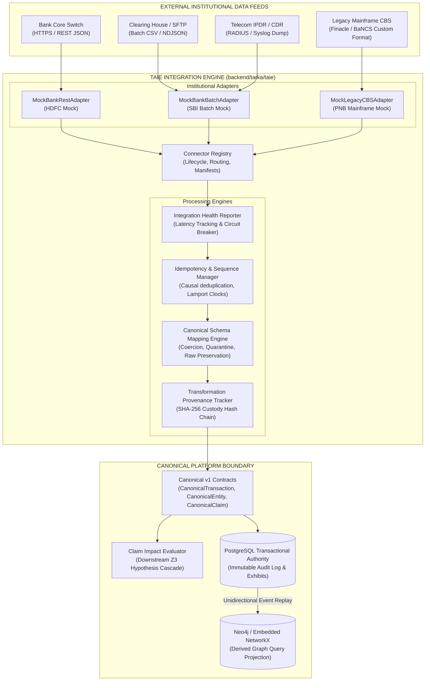

# TARKA ASYNCHRONOUS INTEGRATION ENGINE (TAIE)
## Comprehensive Architectural Design and Integration Blueprint

**Version:** 1.0.0  
**Status:** IMPLEMENTED & VERIFIED  
**Track:** SUTRAM 2026 — Problem Statement PS04  
**Date:** November 5, 2026  
**Governing Doctrine:** AI Proposes. Evidence Verifies. Human Decides.  

---

# 1. EXECUTIVE OVERVIEW

The **TARKA Asynchronous Integration Engine (TAIE)** is the institutional ingestion and protocol bridging subsystem of the TARKA platform. It enables real-time and batch integration across disparate external systems:
1. **Tier-1 Financial Institutions:** Core banking switches (Finacle, BaNCS), payment switches (NPCI UPI 2.0, IMPS, NEFT/RTGS), and card gateways.
2. **Telecom Service Providers:** Call Detail Records (CDR), IP Detail Records (IPDR), CGNAT radius logs, and IMEI/IMSI historical associations.
3. **Law Enforcement & Judicial Infrastructure:** CCTNS, ICJS, NCIIPC, and state cyber-crime portal feeds.

TAIE translates heterogeneous, unvalidated, and often conflicting external data formats into cryptographically verifiable, canonical domain models (**Canonical v1**) while preserving legal chain of custody under Section 63 of Bharatiya Sakshya Adhiniyam, 2023 (BSA §63).

---

# 2. END-TO-END SYSTEM TOPOLOGY

---

# 3. CORE DESIGN INVARIANTS

### Invariant 1: Append-Only Immutable Custody
Raw exhibits ingested through TAIE are hashed with SHA-256 immediately upon arrival. Neither transformation errors, schema mismatches, nor duplicate events mutate original raw bytes.

### Invariant 2: Preserved Field Fidelity
Unrecognized, extra, or vendor-specific legacy fields are never dropped silently. They are quarantined or preserved in the `.metadata` dictionary of the canonical model, allowing retrospective re-parsing as schemas evolve.

### Invariant 3: Causal Event Sequencing
Institutions with asynchronous delivery or delayed networks cannot corrupt causal investigative timelines. TAIE tracks natural keys, payload hashes, and Lamport timestamps to differentiate between duplicate replays and legitimate delayed events.

### Invariant 4: Fail-Closed Protection & Circuit Breakers
If an external API experiences error rates exceeding threshold ($\ge 5$ consecutive failures or $>15\%$ error rate), the adapter trips to `OPEN` state. This prevents cascading load spikes and protects case state integrity.

### Invariant 5: Downstream Claim Re-evaluation
When new evidence is ingested or an adapter re-maps existing transactions, `ClaimImpactEvaluator` automatically identifies all active investigative hypotheses (claims) that rely on the modified evidence and resets their state to `NOT_EVALUATED`, triggering automated re-verification by the Z3 formal solver.

---

# 4. TRANSPORT & PERSISTENCE GOVERNANCE

As ratified in **ADR-001 (Institutional Transport)** and **ADR-002 (Graph Persistence)**:
- **Default External Transport:** RESTful JSON over TLS 1.3 (HTTPS) on standard port 443 with strict Bearer / HMAC-SHA256 authentication.
- **Batch Processing:** Controlled SFTP / Encrypted Tarball ingestion with SHA-256 custody manifests.
- **Persistence:** PostgreSQL is the single transactional authority. Graph projections (Neo4j in production, NetworkX/SQLite in test/air-gapped mode) are read-only derived views, 100% rebuildable on demand.

