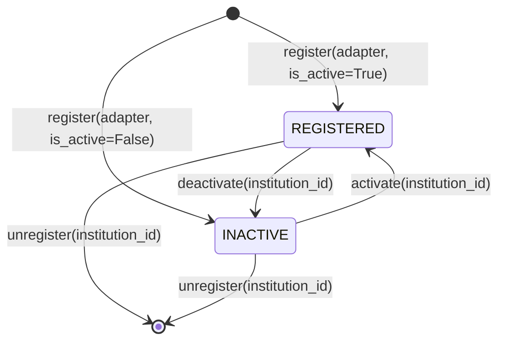

# TAIE CONNECTOR REGISTRY
## Lifecycle Management, Discovery, and Dynamic Routing

**Package:** `backend/tarka/taie/registry.py`  
**Class:** `ConnectorRegistry`  
**Status:** IMPLEMENTED & TESTED  

---

# 1. OVERVIEW

The `ConnectorRegistry` manages the lifecycle, discovery, and capability-based routing of all institutional adapters in TARKA. Rather than hardcoding bank or telecom integrations, TARKA decouples ingestion through a central, dynamic registry.

### Core Responsibilities:
1. **Lifecycle Tracking:** Supports registration, activation, deactivation, and unregistration of connectors.
2. **Dynamic Routing:** Discovers adapters matching specific protocols (`REST`, `BATCH_FILE`, `LEGACY_CBS`) or schemas (`CANONICAL_V1`, `CBS_8583`).
3. **Capability Manifest Lookup:** Provides direct access to statutory authorizations, rate limits, and security classifications for any registered institution.

---

# 2. LIFECYCLE STATE MACHINE



---

# 3. API SPECIFICATION

```python
class ConnectorRegistry:
    def register(self, adapter: BaseInstitutionalAdapter, is_active: bool = True) -> None:
        """Register an adapter instance and set its initial operational state."""

    def unregister(self, institution_id: str) -> Optional[BaseInstitutionalAdapter]:
        """Remove an adapter from the registry."""

    def get(self, institution_id: str) -> Optional[BaseInstitutionalAdapter]:
        """Retrieve an adapter by its institution_id."""

    def activate(self, institution_id: str) -> None:
        """Mark an adapter as active for ingestion."""

    def deactivate(self, institution_id: str) -> None:
        """Deactivate an adapter, preventing new ingestions."""

    def is_active(self, institution_id: str) -> bool:
        """Check if an adapter is currently active."""

    def get_manifest(self, institution_id: str) -> Optional[InstitutionCapabilityManifest]:
        """Retrieve the capability manifest for a given institution."""

    def list_adapters(
        self,
        protocol: Optional[str] = None,
        schema: Optional[str] = None,
        active_only: bool = True
    ) -> List[BaseInstitutionalAdapter]:
        """Filter registered adapters by protocol, schema, and active status."""
```

---

# 4. USAGE EXAMPLE

```python
from tarka.taie import default_connector_registry, MockBankRestAdapter, MockLegacyCBSAdapter

# 1. Initialize and register adapters
rest_adapter = MockBankRestAdapter(institution_id="HDFC_PROD")
cbs_adapter = MockLegacyCBSAdapter(institution_id="PNB_CBS")

default_connector_registry.register(rest_adapter, is_active=True)
default_connector_registry.register(cbs_adapter, is_active=False)

# 2. Query active REST adapters
rest_connectors = default_connector_registry.list_adapters(protocol="REST", active_only=True)
assert len(rest_connectors) == 1
assert rest_connectors[0].institution_id == "HDFC_PROD"

# 3. Inspect statutory authorizations
manifest = default_connector_registry.get_manifest("HDFC_PROD")
if manifest.check_statutory_scope("PMLA_2002"):
    print("Institution authorized under PMLA §50.")
```

