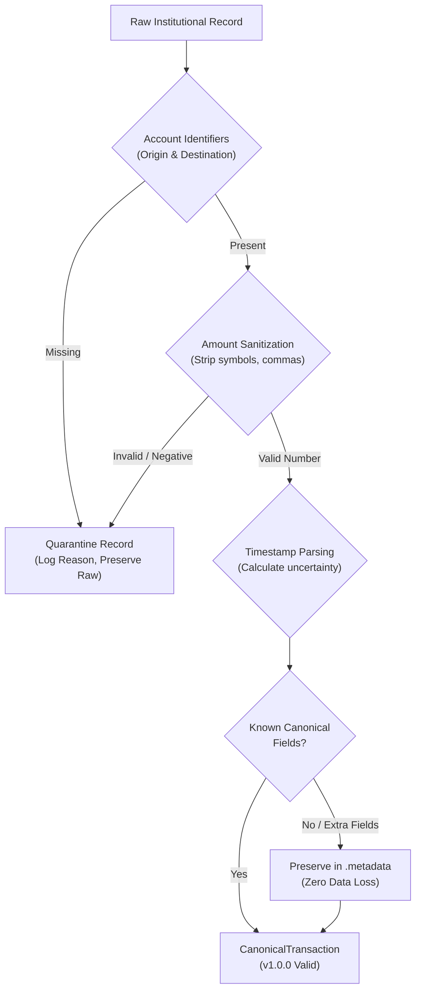

# TAIE SCHEMA MAPPING ENGINE
## Normalization, Field Preservation, and Quarantine Semantics

**Package:** `backend/tarka/taie/mapping.py`  
**Class:** `CanonicalSchemaMappingEngine`  
**Output Model:** `MappingResult`  
**Status:** IMPLEMENTED & TESTED  

---

# 1. OVERVIEW

Institutional data in Indian financial cybercrime investigations originates from hundreds of non-standard formats:
- REST APIs emitting camelCase JSON.
- EOD clearing houses emitting CSV exports with local headers.
- Legacy core banking systems (Finacle, BaNCS) using uppercase field abbreviations and Indian date formats (`DD-MM-YYYY`).

The `CanonicalSchemaMappingEngine` deterministically maps these structures into `CanonicalTransaction` and `CanonicalEntity` models, ensuring full forensic reproducibility.

---

# 2. KEY MAPPING POLICIES

### 1. Robust Account & Identifier Extraction
The engine scans multiple known institutional aliases:
- **Origin Account:** `origin_account_identifier`, `sourceAccount`, `SRC_ACC_NO`, `remitter_account`, `sender_vpa`, `debit_account`.
- **Destination Account:** `destination_account_identifier`, `targetAccount`, `DEST_ACC_NO`, `beneficiary_account`, `payee_vpa`, `credit_account`.

### 2. Financial Amount Sanitization
- Strips non-numeric currency decorations (e.g., `₹ 1,50,000.00` $\to$ `150000.0`).
- Validates non-negativity: negative amounts trigger automatic quarantine isolation.

### 3. Dual-Timestamp Normalization
Under BSA §63, courts require both the original raw artifact string and a standardized UTC timestamp:
- `original_timestamp_raw`: Preserves the exact raw string (`"29-03-2026 14:30:00"`).
- `normalised_timestamp_utc`: Standardized ISO 8601 UTC (`"2026-03-29T14:30:00Z"`).
- `timestamp_uncertainty_sec`: Calibrated to format granularity ($1.0\text{s}$ for seconds, $86400.0\text{s}$ for date-only formats).

### 4. Preservation of Unrecognized Fields
Any field not defined in the core `CanonicalTransaction` schema (e.g. `TELLER_ID`, `BRANCH_CODE`, `CBS_LEDGER_FOLIO`, `GEO_IP`) is automatically stored in `CanonicalTransaction.metadata`. No evidence is discarded.

### 5. Non-Destructive Quarantine
When a record has missing required fields or unparseable numbers, it does NOT crash the batch. Instead, it is placed in `MappingResult.quarantined_records` with an explicit reason, enabling human review.

---

# 3. TRANSFORMATION PERFORMANCE & TESTING

The schema mapping engine was verified with 100% pass rates across:
- Modern REST camelCase payloads (`MockBankRestAdapter`).
- Batch EOD CSV settlement logs (`MockBankBatchAdapter`).
- Legacy Finacle mainframe dumps with Indian date formats and reversals (`MockLegacyCBSAdapter`).

