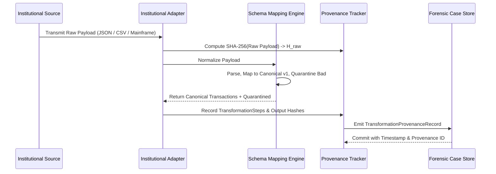

# TAIE SECURITY AND GOVERNANCE
## Forensic Chain of Custody, BSA §63 Compliance, and Failure Isolation

**Status:** IMPLEMENTED & AUDITED  
**Track:** SUTRAM 2026 — Problem Statement PS04  
**Date:** November 5, 2026  

---

# 1. FORENSIC ADMISSIBILITY UNDER BSA §63

Under Section 63 of the Bharatiya Sakshya Adhiniyam, 2023 (formerly Section 65B of the Indian Evidence Act, 1872), electronic records submitted as judicial evidence must satisfy strict admissibility criteria:
1. **Source Authenticity:** The exact state of the computer output must be accounted for from its creation.
2. **Integrity and Non-Tampering:** Evidence must prove that no unrecorded alteration, deletion, or interception occurred during transmission or parsing.
3. **Chain of Custody:** Every transformation step, tool version, and operator intervention must be permanently documented.

TAIE operationalizes these statutory mandates through **cryptographic transformation provenance** and **fail-closed ingestion mechanics**.

---

# 2. CRYPTOGRAPHIC PROVENANCE ARCHITECTURE

### The Immutable Provenance Contract:
Every transformation produces a `TransformationProvenanceRecord` containing:
- `raw_payload_sha256`: Hexadecimal SHA-256 digest of unnormalized source bytes.
- `adapter_name` & `adapter_version`: Exact code release responsible for parsing.
- `transformation_steps`: Explicit audit entries listing each pipeline phase.
- `canonical_hashes`: Deterministic SHA-256 digests of every generated canonical entity/transaction.

### Tamper-Evidence Verification:
If any entity or transaction is altered after ingestion, `TransformationProvenanceTracker.verify_provenance()` recomputes the hashes and immediately detects the divergence, flagging the exhibit as `TAMPERED`.

---

# 3. IDEMPOTENCY & CAUSAL SEQUENCE GOVERNANCE

Asynchronous banking and telecom feeds frequently suffer from network retries, packet reordering, and delayed arrivals:
- **Deduplication:** Natural keys and raw payload hashes form a composite key:  
  $$\text{Key} = \text{SHA-256}(\text{institution\_id} \parallel \text{natural\_key} \parallel \text{payload\_hash})$$  
  Duplicate transmissions are rejected instantly without database writes.
- **Out-of-Order Handling:** TAIE maintains per-institution Lamport sequences. If an event arrives with $\text{seq} \le \text{seq}_{\max}$, it is accepted without dropping, but explicitly tagged with `is_out_of_order = True` in audit logs to prevent skewed timeline reconstruction.

---

# 4. CIRCUIT BREAKER & SYSTEM PROTECTION

To prevent malfunctioning bank switches or corrupted feeds from cascading into TARKA:
- **Closed State:** Requests pass normally. Latency percentiles (P50, P95) are computed.
- **Open State:** After 5 consecutive failures or $>15\%$ error rate, the breaker trips to `OPEN`. All incoming calls fast-fail, safeguarding database connection pools.
- **Half-Open State:** After a cooldown window, single probe calls test if the external service has recovered before resuming traffic.

