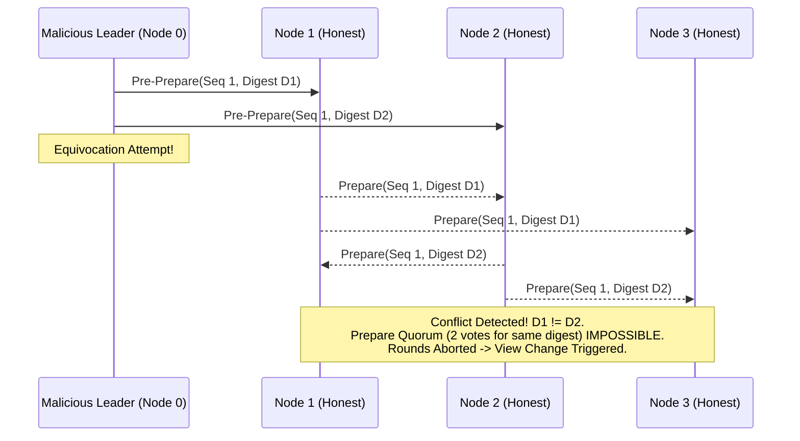

# BFT THREAT MODEL & ADVERSARIAL RESILIENCY SPECIFICATION
## Formal Adversarial Threat Analysis, Attack Vectors, and Defensive Invariants

**Milestone:** M2 (Distributed Event Fabric, BFT Consensus, and Vector Clock Ordering)  
**Status:** IMPLEMENTED & VERIFIED  
**Track:** SUTRAM 2026 — Problem Statement PS04  
**Date:** November 5, 2026  
**Governing Doctrine:** AI Proposes. Evidence Verifies. Human Decides.

---

# 1. THREAT LANDSCAPE & ADVERSARY MODEL

In cross-institutional financial cybercrime enforcement, participants in the distributed event fabric have conflicting institutional incentives, asymmetric regulatory scrutiny, and disparate operational security postures.

The TARKA Byzantine Fault Tolerant (PBFT) consensus engine assumes the **Byzantine Failure Model**:
- Up to $f$ nodes out of $N = 3f + 1$ (1 out of 4 nodes) may be actively malicious, compromised by cybercriminals, uncooperative, crash-stopped, or experiencing arbitrary network partitions.
- The adversary can:
  * Drop, delay, reorder, or duplicate arbitrary network packets.
  * Attempt to propose conflicting transactions to different validators (equivocation / fork attempts).
  * Fabricate signatures or forge message payloads.
  * Refuse to broadcast prepare or commit votes (silent sabotage).
- The adversary **cannot**:
  * Break standard cryptographic primitives (SHA-256 collision resistance, HMAC-SHA256 authenticity).
  * Subvert more than $f$ independent institutional nodes simultaneously.

---

# 2. ADVERSARIAL ATTACK VECTORS & DEFENSIVE INVARIANTS

| Attack Vector | Threat Description | Attacker Capability | TARKA Defensive Mechanism | Verified Test Scenario |
|:---|:---|:---|:---|:---|
| **Silent Node / Crash Fault** | 1 node abruptly crashes, drops off the network, or ignores incoming RPC calls | Passive Byzantine ($f=1$) | Quorum requirement is $2f+1=3$. The remaining 3 honest nodes reach prepare and commit quorums without stalling. | `test_09_bft_silent_node_tolerance` |
| **Equivocation (Fork Attempt)** | Malicious leader proposes digest $d_1$ to Node 1 and digest $d_2$ to Node 2 for sequence $s$ | Active Byzantine Leader | Replicas cross-exchange `PREPARE` votes. No digest achieves the required $2f=2$ prepare quorum. Proposals stall, and replicas trigger a View Change. | `test_10_bft_equivocation_detected_and_rejected` |
| **Signature Forgery / Payload Tampering** | Adversary injects modified event bytes or invalid HMAC authentication tokens | Active Byzantine Node | Replicas verify HMAC signature against institutional public keys during ingress. Forged messages are discarded immediately. | `test_11_bft_invalid_signature_rejection` |
| **Message Replay Attack** | Adversary intercepts and re-transmits valid past consensus votes to disrupt current round | Replay Adversary | Sequence number monotonically increases. Idempotency key `(institution_id, event_id)` drops duplicates. | `test_02_idempotency_duplicate_rejection` |
| **Network Partition (Split-Brain)** | Network splits into two isolated partitions ($2 \times 2$) | Asynchronous Network Failure | Quorum threshold $Q = 2f+1 = 3$. Neither partition possesses 3 nodes; both halt state execution safely (Safety over Liveness). Network heals upon partition resolution. | `test_12_bft_network_partition_and_heal` |
| **Clock Skew Inversion** | Adversary alters NTP local time on bank switch to invert transaction timestamps | Time Spoofing | Causality is governed strictly by Fidge-Mattern Vector Clocks. `TemporalConsistencyEngine` flags hardware skew paradox and preserves causal ordering. | `test_07_temporal_consistency_clock_skew_paradox` |

---

# 3. DETAILED DEFENSIVE MECHANISMS

### 3.1 Equivocation Rejection Proof
Suppose a Byzantine leader $P$ attempts to commit two conflicting events $E_1$ (digest $d_1$) and $E_2$ (digest $d_2$) at sequence number $s$:
1. $P$ sends $\langle\text{PRE-PREPARE}, v, s, d_1\rangle$ to Node 1 and $\langle\text{PRE-PREPARE}, v, s, d_2\rangle$ to Node 2.
2. Node 1 broadcasts $\langle\text{PREPARE}, v, s, d_1, \text{Node 1}\rangle$.
3. Node 2 broadcasts $\langle\text{PREPARE}, v, s, d_2, \text{Node 2}\rangle$.
4. Honest Node 3 receives both prepares. Because $d_1 \neq d_2$ for the same sequence $s$, Node 3 refuses to prepare either proposal.
5. Consequently, neither $d_1$ nor $d_2$ can ever collect the $2f = 2$ prepare votes required to achieve the `PREPARED` state. Both branches stall, and the honest nodes trigger a View Change to elect a new primary.

---

# 4. SAFETY VS LIVENESS GUARANTEES (FLPAS THEOREM COMPLIANCE)

Under the Fischer-Lynch-Paterson (FLP) impossibility result, no deterministic consensus protocol can guarantee both safety and liveness in an asynchronous network with unannounced crash failures.

TARKA resolves this trade-off by strictly prioritizing **Forensic Safety over Operational Liveness**:
- **Safety Invariant (Zero Conflicting Commits):**
  Under no network latency or Byzantine attack will two honest nodes commit different events at the same ledger sequence number:
  $$\forall i, j \text{ honest}: \quad \text{Ledger}_i[s] = \text{Ledger}_j[s]$$
- **Fail-Closed Resilience:**
  If network partitions reduce node connectivity below $2f+1=3$, the consensus engine refuses to commit new ledger entries until network connectivity is restored. It never executes unconfirmed state transitions.

