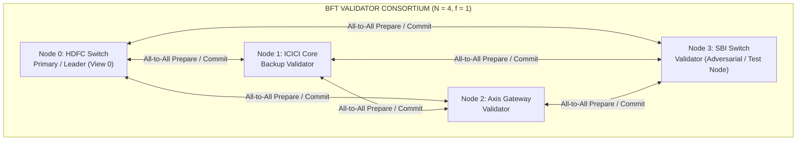
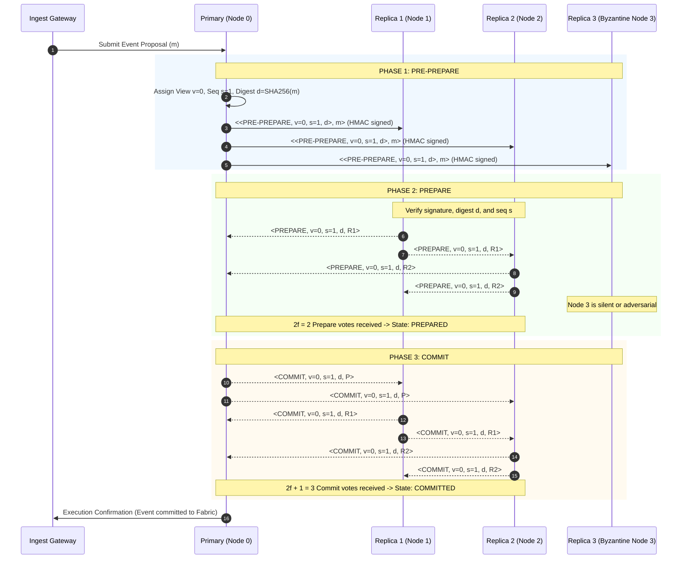
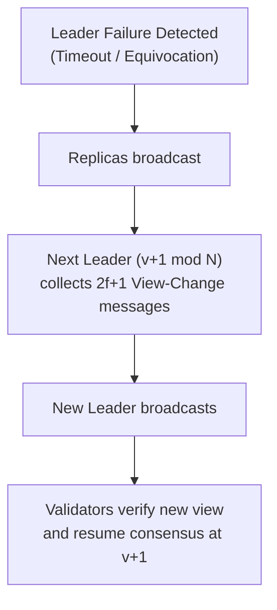

# BFT VALIDATOR ARCHITECTURE SPECIFICATION
## Byzantine Fault Tolerant Consortium State Machine Replication for Cross-Institutional Ledgers

**Milestone:** M2 (Distributed Event Fabric, BFT Consensus, and Vector Clock Ordering)  
**Status:** IMPLEMENTED & VERIFIED  
**Track:** SUTRAM 2026 — Problem Statement PS04  
**Date:** November 5, 2026  
**Governing Doctrine:** AI Proposes. Evidence Verifies. Human Decides.

---

# 1. CONSENSUS SCOPE & FORENSIC ROLE

In cross-institutional cyber-fraud enforcement, no single bank, payment aggregator, or police cell should possess unilateral authority to rewrite the global audit trail, alter transaction ordering, or delete historical evidence exhibits.

TARKA implements a **Practical Byzantine Fault Tolerant (PBFT)** state machine replication engine (`backend/tarka/distributed/pbft_consensus.py`) to govern multi-institution event ordering.

> [!IMPORTANT]
> **Constitutional Invariant:**
> PBFT consensus in TARKA establishes multi-institution agreement on **event ordering and ledger commit state**.
> Consensus does NOT evaluate the raw truth or falsehood of real-world allegations. Legal and forensic truth is verified exclusively through cryptographic evidence exhibits under human judicial oversight.

---

# 2. VALIDATOR TOPOLOGY & QUORUM MATHEMATICS

The baseline consortium network operates with $N = 4$ independent validator nodes:

### PBFT Quorum Bounds

Under the classical Castro & Liskov theorem, to tolerate $f$ Byzantine (arbitrary or malicious) faulty nodes:
$$N \ge 3f + 1$$

For $N = 4$ nodes:
- Maximum tolerable Byzantine nodes: $f = \lfloor \frac{4-1}{3} \rfloor = 1$
- Prepare Quorum requirement: $2f = 2$ matching prepare messages from peers
- Commit Quorum requirement: $2f + 1 = 3$ matching commit messages (including self)

---

# 3. THREE-PHASE CONSENSUS PROTOCOL

### Phase Details

1. **Pre-Prepare Phase:**
   - The primary node $p = v \pmod N$ receives an event proposal.
   - Computes canonical payload digest $d = \text{SHA-256}(\text{CanonicalJSON}(m))$.
   - Stamps sequence number $s$ and broadcasts the signed `PRE-PREPARE` message.
2. **Prepare Phase:**
   - Replicas verify that:
     * The primary signature is authentic.
     * The view $v$ matches the replica's local view.
     * The sequence number $s$ is strictly greater than the last executed sequence.
     * The digest $d$ accurately matches $m$.
   - Replicas broadcast `PREPARE` messages.
   - When a node collects $2f$ matching `PREPARE` messages from distinct replicas, it enters the `PREPARED` state.
3. **Commit Phase:**
   - Upon entering `PREPARED`, the node broadcasts a `COMMIT` message.
   - When a node collects $2f + 1$ matching `COMMIT` messages from distinct nodes (including itself), the proposal is deemed `COMMITTED`.
   - The event envelope is passed to `DistributedEventFabric.append_event()` and permanently committed to the append-only ledger.

---

# 4. VIEW CHANGE & LEADER ELECTION

If the primary validator becomes unresponsive, experiences a network failure, or attempts equivocation (broadcasting conflicting digests for the same sequence number), the consortium initiates a **View Change**:

### Protocol Steps (`PBFTConsensusNetwork.initiate_view_change()`)
1. **Trigger:** A replica's timer expires without progress from primary $p$, or a duplicate sequence conflict is detected.
2. **View Change Broadcast:** The replica increments to view $v+1$ and broadcasts:
   $$\langle\text{VIEW-CHANGE}, v+1, \text{prepared\_proofs}, i\rangle$$
3. **New Leader Induction:** The designated primary for view $v+1$, calculated as:
   $$p_{\text{new}} = (v + 1) \pmod N$$
   listens for incoming `VIEW-CHANGE` messages.
4. **New View Emission:** Once $p_{\text{new}}$ accumulates $2f + 1 = 3$ valid `VIEW-CHANGE` messages, it constructs and broadcasts a `NEW-VIEW` message containing the quorum proof and stable checkpoints.
5. Replicas verify the `NEW-VIEW` payload and transition their local state to view $v+1$.

