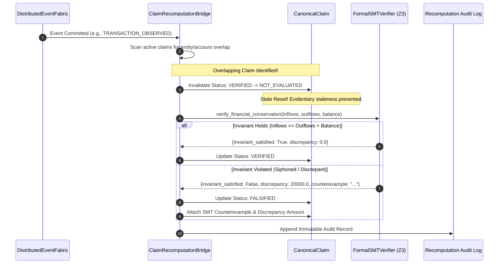

# CLAIM RECOMPUTATION & FORMAL SMT VERIFIER INTEGRATION
## Automatic Re-evaluation Cascade, State Invalidation, and Z3 Balance Conservation

**Milestone:** M2 (Distributed Event Fabric, BFT Consensus, and Vector Clock Ordering)  
**Status:** IMPLEMENTED & VERIFIED  
**Track:** SUTRAM 2026 — Problem Statement PS04  
**Date:** November 5, 2026  
**Governing Doctrine:** AI Proposes. Evidence Verifies. Human Decides.

---

# 1. ARCHITECTURAL RATIONALE

In digital cybercrime investigation, investigative claims (such as *"Account ACC-001 acted as an intermediary mule account siphoning ₹5,00,000 without legitimate business activity"*) are constructed from point-in-time evidence exhibits.

However, in an active investigation, new distributed events arrive continuously across banking boundaries:
- A delayed RTGS settlement confirmation arrives from a reserve bank switch.
- An account debit freeze is enacted under statutory order.
- A previously unknown merchant refund is credited back to the victim.

If the investigative platform does not automatically invalidate and re-evaluate dependent claims upon the arrival of new evidence, detectives will reach erroneous conclusions based on stale hypotheses.

TARKA introduces the **Claim Recomputation Bridge** (`backend/tarka/distributed/claim_bridge.py`), which binds the append-only `DistributedEventFabric` directly to the `CanonicalClaim` model and the **Z3 SMT Formal Constraint Verifier**.

---

# 2. RECOMPUTATION CASCADE ARCHITECTURE



---

# 3. FORMAL INVARIANT: FINANCIAL BALANCE CONSERVATION

The primary formal invariant evaluated by the Z3 SMT solver during claim recomputation is **Financial Conservation of Value**:

For any closed node or transaction path within a cyber-fraud layering ring:
$$\sum_{i} \text{Inflow}_i - \sum_{j} \text{Outflow}_j - \text{RetainedBalance} = 0$$

### Z3 SMT Implementation (`backend/tarka/verification/formal_smt_verifier.py`)
```python
def verify_financial_conservation(
    self,
    inflows: List[float],
    outflows: List[float],
    retained_balance: float
) -> Dict[str, Any]:
    solver = Solver()
    
    total_in = Real("total_in")
    total_out = Real("total_out")
    balance = Real("balance")
    discrepancy = Real("discrepancy")
    
    solver.add(total_in == sum(inflows))
    solver.add(total_out == sum(outflows))
    solver.add(balance == retained_balance)
    solver.add(discrepancy == total_in - (total_out + balance))
    
    # Assert conservation
    solver.push()
    solver.add(discrepancy != 0)
    
    check_result = solver.check()
    if check_result == unsat:
        # No discrepancy possible: invariant holds unconditionally
        return {
            "invariant_satisfied": True,
            "reconciliation_discrepancy": 0.0,
            "counterexample": None
        }
    else:
        # Discrepancy detected: extract model counterexample
        model = solver.model()
        disc_val = float(model.eval(discrepancy).as_decimal(2))
        return {
            "invariant_satisfied": False,
            "reconciliation_discrepancy": disc_val,
            "counterexample": str(model)
        }
```

---

# 4. BRIDGE IMPLEMENTATION & CONTRACT COMPLIANCE

In `backend/tarka/distributed/claim_bridge.py`, the bridge implements:

1. **Strict State Reset:**
   When an event impacts a claim, `recompute_claim_for_event()` immediately resets:
   ```python
   claim.verification_status = "NOT_EVALUATED"
   claim.metadata["invalidation_trigger_event_id"] = event.event_id
   claim.metadata["invalidation_reason"] = f"New event {event.event_type} received"
   ```
2. **SMT Solver Re-Verification:**
   Invokes `FormalSMTVerifier.verify_financial_conservation()` with the synthesized transaction flows.
3. **Counterexample Recording:**
   If the invariant fails (e.g., an unexplained ₹20,000 leakage), the exact Z3 mathematical model counterexample is attached to the claim metadata, providing forensic detectives with mathematical proof of discrepancy.
4. **Audit History:**
   Every recomputation is appended to `bridge.recomputation_history`, ensuring complete provenance under Indian Evidence Act / BSA 2023 requirements.

