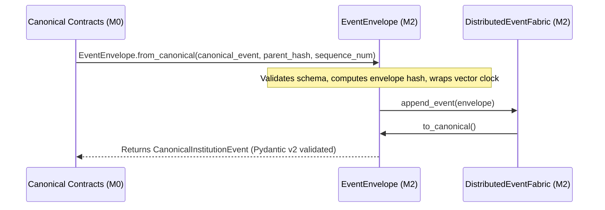

# DISTRIBUTED EVENT MODEL SPECIFICATION
## Canonical Institutional Event Envelopes, Causality Metadata, and Cryptographic Serialization

**Milestone:** M2 (Distributed Event Fabric, BFT Consensus, and Vector Clock Ordering)  
**Status:** IMPLEMENTED & VERIFIED  
**Track:** SUTRAM 2026 — Problem Statement PS04  
**Date:** November 5, 2026  
**Governing Doctrine:** AI Proposes. Evidence Verifies. Human Decides.

---

# 1. SCOPE AND PURPOSE

In cross-institutional cyber-fraud investigations (involving commercial banks, UPI switches, telecom providers, and law enforcement agencies), event streams originate from geographically dispersed, asynchronously networked servers. To achieve forensic defensibility and prevent data tampering, all institutional events must adhere to a strictly typed, cryptographically verifiable, and causally ordered envelope specification.

The TARKA Distributed Event Model satisfies three critical forensic requirements:
1. **Canonical Schema Alignment:** Direct bi-directional conversion between the core distributed `EventEnvelope` and the M0 `CanonicalInstitutionEvent` contract.
2. **Deterministic Cryptographic Serialization:** Canonical JSON formatting (`sort_keys=True`, normalized whitespace) producing immutable SHA-256 payload and envelope digests.
3. **Dual Temporal Tracking:** Simultaneous recording of ISO-8601 UTC microsecond wall-clock timestamps and logical Lamport / Vector Clocks to reconcile clock skew without losing causal precedence.

---

# 2. ENVELOPE SCHEMA DEFINITION

The primary transport and persistence structure is `EventEnvelope` (`backend/tarka/distributed/event_envelope.py`):

```python
class EventEnvelope:
    event_id: str                      # Unique UUIDv4 event identifier
    institution_id: str                # E.g., "HDFC_BANK", "ICICI_CORE", "SBI_SWITCH", "CYBER_CELL"
    event_type: str                    # Standardized institutional event type
    correlation_id: str                # Global investigation or session correlation identifier
    case_id: Optional[str]             # Statutory investigation case ID (e.g., "CASE-2026-PS04-001")
    payload: Dict[str, Any]            # Arbitrary strongly typed business payload
    vector_clock: Dict[str, int]       # Fidge-Mattern vector clock: {institution_id: counter}
    lamport_clock: int                 # Logical scalar counter for causal tie-breaking
    timestamp_iso: str                 # ISO-8601 UTC timestamp with microsecond precision
    sha256_hash: str                   # Cryptographic hash of this envelope and its payload
    parent_hash: str                   # SHA-256 hash of the immediately preceding ledger event
    sequence_num: int                  # Monotonically increasing sequence number on local ledger
    signature: Optional[str]           # Institutional HMAC-SHA256 or asymmetric digital signature
```

### Supported Institutional Event Types

| Event Type Constant | Description | Mandatory Payload Attributes |
|:---|:---|:---|
| `TRANSACTION_OBSERVED` | Financial movement across institutional ledger boundaries | `tx_id`, `from_account`, `to_account`, `amount`, `currency` |
| `MULE_ACCOUNT_FLAGGED` | Account flagged for high-velocity layering or synthetic identity | `account_id`, `institution_id`, `risk_score`, `flag_reason` |
| `DEVICE_ASSOCIATED` | IMEI, IMSI, or MAC address linked to banking credential | `account_id`, `device_id`, `ip_address`, `geo_coords` |
| `ACCOUNT_FROZEN` | Statutory debit freeze enacted under Section 106 BNSS / 91 CrPC | `account_id`, `statutory_order_id`, `freeze_amount`, `officer_id` |
| `EVIDENCE_SUBMITTED` | Cryptographic evidence exhibit registered into custody | `exhibit_id`, `file_hash_sha256`, `custody_chain`, `vault_uri` |
| `CROSS_INSTITUTION_ALERT` | Inter-bank early warning notification of active cyber siphoning | `alert_id`, `origin_bank`, `target_banks`, `alert_severity` |
| `AUDIT_CHECKPOINT` | Consensus round checkpoint anchoring state to external ledger | `checkpoint_id`, `merkle_root`, `validator_signatures`, `round_num` |

---

# 3. DETERMINISTIC SERIALIZATION & SHA-256 HASH CHAINING

Forensic evidence ledgers must never depend on implementation-dependent JSON key ordering or non-standard float representations.

### Hash Derivation Pipeline

1. **Payload Hash:**
   $$\text{Hash}_{\text{payload}} = \text{SHA-256}(\text{CanonicalJSON}(\text{payload}))$$
2. **Envelope Hash:**
   $$\text{Hash}_{\text{envelope}} = \text{SHA-256}\Big(\text{event\_id} \parallel \text{institution\_id} \parallel \text{event\_type} \parallel \text{parent\_hash} \parallel \text{Hash}_{\text{payload}} \parallel \text{lamport\_clock} \parallel \text{sequence\_num}\Big)$$

```python
def compute_hash(self) -> str:
    payload_canonical = json.dumps(self.payload, sort_keys=True, separators=(",", ":"))
    payload_hash = hashlib.sha256(payload_canonical.encode("utf-8")).hexdigest()
    
    hash_preimage = (
        f"{self.event_id}:{self.institution_id}:{self.event_type}:"
        f"{self.parent_hash}:{payload_hash}:{self.lamport_clock}:{self.sequence_num}"
    )
    return hashlib.sha256(hash_preimage.encode("utf-8")).hexdigest()
```

---

# 4. CONTRACT INTEGRATION: CANONICALINSTITUTIONEVENT

To maintain compatibility with M0 Canonical Contracts (`backend/tarka/contracts/canonical_models.py`), `EventEnvelope` provides lossless bi-directional transformation:



### Python Conversion Methods

```python
def to_canonical(self) -> "CanonicalInstitutionEvent":
    from tarka.contracts.canonical_models import CanonicalInstitutionEvent
    return CanonicalInstitutionEvent(
        event_id=self.event_id,
        institution_id=self.institution_id,
        event_type=self.event_type,
        correlation_id=self.correlation_id,
        payload=self.payload,
        vector_clock=self.vector_clock,
        lamport_clock=self.lamport_clock,
        timestamp_iso=self.timestamp_iso,
        sha256_hash=self.sha256_hash,
    )

@classmethod
def from_canonical(
    cls,
    canonical: "CanonicalInstitutionEvent",
    parent_hash: str = "0" * 64,
    sequence_num: int = 0
) -> "EventEnvelope":
    envelope = cls(
        event_id=canonical.event_id,
        institution_id=canonical.institution_id,
        event_type=canonical.event_type,
        correlation_id=canonical.correlation_id,
        payload=canonical.payload,
        vector_clock=canonical.vector_clock.copy(),
        lamport_clock=canonical.lamport_clock,
        timestamp_iso=canonical.timestamp_iso,
        parent_hash=parent_hash,
        sequence_num=sequence_num,
    )
    envelope.sha256_hash = envelope.compute_hash()
    return envelope
```

---

# 5. CAUSALITY METADATA

Every envelope carries:
- `vector_clock`: An explicit map of $\{\text{NodeID} \to \text{Sequence}\}$ indicating the causal horizon known to the emitter at the instant of event generation.
- `lamport_clock`: An integer scalar $\max(\text{clock}_{\text{local}}, \text{clock}_{\text{incoming}}) + 1$ ensuring a deterministic strict partial order can be derived for logging.
- `timestamp_iso`: Physical UTC timestamp formatted as `YYYY-MM-DDTHH:MM:SS.ffffffZ` used for human timeline displays and clock skew paradox detection.

