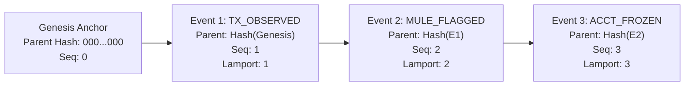
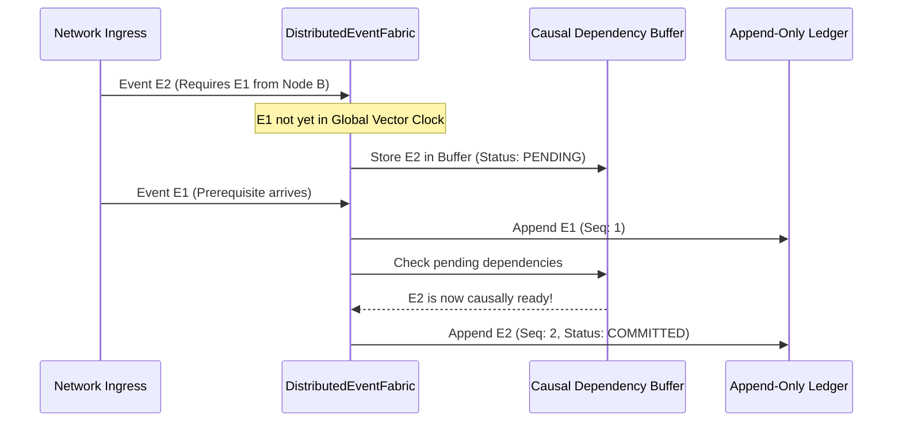

# DISTRIBUTED EVENT SYNCHRONISATION SPECIFICATION
## Append-Only Ledger, Idempotent Ingestion, Causal Dependency Buffering, and State Replay

**Milestone:** M2 (Distributed Event Fabric, BFT Consensus, and Vector Clock Ordering)  
**Status:** IMPLEMENTED & VERIFIED  
**Track:** SUTRAM 2026 — Problem Statement PS04  
**Date:** November 5, 2026  
**Governing Doctrine:** AI Proposes. Evidence Verifies. Human Decides.

---

# 1. OVERVIEW

The TARKA `DistributedEventFabric` (`backend/tarka/distributed/event_store.py`) provides an append-only, tamper-evident cryptographic event store for multi-institution financial crime investigations. It guarantees:
1. **Append-Only Integrity:** Every committed event is cryptographically bound to its immediate predecessor via SHA-256 chaining.
2. **Strict Idempotency:** Duplicate submissions (due to network retries, malicious re-broadcasts, or multi-switch routing) are detected and suppressed without corrupting ledger sequence numbering.
3. **Causal Dependency Buffering:** Events arriving out-of-causal-order are safely quarantined in an in-memory dependency buffer until all prerequisite causal predecessors are committed, after which they automatically drain into the ledger.
4. **Deterministic State Replay:** The system can reconstruct state both as a high-level investigative domain summary (accounts flagged, accounts frozen, evidence exhibits registered) or as an exact slice of envelopes for forensic timeline reproduction.

---

# 2. CRYPTOGRAPHIC LEDGER STRUCTURE



### Genesis Initialization
Upon instantiating `DistributedEventFabric`, the ledger anchors to a 64-character hexadecimal zero string:
$$\text{GENESIS\_HASH} = \text{"0000000000000000000000000000000000000000000000000000000000000000"}$$

### Hash Chaining Mechanism
When appending an event:
1. The fabric checks that `envelope.parent_hash` matches the current `ledger[-1].sha256_hash` (or the genesis hash if the ledger is empty). If unassigned, the fabric binds it automatically to the current chain tip.
2. The event is assigned the next sequential integer `sequence_num = len(ledger) + 1`.
3. The cryptographic envelope hash is computed and stamped into `envelope.sha256_hash`.
4. The event is appended to the ledger and indexed by `event_id`, `correlation_id`, and `institution_id`.

---

# 3. IDEMPOTENT INGESTION & DUPLICATE DETECTION

In a high-throughput inter-bank payment network (e.g., IMPS, NEFT, UPI), network timeouts frequently cause senders to retransmit messages. Furthermore, adversarial nodes may replay past messages to trigger duplicate debits or false freezes.

### Dual-Key Deduplication
The fabric maintains two deduplication indices:
1. **Event Identity Index:** Set of composite keys `(institution_id, event_id)`.
2. **Payload Hash Index:** Set of SHA-256 digests of the canonical payload JSON.

```python
# Duplicate detection logic in DistributedEventFabric.append_event()
idempotency_key = f"{envelope.institution_id}:{envelope.event_id}"
payload_canonical = json.dumps(envelope.payload, sort_keys=True)
payload_hash = hashlib.sha256(payload_canonical.encode("utf-8")).hexdigest()

if idempotency_key in self._idempotency_keys or payload_hash in self._seen_payload_hashes:
    # Safe duplicate drop: returns True without appending to ledger or updating sequence
    return True
```

---

# 4. CAUSAL DEPENDENCY BUFFER & AUTO-DRAIN

When events traverse disparate institutional switches, network latency or packet re-routing may cause a child event (e.g., "Account Frozen following Mule Flagging") to arrive before its causal prerequisite ("Mule Flagged").

Processing events out of causal order can produce invalid investigations, inaccurate fraud attributions, or broken timeline charts.



### Auto-Drain Algorithm

1. **Pre-requisite Check:** When `append_event(envelope)` is called, the fabric evaluates whether all foreign causal dependencies ($\text{dependencies for } k \neq \text{envelope.institution\_id}$) have already been satisfied:
   $$\forall k \neq \text{institution\_id}: \quad \text{envelope.vector\_clock}[k] \le \text{global\_delivered\_clock}[k]$$
2. **Buffer Quarantine:** If dependencies are unmet, the event is held in `self._causal_buffer: List[EventEnvelope]`.
3. **Cascade Drain:** Whenever a valid event is committed to the ledger:
   - The fabric updates `self._global_delivered_vector_clock.update(committed_event.vector_clock)`.
   - The fabric iterates through `self._causal_buffer`. Any buffered event whose prerequisites are now satisfied is dequeued, sequenced, and committed to the ledger.
   - This process repeats recursively until no further buffered events can be committed.

---

# 5. CRYPTOGRAPHIC AUDIT & CHAIN INTEGRITY VERIFICATION

To support courtroom presentation and defense scrutiny under statutory evidence guidelines (e.g., Section 65B Indian Evidence Act / Section 63 BSA 2023), the fabric provides complete chain verification:

```python
def verify_ledger_chain_integrity(self) -> Tuple[bool, Optional[str]]:
    """
    Performs full linear audit verifying:
    1. Genesis parent hash matches 000...000
    2. Every subsequent parent_hash matches predecessor's sha256_hash
    3. Recomputed envelope hash matches stored sha256_hash
    4. Sequence numbers strictly increment by 1
    """
```

If any single byte of any event, timestamp, or payload is modified, or if an event is deleted or inserted, `verify_ledger_chain_integrity()` immediately detects the corruption, returns `False`, and identifies the exact sequence number and failure reason.

---

# 6. DETERMINISTIC STATE REPLAY

The fabric supports dual-mode deterministic state reconstruction:

### Mode 1: Case Domain Summary Replay
When called with a `correlation_id` string:
```python
state = fabric.replay_state("CASE-2026-PS04-001")
```
Returns an aggregated domain dictionary:
- `evidence_items`: List of registered evidence IDs and exhibit payloads.
- `flagged_accounts`: Set of account IDs flagged for mule activity.
- `frozen_accounts`: Set of account IDs subjected to statutory debit freezes.

### Mode 2: Sequence Slice Replay
When called with integer bounds:
```python
envelopes = fabric.replay_state(from_sequence=10, up_to_sequence=25)
```
Returns an ordered `List[EventEnvelope]` representing the exact state transitions that occurred between sequence 10 and 25, facilitating forensic scrubbing and step-by-step playback in the frontend timeline component.

