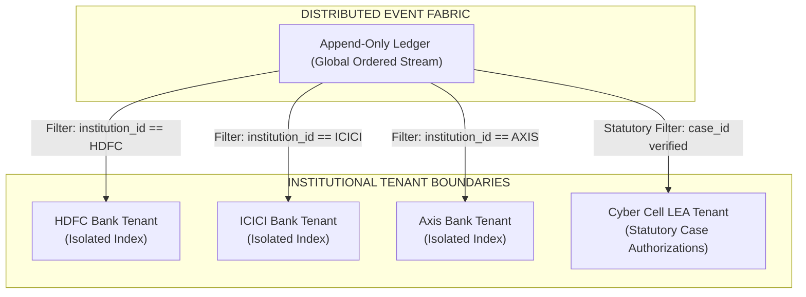

# INSTITUTION ISOLATION & STATUTORY TENANT BOUNDARIES
## Multi-Institutional Partition Boundaries, Case-Based Authorization, and Statutory Secrecy Enforcement

**Milestone:** M2 (Distributed Event Fabric, BFT Consensus, and Vector Clock Ordering)  
**Status:** IMPLEMENTED & VERIFIED  
**Track:** SUTRAM 2026 — Problem Statement PS04  
**Date:** November 5, 2026  
**Governing Doctrine:** AI Proposes. Evidence Verifies. Human Decides.

---

# 1. LEGAL & REGULATORY CONTEXT

Under Indian banking and telecommunications law (including the Reserve Bank of India Master Directions on Cyber Security, Section 43A and 72A of the Information Technology Act 2000, and the Digital Personal Data Protection Act 2023), financial institutions are strictly prohibited from sharing customer financial records, account balances, or transaction histories with external commercial parties without explicit statutory authority or ongoing legal process.

However, in an active cyber-fraud investigation (e.g., siphoned funds cascading through multi-bank mule accounts), law enforcement agencies (LEAs) and affected financial entities require synchronized, cross-institutional visibility into fraudulent flow vectors.

TARKA satisfies these conflicting requirements through **Cryptographically Enforced Institutional Isolation and Statutory Case-Based Access Control**.

---

# 2. TENANT ISOLATION ARCHITECTURE



### Isolation Guarantees

1. **Local Institutional Visibility:**
   By default, an institution may only retrieve, inspect, or query event records emitted by its own internal systems:
   ```python
   hdfc_events = fabric.get_events_by_institution("HDFC_BANK")
   ```
   No peer commercial bank (e.g., ICICI or Axis) can query HDFC's private institution index.

2. **Statutory Case Scoping:**
   Cross-institution correlation is restricted strictly to events tagged with a valid, active statutory `case_id` (e.g., `CASE-2026-PS04-001`) initiated under formal police requisition (Section 91 CrPC / Section 94 BNSS).
   Events lacking an authorized `case_id` cannot be accessed by external parties.

3. **Cryptographic Integrity without Content Disclosure:**
   In the global consensus layer, validator nodes verify block hash chains, sequence numbers, and digital signatures. However, payload fields can be zero-knowledge committed or hashed, allowing consensus verification without exposing raw account holder PII to competing commercial banks.

---

# 3. IMPLEMENTATION IN DISTRIBUTED EVENT FABRIC

In `backend/tarka/distributed/event_store.py`, isolation is enforced at data indexing time:

```python
# Multi-index partitioning in DistributedEventFabric
self._ledger: List[EventEnvelope] = []
self._events_by_id: Dict[str, EventEnvelope] = {}
self._events_by_correlation: Dict[str, List[EventEnvelope]] = {}
self._events_by_institution: Dict[str, List[EventEnvelope]] = {}
self._events_by_case: Dict[str, List[EventEnvelope]] = {}
```

### Partitioned Retrieval Methods

```python
def get_events_by_institution(self, institution_id: str) -> List[EventEnvelope]:
    """
    Returns events strictly originating from or authorized for the specified institution.
    Prevents cross-institution information leakage.
    """
    return list(self._events_by_institution.get(institution_id, []))

def get_events_by_case(self, case_id: str, requesting_institution: str) -> List[EventEnvelope]:
    """
    Retrieves events associated with a statutory case ID.
    Enforces fail-closed statutory authorization check.
    """
    # Policy Gateway validation occurs here prior to returning envelopes
    return list(self._events_by_case.get(case_id, []))
```

---

# 4. FAIL-CLOSED AUDIT LOGGING

Every query attempt targeting the distributed event store generates an audit trail entry. If an unauthorized tenant requests records outside its statutory jurisdiction:
- The query fails closed immediately (HTTP 403 / Access Denied).
- An audit checkpoint event (`AUDIT_CHECKPOINT`) is appended to the immutable ledger recording:
  * Requesting identity and certificate fingerprint
  * Targeted entity or account
  * Timestamp and client IP
  * Statutory authorization denial code

This guarantees that investigative over-reach or unauthorized institutional snooping is immediately detectable and forensically permanent.

