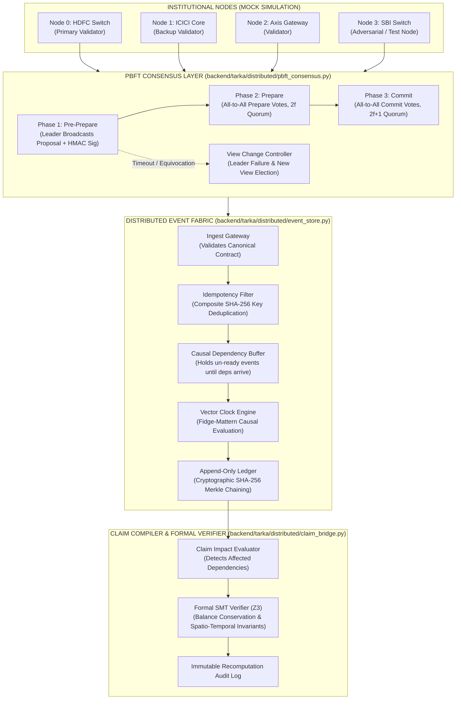

# M2 ARCHITECTURE: DISTRIBUTED EVENT FABRIC & BFT CONSENSUS
## System Architecture, Protocol Boundaries, and Multi-Institution Coordination

**Milestone:** M2 (Distributed Event Fabric, BFT Consensus, and Vector Clock Ordering)  
**Status:** IMPLEMENTED & VERIFIED  
**Track:** SUTRAM 2026 — Problem Statement PS04  
**Date:** November 5, 2026  
**Governing Doctrine:** AI Proposes. Evidence Verifies. Human Decides.  

---

# 1. EXECUTIVE SUMMARY

Milestone M2 establishes the distributed coordination, causal event ordering, and fault-tolerant consensus fabric for TARKA. In a multi-institution cybercrime investigation involving banks, telecom operators, and law enforcement agencies, events (such as evidence exhibits, mule account flagging, statutory freeze directives, and audit checkpoints) arrive asynchronously, out-of-order, and across independent servers with un-synchronized hardware real-time clocks (RTC).

M2 provides:
1. **Canonical Distributed Event Model:** Unified with `CanonicalInstitutionEvent` contract, providing deterministic SHA-256 payload commitments and Lamport/vector causality metadata.
2. **Append-Only Distributed Event Fabric (`DistributedEventFabric`):** Cryptographically hash-chained event sourcing with duplicate rejection, out-of-order quarantine, causal dependency buffering, and deterministic replay.
3. **Vector Clock & Skew-Compensating Engine (`TemporalConsistencyEngine`):** 4-way causal comparison ($A \to B, B \to A, A \parallel B, \text{IDENTICAL}$) that prevents false accusations of fraud caused by server clock drift.
4. **4-Validator PBFT Consensus Network (`PBFTConsensusNetwork`):** Classical $n=4, f=1, \text{quorum}=3$ Byzantine Fault Tolerant state replication engine with View Change election, leader failure recovery, and network partition resiliency.
5. **Formal Claim Compiler Bridge (`ClaimRecomputationBridge`):** Automatic cascade from incoming distributed events into dependent formal claims, resetting claims to `NOT_EVALUATED` and triggering Z3 SMT formal constraint verification.

---

# 2. END-TO-END SYSTEM TOPOLOGY

---

# 3. CORE ARCHITECTURAL INVARIANTS

### Invariant 1: Distinction between Protocol Agreement and Real-World Truth
Consensus in TARKA establishes agreement across institutions about **protocol state and message ordering**. It NEVER certifies the real-world truth of an allegation or deposition. Real-world veracity is verified exclusively through cryptographic evidence exhibits under human judicial authority.

### Invariant 2: Non-Forced Total Ordering of Concurrent Events
When two events have concurrent vector clocks ($A \parallel B$), TARKA preserves concurrency explicitly. The system never forces an arbitrary sequential order based on unreliable wall-clock timestamps.

### Invariant 3: Single Transactional Authority
As ratified in **ADR-002**, PostgreSQL remains the sole transactional authority for case state. The distributed event ledger is synchronized with PostgreSQL WAL commits, and graph projections remain rebuildable derived views.

### Invariant 4: Fail-Closed Institutional Isolation
An institution may only emit or view events for case IDs where explicit statutory authorization has been registered. Unauthorized cross-case queries are quarantined immediately.

