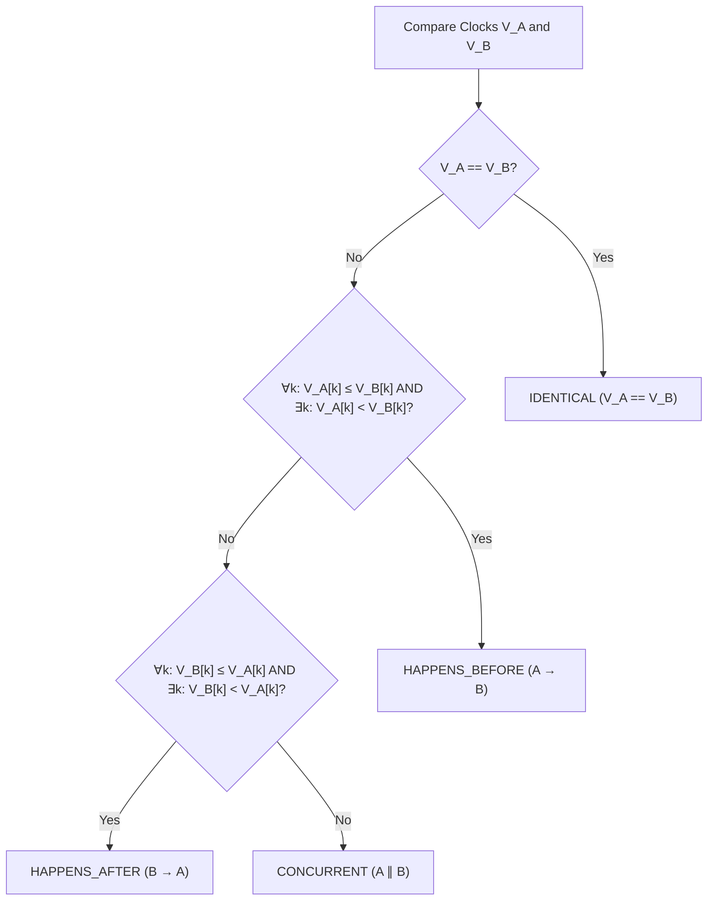
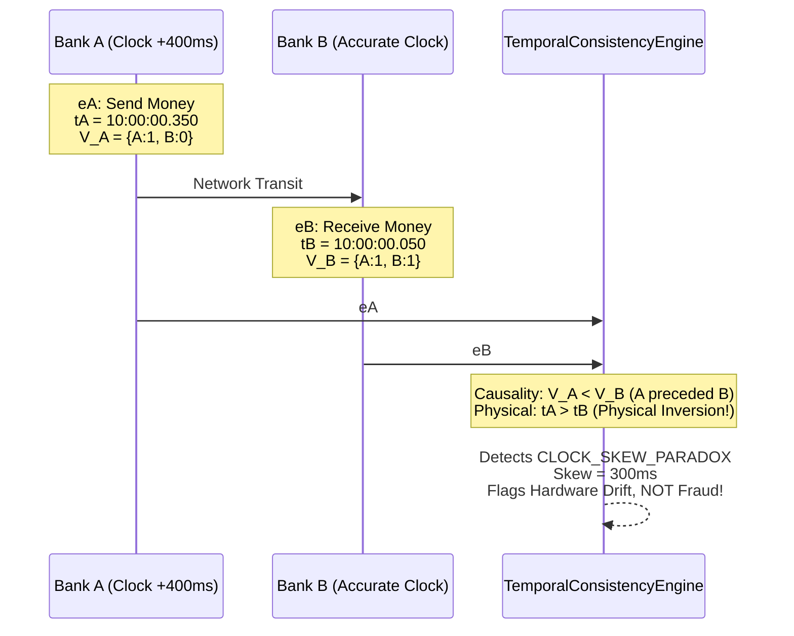

# VECTOR CLOCK & TEMPORAL CONSISTENCY SPECIFICATION
## Fidge-Mattern Causal Ordering, 4-Way Comparison, Clock Pruning, and Clock Skew Paradox Detection

**Milestone:** M2 (Distributed Event Fabric, BFT Consensus, and Vector Clock Ordering)  
**Status:** IMPLEMENTED & VERIFIED  
**Track:** SUTRAM 2026 — Problem Statement PS04  
**Date:** November 5, 2026  
**Governing Doctrine:** AI Proposes. Evidence Verifies. Human Decides.

---

# 1. THE PROBLEM OF TIME IN DISTRIBUTED FORENSICS

In modern financial cybercrime (e.g., mule account networks, multi-stage SIM swap siphoning, UPI rapid-relay laundering), transactions transition across multiple autonomous banking, aggregator, and telecom systems within milliseconds.

Traditional investigative tools rely solely on physical wall-clock timestamps ($t_{\text{RTC}}$ or NTP). However, in real-world distributed architectures:
1. **Clock Drift and Jitter:** Network Time Protocol (NTP) synchronization between independent financial institutions regularly exhibits drift of $50\,\text{ms}$ to $500\,\text{ms}$, and occasionally seconds during leap seconds or network congestion.
2. **False Fraud Accusations:** If Bank A's server clock runs $200\,\text{ms}$ ahead of Bank B's clock, a legitimate sequential transfer from Bank A to Bank B appears in logs as having arrived at Bank B *before* it was sent by Bank A. Naive fraud detection engines misinterpret this temporal inversion as synthetic fraud, impossible time travel, or data tampering.
3. **Loss of Concurrency:** Sorting events solely by wall-clock forces an artificial linear order on events that actually occurred independently and concurrently, distorting investigative attribution.

To solve this, TARKA implements the **Fidge-Mattern Vector Clock Algorithm** augmented with a **Temporal Consistency Engine** (`backend/tarka/distributed/vector_clock.py`).

---

# 2. VECTOR CLOCK MATHEMATICAL FORMALISM

A Vector Clock $V$ for a system of $N$ institutional nodes is a vector of $N$ logical integers:
$$V = \langle v_1, v_2, \dots, v_N \rangle$$
where $v_i$ represents the number of events initiated by node $i$ that are causally known to the holder of the clock.

### Vector Clock Update Rules
1. **Local Progression:** Before initiating a local event $e$, node $i$ increments its own component:
   $$V_i[i] \leftarrow V_i[i] + 1$$
2. **Message Transmission:** Node $i$ attaches its current vector clock $V_i$ to every transmitted event envelope.
3. **Message Ingress:** When node $j$ receives an event with vector clock $V_{\text{msg}}$, it updates its local clock:
   $$\forall k: \quad V_j[k] \leftarrow \max(V_j[k], V_{\text{msg}}[k])$$
   $$V_j[j] \leftarrow V_j[j] + 1$$

---

# 3. 4-WAY CAUSAL COMPARISON

Given two vector clocks $V_A$ and $V_B$, TARKA evaluates their causal relationship using a strict 4-way classification:



### Formal Definitions

1. **`IDENTICAL` ($V_A = V_B$):**
   $$\forall k: \quad V_A[k] = V_B[k]$$
2. **`HAPPENS_BEFORE` ($A \to B$):**
   Event $A$ causally preceded event $B$:
   $$(\forall k: V_A[k] \le V_B[k]) \quad \land \quad (\exists k: V_A[k] < V_B[k])$$
3. **`HAPPENS_AFTER` ($B \to A$):**
   Event $B$ causally preceded event $A$:
   $$(\forall k: V_B[k] \le V_A[k]) \quad \land \quad (\exists k: V_B[k] < V_A[k])$$
4. **`CONCURRENT` ($A \parallel B$):**
   Neither event causally preceded the other; they occurred independently:
   $$(\exists i: V_A[i] > V_B[i]) \quad \land \quad (\exists j: V_B[j] > V_A[j])$$

> [!IMPORTANT]
> **Constitutional Rule:** TARKA NEVER forces an artificial total order on concurrent events ($A \parallel B$). Concurrency is preserved explicitly in graph and timeline projections.

---

# 4. DYNAMIC VECTOR CLOCK PRUNING

In an inter-bank consortium, thousands of distinct institutions, branches, or API endpoints may emit events over months. Without pruning, vector clock size grows $O(N)$ with the total number of historical participants, leading to metadata bloat in network payloads.

TARKA implements **Dynamic Clock Pruning** (`VectorClock.prune()`):
```python
def prune(self, active_nodes: Set[str]) -> "VectorClock":
    """
    Returns a new VectorClock containing only entries for active_nodes.
    Nodes outside the active set that have zero or negligible causal impact
    are pruned while preserving monotonicity for all active participants.
    """
```
- Dormant institutions with static counters are safely pruned during long-term archive transitions.
- Active validators and investigating entities remain pinned in the vector clock horizon.

---

# 5. CLOCK SKEW PARADOX DETECTION

The `TemporalConsistencyEngine` (`backend/tarka/distributed/vector_clock.py`) cross-examines physical wall-clock timestamps against vector clock causality to detect hardware clock anomalies.

### Paradox Scenario
Let Event $A$ be a fund transfer initiated at Bank A, and Event $B$ be the receipt confirmation at Bank B.
1. **Vector Causality:** $A \to B$ ($V_A \prec V_B$). Event $A$ is an indisputable causal prerequisite of Event $B$.
2. **Physical Timestamps:**
   - $t_A = \text{10:00:00.350}$ (Bank A's clock is running 400ms fast)
   - $t_B = \text{10:00:00.050}$ (Bank B's clock is synchronized)
   - $t_A > t_B \implies \Delta t = -300\,\text{ms}$.



### Detection Logic in TARKA

```python
def evaluate_temporal_consistency(
    self,
    event_a: EventEnvelope,
    event_b: EventEnvelope
) -> Dict[str, Any]:
    causal_rel = self.compare_causality(event_a.vector_clock, event_b.vector_clock)
    t_a = datetime.fromisoformat(event_a.timestamp_iso)
    t_b = datetime.fromisoformat(event_b.timestamp_iso)
    
    skew_paradox = False
    skew_ms = 0.0
    
    if causal_rel == "HAPPENS_BEFORE" and t_a > t_b:
        skew_paradox = True
        skew_ms = (t_a - t_b).total_seconds() * 1000.0
    elif causal_rel == "HAPPENS_AFTER" and t_b > t_a:
        skew_paradox = True
        skew_ms = (t_b - t_a).total_seconds() * 1000.0
        
    return {
        "causal_relation": causal_rel,
        "physical_delta_ms": (t_b - t_a).total_seconds() * 1000.0,
        "clock_skew_paradox": skew_paradox,
        "skew_magnitude_ms": skew_ms,
        "authoritative_order": "CAUSAL_VECTOR_CLOCK"
    }
```

When `clock_skew_paradox == True`:
- TARKA suppresses false positive "impossible travel" or "pre-cognition" alerts.
- An institutional warning is emitted alerting network administrators to re-synchronize NTP on the offending switch.
- The forensic timeline orders the events by **Causal Vector Clock**, preserving evidentiary integrity.

