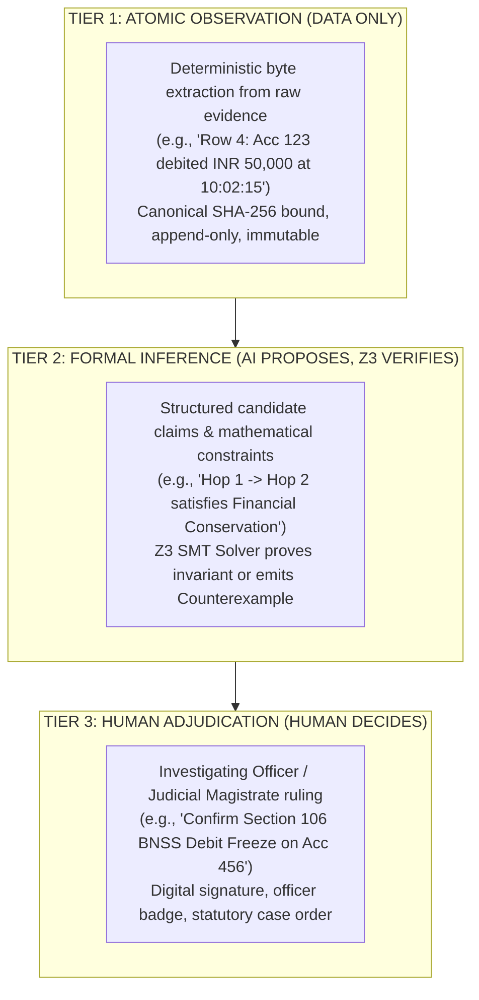

# M3 FORENSIC RELIABILITY & CLAIM COMPILER SPECIFICATION
## Evidentiary Lineage, Dependency Invalidation, Formal SMT Constraints, and Courtroom Defensibility

**Milestone:** M3 (Adversarial Validation, Security, and Forensic Reliability)  
**Track:** SUTRAM 2026 — Problem Statement PS04  
**Date:** November 5, 2026  
**Governing Doctrine:** AI Proposes. Evidence Verifies. Human Decides.

---

# 1. THE PROBLEM OF FORENSIC AI IN FINANCIAL CYBERCRIME

Conventional AI tools in law enforcement fail the threshold of judicial admissibility because they act as "black boxes":
1. **Unverifiable Probability Scores:** Telling a judge that a suspect has a "94.2% fraud risk" is legally inadmissible without showing the exact statutory evidence and mathematical reasoning.
2. **Silent Resolution of Contradictions:** Naive neural networks or LLMs smooth over or hallucinate past contradictory facts (e.g., an individual being in two cities simultaneously).
3. **Stale Conclusions:** If a bank retracts a flawed statement 3 weeks into an investigation, standard databases fail to identify which downstream investigative claims collapse as a result.

TARKA solves these vulnerabilities through the **Forensic Claim Compiler** (`backend/tarka/claim_compiler/`).

---

# 2. THE THREE-TIER FORENSIC TAXONOMY

TARKA strictly segregates evidentiary data into three un-blurrable categories:

> [!IMPORTANT]
> **Constitutional Rule:**
> AI NEVER labels a person "GUILTY" or "INNOCENT".
> AI NEVER executes autonomous freezes without officer confirmation.
> AI PROPOSES structured hypotheses; EVIDENCE VERIFIES invariants; HUMAN DECIDES statutory actions.

---

# 3. REACTIVE DEPENDENCY INVALIDATION

The Claim Compiler structures claims as a **Directed Acyclic Graph (DAG)** (`ClaimDependencyDAG`):
- Every claim cites explicit supporting observation IDs (`supporting_evidence_ids`).
- Child claims cite prerequisite premise claims (`premise_claim_ids`).

### Invalidation Algorithm
When an evidence artifact is modified, excluded, or found corrupt:
1. `dag.retract_evidence(artifact_id)` marks the artifact invalid.
2. Direct child claims immediately transition from `SUPPORTED` to `UNSUPPORTED`.
3. The invalidation cascades recursively down all transitive descendants in topological order.
4. An alert is pushed to the investigator workbench: *"Claim CLM-001 has dissolved due to retraction of exhibit EVID-002."*

This reactive propagation ensures that detectives never present an ungrounded or hollow claim in court.
