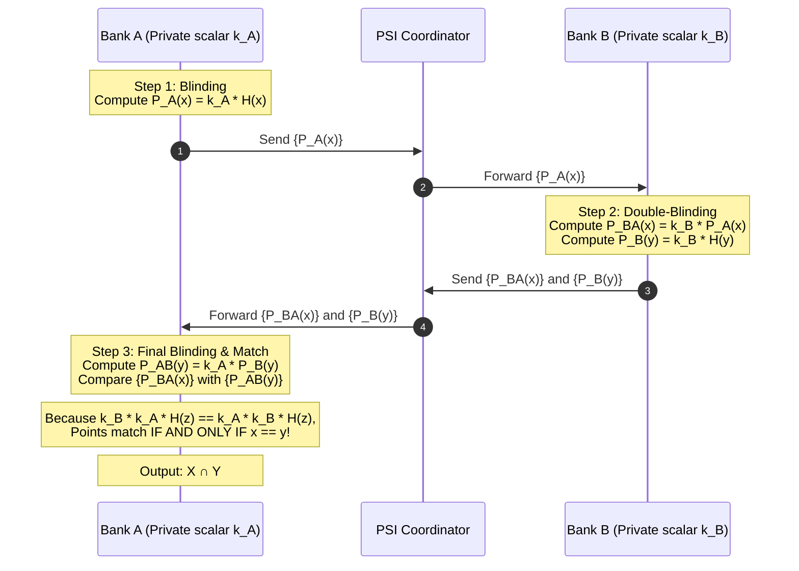

# M3 PRIVACY THREAT MODEL & CRYPTOGRAPHIC PRIVACY SPECIFICATION
## Multi-Party Private Set Intersection (ECDH-PSI), Leakage Bounds, and DPDP Act 2023 Compliance

**Milestone:** M3 (Adversarial Validation, Security, and Forensic Reliability)  
**Track:** SUTRAM 2026 — Problem Statement PS04  
**Date:** November 5, 2026  
**Governing Doctrine:** AI Proposes. Evidence Verifies. Human Decides.

---

# 1. PRIVACY REGULATORY MANDATE

Cross-institutional financial fraud investigation operates under severe privacy constraints:
- **Digital Personal Data Protection Act (DPDPA), 2023:** Mandates purpose limitation, data minimization, and strict penalties for unauthorized customer data disclosure.
- **Reserve Bank of India (RBI) Banking Secrecy:** Commercial banks cannot legally share complete account or customer lists with peer commercial banks during early-stage fraud inquiries.
- **The Operational Dilemma:** How can Bank A determine whether its suspicious mule accounts overlap with active fraud rings at Bank B without revealing innocent customer identities to Bank B?

TARKA resolves this through **Elliptic Curve Diffie-Hellman Private Set Intersection (ECDH-PSI)** (`backend/tarka/privacy/psi.py`).

---

# 2. CRYPTOGRAPHIC FORMALISM: ECDH-PSI

Let Bank A have a dataset of suspect phone numbers $X = \{x_1, \dots, x_m\}$ and Bank B have a dataset $Y = \{y_1, \dots, y_n\}$.

### Mathematical Invariants
1. **Commutativity of Scalar Multiplication:**
   For any identifier $z \in X \cap Y$:
   $$k_A \cdot (k_B \cdot H(z)) = k_B \cdot (k_A \cdot H(z)) = (k_A \cdot k_B) \cdot H(z)$$
2. **Computational Diffie-Hellman (CDH) Assumption on SECP256k1:**
   Given $H(x)$, $k_A \cdot H(x)$, and $k_B \cdot H(x)$, an adversary cannot compute $k_A \cdot k_B \cdot H(x)$ without knowing $k_A$ or $k_B$.

---

# 3. LEAKAGE BOUNDS & ADVERSARIAL RESISTANCE

| Threat Scenario | Attacker Capability | TARKA Privacy Guarantee |
|:---|:---|:---|
| **Non-Matching Identifiers** | Bank B inspects transmitted points from Bank A | **Zero Knowledge:** Points $k_A \cdot H(x)$ are indistinguishable from random curve elements under CDH. Bank B learns nothing about items outside the intersection. |
| **Dictionary / Offline Brute-Force** | Malicious participant hashes common phone numbers to test membership | **Salted Pre-Image & Rate Limiting:** Hash-to-curve uses domain separation prefixes. Query coordinators enforce strict query rate quotas. |
| **Eavesdropping on Coordinator** | Untrusted coordinator intercepts messages | **Zero Content Exposure:** Coordinator sees only blinded elliptic curve points; possesses neither $k_A$ nor $k_B$. |
| **Collusion between 2 Banks** | Two banks share keys to de-anonymize a third | **Ephemeral Session Keys:** Nodes rotate ephemeral EC scalars ($k$) for each discrete query session, preventing cross-query correlation. |
