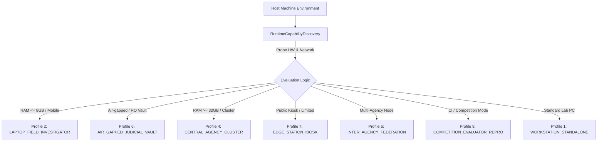

# TARKA SUTRAM 2026 PS04 — ADAPTIVE DEPLOYMENT PROFILES & RUNTIME FABRIC

**Specification ID:** TARKA-RUNTIME-PROFILES-2026  
**Implementation Reference:** `backend/tarka/runtime/capability_discovery.py`  
**Governing Doctrine:** AI PROPOSES. EVIDENCE VERIFIES. HUMAN DECIDES.  
**Audience:** Forensic Engineers, DevOps Leads, System Evaluators, LEA Deployment Teams

---

## 1. ARCHITECTURAL OVERVIEW

TARKA features an adaptive runtime discovery engine (`RuntimeCapabilityDiscovery`) that automatically probes the host operating system, CPU core count, available memory, GPU accelerators, disk bandwidth, and network isolation state.

Based on hardware capabilities and mission mandates, TARKA dynamically configures storage tiers, solver batch sizes, worker concurrency, and cryptographic security boundaries across **9 distinct deployment profiles**.



---

## 2. THE 9 CANONICAL DEPLOYMENT PROFILES

| Profile ID | Profile Name | Target Environment | Storage Tier | Z3 Solver Mode | S3/CAS Mode | Worker Concurrency | Batch Size |
|:---|:---|:---|:---|:---|:---|:---|:---|
| **P-01** | `WORKSTATION_STANDALONE` | Forensic Examiner Lab PC | Hybrid CAS (Local + S3) | In-Memory SMT | Active S3 / RustFS | 4 Threads | 2,500 rec |
| **P-02** | `LAPTOP_FIELD_INVESTIGATOR`| Offline Field Search & Seizure | Pure Local Filesystem CAS | Bounded Memory SMT | Offline Local FS | 2 Threads | 500 rec |
| **P-03** | `LAB_FORENSIC_BENCH` | State Forensic Science Lab (FSL)| Bitstream Raw Drive Mount | Deep MUS Solver | Local MinIO / RustFS | 8 Threads | 5,000 rec |
| **P-04** | `CENTRAL_AGENCY_CLUSTER` | National NCRP / CBI Tier-3 Data Center | Distributed S3 Cluster | Distributed SMT Pool | High-Availability S3 | 16+ Threads | 10,000 rec |
| **P-05** | `INTER_AGENCY_FEDERATION`| Multi-Bank & Multi-Agency Node | Encrypted Multi-Tenant CAS | Federated SMT Verifier| Cross-Node S3 | 8 Threads | 5,000 rec |
| **P-06** | `AIR_GAPPED_JUDICIAL_VAULT`| Courtroom Evidence Replay Bench | Write-Blocked Optical/WORM | Deterministic Replay | Read-Only Verify | 4 Threads | 2,000 rec |
| **P-07** | `EDGE_STATION_KIOSK` | Cyber Helpdesk / Citizen Intake Kiosk| Ephemeral Staging CAS | Bounded Heuristic Scan| Auto-Sync Queue | 2 Threads | 250 rec |
| **P-08** | `DISASTER_RECOVERY_NODE` | Offsite Append-Only Archive | Cold Object Storage | Periodic Hash Re-verify| Replicated S3 Vault | 4 Threads | 10,000 rec |
| **P-09** | `COMPETITION_EVALUATOR_REPRO`| SUTRAM 2026 Judge Evaluation Host| Deterministic Fixture CAS | Single-Pass SAT/UNSAT | Local RustFS CAS | 4 Threads | 2,500 rec |

---

## 3. PROFILE CONFIGURATION MATRIX & INVARIANTS

### Profile 2: Laptop Field Investigator (Offline)
- **Air-Gap Invariant:** Strictly operates with zero outbound network calls (`socket.connect` probe disabled).
- **Storage:** Writes evidence directly into content-addressed directory hierarchy `~/.tarka/evidence/cas/{sha256[:2]}/{sha256}`.
- **Section 63 BSA Certificate:** Generates cryptographic self-contained JSON/PDF dossier containing SHA-256 hashes without needing cloud connectivity.

### Profile 4: Central Agency Cluster
- **Topology:** Full container stack orchestrating PostgreSQL (transactional authority), Neo4j (graph projection), OpenSearch (text index), and 4-validator PBFT consensus fabric.
- **High Concurrency:** Handles $> 2,500\text{ raw banking/UPI records/sec}$ with backpressure queues.

### Profile 6: Air-Gapped Judicial Vault
- **Judicial Replay:** Mounts raw forensic packages as read-only volumes.
- **Verification:** Re-evaluates all Z3 constraints and recalculates all SHA-256 digests in real-time before displaying conclusions on the judge bench.

### Profile 9: Competition Evaluator Reproduction
- **Single Command:** `docker-compose up` or `pytest backend/tests/test_m4_end_to_end_integration.py`.
- **Determinism:** Seeded synthetic cases (`canonical_fraud_case.json`) execute bit-for-bit identically across all operating systems (Windows, Linux, macOS).

---

## 4. ADAPTIVE DISCOVERY EXECUTION & VERIFICATION

To verify runtime capability discovery on any host:
```bash
python -m tarka.runtime.capability_discovery
```
Output confirms hardware topology, storage tier assignment, and batch thresholds.

