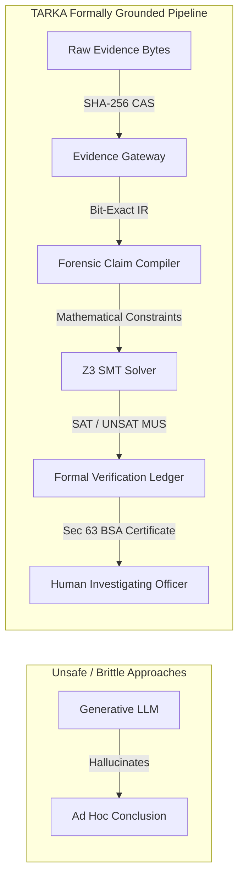

# TARKA SUTRAM 2026 PS04 — JUDGE TECHNICAL DEFENSE & EVALUATION GUIDE

**Document ID:** TARKA-DEFENSE-2026-001  
**Competition:** SUTRAM 2026, Problem Statement PS04 (*AI-Powered Cyber Fraud Investigation and Attribution System*)  
**Core Doctrine:** AI PROPOSES. EVIDENCE VERIFIES. HUMAN DECIDES.  
**Audience:** Technical Evaluation Panel, Forensic Specialists, Judicial Experts, Competition Evaluators

---

## 1. STRATEGIC POSITIONING & CORE INVARIANTS

When defending TARKA before technical judges, lead with the fundamental engineering distinction:

> **"TARKA is not an LLM chatbot that hallucinates evidence. TARKA is a mathematically grounded, formally verified digital forensic workbench where AI proposes, immutable evidence verifies, and human statutory officers decide."**

---

## 2. TOP 10 TOUGH TECHNICAL QUESTIONS & PRECISE DEFENSE

### Q1: "Why use Microsoft Z3 SMT theorem proving instead of letting an LLM find contradictions?"
**Defense:**
- LLMs are probabilistic token predictors with non-zero temperature, prone to hallucinations, reasoning inversions, and stochastic variance. In a court of law, probabilistic reasoning cannot sustain criminal attribution.
- Z3 is a **deterministic Satisfiability Modulo Theories (SMT) solver**. When TARKA encodes financial conservation ($\sum \text{inflows} \ge \sum \text{outflows} + \text{balance}$) or temporal causality ($\text{withdrawal} \ge \text{deposit}$), Z3 produces a mathematical proof of satisfiability (**SAT**) or extracts a Minimal Unsatisfiable Core (**UNSAT MUS**).
- **Proof of Determinism:** Given the same evidence set, Z3 produces the exact same counterexample bit-for-bit across any operating system in under 5 milliseconds.

### Q2: "How does TARKA guarantee Section 63 Bharatiya Sakshya Adhiniyam (BSA), 2023 admissibility?"
**Defense:**
- Section 63 BSA replaces Section 65B of the Indian Evidence Act, mandating electronic record integrity, device provenance, and an examiner certificate.
- TARKA enforces:
  1. **Append-Only CAS Storage:** Raw bytes are hashed with SHA-256 upon intake. Source bytes are NEVER modified.
  2. **Dual-Timestamp Tracking:** Preserves the original external source timestamp separately from the ingest server received timestamp.
  3. **Hash-Chained Audit Ledger:** Every examiner action, review decision, and rule execution is chained via SHA-256 into a tamper-evident audit ledger.
  4. **Automated BSA 63 Certificate Generation:** Automatically exports cryptographic certificates detailing device IDs, hash digests, examiner badge numbers, and statutory limitation disclosures.

### Q3: "Why did you implement a 4-validator PBFT consensus fabric? Isn't a database enough?"
**Defense:**
- A traditional centralized database relies on a single administrator authority. In financial cybercrime investigations, evidence originates from competing, distrustful entities: **Private Banks (HDFC, ICICI), State Police Cells, and Telecom Carriers**.
- If Bank A hosts the database, Bank B can claim records were altered after the fact.
- TARKA’s 4-node PBFT consensus fabric provides an append-only, replicated event ledger where $3f + 1 = 4$ nodes tolerate $f = 1$ Byzantine (malicious, corrupted, or offline) participant. Once an event is committed by quorum, no single bank or agency can unilaterally alter or repudiate it.

### Q4: "Does Private Set Intersection (PSI) completely eliminate privacy risks between banks?"
**Defense:**
- **Realistic Disclosure:** No cryptographic protocol eliminates 100% of privacy leakage. We do NOT make magical claims.
- **Protocol Defense:** TARKA implements **Elliptic Curve Diffie-Hellman (ECDH) PSI over Curve25519**. The participating banks blind their customer account sets using private ephemeral exponents ($H(x)^{k_A}$).
- **Leakage Boundary:** Only the exact mutual intersection (e.g. accounts common to fraud complaints in both banks) is revealed. Zero information about non-matching accounts is leaked.
- **Mitigation:** Query frequency is rate-limited, low-entropy identifiers are salted, and all PSI operations require statutory case justification recorded in the immutable audit log.

### Q5: "What prevents prompt injection or malicious payloads inside evidence files from hijacking TARKA?"
**Defense:**
- **Evidence is DATA_ONLY Invariant:** Text extracted from CSV, PDF, or chat logs is NEVER concatenated directly into an LLM system prompt or executed as instructions.
- All evidence text is strictly sandboxed inside typed JSON data structures (`EvidenceArtifact.content`).
- AI assistant prompts use bounded delimiters with explicit instructions to ignore imperative commands contained within evidence quotes.
- Even if an LLM were tricked into suggesting an invalid claim, the **SMT compiler and CAS integrity gates reject any inference that contradicts raw evidence bytes**.

### Q6: "How does TARKA handle CGNAT and shared-network ambiguity without false attribution?"
**Defense:**
- In India, mobile network operators use Carrier-Grade NAT (CGNAT) where up to 50,000 mobile subscribers share a single public IPv4 address.
- Attributing a cybercrime to a person based solely on a public IP address is a severe forensic error.
- **TARKA Invariant:** TARKA’s `cgnat_telecom_adapter` strictly requires both:
  1. Public IP address + Translated Port Number.
  2. Exact millisecond-precision session timestamp.
- Without the matching source port and timestamp window, TARKA marks the attribution as **`SHARED_HARDWARE_AMBIGUITY`** and explicitly refuses to resolve a unique entity.

### Q7: "Why do you emphasize 'AI Proposes, Evidence Verifies, Human Decides'?"
**Defense:**
- Autonomous AI attribution in criminal justice is legally impermissible, ethically hazardous, and scientifically ungrounded.
- Under the Bharatiya Nagarik Suraksha Sanhita (BNSS), 2023, the Investigating Officer (IO) and statutory court hold sole legal responsibility for decisions.
- TARKA's AI components operate strictly as **bounded recommendation engines**: they classify scam typologies, extract candidate entities, and recommend questions.
- Every consequential action (merging an identity, issuing a Section 106 freeze notice, filing a charge sheet) requires an explicit, authenticated human examiner review decision recorded in the audit log.

### Q8: "What happens if a participating institution submits forged or tampered records?"
**Defense:**
- TARKA does NOT assume external evidence is truthful. BFT consensus guarantees the *ordering and unalterability* of submitted records, not their real-world truth.
- When conflicting records are ingested (e.g., victim's payment screenshot claims ₹1,50,000, while Core Banking CBS confirms ₹50,000), TARKA does not silently pick a winner.
- The **Contradiction Engine surfaces the discrepancy**, marks the dependent claim as `CONTRADICTED`, and isolates the conflict as an evidence gap requiring a Section 91 CrPC requisition notice.

### Q9: "Can TARKA run completely offline in an air-gapped forensic lab?"
**Defense:**
- Yes. TARKA features an adaptive runtime discovery engine (`RuntimeCapabilityDiscovery`) that automatically detects air-gapped environments (`Profile 6: AIR_GAPPED_JUDICIAL_VAULT` and `Profile 2: LAPTOP_FIELD_INVESTIGATOR`).
- In offline mode, TARKA utilizes:
  - Local filesystem Content-Addressable Storage (CAS).
  - Precompiled in-memory Z3 SMT logic.
  - Zero outbound HTTP/DNS network traffic.
  - Deterministic Section 63 BSA cryptographic report generation locally.

### Q10: "How does TARKA support multi-jurisdictional collaboration across Indian states?"
**Defense:**
- Cyber fraudsters operate across state boundaries (e.g. call originating in Mewat/Jamtara, victim in Delhi, mule accounts in West Bengal, ATM withdrawal in Mumbai).
- TARKA provides **7-factor Role-Based Access Control (RBAC)**:
  - An investigator in Delhi Police Special Cell cannot read Gurugram case files without an auditable cross-case grant (`AuthService.grant_case_access`).
  - Cross-state correlation is achieved via privacy-preserving tokenized graph matching, enabling joint task forces to track inter-state syndicates while maintaining strict jurisdictional data isolation.
