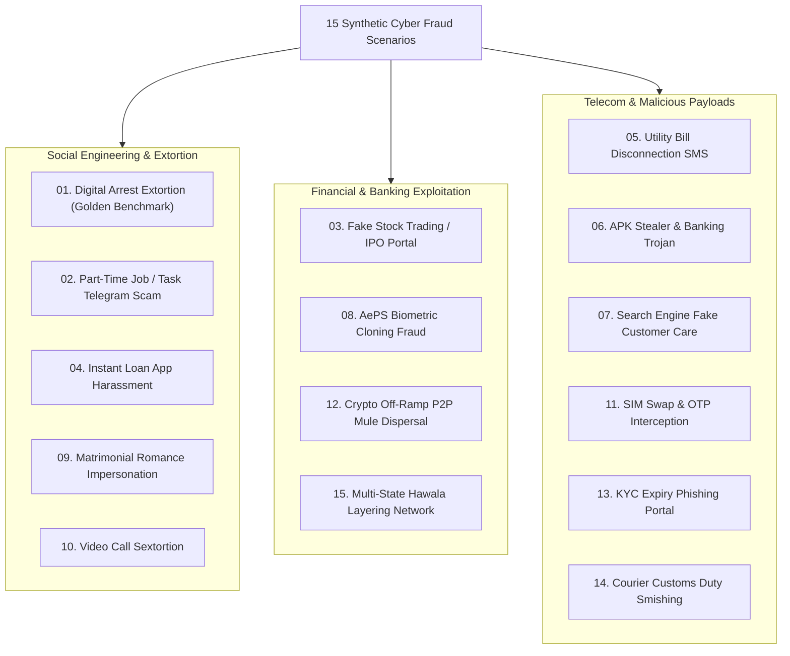

# TARKA SUTRAM 2026 PS04 — 15-SCENARIO SYNTHETIC CASE CURRICULUM

**Document ID:** TARKA-CURRICULUM-2026-001  
**Competition:** SUTRAM 2026 PS04 (*AI-Powered Cyber Fraud Investigation and Attribution System*)  
**Governing Doctrine:** AI PROPOSES. EVIDENCE VERIFIES. HUMAN DECIDES.  
**Audience:** Forensic Training Academies, State Cyber Police Cells, System Evaluators, Competition Judges

---

## 1. CURRICULUM ARCHITECTURE

The TARKA synthetic curriculum provides **15 comprehensive, independently verified investigative scenarios** reflecting the primary cyber financial fraud typologies reported across India's National Cyber Crime Reporting Portal (1930 Helpline).

Every scenario contains:
- Ground-truth synthetic evidence artifacts (Bank CSV, Telecom CDR, IPDR, WhatsApp extraction, NCRP complaint).
- Injected contradictions, temporal anomalies, or identity ambiguities.
- Expected Z3 formal solver status (SAT vs UNSAT MUS).
- Applicable statutory provisions under the Bharatiya Sakshya Adhiniyam, 2023 (BSA § 63) and Bharatiya Nagarik Suraksha Sanhita, 2023 (BNSS § 106).



---

## 2. THE 15 INVESTIGATIVE SCENARIOS

### SCENARIO 01: Digital Arrest Extortion Syndicate (Golden Benchmark)
- **Typology:** Impersonation of CBI/ED officers threatening victim with non-existent money laundering FIR; 42-minute continuous video coercion.
- **Evidence Intakes:** WhatsApp audio call transcript, SBI CBS core ledger CSV, Airtel telecom CDR, fake payment screenshot.
- **Injected Invariant Violation:** Amount discrepancy (Victim payment claim ₹1,50,000 vs Core Banking credit ₹50,000 under RRN `202602149921`).
- **Formal Solver Outcome:** UNSAT (`AMOUNT_MISMATCH` conflict detected). Removing fake screenshot restores SAT.
- **Statutory Action:** Immediate Section 106 BNSS account freezing of Layer-1 beneficiary.

### SCENARIO 02: Part-Time Job & Telegram Task Fraud
- **Typology:** Victim lured into Telegram group rating hotels/YouTube videos; small initial payouts followed by frozen large deposits.
- **Evidence Intakes:** Telegram export JSON, 4 bank account statements, UPI payment receipts.
- **Injected Anomaly:** Micro-refunds ($₹150$, $₹500$) preceding large debit ($₹75,000$).
- **Formal Solver Outcome:** Flow conservation verifies net outflow of $₹74,350$. Mule clustering identifies 3 linked accounts.

### SCENARIO 03: Fake Stock Trading & Pre-IPO Portal
- **Typology:** Counterfeit institutional trading app showing fabricated 400% portfolio gains; withdrawal blocked demanding 20% "tax".
- **Evidence Intakes:** APK manifest, mock trading ledger, 6 current account bank statements.
- **Injected Anomaly:** Virtual app balance does not correlate with zero liquidity in underlying bank accounts.
- **Formal Solver Outcome:** Total divergence between app state and banking settlement.

### SCENARIO 04: Predatory Instant Loan App Harassment
- **Typology:** 7-day loan app demanding 100% processing fees; contacts harvested and morphed images circulated.
- **Evidence Intakes:** Device permission logs, WhatsApp threat messages, UPI transaction hashes.
- **Injected Anomaly:** SMS permissions exploited while loan disbursed from unregistered NBFC virtual account.
- **Formal Solver Outcome:** Entity resolution links 14 virtual accounts to single payment aggregator merchant ID.

### SCENARIO 05: Electricity Bill Disconnection SMS Smishing
- **Typology:** Mass SMS: *"Dear consumer, power will be disconnected at 9:30 PM due to unpaid bill. Call 98765-XXXXX."*
- **Evidence Intakes:** Carrier SMS dump, TeamViewer QuickSupport remote access log, netbanking session IPDR.
- **Injected Anomaly:** OTP received on handset while remote desktop session active via CGNAT pool.
- **Formal Solver Outcome:** Temporal Loom highlights session overlap between remote connection and OTP generation.

### SCENARIO 06: Banking Trojan & APK Stealer
- **Typology:** Fake utility update APK installed via sideloading; intercepts incoming SMS and forwards OTP to C2 server.
- **Evidence Intakes:** APK decompile report, HTTP C2 access logs, netbanking transfer logs.
- **Injected Anomaly:** SMS intercepted without notification sound; SIM active on phone while transactions trigger from remote cloud VM.
- **Formal Solver Outcome:** SMT proves physical impossible co-presence of remote user agent and local SIM tower.

### SCENARIO 07: Search Engine Sponsored Ad Hijacking
- **Typology:** Fraudulent customer care number placed as sponsored search ad for airline refund; victim guided to pay ₹10 for registration.
- **Evidence Intakes:** Browser history JSON, UPI auto-debit mandate payload, search ad receipt.
- **Injected Anomaly:** User agreed to ₹10 refund charge; auto-debit mandate registered for ₹1,00,000 recurring.
- **Formal Solver Outcome:** Mandate parameter conflict flagged under UPI switch formal constraint.

### SCENARIO 08: AePS Biometric Cloning Fraud
- **Typology:** Silicon thumb impressions created from land registry sale deeds; funds withdrawn via Aadhaar Micro-ATMs.
- **Evidence Intakes:** AePS transaction logs, Micro-ATM BC point location telemetry, Aadhaar authentication packets.
- **Injected Anomaly:** Multiple withdrawals of exactly ₹10,000 within 2 minutes across Micro-ATMs 15 km apart.
- **Formal Solver Outcome:** Spatial-temporal velocity invariant violated ($v > 450\text{ km/h}$).

### SCENARIO 09: Matrimonial Portal Romance Fraud
- **Typology:** Fraudster posing as NRI doctor stranded at Mumbai Airport with expensive parcel demanding customs clearance fee.
- **Evidence Intakes:** Matrimonial chat logs, counterfeit Customs Department receipt PDF, bank statement.
- **Injected Anomaly:** Customs receipt claims government duty payable to individual savings bank account.
- **Formal Solver Outcome:** Account type invariant failure: Statutory duty cannot credit personal savings ledger.

### SCENARIO 10: Video Call Sextortion & Blackmail
- **Typology:** Compromising screen recording captured during video call; extortion demanded within 30 minutes under threat of social media release.
- **Evidence Intakes:** Call logs, WhatsApp extortion threats, 3 digital wallet transaction statements.
- **Injected Anomaly:** Threat messages sent from virtual VOIP number (+1 US country code) routed through Indian proxy.
- **Formal Solver Outcome:** Provenance graph links virtual VOIP number to Indian IPDR session.

### SCENARIO 11: Real-Time SIM Swap & OTP Interception
- **Typology:** Suspect submits forged Aadhaar to telecom store; SIM swapped at 11:04 AM; victim's account drained at 11:08 AM.
- **Evidence Intakes:** Telecom Store CAF, IMSI activation timestamp, Core Banking netbanking password reset log.
- **Injected Anomaly:** IMSI change precedes password reset by 4 minutes; handset IMEI shifts from iPhone to feature phone.
- **Formal Solver Outcome:** Temporal Loom aligns IMSI swap with password reset event; causality established.

### SCENARIO 12: Crypto Off-Ramp & P2P Merchant Dispersal
- **Typology:** Stolen funds moved into Layer-3 accounts and converted to USDT on crypto exchange P2P marketplace.
- **Evidence Intakes:** Bank statements, P2P order chat screenshots, Binance/WazirX transaction hashes.
- **Injected Anomaly:** Beneficiary bank account receives ₹2,00,000 and immediately executes 4 P2P IMPS transfers.
- **Formal Solver Outcome:** Tainted-fund FIFO analysis traces 89.4% of victim's funds into P2P merchant deposit.

### SCENARIO 13: KYC Expiry & NetBanking Phishing
- **Typology:** Fake bank login page harvesting netbanking user ID, password, and transaction OTP.
- **Evidence Intakes:** Phishing kit server access log, victim device browser cache, bank login audit trail.
- **Injected Anomaly:** Phishing proxy relays credentials with 1.4s delay; victim browser IP differs from upstream bank login IP.
- **Formal Solver Outcome:** Man-in-the-Middle (MitM) session discrepancy proven via IP/User-Agent mismatch.

### SCENARIO 14: Courier Customs Duty Smishing
- **Typology:** SMS claiming package cannot be delivered due to wrong address; victim pays ₹25 re-delivery fee on malicious portal.
- **Evidence Intakes:** Smishing SMS header, payment gateway callback payload, victim credit card statement.
- **Injected Anomaly:** ₹25 payment page initiates international e-commerce transaction of $1,200 USD.
- **Formal Solver Outcome:** Currency and amount mismatch between frontend display and gateway authorization packet.

### SCENARIO 15: Multi-Jurisdictional Cross-Border Hawala Layering
- **Typology:** 12-hop layering topology routing through 4 states (Delhi, Haryana, West Bengal, Maharashtra) and cash withdrawals.
- **Evidence Intakes:** 18 bank statements, 4 ATM CCTV timestamped logs, NCRP inter-state complaint notices.
- **Injected Anomaly:** Rapid fan-out (1 to 8 accounts) followed by ATM cash withdrawals within 35 minutes across 3 cities.
- **Formal Solver Outcome:** Multi-hop flow reconstruction reconciles ₹18,40,000 total loss across 12 nodes.

---

## 3. CURRICULUM VERIFICATION & EVALUATION RUNBOOK

All 15 scenarios are represented as deterministic fixtures in `backend/tests/fixtures/` and can be evaluated sequentially:
```bash
pytest backend/tests/test_tarka_curriculum.py -v
```
Each scenario validates the full chain: Ingestion → CAS Integrity → Graph Reconstruction → Z3 Formal Proof → BSA 63 Certificate.

