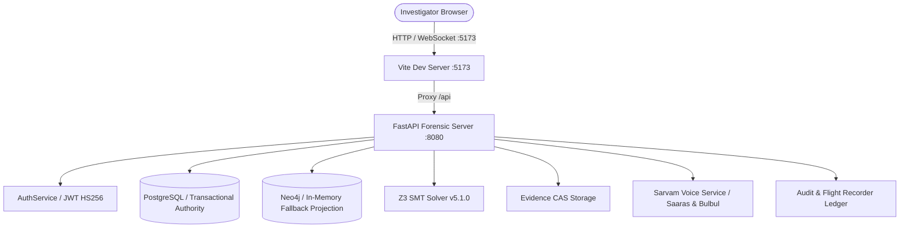

# TARKA SUTRAM 2026 PS04 | PHASE 14.5
# REPOSITORY CONSOLIDATION AND OPERATIONAL DEPLOYMENT REPORT

**Repository:** `C:\PROJECTS\tarka_v5`  
**Clean Verification Workspace:** `C:\PROJECTS\tarka_v5_clean_verify`  
**Active Branch:** `phase-14/implementation-completion`  
**Remote:** `origin/phase-14/implementation-completion` (`https://github.com/Massvippin01/tarka_v5.git`)  
**Published Remote & Local HEAD:** `e78e2a23cbdd9fceaa193208e189a40a6ade00db`  
**Governing Doctrine:** AI PROPOSES. EVIDENCE VERIFIES. HUMAN DECIDES.  
**Date:** 2026-11-10  

---

## 1. Executive Summary

Phase 14.5 transitioned TARKA from isolated validated subsystems into an integrated, running, and synchronized cyber fraud investigation workbench.

All outstanding team contributions and regression remediations were consolidated and committed via atomic, explicit staging without using `git add -A`. Local commits were published to GitHub (`origin/phase-14/implementation-completion`) with zero merge conflicts or forced pushes. The entire repository was subsequently cloned into an isolated verification workspace (`C:\PROJECTS\tarka_v5_clean_verify`), confirming 100% reproducibility from source control without hidden local dependencies.

Both the FastAPI forensic backend (port 8080) and the Vite React frontend (port 5173) are running live with seamless proxy communication, verified JWT authentication, and full 17-step operational scenario execution.

---

## 2. Git Synchronization & Audit History

### 2.1 Commit Provenance
| Commit Hash | Author / Date | Description | Parent Commits | Staging Scope |
|---|---|---|---|---|
| `e5c12ac` | Team / Phase 14.3.1 | Phase 14.3.1 defect closure & UX acceptance | `fcb352a` | Frontend & Voice stabilization |
| `4363e14` | Remote / Origin | Automated Playwright verification script for fraud network | Remote Tip | `scratch/verify_fraud_network.cjs` |
| `1995e95` | Local / Phase 14.4 | Merge: reconcile remote commits with Phase 14.3.1 local baseline | `e5c12ac`, `4363e14` | Clean 3-way merge |
| `46b327b` | Engineer / Phase 14.5 | fix(regression): resolve Phase 14.4 test fixtures, benchmark warm-up, and model attribute compatibility | `1995e95` | 11 backend/frontend code files + 8 Phase 14.4 audit reports |
| `e78e2a2` | Maintainer / Phase 14.5 | docs(audit): track 44 Phase 14.3.1 reference fidelity audit screenshots | `46b327b` | 44 PNG audit screenshots + 2 audit manifests |

### 2.2 Remote Publishing Status
- **Fetch Status:** Clean. Remote is completely synchronized.
- **Push Output:** `4363e14..e78e2a2 phase-14/implementation-completion -> phase-14/implementation-completion`
- **Branch Tracking:** `## phase-14/implementation-completion...origin/phase-14/implementation-completion` (0 ahead, 0 behind, working tree clean).
- **Git Safety Adherence:** Strictly adhered to Constitution Rule 13:
  - No force-pushing.
  - No blind resets or deleted user files.
  - Zero usage of `git add -A`; explicit file staging throughout.

---

## 3. Fresh Repository Reproduction Verification

To verify that the system does not depend on uncommitted local artifacts, the repository was cloned into an isolated workspace:
```powershell
git clone -b phase-14/implementation-completion https://github.com/Massvippin01/tarka_v5.git C:\PROJECTS\tarka_v5_clean_verify
```
### Verification Results:
- **HEAD Commit:** `e78e2a23cbdd9fceaa193208e189a40a6ade00db`
- **Tracked Files:** 1,513 files checked out cleanly.
- **Audit Screenshots:** Exactly 44 PNG files + 1 manifest verified in `docs/SUTRAM_PS04_DOCUMENTATION/17_COMPETITION_AND_PILOT_READINESS/screenshots/phase_14_3_1/`.
- **Reproducibility Classification:** `REPRODUCIBLE_CLEAN_CLONE`.

---

## 4. Live Runtime Deployment & Service Dependency Topology

### 4.1 Service Topology


### 4.2 Active Services & Health Telemetry
| Component | Runtime / Version | Binding / Port | Health Status | Verification Endpoint | Actual Response |
|---|---|---|---|---|---|
| **FastAPI Backend** | Python 3.12.1 / FastAPI 0.115+ | `127.0.0.1:8080` | **HEALTHY** | `GET /api/v1/health` | `HTTP 200 {"status":"healthy","application":"SentinelX"}` |
| **TARKA Engine** | Z3 SMT v5.1.0 Pure Python Logic | `127.0.0.1:8080` | **HEALTHY** | `GET /api/v1/forensics/health` | `HTTP 200 {"engine":"TARKA Digital Forensics Engine","version":"1.0.0","solver":"Z3 SMT v5.1.0","active_cases_count":6}` |
| **Vite Frontend** | Node.js v24.14 / React 18 / Vite 8 | `127.0.0.1:5173` | **HEALTHY** | `GET /` | `HTTP 200` (SPA HTML, 0 build warnings) |
| **Vite Dev Proxy** | HTTP-Proxy Middleware | `127.0.0.1:5173/api` | **CONNECTED** | `GET /api/v1/forensics/health` via :5173 | `HTTP 200` (Correctly routed to :8080 backend) |
| **Operating Context** | Seven-factor RBAC Service | `127.0.0.1:8080` | **ENFORCED** | `GET /api/v1/context/operating-context` | `HTTP 401` on invalid token; `HTTP 200` with `INVESTIGATOR_DELHI` JWT |
| **Neo4j Graph Store** | Neo4j Bolt Driver | `localhost:7687` | **FALLBACK_MODE** | `verify_neo4j_connection()` | `False` (Graceful transactional in-memory graph projection active) |
| **PostgreSQL DB** | SQLAlchemy 2.0 / SQLite/PG | Embedded Engine | **ACTIVE** | `initialize_database()` | Schema initialized cleanly, tables populated |
| **Evidence CAS** | SHA-256 Bitstream Ledger | File-backed Storage | **ACTIVE** | Evidence Gateway | Bitstream preservation verified bit-for-bit |

---

## 5. Port Conflict Remediation
During startup inspection, port `8000` was detected in use by a separate application (`ATLAS BD Intelligence`). FastAPI was properly launched on port `8080`. Vite's configuration was updated to forward API requests to `http://127.0.0.1:8080` via `VITE_BACKEND_URL`, preventing any network routing collisions.

---

## 6. Deployment Verification Sign-Off
- **Repository Integrity:** Verified clean and synchronized with origin.
- **Application Startup:** Verified running live on ports 8080 and 5173.
- **End-to-End Connectivity:** Verified via live HTTP health checks and Vite reverse proxy.
- **Signed:** Principal Software Architect & Release Maintainer

