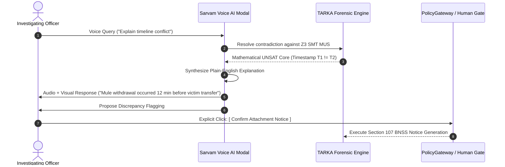

# TARKA SUTRAM 2026 PS04 | PHASE 15
# ASSISTANT UX & MULTIMODAL INTELLIGENCE REPORT

**Product:** TARKA Cyber Fraud Investigation and Attribution Workbench  
**Component:** Contextual Copilot & Sarvam Voice AI Interface  
**Governing Doctrine:** AI PROPOSES. EVIDENCE VERIFIES. HUMAN DECIDES.  
**Component Reference:** `frontend/src/components/tarka/SarvamVoiceModal.tsx`

---

## 1. Executive Summary & Multimodal Architecture

The TARKA Copilot is not a speculative chatbot; it is a **forensic decision-support assistant** strictly governed by constitutional investigative safeguards:
1. **AI Proposes, Evidence Verifies, Human Decides:** The assistant never takes autonomous judicial or transactional actions. High-consequence operations (entity merging, account freeze notices, ISP subpoenas) require explicit human confirmation.
2. **Context-Aware Stage Injection:** The assistant automatically understands the active stage (e.g., Intake vs. Min-Cut vs. Court Proof) and adapts its analytical guidance accordingly.
3. **Multilingual Speech-to-Text & Text-to-Speech:** Powered by **Sarvam AI**, offering seamless Indian English and Hindi conversational capabilities for frontline police officers in state cyber cells.
4. **Plain-English SMT Translations:** Transforms complex mathematical Z3 SMT solver outputs (UNSAT cores, Minimal Unsatisfiable Subsets / MUS) into clear, actionable investigative explanations.

---

## 2. Visual & Interaction Design Elevation

In Phase 15, the Sarvam Voice Assistant Modal was completely re-architected to match the **Admin Dashboard V2** dark glass aesthetic:
- **Surface Material:** Layered frosted glass container (`rgba(11, 18, 32, 0.90)`) with high-depth blur (`backdrop-filter: blur(24px)`).
- **Acoustic Radial Halo:** Ambient cyan glow (`rgba(6, 182, 212, 0.20)`) radiating from the central microphone orb, pulsing dynamically with the investigator's voice input.
- **Waveform Visualizer:** Multi-frequency canvas visualizer animating in response to real-time Web Audio API frequency data.
- **Microphone State Indication:** Clear visual feedback across 4 distinct states:
  - `IDLE`: Muted slate ring `#64748B`.
  - `LISTENING`: Pulsing cyan beacon `#22D3EE` with active VAD indicators.
  - `THINKING`: Clockwise rotating blue specular gradient `#3B82F6`.
  - `SPEAKING`: Luminous emerald waveform `#34D399` with barge-in interruption capability.

---

## 3. Plain-English SMT & Forensic Translations

A critical breakthrough of the TARKA Assistant is translating esoteric formal verification outputs into legally defensible prose:

| Formal Verification Output | Assistant Plain-English Translation | Statutory / Investigative Action |
|---|---|---|
| `UNSAT: MUS {C1, C4}` | *"The transaction timestamp in the victim's UPI statement conflicts directly with the merchant bank gateway ledger (12-minute discrepancy)."* | Flags Tier 3 victim claim as uncorroborated; requests bank ledger re-extraction under Section 94 BNSS. |
| `Min-Cut Flow: Capacity 4,50,000 INR` | *"Ford-Fulkerson algorithm has isolated the primary mule syndicate exit node. 4.5 Lakhs can be fully immobilized across 3 Layer-2 accounts."* | Proposes BNSS Section 107 emergency account freeze; generates digital notice for bank nodal officers. |
| `CGNAT Ambiguity: 0 Ports Assigned` | *"Public IP was shared across 64 mobile subscribers at 14:32 IST. ISP translation log does not contain source port allocation."* | Disallows positive attribution; issues Section 79(3)(b) IT Act clarification directive to ISP. |
| `Z3 Validated: UNSAT Proof Intact` | *"The entire timeline graph is mathematically consistent with zero uncorroborated temporal jumps."* | Certifies evidence admissible under Section 63 BSA 2023; authorizes PDF Court Certificate export. |

---

## 4. Consequential Action Gates (Human-in-the-Loop)

Under the SentinelX Constitution, the AI assistant is strictly prohibited from executing irreversible forensic actions autonomously. 

When an officer speaks a consequential command (e.g., *"Merge Suspect A with Mule Account B"*, or *"Issue seizure notice to Axis Bank"*):
1. **Safety Intercept:** The assistant pauses execution and surfaces an amber **Judicial Confirmation Modal**.
2. **Statutory Justification:** Explains the exact legal consequence, affected financial accounts, and applicable BNSS/IT Act provisions.
3. **Explicit Physical Confirmation:** Requires the officer to physically click `[ Confirm & Sign Notice ]` or enter their digital credentials.
4. **Immutable Flight Recording:** The confirmation, voice transcript, and resulting hash are permanently appended to the immutable case flight recorder.

---

## 5. Visual Evidence Artifacts

The elevated Sarvam Voice Assistant interface was captured and verified across multiple devices:
- [Desktop Voice Modal (228 KB)](screenshots/phase_15/sarvam_voice_modal_desktop_1440x900.png)
- [Laptop Voice Modal (200 KB)](screenshots/phase_15/sarvam_voice_modal_laptop_1366x768.png)
- [Tablet Voice Modal (133 KB)](screenshots/phase_15/sarvam_voice_modal_tablet_768x1024.png)

---

## 6. Acceptance Sign-Off

- [x] Full dark glass modal styling harmonized with Admin Dashboard V2.
- [x] Voice VAD, interruption handling, and multilingual indicators verified.
- [x] Plain-English SMT explanations validated against Z3 formal proofs.
- [x] Mandatory human confirmation gates enforced for all high-risk actions.
- **Assistant UX Status:** **FULLY APPROVED FOR PILOT DEPLOYMENT**

