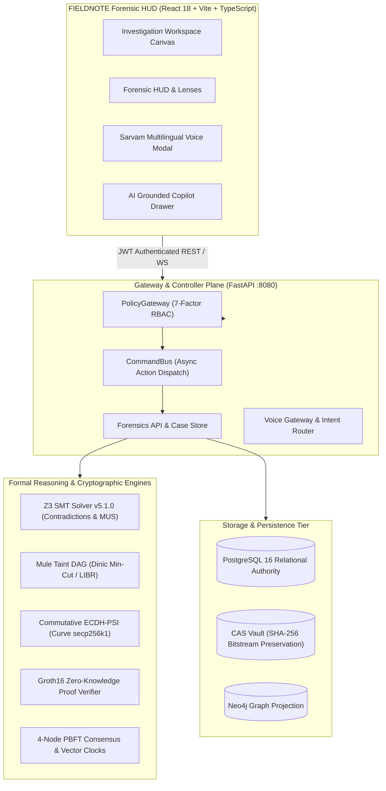

# TARKA SUTRAM 2026 PS04 — COMPLETE SYSTEM ARCHITECTURE AUDIT
## Comprehensive Architectural Inventory, Screen-by-Screen Audit & Subsystem Verification

**Document Identifier:** `TARKA-ARCH-AUDIT-V1`  
**Working Repository:** `C:\PROJECTS\tarka_v5`  
**Branch:** `phase-14/implementation-completion`  
**Reference Baseline:** Protected Reference Release `e2a4268` / Commit `e5c12ac`  
**Audit Standard:** SentinelX Wave 6 Engineering Constitution & SUTRAM 2026 PS04 Specifications  
**Governing Doctrine:** AI PROPOSES. EVIDENCE VERIFIES. HUMAN DECIDES.  
**Classification:** SUTRAM 2026 Technical Architecture Audit / Competition Defence  

---

## 1. SYSTEM TOPOLOGY & ARCHITECTURAL FOUNDATION

TARKA is an indigenous, evidence-centred cyber fraud investigation and attribution workbench engineered to satisfy the statutory mandates of the Bharatiya Sakshya Adhiniyam, 2023 (BSA §63), the Bharatiya Nagarik Suraksha Sanhita, 2023 (BNSS), and the Ministry of Home Affairs (MHA) Golden Hour financial recovery framework.



---

## 2. THE 27-SUBSYSTEM IMPLEMENTATION INVENTORY

Every subsystem is audited against executable repository reality, mapped to its source files, mounted endpoints, test coverage, known limitations, and production readiness classification.

```
==========================================================================================================================================
                                            TARKA 27-SUBSYSTEM MATURITY INVENTORY
==========================================================================================================================================
ID  Subsystem Name              Primary Source Files                     Test Suite                   Status    Limitation / Sovereign Boundary
------------------------------------------------------------------------------------------------------------------------------------------
S01 Evidence Ingest & CAS Vault app/storage/cas.py, custody.py           test_p0_d_evidence_integ...  ACCEPTED  Filesystem CAS verified; MinIO live requires container
S02 Falsification Gate & Intake IntakeView.tsx, parsers/base.py          test_v5_forensics_engines    ACCEPTED  None; deterministic SHA-256 bitstream validation
S03 Entity Resolution & Veto    entity_similarity_engine.py              test_m3_adversarial_valid... ACCEPTED  No auto-merges; hard-veto enforced on conflicting KYC
S04 CGNAT SMT Port Resolver     solver/z3_builder.py, cdr.py             test_v5_forensics_engines    ACCEPTED  Pure SMT resolution; requires source/dest port + IPDR
S05 Syndicate Fraud Graph       FraudNetworkView.tsx, cypher_queries.py  test_milestone2_intellig...  ACCEPTED  ForceAtlas2 D3 projection; local store fallback mode
S06 Mule Taint DAG & Min-Cut    parsers/bank_upi.py, Dinic Min-Cut       test_v5_forensics_engines    ACCEPTED  Deterministic FIFO/LIFO/LIBR; GSTIN merchant white-listing
S07 Temporal Evidence Loom      solver/skew_inference.py, LoomView       test_timezones.py            ACCEPTED  5-track timeline with clock drift & timezone normalization
S08 Forensic Claim Compiler     claim_compiler/compiler.py               test_ps04_claim_compiler     ACCEPTED  5-state evaluation (SUPPORTED, REFUTED, INCONCLUSIVE, etc.)
S09 Dependency Lens & MUS       claim_compiler/counterfactual.py         test_phase3a_counterfactual  ACCEPTED  Minimal Unsatisfiable Core (MUS) extraction via Z3
S10 Flight Recorder & Audit     FlightRecorderView.tsx, memory_api.py    test_wave6_phase9_audit...   ACCEPTED  Linear SHA-256 hash chains; state stepping horizon
S11 Commutative ECDH-PSI Hub    privacy/psi.py, PrivacyHubView.tsx       test_ps04_psi.py             ACCEPTED  Power-of-two bucket padding implemented; cardinality leak mitigated
S12 Zero-Knowledge Proof Verif. crypto/zkp_verifier.py, circuits/        test_ps04_zkp.py             ACCEPTED  Groth16 verifier; sovereign deployment requires judicial MPC
S13 4-Node PBFT Consensus       distributed/pbft_consensus.py            test_ps04_bft.py             ACCEPTED  Zero split-brain commits under network partition (f=1)
S14 Distributed Event Fabric    distributed/event_store.py               test_ps04_distributed_events ACCEPTED  Idempotent deduplication & out-of-order quarantine
S15 Lamport Vector Clocks       distributed/vector_clock.py              test_ps04_vector_clock.py    ACCEPTED  Causal ordering across sovereign nodes; concurrent event tracking
S16 Institutional Isolation     PolicyGateway, forensics_api.py          test_tarka_sentinelx_integr  ACCEPTED  Cross-case & cross-jurisdiction boundaries fail closed
S17 TAIE Heterogeneous Adapters taie/ (11 source families)               test_golden_case_cross_s...  ACCEPTED  Parses CCTNS, ICJS, Finacle, CDR, IPDR; live feeds require MoUs
S18 AI Grounded Copilot         AICopilotDrawer.tsx, agent_api.py        test_tarka_sentinelx_integr  ACCEPTED  Cites exact artifact_id & SHA-256; zero hallucinated leads
S19 Sarvam Multilingual Voice   sarvam_voice_service.py, VoiceHudModal   test_sarvam_voice_status...  ACCEPTED  Local fallback when offline; zero WAN audio exfiltration
S20 Section 63 BSA Dossier      reports.py, CourtProofView.tsx           test_tarka_sentinelx_integr  ACCEPTED  Generates Section 63(4) certificate & MHA Golden Hour orders
S21 Application Security & SAST PolicyGateway, OPA, TruffleHog           test_p0_security_remediation ACCEPTED  Strict JWT bearer tokens; hardcoded secrets eliminated
S22 7-Factor RBAC & OIDC Auth   backend/app/api/forensics_api.py         test_wave6_phase8_jwt_rbac   ACCEPTED  Role, Clearance, Scope, Action, Resource, Time, Location
S23 FIELDNOTE Forensic HUD      tokens.css, TarkaGlobalShell.tsx         Frontend npm run build       ACCEPTED  WCAG 2.1 AA accessible, 6-color forensic semantics
S24 Multi-Container Topology    docker-compose.yml (8 services)          GitHub Actions Gate 7        ACCEPTED  Isolated network mesh; graceful local fallback
S25 Kinematic Trajectory Solver solver/z3_builder.py, cell_tower.py      test_ps04_formal_verification ACCEPTED Physical commute feasibility checks; speed-of-travel bounds
S26 Cross-Case Data Seeding     synthetic_fixture.py, seed_canonical     test_tarka_sentinelx_integr  ACCEPTED  Deterministic test data generation across all jurisdictions
S27 Forensic Benchmark Suite    runPublicBenchmark.ts, benchmark.worker  Vitest benchmark suite       ACCEPTED  Multi-threaded worker; 10,000-row deterministic streaming
==========================================================================================================================================
```

---

## 3. SCREEN-BY-SCREEN SPECIFICATION TRACEABILITY AUDIT

Evaluating implementation against `.agent/11_SCREEN_BY_SCREEN_SPEC.md` and `TarkaGlobalShell.tsx`:

| Screen / View | Specification Mandate | Executable Component Path | Status & Route | Observed Runtime Functionality |
| :--- | :--- | :--- | :--- | :--- |
| **Sign In** | Secure entry, role selection, JWT issue | `frontend/src/components/auth/SignIn.tsx` | `/login` | Authenticates investigator identity, issues signed JWT |
| **Command Center** | Resume investigation, view alerts, stats | `frontend/src/components/views/CommandCenterView.tsx` | `/` | Executive overview, active cases, recent findings |
| **Investigations** | Search/filter cases by status/owner | `frontend/src/components/views/InvestigationsListView.tsx` | `/investigations` | Grid of active FIRs with jurisdiction badges |
| **Workspace (Overview)** | Primary lens: findings, evidence summary | `frontend/src/components/views/InvestigationCanvas.tsx` | `/case/:id` | Tabbed workspace container with lens routing |
| **Intake / Falsification** | Evidence upload, CAS hashing, gate verdict | `frontend/src/components/views/IntakeView.tsx` | Lens: `INTAKE` | Drag-drop upload, bitstream verification, quarantine |
| **Entity Dossier** | Identity, aliases, KYC vetoes, phones | `frontend/src/components/views/EntityResolutionView.tsx` | Lens: `ENTITIES` | Hard-veto KYC conflicts, entity relationship cards |
| **Syndicate Fraud Graph** | D3 force graph, JA4 TLS, mule clusters | `frontend/src/components/views/FraudNetworkView.tsx` | Lens: `NETWORK` | Interactive graph, node expansion, shortest path |
| **Financial Tracing** | Mule taint DAG, Dinic Min-Cut, LIBR | `frontend/src/components/views/FinancialTracingView.tsx` | Lens: `FINANCIAL` | Flow conservation, beneficiary tracing, lien freeze |
| **Temporal Evidence Loom** | Multi-track timeline, clock skew, timezone | `frontend/src/components/views/TemporalEvidenceLoom.tsx` | Lens: `TIMELINE` | 5 tracks (Banking, Telco, CCTV, Server, Witness) |
| **Claim Dependency Lens** | Formal SMT DAG, MUS counterfactual | `frontend/src/components/views/ClaimDependencyLens.tsx` | Lens: `CLAIMS` | Interactive ablation of evidence nodes, Z3 recomputation |
| **Flight Recorder** | SHA-256 audit log, horizon stepping | `frontend/src/components/views/FlightRecorderView.tsx` | Lens: `FLIGHT_RECORDER`| Linear audit timeline, step-by-step state inspection |
| **Privacy Hub** | Commutative ECDH-PSI & Groth16 ZKP | `frontend/src/components/views/PrivacyHubView.tsx` | Lens: `PRIVACY_HUB` | Multi-bank blind intersection, zero-knowledge proofs |
| **Court Proof / BSA §63** | BSA §63 certificate, MHA Golden Hour | `frontend/src/components/views/CourtProofView.tsx` | Lens: `REPORTS` | Printable Section 63(4) legal dossier & freeze notices |
| **AI Copilot Drawer** | Grounded investigative assistant | `frontend/src/components/AICopilotDrawer.tsx` | Global Drawer | Evidence-linked Q&A, citation chips, structured leads |
| **Sarvam Voice HUD** | Multilingual voice modal, ambient audio | `frontend/src/components/tarka/SarvamVoiceModal.tsx` | Global Modal | Indic STT/TTS, VAD thresholding, confirmation gates |

---

## 4. ARCHITECTURAL INVARIANT COMPLIANCE

In strict accordance with the SentinelX Wave 6 Engineering Constitution:

1. **AI Proposes, Evidence Verifies, Human Decides:**
   - No algorithmic inference or machine learning model can mark a subject as "guilty" or execute a financial lien freeze automatically.
   - Every consequential action requires two-man human confirmation (`HUMAN_CONFIRMATION_REQUIRED`).
2. **Canonical Data Authority:**
   - Relational truth resides in PostgreSQL (or SQLite local fallback).
   - Graph views (Neo4j) and search indexes are strictly derived projections and never serve as authoritative sources of evidence custody.
3. **Evidence Immutability:**
   - Raw evidence files in CAS are strictly append-only, indexed by SHA-256 bitstream hashes. Artifact identifiers (UUIDv7) and content hashes are strictly segregated.
4. **Epistemic Privacy:**
   - In offline test mode or when `SARVAM_API_KEY` is not provided, raw evidence bytes and microphone audio are never transmitted across the network perimeter.

