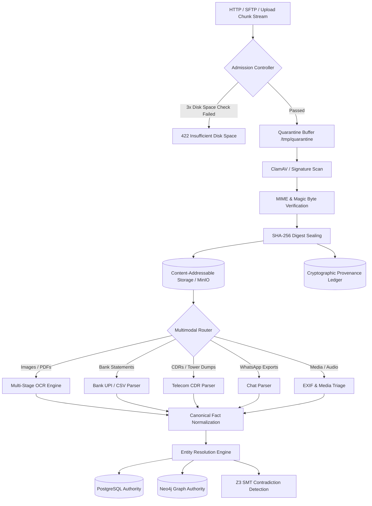

# TARKA UNIVERSAL EVIDENCE PROCESSING PIPELINE
## End-to-End Streaming Ingestion, Quarantine, Extraction & Graph Projection Architecture

**Document Version:** 2.0.0  
**Classification:** Forensics Engineering / Ingestion Architecture  
**Canonical Repository:** `C:\PROJECTS\SentinelX`  
**System Target:** TARKA × SENTINELX Forensic Intelligence Platform  
**Authority:** SentinelX Wave 6 Engineering Constitution  

---

## 1. Architectural Philosophy & Invariants

Forensic evidence ingestion in criminal cyber investigations is mission-critical. Inadmissible evidence, lost provenance, or corrupted byte payloads compromise judicial proceedings under Bharatiya Sakshya Adhiniyam, 2023 (BSA §63).

### Strict Constitutional Guarantees:
1. **Append-Only & Byte Preservation:** Raw bytes received over the wire are preserved verbatim. They are never overwritten, in-place edited, or modified.
2. **Deterministic SHA-256 Digesting:** The SHA-256 hash of evidence bytes is computed during streaming ingress and acts as the immutable cryptographic root for all downstream facts.
3. **Quarantine Before Admission:** Unverified files reside in an isolated quarantine zone until MIME inspection, virus screening, and zip-bomb validation pass.
4. **Memory-Bounded Streaming:** Evidence files up to 5 GB are ingested in bounded 64 KB chunks / 8 MB buffers, ensuring zero memory exhaustion under concurrent workloads.



---

## 2. Detailed Pipeline Stages

### Stage 1: Resource Admission Control & Quarantine
- **Disk Headroom Pre-Check:** The admission controller inspects the destination filesystem. A minimum of $3\times \text{file\_size}$ contiguous free storage must be verified before accepting the first byte.
- **Resumable Chunking:** Uses chunked multipart upload (64 KB chunk size). Interrupted network transfers resume from the last verified chunk offset.
- **Quarantine Enclave:** Incoming bytes are written to an isolated, non-executable directory (`/var/data/tarka/quarantine/`).

### Stage 2: Format & Integrity Validation
- **Magic Byte Verification:** File extensions (`.pdf`, `.jpg`, `.xlsx`) are strictly cross-checked against true magic byte signatures via `python-magic` / `file` utility. Mismatched or polyglot files are rejected.
- **Decompression Bomb Protection:**
  - Max compression expansion ratio: $100:1$.
  - Max nested archive recursion depth: $3$ levels.
  - Max uncompressed archive footprint: $10 \text{ GB}$.
  - Any archive violating these thresholds is immediately quarantined with code `ERR_SECURITY_ZIP_BOMB`.

### Stage 3: SHA-256 Sealing & Content-Addressable Storage (CAS)
- During streaming ingress, the SHA-256 hash is incrementally calculated via hashlib.
- Once complete, the file is moved atomically to CAS storage:
  $$\text{Storage Path} = \text{CAS\_ROOT} / \text{hash}[0:2] / \text{hash}[2:4] / \text{hash}$$
- Read-only file permissions (`chmod 0440`) are enforced on disk.
- A genesis custody record is committed to PostgreSQL and the Provenance DAG.

### Stage 4: Multimodal Classification & Routing
- The router dispatches the evidence artifact to specialized worker pools:
  - **Document Worker Pool:** Scanned PDFs, receipts, FIRs, invoices.
  - **Tabular Worker Pool:** Bank statement CSVs, Excel workbooks, MT940 text.
  - **Telecom Worker Pool:** Call Detail Records (CDRs), IPDRs, cellular tower location dumps.
  - **Communication Worker Pool:** WhatsApp `_chat.txt` exports, SMS dumps.
  - **Media Worker Pool:** Images for EXIF metadata extraction, GPS tags, camera make/model.

### Stage 5: Extraction & Deterministic Parsing
- **OCR Engine:** Executes RapidOCR ONNX with deskewing and CLAHE contrast enhancement.
- **Financial Field Parser:** Employs compiled deterministic regular expressions and checksum validators to extract UTRs, RRNs, IFSCs, Account numbers, and monetary values.
- **Zero Fabrication Rule:** If extraction yields no valid tokens, an empty set is recorded. Under no circumstances are placeholder entities fabricated.

### Stage 6: Canonical Fact Normalization
- Extracted raw strings are transformed into strongly-typed Canonical Fraud Schema structures:
  - Monetary values $\to$ Decimal(18, 2) INR.
  - Timestamps $\to$ UTC ISO 8601 with timezone offset preservation.
  - Names $\to$ Normalized uppercase ASCII with honorific stripping (e.g., "SHRI", "DR.", "MR.").
  - Phone Numbers $\to$ E.164 standard (`+91...`).

### Stage 7: Entity Resolution & Graph Projection
- Deterministic and probabilistic linking engines evaluate incoming facts against existing case entities.
- New or linked entities are committed to PostgreSQL (authoritative store).
- Graph edges and nodes are projected asynchronously into Neo4j for investigative topological queries.

### Stage 8: Z3 SMT Contradiction Analysis
- The Microsoft Z3 solver checks physical and temporal consistency:
  - Impossible travel speeds between consecutive cell tower hits ($> 900 \text{ km/h}$).
  - Simultaneous withdrawals across geographically separated ATMs.
  - Retroactive credit-after-debit transaction sequence anomalies.
- Discrepancies are flagged as high-priority alerts in the Investigator UI.

---

## 3. Resilience, Priority Queuing & Dead-Letter Routing

```
Incoming Stream
      │
      ▼
[ Priority Classifier ]
 ├── Priority 0 (VIP): Golden-Hour Active Loss Freeze (Under 2 hours old)  ──► [ High-Priority Worker Pool ]
 └── Priority 1 (Standard): Historical Dossiers / Batch Bank Feeds         ──► [ Standard Worker Pool ]
```

### Dead-Letter Queue (DLQ) Mechanics:
- Any file failing parsing after 3 exponential retries is committed to the DLQ.
- The DLQ entry contains: original artifact hash, error trace, parser version, and timestamp.
- Investigators are alerted in the V6 UI (`Admitted Evidence` status flagged with `Needs Manual Inspection`).
- Re-processing can be triggered dynamically with alternate parser parameters without re-uploading the file.
