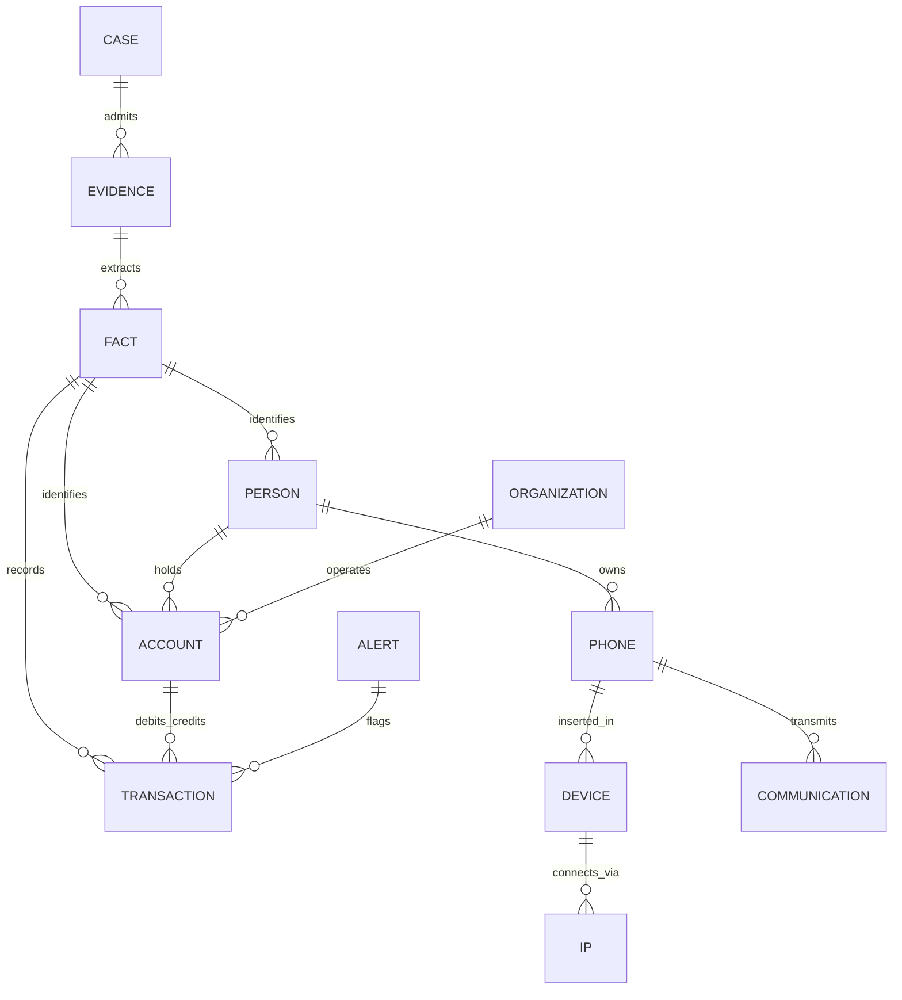

# CANONICAL FRAUD SCHEMA SPECIFICATION
## Unified Forensic Ontology for Financial Cybercrime & Syndicate Attribution

**Document Version:** 2.0.0  
**Classification:** Forensics Engineering / Data Contracts  
**Canonical Repository:** `C:\PROJECTS\SentinelX`  
**System Target:** TARKA × SENTINELX Forensic Intelligence Platform  
**Authority:** SentinelX Wave 6 Engineering Constitution  

---

## 1. Overview & Data Invariants

The TARKA Canonical Fraud Schema provides an unambiguous, strongly-typed data contract across the ingestion, parsing, entity resolution, graph projection, and reporting subsystems.

### Core Invariants:
1. **Strong Typing & Deterministic Coercion:** All incoming data from heterogenous sources (bank statements, CDRs, WhatsApp exports, police FIRs) must map to one of the 14 canonical entity types.
2. **Temporal Traceability:** Every observation carries both `observed_at` (event timestamp) and `recorded_at` (system ingestion timestamp).
3. **Evidence Lineage:** Every entity, relationship, and attribute must link directly to an admitted `Evidence` artifact via cryptographic hash.
4. **Zero Implicit Merging:** Entities are never merged automatically based on similarity. Clusters and aliases maintain explicit edge links with associated confidence scores.

---

## 2. The 14 Canonical Entity Types

### 1. `Person`
Represents an individual human actor identified in the investigation.
- **Fields:**
  - `entity_id`: UUID / Deterministic String (`ENT-PER-...`)
  - `full_name`: Standardized text (UPPERCASE)
  - `normalized_aliases`: List[str]
  - `role`: Enum (`VICTIM`, `SUSPECTED_MULE`, `SYNDICATE_OPERATOR`, `BENEFICIARY`, `INVESTIGATOR`, `WITNESS`, `UNKNOWN`)
  - `pan_number`: Optional[str] (Regex: `[A-Z]{5}[0-9]{4}[A-Z]{1}`)
  - `aadhaar_hash`: Optional[str] (SHA-256 of normalized 12-digit UID)
  - `date_of_birth`: Optional[date]
  - `kyc_status`: Enum (`VERIFIED`, `FORGED`, `UNKNOWN`, `NON_COMPLIANT`)
  - `provenance_ids`: List[str] (Evidence artifact hashes)

### 2. `Account`
Represents a financial account, ledger position, or digital wallet.
- **Fields:**
  - `entity_id`: UUID / Deterministic String (`ENT-ACC-...`)
  - `account_number`: String (Cleaned alphanumeric)
  - `ifsc_code`: String (11-character Indian Financial System Code)
  - `bank_name`: String (e.g., "State Bank of India", "HDFC Bank")
  - `account_type`: Enum (`SAVINGS`, `CURRENT`, `SALARY`, `VIRTUAL`, `PPI_WALLET`, `ESCROW`, `CRYPTO_WALLET`)
  - `vpa_handles`: List[str] (e.g., `user@okhdfcbank`, `9876543210@paytm`)
  - `freeze_status`: Enum (`ACTIVE`, `FROZEN_FULL`, `FROZEN_LIEN`, `BLOCKED`, `REQUESTED_FREEZE`)
  - `freeze_authority`: Optional[str] (e.g., "BNSS §106 Order - Gurugram Cyber PS")
  - `lien_amount_inr`: Optional[Decimal]
  - `current_balance_inr`: Optional[Decimal]

### 3. `Phone`
Represents a telecommunication line, MSISDN, or SIM identifier.
- **Fields:**
  - `entity_id`: UUID / Deterministic String (`ENT-PHN-...`)
  - `msisdn`: String (E.164 normalized, e.g., `+919876543210`)
  - `country_code`: String (`IN`)
  - `subscriber_name`: Optional[str] (From CAF / CDR)
  - `imsi`: Optional[str] (15-digit International Mobile Subscriber Identity)
  - `service_provider`: Optional[str] (e.g., "Jio", "Airtel", "Vi", "BSNL")
  - `sim_activation_date`: Optional[datetime]
  - `sim_swap_events`: List[Dict] (Historical SIM replacement records)

### 4. `Device`
Represents physical hardware used to conduct fraudulent activity.
- **Fields:**
  - `entity_id`: UUID / Deterministic String (`ENT-DEV-...`)
  - `imei_primary`: String (15-digit TAC+Serial+Luhn)
  - `imei_secondary`: Optional[str]
  - `mac_address`: Optional[str]
  - `make_model`: Optional[str] (e.g., "Samsung Galaxy M32", "OnePlus Nord")
  - `os_fingerprint`: Optional[str] (e.g., "Android 13; Build/TP1A.220624.014")
  - `rooted_jailbroken`: Optional[bool]
  - `tethered_accounts_count`: int

### 5. `IP`
Represents a network ingress, egress, or proxy IP address.
- **Fields:**
  - `entity_id`: UUID / Deterministic String (`ENT-IP-...`)
  - `ip_address`: String (IPv4 or IPv6)
  - `asn`: Optional[int] (Autonomous System Number)
  - `asn_organization`: Optional[str] (e.g., "Reliance Jio Infocomm")
  - `is_vpn`: bool
  - `is_tor`: bool
  - `is_datacenter_proxy`: bool
  - `geo_country`: Optional[str]
  - `geo_city`: Optional[str]

### 6. `Location`
Represents a physical address, geographic point, or cell-tower sector.
- **Fields:**
  - `entity_id`: UUID / Deterministic String (`ENT-LOC-...`)
  - `address_line`: Optional[str]
  - `pincode`: Optional[str] (6-digit Indian Postal Code)
  - `latitude`: Optional[float]
  - `longitude`: Optional[float]
  - `cell_tower_id`: Optional[str] (Cell ID / eNodeB / Azimuth)
  - `location_type`: Enum (`BRANCH_ADDRESS`, `RESIDENCE`, `ATM`, `CELL_TOWER_SECTOR`, `INCIDENT_SCENE`)

### 7. `Document`
Represents a legal identification or certification artifact.
- **Fields:**
  - `entity_id`: UUID / Deterministic String (`ENT-DOC-...`)
  - `document_type`: Enum (`AADHAAR`, `PAN`, `PASSPORT`, `VOTER_ID`, `DRIVING_LICENSE`, `INVOICE`, `KYC_FORM`)
  - `masked_number`: String (e.g., `XXXX-XXXX-1234`, `ABCDE****F`)
  - `document_hash`: String (SHA-256 of original file)
  - `issuing_authority`: Optional[str] (e.g., "UIDAI", "Income Tax Dept")
  - `tampering_detected`: bool
  - `tampering_rationale`: Optional[str]

### 8. `Transaction`
Represents a discrete financial flow between two accounts.
- **Fields:**
  - `entity_id`: UUID / Deterministic String (`TXN-...`)
  - `utr_number`: String (Unique Transaction Reference / RRN)
  - `source_account_id`: String (Foreign Key to `Account`)
  - `destination_account_id`: String (Foreign Key to `Account`)
  - `amount_inr`: Decimal (Precision 18, Scale 2)
  - `payment_channel`: Enum (`UPI`, `IMPS`, `NEFT`, `RTGS`, `AEPS`, `ATM_CASH`, `POS`, `NET_BANKING`)
  - `timestamp`: datetime (UTC ISO 8601)
  - `remittance_description`: Optional[str]
  - `layer_level`: int (e.g., 0 = Victim debit, 1 = Mule 1, 2 = Layering, 3 = Cashout)
  - `conduit_velocity_seconds`: Optional[int] (Seconds between credit and subsequent debit)

### 9. `Communication`
Represents an interpersonal or automated message / call.
- **Fields:**
  - `entity_id`: UUID / Deterministic String (`COMM-...`)
  - `channel`: Enum (`WHATSAPP`, `TELEGRAM`, `SMS`, `VOICE_CALL`, `EMAIL`)
  - `sender_id`: String (Phone, Handle, or Email)
  - `recipient_id`: String (Phone, Handle, or Email)
  - `timestamp`: datetime
  - `content_snippet`: Optional[str] (Sanitized, non-executable)
  - `threat_indicators`: List[str] (e.g., "CBI_IMPERSONATION", "EXTORTION_THREAT", "APK_DELIVERY")
  - `attachments_hashes`: List[str]

### 10. `Case`
Represents the formal investigative dossier.
- **Fields:**
  - `case_id`: String (`CASE-YYYY-NNN`, e.g., `CASE-2026-001`)
  - `fir_number`: String (e.g., `FIR 0142/2026 Cyber Crime PS`)
  - `police_station`: String
  - `jurisdiction_state`: String
  - `investigating_officer`: String
  - `booked_loss_inr`: Decimal
  - `frozen_amount_inr`: Decimal
  - `typology`: Enum (`DIGITAL_ARREST`, `APK_SIM_SWAP`, `CORPORATE_BEC`, `TASK_FRAUD`, `INVESTMENT_SCAM`, `LOAN_APP`)
  - `status`: Enum (`ACTIVE_INVESTIGATION`, `GOLDEN_HOUR_PURSUIT`, `COURT_FILING_READY`, `CLOSED`)

### 11. `Evidence`
Represents an admitted physical or digital artifact.
- **Fields:**
  - `artifact_id`: UUID / Deterministic String (`EV-...`)
  - `case_id`: String
  - `filename`: String
  - `mime_type`: String
  - `sha256_hash`: String (64-character lowercase hex)
  - `byte_size`: int
  - `storage_uri`: String (CAS URI: `s3://evidence-cas/...` or `cas://sha256/...`)
  - `custody_chain`: List[Dict] (Timestamp, Agent, Action, Signature)
  - `admitted_by`: String (Investigator ID)
  - `status`: Enum (`ADMITTED`, `QUARANTINED`, `REJECTED`, `SEALED`)

### 12. `Alert`
Represents an automated or heuristic trigger requiring officer attention.
- **Fields:**
  - `alert_id`: UUID (`ALT-...`)
  - `case_id`: String
  - `severity`: Enum (`CRITICAL`, `HIGH`, `MEDIUM`, `LOW`, `INFORMATIONAL`)
  - `title`: String
  - `description`: String
  - `triggered_rule_id`: String
  - `target_entity_id`: String
  - `acknowledged`: bool

### 13. `Rule`
Represents a deterministic statutory, forensic, or heuristic evaluation constraint.
- **Fields:**
  - `rule_id`: String (e.g., `RULE-MULE-RAPID-FLOW-01`)
  - `name`: String
  - `description`: String
  - `legal_basis`: Optional[str] (e.g., "BNSS §106", "RBI Master Direction on Cyber Security")
  - `condition_expression`: String (Z3 SMT or Python AST expression)
  - `is_statutory`: bool

### 14. `Organization`
Represents a formal corporate, banking, or telecommunications institution.
- **Fields:**
  - `entity_id`: UUID / Deterministic String (`ENT-ORG-...`)
  - `legal_name`: String
  - `org_type`: Enum (`SCHEDULED_COMMERCIAL_BANK`, `PAYMENT_AGGREGATOR`, `TELECOM_OPERATOR`, `LAW_ENFORCEMENT_AGENCY`, `CORPORATE_ENTITY`)
  - `cin`: Optional[str] (Corporate Identity Number)
  - `rbi_license_code`: Optional[str]
  - `grievance_officer_contact`: Optional[str]

---

## 3. Canonical Relationship Types

| Relationship | Source | Target | Attributes |
| :--- | :--- | :--- | :--- |
| `HOLDS_ACCOUNT` | `Person` | `Account` | `ownership_type` (`PRIMARY`, `AUTHORIZED_SIGNATORY`, `MULE_NOMINEE`), `confidence` |
| `TRANSFERRED_TO` | `Account` | `Account` | `txn_id`, `amount_inr`, `timestamp`, `utr`, `velocity_seconds` |
| `REGISTERED_TO` | `Phone` | `Person` | `verification_type` (`BIOMETRIC_KYC`, `PAPER_CAF`, `FORGED`), `confidence` |
| `HOSTED_ON` | `Phone` | `Device` | `slot_number` (1 or 2), `imsi`, `observed_start`, `observed_end` |
| `ACCESSED_FROM` | `Account` | `IP` | `timestamp`, `session_token_hash`, `user_agent` |
| `OPERATES_UNDER` | `Account` | `Organization` | `branch_name`, `ifsc_prefix` |
| `INVOLVED_IN` | `Person` / `Account` | `Case` | `role`, `indictment_status` |
| `EXTRACTED_FROM` | Any Entity | `Evidence` | `page_number`, `bounding_box`, `extraction_timestamp`, `confidence` |

---

## 4. Verification & Validation Rules

1. **Financial Precision:** All monetary amounts are encoded as arbitrary-precision decimals ($18, 2$). Floating-point arithmetic is strictly prohibited in financial balances.
2. **Hash Sealing:** If `Evidence.sha256_hash` does not match the actual byte payload retrieved from CAS storage, all derived entities are immediately invalidated with error `ERR_CUSTODY_HASH_MISMATCH`.
3. **No Phantom Accounts:** A `Transaction` cannot be admitted into PostgreSQL or projected into Neo4j without verified `source_account_id` and `destination_account_id` references.

