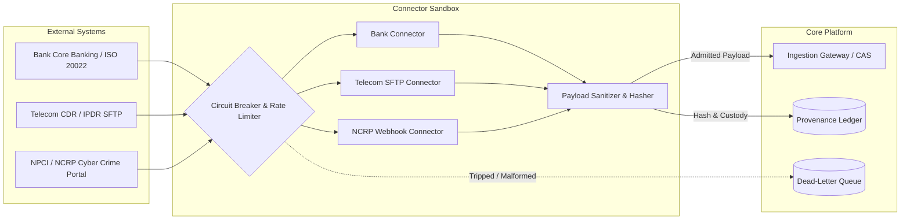
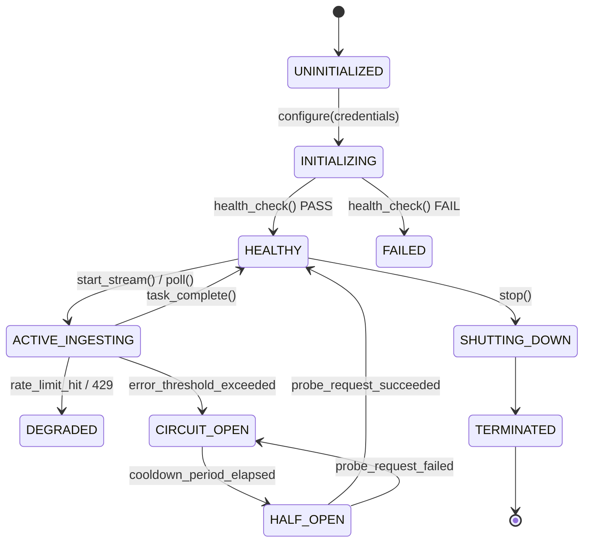

# TARKA UNIVERSAL CONNECTOR SDK SPECIFICATION
## Extensible External Integration Architecture for Financial, Telecom & Law Enforcement Feeds

**Document Version:** 2.0.0  
**Classification:** Forensics Engineering / Integration Architecture  
**Canonical Repository:** `C:\PROJECTS\SentinelX`  
**System Target:** TARKA × SENTINELX Forensic Intelligence Platform  
**Authority:** SentinelX Wave 6 Engineering Constitution  

---

## 1. Architectural Philosophy

External data sources in forensic cybercrime investigations are intrinsically untrusted, highly heterogenous, and prone to service interruptions. The TARKA Connector SDK enforces four architectural principles:

1. **Strict Sandboxing & Isolation:** Connectors run within bounded processes. Connectors never write directly to PostgreSQL, Neo4j, or the file system. They emit normalized, validated canonical facts to the Ingestion Gateway.
2. **Defensive Ingress & Content Sanitization:** All inbound payloads are treated as `DATA_ONLY`. Executable scripts, malicious macros, and prompt-injection payloads are stripped or encapsulated.
3. **Resilience & Fault Isolation:** Connectors feature built-in Circuit Breakers, Exponential Backoff with jitter, Rate Limiters, and persistent Dead-Letter Queues (DLQ). A failing external bank API or telecom server cannot degrade core investigation services.
4. **End-to-End Cryptographic Audit:** Every raw byte received from an external feed is hashed (SHA-256) and logged to the Provenance DAG before parsing.



---

## 2. Core SDK Abstractions

### 2.1 The `BaseConnector` Abstract Interface

All connectors inherit from `tarka.connectors.base.BaseConnector`:

```python
from abc import ABC, abstractmethod
from typing import AsyncIterator, Dict, Any, Optional
from datetime import datetime

class BaseConnector(ABC):
    """
    Standard contract for all external TARKA integration adapters.
    """
    connector_id: str
    connector_type: str  # REST, SFTP, WEBHOOK, POLL_DATABASE, MESSAGE_BUS
    version: str
    
    @abstractmethod
    async def initialize(self, config: Dict[str, Any]) -> None:
        """Establish connections, authenticate, and verify certificates."""
        pass

    @abstractmethod
    async def health_check(self) -> Dict[str, Any]:
        """Validate remote endpoint health, latency, and credential validity."""
        pass

    @abstractmethod
    async def fetch_records(self, query_params: Dict[str, Any]) -> AsyncIterator[Dict[str, Any]]:
        """Fetch raw external records with streaming backpressure."""
        pass

    @abstractmethod
    def normalize_record(self, raw_record: Dict[str, Any]) -> Dict[str, Any]:
        """Map raw external schemas to Canonical Fraud Schema entity definitions."""
        pass

    @abstractmethod
    async def shutdown(self) -> None:
        """Gracefully drain pools, close sockets, and release resources."""
        pass
```

### 2.2 Connector Lifecycle States



---

## 3. Resilience Engine

### 3.1 Circuit Breaker Implementation
The connector framework integrates a standard 3-state Circuit Breaker:
- **`CLOSED` (Normal):** Requests pass through. Failures increment an error counter within a sliding 60-second window.
- **`OPEN` (Tripped):** When error rate exceeds 50% or 5 consecutive failures occur, the circuit opens immediately. Calls fail fast, redirecting to the local Dead-Letter Queue without calling remote endpoints.
- **`HALF_OPEN` (Probing):** After `cooldown_seconds` (default: 30s), a single probe request is permitted. If successful, state resets to `CLOSED`; if unsuccessful, the breaker reopens for an exponential backoff interval.

### 3.2 Rate Limiter & Token Bucket
- Enforces requests-per-second (RPS) and burst limits.
- Provides compliance with bank-mandated throttling (e.g., maximum 5 requests/sec for Indian core banking inquiry APIs).

### 3.3 Dead-Letter Queue (DLQ)
- Unprocessable, schema-violating, or rejected records are committed to persistent DLQ storage (`/var/data/tarka/dlq/{connector_id}/`).
- Each DLQ item contains:
  - `dlq_id`: Unique identifier
  - `connector_id`: Originating adapter
  - `timestamp`: UTC ISO 8601
  - `raw_bytes_base64`: Preserved verbatim payload
  - `error_reason`: Exception message and trace
  - `retry_count`: Integer attempt counter

---

## 4. Supported Data Formats & Protocols

| Protocol / Format | Typical Data Source | Parser / Adapter Engine | Output Canonical Types |
| :--- | :--- | :--- | :--- |
| **ISO 20022 XML (`camt.053`, `pacs.008`)** | RTGS / NEFT / Core Banking | DefusedXML / Streaming LXML | `Transaction`, `Account`, `Organization` |
| **MT940 / MT942 Swift Text** | Commercial Bank Statements | `tarka.parsers.mt940` | `Transaction`, `Account` |
| **CSV / XLSX Structured Feeds** | Bank Dump Files / UPI Settlement | `tarka.parsers.bank_upi` | `Transaction`, `Account`, `Person` |
| **Telecom CDR / IPDR SFTP** | Law Enforcement CCTNS / Telco Feeds | `tarka.parsers.cdr` | `Phone`, `Device`, `Location`, `Communication` |
| **REST / JSON Webhooks** | National Cyber Crime Portal (NCRP) | FastAPI Async Worker | `Case`, `Evidence`, `Alert`, `Person` |

---

## 5. Security & Isolation Controls

1. **Process-Level Isolation:** When running in Tier 3 or Tier 4 environments, connectors execute inside unprivileged worker containers (`uid: 10001, no-new-privileges: true`).
2. **Strict Network Egress Policies:** Connectors are strictly bound to their target upstream domain/IP via firewall or Cilium egress network policies. No open internet access is permitted from connector workers.
3. **Secret Zeroization:** Credentials, private keys, and API tokens are loaded into memory from encrypted vaults (HashiCorp Vault or Kubernetes Secrets) and securely zeroized on worker termination.
4. **Certificate Pinning:** TLS 1.3 with strict certificate pinning is enforced for all banking and government endpoint connections.
