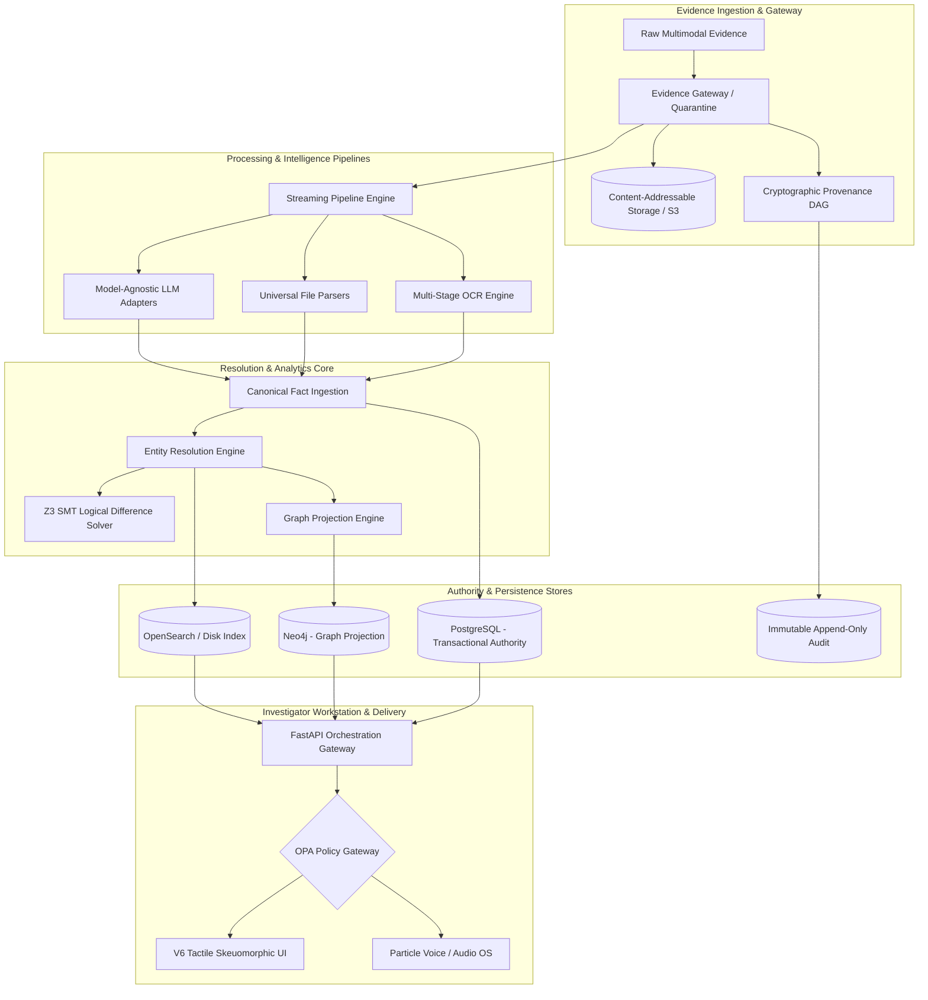
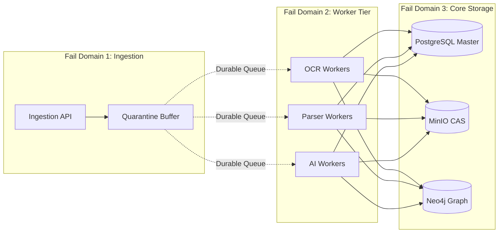

# TARKA TARGET ARCHITECTURE SPECIFICATION
## Open-Ended Intelligence Platform, Universal Evidence Processing & Sovereign Readiness

**Document Version:** 2.0.0  
**Classification:** Forensics Engineering / Target Architecture  
**Canonical Repository:** `C:\PROJECTS\SentinelX`  
**System Target:** TARKA × SENTINELX Forensic Intelligence Platform  
**Authority:** SentinelX Wave 6 Engineering Constitution  

---

## 1. Executive Summary & Product Mission

TARKA is a specialized forensic intelligence and investigative attribution platform engineered to combat complex financial cybercrime, including:
- **UPI Fraud & Rapid Disbursement Networks:** Sub-minute money transfers across multi-tier accounts.
- **Mule Account Syndicates:** Layered commercial, current, and savings accounts opened via forged or rented identities.
- **SIM Swapping & Device Clustering:** Telecommunication impersonation, IMEI rotation, and tower-jump anomalies.
- **Digital Arrest Extortion & Phishing Schemes:** Multi-vector coercion, forged law-enforcement credentials, and coordinated intimidation.
- **Corporate BEC & Investment Fraud:** High-value corporate invoice tampering, grey-market IPO scams, and offshore routing.

The platform transforms unstructured, multimodal evidence into cryptographically verifiable, traceable investigative intelligence. It enforces the constitutional tenet:
$$\text{AI PROPOSES} \implies \text{EVIDENCE VERIFIES} \implies \text{HUMAN DECIDES}$$



---

## 2. Core Architectural Subsystems

TARKA is architected into ten decoupled, independently verifiable subsystems:

```
+----------------------------------------------------------------------------------------------------+
|                                    1. WEB API GATEWAY (FastAPI)                                    |
|   - OpenAPI 3.1 & JSON-RPC Gateway       - Bearer Auth & PolicyGateway    - Real-Time SSE Streams  |
+----------------------------------------------------------------------------------------------------+
       |                                      |                                      |
+--------------------+               +--------------------+                +--------------------+
|  2. INGESTION GW   |               |   3. OCR ENGINE    |                | 4. AI/ML INFERENCE |
| - Chunked upload   |               | - Document triage  |                | - Open-weight LLMs |
| - Anti-bomb checks |               | - Deskew/Binarize  |                | - Evidence DATA_ONLY|
| - SHA-256 seal     |               | - RapidOCR/ONNX    |                | - Prompt firewall  |
| - Custody logging  |               | - Financial regex  |                | - No tool exec     |
+--------------------+               +--------------------+                +--------------------+
       |                                      |                                      |
+----------------------------------------------------------------------------------------------------+
|                               5. ENTITY RESOLUTION & MULE CLUSTERING                               |
|   - Deterministic Identifier Matching (Account, IFSC, Phone, IMEI, PAN, Aadhaar, Hash)             |
|   - Probabilistic Record Linkage (Fellegi-Sunter, Jaro-Winkler, Levenshtein Token Overlap)         |
|   - Graph-Based Component Clustering & Temporal Adjacency Pass-Through Analysis                   |
+----------------------------------------------------------------------------------------------------+
       |                                      |                                      |
+--------------------+               +--------------------+                +--------------------+
| 6. ANALYTICS & SMT |               | 7. GRAPH AUTHORITY |                | 8. REPORTING CORE  |
| - Z3 SMT reasoning |               | - Neo4j projection |                | - Form 65B Certs   |
| - Contradiction det|               | - Multi-hop flows  |                | - Seizure notices  |
| - Golden hour loss |               | - Flow conservation|                | - Court dossiers   |
+--------------------+               +--------------------+                +--------------------+
       |                                      |                                      |
+----------------------------------------------------------------------------------------------------+
|                              9. UNIVERSAL CONNECTOR SDK & EXTERNAL ADAPTERS                        |
|   - ISO 20022 / MT940 Financial Feeds     - Telecom CDR / IPDR Adapters    - NPCI / NCRP Gateways  |
|   - Circuit Breakers & Dead-Letter Queues - Strictly Isolated Sandboxing   - Ingress Sanitization  |
+----------------------------------------------------------------------------------------------------+
       |                                                                             |
+----------------------------------------------------------------------------------------------------+
|                             10. CRYPTOGRAPHIC PROVENANCE & AUDIT LOGGING                           |
|   - Immutable Append-Only Ledger         - Content-Addressable Hashes     - Zero Data-Loss SLA     |
+----------------------------------------------------------------------------------------------------+
```

### Detailed Component Responsibilities

1. **Web API Gateway (`backend/app/`):**
   - Implemented with FastAPI and Uvicorn.
   - Enforces Bearer JWT token verification and OPA-backed role-based access control.
   - Dispatches long-running background tasks through durable asynchronous job channels.
   - Provides server-sent event (SSE) streams for real-time progress updates.

2. **Evidence Gateway & Admission Controller (`backend/app/services/ingestion/`):**
   - Manages resumable chunked ingestion with strict memory bounds (64 KB chunks / 8 MB streaming frames).
   - Validates resource headroom: minimum $3\times$ file size available disk space before admission.
   - Computes SHA-256 digest on raw bytes prior to file system commitment.
   - Maintains strict quarantine status until virus, zip-bomb, and MIME validation complete.

3. **Multi-Stage OCR Engine (`backend/tarka/ocr/`):**
   - Stage A: Document Classification & Orientation Detection.
   - Stage B: High-fidelity image preprocessing (CLAHE contrast normalization, deskewing, Otsu binarization).
   - Stage C: Text extraction using RapidOCR ONNX with deterministic fallback to PyMuPDF digital text blocks.
   - Stage D: Financial entity extraction (UTR, RRN, IFSC, Account Number, UPI VPA, Transaction Amounts).
   - Stage E: Quality assurance verification with confidence scoring.

4. **AI/ML Inference & Prompt-Defense Engine (`backend/tarka/ai/`):**
   - Decoupled model adapter interface supporting open-weight models (Llama 3.1, Mistral, Qwen 2.5 via vLLM/Ollama/llama.cpp) and external enterprise endpoints.
   - Strict `DATA_ONLY` prompt isolation: evidence is injected into designated containment blocks.
   - Zero execution privilege: models never execute code or shell commands from evidence content.

5. **Entity Resolution & Fraud Clustering Core (`backend/tarka/core/entity_resolution.py`):**
   - Multi-tiered resolution pipeline:
     1. Exact deterministic matching on immutable identifiers (bank account + IFSC, UPI ID, phone, PAN, Aadhaar hash).
     2. Probabilistic record linkage on names and addresses using Fellegi-Sunter weightings and Levenshtein distances.
     3. Temporal transaction adjacency matching for rapid money mule layering ($< 120$ seconds).
   - Graph-based connected component clustering for syndicate identification.

6. **Analytics & Z3 SMT Solver Core (`backend/tarka/solver/`):**
   - Employs Microsoft Z3 theorem prover for timeline and constraint contradiction detection.
   - Validates physical impossibility (e.g., travel anomalies, concurrent ATM withdrawals).
   - Calculates Golden Hour asset preservation metrics and pass-through conduit velocity.

7. **Graph Authority (`backend/tarka/core/investigation_graph.py`):**
   - Projects resolved entities and verified transactions into Neo4j graph schemas.
   - Executes Cypher queries for multi-hop money flow tracing, circular transaction laundering detection, and bottleneck node identification.
   - Canonical rule: Neo4j is a projection; all nodes and edges are fully reconstructible from PostgreSQL.

8. **Reporting & Forensic Dossier Generator (`backend/tarka/core/forensic_report.py`):**
   - Generates evidentiary packages compliant with Section 63 of Bharatiya Sakshya Adhiniyam, 2023 (formerly Section 65B of Indian Evidence Act).
   - Emits standardized bank account freeze mandates under BNSS §106.
   - Formats court dossiers with cryptographic hashes and chain-of-custody certificates.

9. **Universal Connector SDK (`backend/tarka/connectors/`):**
   - Pluggable framework for external banking, telecom, and law enforcement integrations.
   - Built-in circuit breakers, rate limiters, retry policies, and dead-letter queues.
   - Format adapters for ISO 20022 XML, MT940, CSV/XLSX, and NCRP portal feeds.

10. **Cryptographic Provenance DAG (`backend/tarka/core/provenance_dag.py`):**
    - Immutable directed acyclic graph recording every evidence transformation.
    - Each node contains parent hash, timestamp, operator identity, algorithm version, and payload hash.

---

## 3. Canonical Data Authority Matrix

To preserve integrity and prevent architectural drift, TARKA maintains an unambiguous hierarchy of storage systems:

| Storage Layer | Authority Role | Primary Technology | Invariants & Guarantees |
| :--- | :--- | :--- | :--- |
| **Evidence Store** | Evidence-Byte Authority | MinIO / S3 / Local CAS Disk | Write-once, read-many (WORM). Raw bytes are never altered. SHA-256 hash verified on every read. |
| **Relational Store** | Transactional Authority | PostgreSQL 16+ | ACID transactions. Houses cases, evidence records, custody logs, users, and canonical facts. |
| **Graph Store** | Query / Projection System | Neo4j 5+ Enterprise / Community | Derived projection. Rebuildable from PostgreSQL. Represents entity-relationship-transaction topology. |
| **Search Index** | Derived Full-Text Search | OpenSearch 2+ / Local Disk Index | Derived full-text and vector index. Rebuildable from PostgreSQL and CAS extractions. |
| **Ephemeral Cache** | Session / State / Queue | Redis 7+ / In-Memory State | Task queues, rate limiting counters, WebSocket / SSE session state. Ephemeral. |

---

## 4. Scaling Characteristics & Failure Domains



### Scaling Properties:
1. **Worker Tier Horizontal Scaling:**
   - Ingestion, OCR, and parsing tasks are stateless and horizontally scalable across worker processes or Kubernetes pods.
   - Worker concurrency is dynamically bounded by CPU core count and GPU VRAM availability.
2. **Database Vertical & Horizontal Isolation:**
   - PostgreSQL handles transactional read/write workloads. Read replicas handle reporting and analytic queries.
   - S3/CAS storage scales linearly with evidentiary volume without impacting transactional query latencies.
3. **Graceful Degradation Under Load:**
   - When GPU/AI workers are saturated, the ingestion pipeline stores raw evidence, extracts deterministic regex fields, and defers deep LLM narrative synthesis to off-peak queues.
   - High-priority freeze requests (BNSS §106 notices) bypass general background queues via a dedicated fast-track lane.

---

## 5. Sovereign Deployment Readiness

TARKA is engineered for sovereign autonomy across four distinct deployment tiers:
- **Tier 1 (Local Workstation):** Standalone zero-network laptop for tactical field deployment. Local SQLite/Postgres + disk CAS + ONNX runtime.
- **Tier 2 (Hosted Demonstration):** Containerized cloud deployment on public/private cloud with ephemeral test data.
- **Tier 3 (Agency On-Premises):** High-availability multi-node cluster inside an agency private cloud or data center.
- **Tier 4 (Sovereign Air-Gapped):** Fully isolated national security environment with zero egress, hardware security module (HSM) key management, and air-gapped open-weight LLMs.

---

## 6. Architectural Invariants Checklist

- [x] **No LLM in the loop for legal authorization:** Enforced strictly by `PolicyGateway`.
- [x] **Zero mutable evidence bytes:** Raw evidence is append-only in CAS storage.
- [x] **Derived stores are rebuildable:** Neo4j and search indexes can be fully reconstructed from PostgreSQL.
- [x] **Evidence is DATA_ONLY:** Prompts isolate evidence into non-executable containment blocks.
- [x] **Human investigator retains final authority:** AI proposes, evidence verifies, human decides.

