# TARKA SOVEREIGN DEPLOYMENT GUIDE
## Multi-Tier Installation, Air-Gapped Air-Drop, Hardware Sizing & Zero-Egress Configuration

**Document Version:** 2.0.0  
**Classification:** Forensics Engineering / Infrastructure & Deployment  
**Canonical Repository:** `C:\PROJECTS\SentinelX`  
**System Target:** TARKA × SENTINELX Forensic Intelligence Platform  
**Authority:** SentinelX Wave 6 Engineering Constitution  

---

## 1. Architectural Tiers Overview

TARKA supports four distinct deployment tiers engineered to meet operational requirements ranging from tactical field laptops to sovereign national intelligence data centers.

```mermaid
graph TD
    subgraph Tier 1: Tactical Field Workstation
        T1[Single Air-Gapped Laptop] -->|Embedded DB + ONNX| T1_APP[Self-Contained TARKA]
    end

    subgraph Tier 2: Hosted Demo
        T2[Public / Private Cloud VM] -->|Docker Compose + TLS| T2_APP[Containerized Preview]
    end

    subgraph Tier 3: Agency On-Premises
        T3[Police HQ Server Cluster] -->|Kubernetes / High Availability| T3_APP[Multi-Node Agency System]
    end

    subgraph Tier 4: Sovereign Air-Gapped
        T4[Classified Intelligence DC] -->|Zero Egress + HSM + Local LLMs| T4_APP[Sovereign Forensics Vault]
    end
```



---

## 2. Tier Specifications & Hardware Requirements

| Parameter | Tier 1: Tactical Laptop | Tier 2: Hosted Demo | Tier 3: Agency On-Premises | Tier 4: Sovereign Air-Gapped |
| :--- | :--- | :--- | :--- | :--- |
| **Operational Target** | Field raid, tactical triage | Public evaluation, training | State Cyber Police HQ | National Security / Intelligence |
| **Network Connectivity**| Zero (Airplane mode / Air-gapped)| Inbound HTTPS; outbound blocked | Internal Agency Intranet | Absolute Zero Egress (Air-Gapped) |
| **Compute Sizing** | 8-core CPU (AMD Ryzen / i7) | 4 vCPU Cloud Instance | 32-core Dual Socket Server | Multi-Node Cluster (64+ cores) |
| **System Memory** | 16–32 GB RAM | 8–16 GB RAM | 64–128 GB RAM | 256–512 GB RAM |
| **GPU Acceleration** | Optional (NVIDIA RTX 4060) | Optional (NVIDIA T4 / L4) | 1x NVIDIA A100 / RTX 6000 Ada | 2x-4x NVIDIA H100 (80GB NVLink) |
| **Evidence Storage** | 1 TB NVMe SSD (Local CAS) | 100 GB Cloud Block Storage | 20 TB RAID 10 NVMe + MinIO | 200+ TB Ceph / NetApp WORM |
| **Database Architecture**| Local PostgreSQL / SQLite | Containerized PostgreSQL 16 | PostgreSQL HA (Patroni / Repmgr)| Multi-Master PostgreSQL HA |
| **Graph Architecture** | Neo4j Community (Embedded/Local)| Neo4j Container | Neo4j Enterprise Cluster | Neo4j Multi-Clustering |
| **OCR Inference** | RapidOCR ONNX (CPU) | RapidOCR ONNX (CPU/T4) | RapidOCR ONNX (CUDA) | RapidOCR ONNX (TensorRT/CUDA) |
| **LLM Inference** | Llama 3.1 8B (Q4_K_M llama.cpp)| Cloud API or vLLM Qwen 14B | vLLM Qwen 2.5 32B (AWQ) | vLLM Llama 3.1 70B (FP16/AWQ) |
| **Key Management** | Local TPM 2.0 / LUKS | Software Key Vault | HashiCorp Vault On-Prem | Thales / SafeNet Luna HSM (FIPS 140-3)|

---

## 3. Tier 4: Sovereign Air-Gapped Installation Procedure

Deploying into a classified, zero-network environment requires an offline "air-drop" installation bundle.

### 3.1 Preparation in Secure Staging Facility (Connected)
```bash
# 1. Clone canonical repository at release tag
git clone https://github.com/Massvippin01/tarka_v5.git --branch phase18.1-stabilized
cd tarka_v5

# 2. Package all pre-built Docker container images into an offline tarball
docker save \
  tarka/web-api:2.0.0 \
  tarka/ingestion-worker:2.0.0 \
  tarka/ocr-worker:2.0.0 \
  tarka/vllm-inference:2.0.0 \
  postgres:16-alpine \
  neo4j:5.20-enterprise \
  minio/minio:RELEASE.2024-05 \
  redis:7.2-alpine | gzip > tarka-airgap-images-2.0.0.tar.gz

# 3. Export verified Python wheels and npm offline cache
pip download -r backend/requirements.txt -d offline_wheels/
npm --prefix frontend pack

# 4. Export offline ONNX model weights and LLM GGUF / AWQ weights
mkdir -p offline_models/ocr offline_models/llm
cp ~/.cache/rapidocr/*.onnx offline_models/ocr/
cp /models/qwen2.5-32b-awq/* offline_models/llm/

# 5. Generate SHA-256 Manifest of the Air-Drop Bundle
sha256sum tarka-airgap-images-2.0.0.tar.gz > MANIFEST.sha256
sha256sum offline_models/**/* >> MANIFEST.sha256
```

### 3.2 Ingestion & Deployment in Sovereign Air-Gapped Datacenter (Offline)
```bash
# 1. Verify cryptographic integrity against signed manifest
sha256sum -c MANIFEST.sha256

# 2. Load container images into local sovereign container registry
docker load < tarka-airgap-images-2.0.0.tar.gz
docker tag tarka/web-api:2.0.0 sovereign-registry.internal/tarka/web-api:2.0.0
docker push sovereign-registry.internal/tarka/web-api:2.0.0

# 3. Initialize HSM Key Enclave for BSA §63 Digital Signatures
tarka-hsm-tool init \
  --slot 0 \
  --pin-env HSM_PIN \
  --key-label "TARKA-STATE-POLICE-FORENSIC-ROOT-2026"

# 4. Deploy Kubernetes Helm Chart
helm install tarka-sovereign ./deploy/helm/tarka \
  --namespace tarka \
  --create-namespace \
  -f ./deploy/helm/values.sovereign-airgap.yaml
```

---

## 4. Zero-Egress Network Policy (Kubernetes / Cilium)

To ensure zero inadvertent data leakage, strict Kubernetes NetworkPolicies isolate the TARKA namespaces from external egress:

```yaml
apiVersion: networking.k8s.io/v1
kind: NetworkPolicy
metadata:
  name: tarka-deny-all-external-egress
  namespace: tarka
spec:
  podSelector: {}
  policyTypes:
  - Egress
  egress:
  # Allow internal intra-namespace communication only
  - to:
    - podSelector: {}
  # Allow internal agency DNS and NTP
  - to:
    - namespaceSelector:
        matchLabels:
          kubernetes.io/metadata.name: kube-system
      podSelector:
        matchLabels:
          k8s-app: kube-dns
    ports:
    - protocol: UDP
      port: 53
```

---

## 5. Post-Deployment Verification Script (`verify-deployment.sh`)

Every sovereign deployment executes an automated health check validating:
1. PostgreSQL read/write transactions and schema migrations.
2. Neo4j graph connectivity and Cypher query execution.
3. CAS storage SHA-256 byte write-and-read roundtrip.
4. Offline OCR text recognition on standard test receipt.
5. Local LLM inference producing valid JSON entity schemas without external calls.
6. HSM key availability and BSA §63 digital signature validation.
