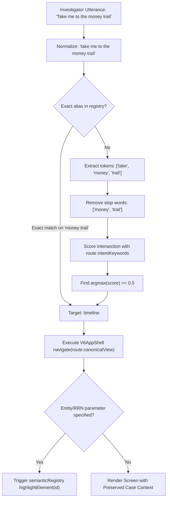

# TARKA | Autonomous Voice-Driven Application Navigation

## Overview

TARKA eliminates cumbersome hierarchical nested menus through an **Autonomous Navigation Engine**. The investigator speaks or types natural language commands, and the navigation registry maps the intent directly to the appropriate forensic screen while preserving active case state, entity selections, and filter parameters.

Located in: `frontend/src/v6/navigation/tarkaNavigationRegistry.ts`

---

## 1. Complete Operational Route Registry

The application exposes 22 canonical operational routes, each enriched with voice aliases, intent keywords, clearance levels, and forensic tool bindings:

| Route ID | Canonical View | Display Title | Primary Spoken Aliases | Clearance Required |
| :--- | :--- | :--- | :--- | :--- |
| `home` | `home` | Particle Intelligence Home | *"home"*, *"particle sphere"*, *"start screen"* | PUBLIC |
| `workspace` | `workspace` | Command Centre Workspace | *"command centre"*, *"dashboard"*, *"workspace"* | INVESTIGATOR |
| `evidence` | `evidence` | Evidence Locker & Ingestion | *"evidence locker"*, *"admit evidence"*, *"intake"* | INVESTIGATOR |
| `ledger` | `evidence` | Evidence Ledger | *"evidence ledger"*, *"transaction ledger"*, *"rrn"* | INVESTIGATOR |
| `timeline` | `timeline` | Temporal Money Trail | *"money trail"*, *"mule hops"*, *"chronology"* | INVESTIGATOR |
| `graph` | `graph` | Fraud Network Graph | *"fraud network"*, *"mule graph"*, *"node clustering"* | INVESTIGATOR |
| `contradictions` | `contradictions` | Discrepancy Matrix | *"contradictions"*, *"conflicts"*, *"discrepancies"* | SENIOR_IO |
| `device-telemetry` | `device-telemetry` | Device & SIM Telemetry | *"device sim"*, *"cgnat"*, *"imei"*, *"cell tower"* | INVESTIGATOR |
| `attribution` | `attribution` | Attribution & Syndicate Intelligence | *"attribution"*, *"syndicate"*, *"threat actor"* | SENIOR_IO |
| `court-ready` | `court-ready` | Judicial Proof & Actions Report | *"court report"*, *"section 63"*, *"bsa certificate"* | JUDICIAL_OFFICER |
| `claim-compiler` | `claim-compiler` | Forensic Claim Compiler | *"claim compiler"*, *"formal claims"*, *"coq proof"* | SENIOR_IO |
| `dependency-lens` | `dependency-lens` | Claim Dependency Lens | *"dependency graph"*, *"claim lineage"* | INVESTIGATOR |
| `flight-recorder` | `flight-recorder` | Investigation Flight Recorder | *"audit log"*, *"flight recorder"*, *"hash chain"* | AUDITOR |
| `provenance-dag` | `provenance-dag` | Cryptographic Provenance DAG | *"provenance"*, *"hash dag"*, *"chain of custody"* | AUDITOR |
| `benchmark-lab` | `benchmark-lab` | SUTRAM Forensic Benchmark Lab | *"benchmark"*, *"stress test"*, *"performance lab"* | SYSTEM_ADMIN |
| `entity-resolution` | `entity-resolution` | Identity Resolution Station | *"entity resolution"*, *"mule accounts"*, *"identity merge"* | SENIOR_IO |
| `settings` | `settings` | Sovereign Platform Configuration | *"settings"*, *"configuration"*, *"api keys"* | SYSTEM_ADMIN |

---

## 2. Intent Resolution Mechanics

### 2.1 Context-Preserving Navigation
When navigating between screens, the active case identifier (e.g., `CASE-2026-001`), the active investigator credentials (`IO-409`), and any selected transaction records are retained in the global state store. An investigator jumping from the **Fraud Network Graph** to the **Device Telemetry** screen maintains focus on the active suspect entity seamlessly.

