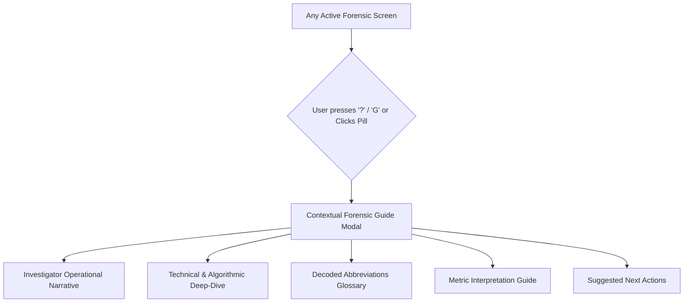

# TARKA | Continuous Contextual Forensic Guide

## Overview

Forensic investigations often involve intricate mathematical concepts, legal evidentiary standards, and complex telecommunication parameters. The **Continuous Contextual Forensic Guide** provides on-demand, dual-depth explanations across all 22 operational screens of TARKA.

Located in:
- Guide Dictionary: `frontend/src/v6/guide/tarkaContextualGuide.ts`
- UI Component: `frontend/src/v6/guide/TarkaContextualGuideModal.tsx`

---

## 1. Dual-Depth Pedagogical Architecture

Every operational view in TARKA is paired with a dual-level analytical guide:

### 1.1 Investigator Operational Narrative
Crafted for Investigating Officers (IOs), Cyber Crime Cell personnel, and public prosecutors:
- **Plain-language explanation** of what the screen establishes.
- **Evidentiary relevance** under Bharatiya Nagarik Suraksha Sanhita (BNSS) §94 (Summons to produce document) and §107 (Attachment and forfeiture of property).
- **Procedural warnings** (e.g., verifying whether a bank freeze order has been dispatched within 24 hours).

### 1.2 Technical & Algorithmic Deep-Dive
Crafted for digital forensic examiners, SREs, and academic mentors:
- Exact data structures used (Adjacency matrices, Directed Acyclic Graphs, Token sets).
- Computational complexity: $O(V + E)$ BFS traversals, $O(N \log N)$ sorting routines.
- Mathematical conservation formulas ($\sum \text{Inflow} - \sum \text{Outflow} = \Delta \text{Balance}$).
- Cryptographic hash derivations (SHA-256 flight recorder audit chains).

---

## 2. Decoded Abbreviations & Metrics Breakdown

### 2.1 Universal Glossary
The modal automatically parses and decodes acronyms relevant to the active screen:
- **RRN**: Retrieval Reference Number (12-digit unique banking transaction identifier).
- **CGNAT**: Carrier-Grade Network Address Translation (Shared public IP mapping multiple private subscribers via source port allocation).
- **IMSI**: International Mobile Subscriber Identity (SIM card hardware identifier).
- **IMEI**: International Mobile Equipment Identity (Physical handset hardware identifier).
- **BSA §63**: Section 63 of Bharatiya Sakshya Adhiniyam, 2023 (Admissibility of electronic records).
- **BNSS §107**: Section 107 of Bharatiya Nagarik Suraksha Sanhita, 2023 (Freezing of proceeds of crime).

### 2.2 Metric Interpretation Guide
Each metric card (e.g., *Total Loss*, *Recoverable Pool*, *Hop Attenuation*, *Clustering Coefficient*) contains explicit warning thresholds:
- **Normal Range**: Safe operational parameters.
- **Investigation Anomaly**: High-risk threshold requiring mandatory supervisor concurrence.
