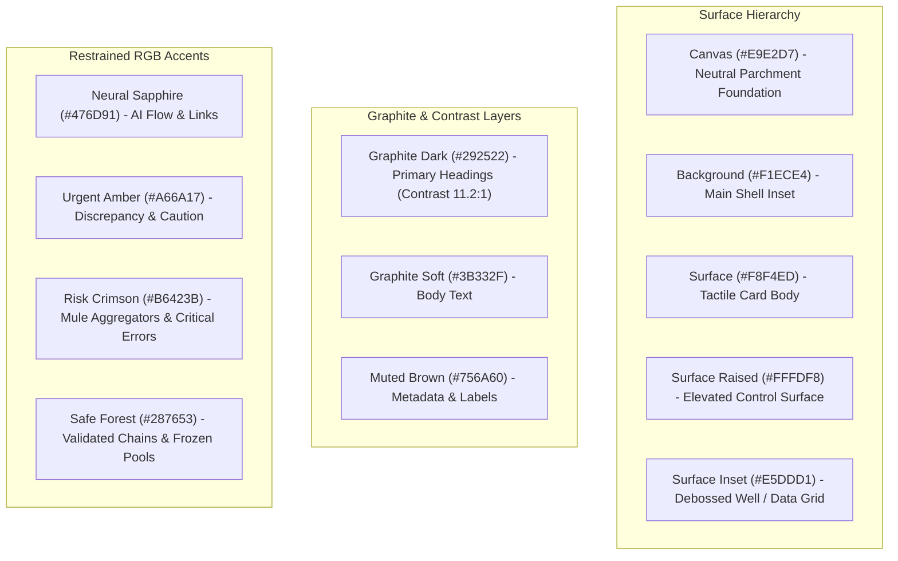

# TARKA | Tactile Skeuomorphic Design System Specification

## Overview

TARKA employs a **tactile skeuomorphic forensic command centre** visual language. Moving beyond flat minimalism, this design system uses warm ivory surfaces, recessed wells, debossed indicators, physical toggles, and restrained edge-glow lighting inspired by high-precision physical laboratory equipment and aircraft flight instrumentation.

Located in: `frontend/src/v6/styles/v6-tokens.css`

---

## 1. Color Palette & Material Architecture



---

## 2. Skeuomorphic Light & Shadow Model

All panels and buttons use dual-source directional lighting (top-left key light at 315°):

### 2.1 Raised Tactile Card
```css
box-shadow:
  0 1px 0 0 rgba(255, 255, 255, 0.9) inset,    /* Specular rim highlight */
  0 -1px 0 0 rgba(0, 0, 0, 0.05) inset,         /* Bottom ambient occlude */
  0 2px 4px 0 rgba(41, 37, 34, 0.04),          /* Soft contact shadow */
  0 8px 16px -2px rgba(41, 37, 34, 0.06);       /* Deep ambient drop shadow */
```

### 2.2 Debossed Inset Well (Data Tables & Metrics)
```css
box-shadow:
  inset 0 2px 4px 0 rgba(41, 37, 34, 0.08),     /* Top inset drop shadow */
  inset 0 1px 2px 0 rgba(41, 37, 34, 0.06),
  0 1px 0 0 rgba(255, 255, 255, 0.8);           /* Bottom rim bevel */
```

### 2.3 Physical Skeuomorphic Push Button
- **Default State**:
  ```css
  background: linear-gradient(180deg, #FFFFFF 0%, #F5EFE6 100%);
  border: 1px solid #D5CABE;
  box-shadow: 0 1px 2px rgba(41, 37, 34, 0.08), inset 0 1px 0 #FFFFFF;
  ```
- **Active / Pressed State**:
  ```css
  transform: translateY(1px);
  background: linear-gradient(180deg, #EDE5D8 0%, #F5EFE6 100%);
  box-shadow: inset 0 1px 2px rgba(41, 37, 34, 0.15);
  ```

---

## 3. Ergonomic Curved Sidebar Rail

The sidebar uses an organic curved silhouette:
- In expanded mode ($240\text{px}$ width), route names and shortcut badges are fully readable.
- In collapsed mode ($64\text{px}$ width), only high-contrast monochrome icons are visible with hover tooltips.
- The top-right toggle button allows one-click transition with smooth CSS transitions (`cubic-bezier(0.16, 1, 0.3, 1)`).

---

## 4. Typography Standards

- **Primary Sans**: `Inter`, `-apple-system`, `sans-serif` (weights 400, 500, 600, 700).
- **Monospace Forensic Ingestion**: `JetBrains Mono`, `IBM Plex Mono` for all hashes, timestamps, RRNs, IPs, and port numbers.
- **Tabular Figures**: Always enabled (`font-variant-numeric: tabular-nums`) on financial figures and metrics to guarantee column alignment.
