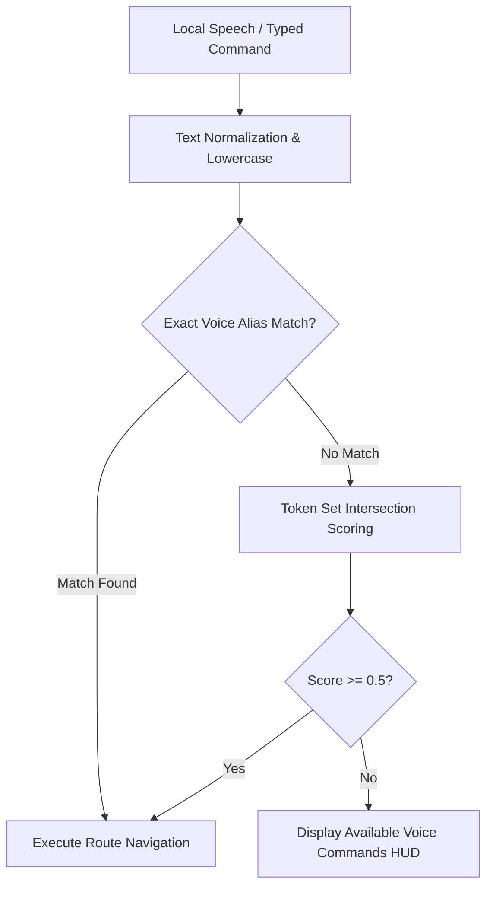

# TARKA | Sovereign Offline Operation & Local Command Execution

## Overview

In mission-critical, air-gapped forensic environments (e.g., military networks, intelligence agencies, or forensic clean rooms), internet access to third-party cloud APIs is strictly prohibited. TARKA implements a **100% sovereign offline mode**.

---

## 1. The Strict Offline Audio Doctrine

### Direct Quote from Product Directive:
> *"In OFFLINE mode: 100% local processing with ZERO SPOKEN AUDIO (no TTS, visual feedback only)."*

When switched to `OFFLINE_LOCAL` (via keyboard shortcut `[O]` or toggle):
1. **Zero Text-to-Speech**: `TarkaVoiceEngine.speak()` immediately returns `false` without executing audio playback or querying any external or local TTS synthesis binary.
2. **Visual Command Feedback**: Spoken feedback is replaced by instant skeuomorphic HUD notifications and typed transcript logs displayed in the bottom status ribbon.
3. **No Network Leaks**: All cloud API calls (`/api/v1/sarvam/*`, external LLM endpoints) are cleanly bypassed.

```typescript
// Verified implementation in TarkaVoiceEngine.ts
if (this.providerType === 'OFFLINE_LOCAL') {
  console.log('[TarkaVoiceEngine] OFFLINE mode: Spoken audio suppressed (Zero-TTS policy).');
  this.audioState = 'idle';
  this.notifyListeners();
  return false;
}
```

---

## 2. Local Forensic Intent Resolution

In offline mode, voice recognition or typed command text is processed entirely inside the browser through the `tarkaNavigationRegistry.ts` intent resolver:



### 2.1 Resolution Examples
- *"Open ledger"* $\rightarrow$ Maps to canonical view `evidence` (Score: 1.0)
- *"Show me who took the money"* $\rightarrow$ Keyword intersection matches `attribution` (Keywords: `['who', 'money', 'took']`)
- *"Check Section 63 certificate"* $\rightarrow$ Maps directly to `court-ready` with hash validation pre-loaded.

---

## 3. Local Analytical Pipeline Integrity

When running offline:
- Graph traversals (BFS money flow trace) execute in-memory or via local Neo4j instances.
- Cryptographic hash verifications execute using native browser `crypto.subtle.digest('SHA-256')`.
- Evidence conservation balance equations are computed synchronously without server dependency.

